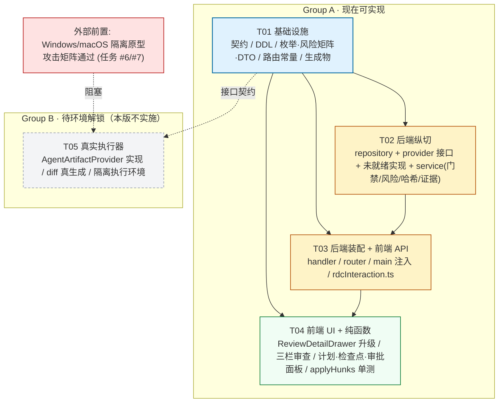

# Dandelion 研发中心（RDC）增量 · AI 人机交互「接口契约设计 + 任务分解」

| 项 | 内容 |
| --- | --- |
| 文档类型 | 系统设计 + 有序任务分解（架构师交付物，**纯契约设计，不含实现代码**） |
| 架构师 | 高见远（Gao）· Architect |
| 上游输入 | `ai-interaction-prd.md`（许清楚）+ 用户 8 项拍板（Q1–Q8）+ team-lead 转达的最终裁决 |
| 现状基线 | 03 人工审核中心（`rdc_review_record` / `ReviewDetailDrawer`）+ 8 态研发状态机（`contract.DevAdvance`）+ 交付中心 Git 隔离设计（安全阻塞） |
| 项目根目录 | `/Users/linanan/Desktop/dandelion`（下文路径均相对此根） |
| 强制规范 | `AGENTS.md`；生效优先级：当前代码与测试 > `api/openapi.yaml` > AGENTS.md > `docs/` 设计稿 |
| 本版范围 | 四步交互体系（Diff 审查 / 计划确认 / 检查点回滚 / 分级审批）的**数据契约 + 交互规范 + 可独立实现的证据控制层**；运行时产物等 Agent 真执行器就绪后接入 |
| 模式限定 | 仅 team；solo 不可见、不可达（`RequireTeamMode` 硬边界） |

---

# Part A · 系统设计

## 1. 实现方案概述

### 1.1 六条关键架构决策（按重要性排序，均不可违背用户裁决）

#### D1 · 交互层与执行器解耦：`AgentArtifactProvider` 接口是唯一数据源边界

- **核心矛盾**：用户拍板「全做 1–4」且「现在就要完整实现」，但 Agent 执行器依赖未就绪的隔离环境（Windows 测试环境缺失、macOS 隔离资源未就绪，见 `rdc-delivery-git-isolation-design.md` §6/§7），数据源必须「等 Agent 真产出」（拍板 1）。
- **解法**：在 `service/rdc` 定义 Go 接口 `AgentArtifactProvider`（见 §3.6），交互层所有「产物读取」只经此接口。
  - **Group A（本版实现）**：接口 + 生产注入 `unavailableProvider`（所有方法返回明确的 `ErrArtifactUnavailable`，**不返回任何假 diff / 假计划 / 假快照**）；仓储 / service / handler / UI 全部按契约对接接口，UI 拿到"未就绪"时显示**真实空态**（"等待 Agent 执行器就绪"），而非可点是假按钮。
  - **Group B（待环境解锁，本版不实施）**：真实执行器实现该接口（连隔离沙箱、产出脱敏有界 diff、计算 before/after hash、应用回滚写回真实文件），在 `main.go` 一处替换注入。
- **收益**：契约一次定稿，执行器就绪后 UI / 后端零返工；本版不写一个字节的模拟数据、不实现一个假按钮、不碰真实 Git。

#### D2 · 状态真相源唯一：交互层绝不写子任务状态（安全底线）

- 沿用 `rdc-dev-design.md` D2：子任务状态只由 `DevService` 状态机（`Advance` / `Skip` / `Resubmit`）与 `ReviewService.apply`（approve/reject/commit，底层仍是 `DevService.ApplyReviewAction`）写。
- 本方案四步的**每一次写操作**只做三件事之一或组合：① 更新 hunk 决策三态；② 更新计划门禁 / 检查点状态；③ 追加 `rdc_review_record` 证据 + `team.audit_logs` 审计。**没有任何一条路径 `UPDATE rdc_dev_subtask SET status`**。
- 特别地：
  - 检查点回滚**只撤销内容快照记录、不回退子任务状态**（拍板 Q4，状态机严格只前进）。
  - 计划确认只表示"意图对齐完成"，不推进状态、不触发生成。
  - 分级审批是"业务介入强度"证据，不是新权限点、不是新状态边。
- 用测试钉死：`interaction_service_test.go` 断言 service 包内无状态写入调用；全仓 grep 断言新增代码不改 `rdc_dev_subtask.status`。

#### D3 · 挂载 03、复用审核留痕，不建第二套审核历史（拍板 Q5）

- **UI 挂载**：升级 `web/src/pages/rdc/ReviewDetailDrawer.tsx`，把现有"前端 Diff / 后端 Diff / 编辑器打开"占位说明块，替换为四类真实交互面板（Diff 审查 / 计划确认 / 检查点时间线 / 分级审批徽标）。不新建菜单、不新建详情页。
- **数据留痕**：四步的三个动作（hunk 决策提交 / 计划确认 / 检查点回滚 / 分级审批，共 4 类）**全部追加到 `team.rdc_review_record`**，通过扩展 `action` 枚举 + 扩展 `detail JSONB` 列承载结构化证据，关联键复用 `task_id` + `subtask_id`。**不新建第二套审核历史表**。
- **审计**：同一批动作另写 `team.audit_logs`（拍板 Q6），`action` 用 `rdc.interaction.*` 前缀；`detail` 含 `taskId/subtaskId/checkpointId/reviewId/action`；写审计失败**只记日志不回滚业务**。
- `rdc_review_record` 是"审核动作留痕"唯一事实表；`team.audit_logs` 是平台审计事实表——两者分工沿用现状 ReviewHandler 的双写惯例。

#### D4 · 检查点回滚：哈希不匹配禁止回滚并提示，不强制覆盖（拍板 Q3）

- 回滚必须携带服务端签发的 `rollback_token`（`UNIQUE`，防重复 / 越权回滚）。
- 回滚前逐目标文件比对 `currentHash == file.after_hash`：
  - **不匹配**（文件已被后续动作改动）→ **409 禁止回滚**，列出冲突文件，写一条 `rollback_blocked` 失败审计（失败只记日志），**绝不强制覆盖**。
  - **匹配** → 写回滚证据 + 更新 `checkpoint.status`（`rolled_back` / `partially_rolled_back`）；**不回退子任务状态**（D2）。
- "内容撤销"分两层：证据层（本版实现：校验 + 留痕 + 状态标记）；文件层（Group B：`provider.ApplyRollback` 把 `before_content` 写回真实文件，仅当隔离执行器就绪）。本版不写真实文件。

#### D5 · 右栏预览 = 应用后的完整文件内容（纯前端计算，拍板 3）

- 定义纯函数 `applyHunks(base, hunks, decisions) → string`（`web/src/utils/applyHunks.ts`）：从原始完整内容出发，仅应用 `accepted` 的 hunk，按 `old_start`（**1-based**）升序 + 累计偏移逐段重建；`pending` / `rejected` 不应用。
- **不改真实文件、不渲染运行效果、不发后端请求、不嵌 iframe**。右栏是纯文本结果视图。
- 多文件 tab：左栏 `files[]` 切换中 / 右栏；每 tab 显示 `已处理 n/total hunk` 进度。
- Q1 / Q2 由架构师拍板并在共享约定（§8）与单测中钉死：1-based 行号；上下文内嵌独立字段仅展示；`added` 文件 base 为空、`deleted` 文件接受删除后右栏显示删除标记。

#### D6 · 反占位 + team 专属分区 + 零新增依赖

- 反占位：`unavailableProvider` 返回的是**真实错误**，不是伪造成功；UI 无数据只显示空态；不注册任何"生成/应用/回滚到真实文件"的占位端点；9 个新路径全部是真实证据 CRUD（有 DB 落点、有测试）。
- DDL：`team.rdc_*` 写在 `schema.sql`「六·研发中心」段之后、**`FOREACH` 循环之外**（沿用 `rdc-dev-design.md` D4：不为永远为空的 solo 造表）。所有查询先 `ScopeFilter(alias, scope)` 再叠业务条件，越界 404。
- 零新增依赖：后端复用 `chi/v5` + `pgx/v5` + 标准库；前端复用 `@seakoi/console-kit` 根入口 + `react` + 已有 `schema.d.ts`；纯函数单测用 Node 22 内置 `node:test` + `--experimental-strip-types`（已实测可行，见 §6）。

### 1.2 技术栈（零新增依赖）

| 层 | 沿用 |
| --- | --- |
| 后端 | Go 1.24 + chi v5 + pgx/v5 stdlib + PostgreSQL 16；按功能归位到 `internal/{handler,service,repository}/rdc/` |
| 前端 | React 18 + TypeScript + Vite 5 + `@seakoi/console-kit` 根入口；`pages → api → client.ts` |
| 契约 | `api/openapi.yaml` → `make gen:api` 生成 `web/src/api/schema.d.ts`（入库、禁手改） |
| DDL | `server/internal/repository/schema.sql`，幂等、`//go:embed`，应用自身账号启动执行 |
| 测试 | 后端 `go test`；前端纯函数用 `node --experimental-strip-types --test web/tests/*.test.ts`（零依赖） |

**不引入**：新 ORM、新迁移框架、新权限点、新 UI 组件库、diff 渲染第三方库、第二份状态机 / 枚举目录、第二套审核历史。

---

## 2. 文件清单

> 标记：**新** / **改** / **生成** / **Group B**（待环境解锁，本版不落实现）。所有新增手写文件顶部写中文四要素注释：**职责 / 输入 / 输出 / 边界**；单文件 ≤ 400 行（后端按 `interaction_*.go` 拆，前端面板拆 2 个组件文件）。

### 2.1 契约与 DDL（事实来源层，Group A）

| 路径 | 标记 | 职责 |
| --- | --- | --- |
| `api/openapi.yaml` | 改 | 新增 9 条路径（9 操作）、全部 DTO/响应 schema、12 组 `x-rdc-interaction-*` 枚举与风险矩阵扩展；`rdc_review_record.action` 的 ReviewAction 枚举扩 4 值。 |
| `server/internal/repository/schema.sql` | 改 | 「六·研发中心」段之后新增 4 张 team 专属表（`rdc_diff_review` / `rdc_hunk_decision` / `rdc_plan_confirmation` / `rdc_checkpoint`）+ 索引；幂等 `ALTER` 给 `rdc_review_record` 加 `detail JSONB`。 |
| `server/internal/contract/contract.go` | 改 | 枚举镜像 / 风险矩阵与介入映射函数 / 未知兜底 `medium` / 9 路由常量入 `APIRoutes` / 全套交互 DTO / 证据 action 常量 / 上限。 |
| `server/internal/contract/contract_test.go` | 改 | 枚举、风险矩阵、介入映射、整体风险取最大值、路由数一致性断言（逐项锁死 openapi）。 |
| `web/src/api/schema.d.ts` | 生成 | `make gen:api` 产物，前端类型唯一来源，必须入库、禁手改。 |

### 2.2 后端（Group A）

| 路径 | 标记 | 职责 |
| --- | --- | --- |
| `server/internal/repository/rdc/interaction_repository.go` | 新 | 交互层唯一 SQL 出入口：审查 / 决策 / 计划 / 检查点的读写、`rdc_review_record` 证据追加（复用同键 + detail）、`ScopeFilter` 优先、越界 404、事务。 |
| `server/internal/repository/rdc/interaction_repository_test.go` | 新 | 证据追加、决策 UPSERT、越界隔离、哈希快照读回、事务一致性测试。 |
| `server/internal/service/rdc/artifact_provider.go` | 新 | `AgentArtifactProvider` 接口定义 + `ErrArtifactUnavailable` + `unavailableProvider` 生产实现（真实报错，非假数据）。 |
| `server/internal/service/rdc/interaction_service.go` | 新 | 业务编排：三态门禁、风险/介入计算、回滚哈希校验（含禁止回滚分支）、provider 注入、审计数据组装；不碰 HTTP / SQL / 状态机。 |
| `server/internal/service/rdc/interaction_service_test.go` | 新 | 门禁、风险取最大、哈希匹配/不匹配两路、越界、provider 未就绪、状态机零写入断言。 |

> `review_service.go` / `review_repository.go` / `dev_service.go` / `contract.go`（状态机部分）/ `schema.sql`（既有表）**不改状态逻辑**；仅 `contract.go` 扩展 DTO / 枚举、`schema.sql` 追加新表与 detail 列、`rdc_review_record` 行映射因 detail 列扩展 1 列（见 §3.1 字段对齐）。

### 2.3 后端装配 + 前端 API（Group A）

| 路径 | 标记 | 职责 |
| --- | --- | --- |
| `server/internal/handler/rdc/interaction_handler.go` | 新 | HTTP 语义：严格 `DecodeJSON`（白名单，未知字段 400）、读路径参数、调 service、写 8 类审计、统一响应。 |
| `server/internal/handler/rdc/interaction_handler_test.go` | 新 | 未知字段 400、越界 404、未就绪 409/503、审计 action 断言、方法不匹配 405。 |
| `server/internal/app/router.go` | 改 | `Deps.RDCInteraction` 注入；9 路径挂 team 专区同一 `rdc.review.read` 组、`RequireTeamMode`；补 405 `Allow` 映射（子路径优先）。 |
| `server/cmd/server/main.go` | 改 | 构造 interaction repo/service/handler，注入 `unavailableProvider`（Group B 在此一处换成真实执行器）。 |
| `web/src/api/rdcInteraction.ts` | 新 | 交互接口前端唯一调用处：9 个 API 函数，类型只从 `./schema` 引、请求只经 `./client`、不拼 URL。 |

### 2.4 前端 UI + 纯函数单测（Group A）

| 路径 | 标记 | 职责 |
| --- | --- | --- |
| `web/src/pages/rdc/ReviewDetailDrawer.tsx` | 改 | 升级审核详情抽屉：移除 3 项占位说明，按子任务渲染四类交互面板；空态真实提示、无假按钮；三栏布局挂接。 |
| `web/src/pages/rdc/DiffReviewPanel.tsx` | 新 | 三栏 Diff 审查：左文件 tab（进度）、中逐 hunk 接受/拒绝/重置 + 风险标签、右 `applyHunks` 应用后内容（纯文本）。 |
| `web/src/pages/rdc/InteractionPanels.tsx` | 新 | 计划确认面板（问卷+任务勾选+门禁）、检查点时间线（回滚入口+二次确认）、分级审批徽标（风险→介入强度）三个纯 UI 组件。 |
| `web/src/utils/applyHunks.ts` | 新 | 纯函数：1-based 行号 + 累计偏移逐段重建；只应用 accepted；零 UI / 零网络依赖，仅 type import。 |
| `web/tests/applyHunks.test.ts` | 新 | node:test 单测：行号口径、增删文件、偏移不漂移、pending 不应用、重叠冲突、末尾换行。 |
| `web/src/styles.scss` | 改 | 三栏 diff、hunk 决策控件、文件 tab 进度、审批徽标、空态样式（沿用主色 `#0369a1`）。 |

### 2.5 待环境解锁（Group B，本版只定义，不落实现）

| 路径 | 标记 | 职责 |
| --- | --- | --- |
| `server/internal/agentexecutor/provider.go` | Group B | `AgentArtifactProvider` 真实实现：调隔离执行器产出 diff/plan/checkpoint，脱敏 + 有界 + hash。 |
| `server/internal/agentexecutor/diff_builder.go` | Group B | 把执行器输出整理为 `FileDiff[]` / `FileSnapshot[]`，计算 before/after hash。 |
| `server/internal/agentexecutor/isolated_runner.go` | Group B | 对接 Windows AppContainer/Job、macOS VM 隔离沙箱（前置：隔离原型攻击矩阵通过）。 |
| `server/cmd/server/main.go` | 改（Group B） | 把 `unavailableProvider` 替换为真实 provider（唯一装配变更点）。 |

### 2.6 设计产物

| 路径 | 标记 | 职责 |
| --- | --- | --- |
| `deliverables/software-company/ai-interaction-class-diagram.mermaid` | 新 | §3.9 类图单独提取。 |
| `deliverables/software-company/ai-interaction-sequence-diagram.mermaid` | 新 | §4 两张时序图单独提取（含失败路径与状态写入边界）。 |

> `docs/class-diagram.mermaid` / `docs/sequence-diagram.mermaid` 属其他特性，本次不覆盖。

---

## 3. 数据结构与接口

### 3.1 DDL 草案（`schema.sql`「六·研发中心」段之后，循环之外，team 专属）

```sql
-- 增量：AI 交互证据层。team 专属，写在 FOREACH 之外（沿用 rdc-dev-design.md D4）。
-- 关联键复用 rdc_dev_task / rdc_dev_subtask（task_id / subtask_id），级联删除不留孤儿。
-- source / decision / status / gate_status 等枚举不加 CHECK（唯一来源是 api/openapi.yaml）。
-- tenant_id 提供公司隔离；产物内容存 JSONB（一次性写入、不可变）；用户决策单独轻量表（可单 hunk 更新）。

-- ① Diff 审查会话：一次 AI 动作产出的 diff 对象；files 为不可变产物快照。
CREATE TABLE IF NOT EXISTS team.rdc_diff_review (
  id            UUID        PRIMARY KEY DEFAULT gen_random_uuid(),
  task_id       UUID        NOT NULL REFERENCES team.rdc_dev_task(id) ON DELETE CASCADE,
  subtask_id    UUID        NOT NULL REFERENCES team.rdc_dev_subtask(id) ON DELETE CASCADE,
  checkpoint_id UUID,                    -- 逻辑关联 rdc_checkpoint.id，无 FK 避免建表顺序依赖
  source        TEXT        NOT NULL,    -- 唯一合法值 agent_executor
  submit_status TEXT        NOT NULL DEFAULT 'pending',
  files         JSONB       NOT NULL DEFAULT '[]'::jsonb,  -- FileDiff[]（含 hunks 原始内容，见 §3.3）
  tenant_id     UUID        REFERENCES public.tenants(id),
  created_at    TIMESTAMPTZ NOT NULL DEFAULT now(),
  updated_at    TIMESTAMPTZ NOT NULL DEFAULT now()
);
CREATE INDEX IF NOT EXISTS idx_rdc_diff_review_subtask ON team.rdc_diff_review (subtask_id, created_at DESC);
CREATE INDEX IF NOT EXISTS idx_rdc_diff_review_tenant  ON team.rdc_diff_review (tenant_id, created_at DESC);

-- ② Hunk 决策：与 files JSONB 内 hunk_id 对齐，单 hunk 可独立更新三态。
CREATE TABLE IF NOT EXISTS team.rdc_hunk_decision (
  id          UUID        PRIMARY KEY DEFAULT gen_random_uuid(),
  review_id   UUID        NOT NULL REFERENCES team.rdc_diff_review(id) ON DELETE CASCADE,
  hunk_id     TEXT        NOT NULL,
  decision    TEXT        NOT NULL DEFAULT 'pending',
  decided_by  TEXT        NOT NULL DEFAULT '',
  decided_at  TIMESTAMPTZ,
  tenant_id   UUID        REFERENCES public.tenants(id),
  created_at  TIMESTAMPTZ NOT NULL DEFAULT now(),
  UNIQUE (review_id, hunk_id)
);
CREATE INDEX IF NOT EXISTS idx_rdc_hunk_decision_review ON team.rdc_hunk_decision (review_id);

-- ③ 计划确认：问卷 + 可确认任务列表整体存 JSONB；确认时整体重写 + 更新门禁。
CREATE TABLE IF NOT EXISTS team.rdc_plan_confirmation (
  id            UUID        PRIMARY KEY DEFAULT gen_random_uuid(),
  task_id       UUID        NOT NULL REFERENCES team.rdc_dev_task(id) ON DELETE CASCADE,
  subtask_id    UUID        NOT NULL REFERENCES team.rdc_dev_subtask(id) ON DELETE CASCADE,
  questionnaire JSONB       NOT NULL DEFAULT '[]'::jsonb,
  plan_tasks    JSONB       NOT NULL DEFAULT '[]'::jsonb,
  gate_status   TEXT        NOT NULL DEFAULT 'blocked',
  confirmed_by  TEXT        NOT NULL DEFAULT '',
  confirmed_at  TIMESTAMPTZ,
  tenant_id     UUID        REFERENCES public.tenants(id),
  created_at    TIMESTAMPTZ NOT NULL DEFAULT now(),
  updated_at    TIMESTAMPTZ NOT NULL DEFAULT now()
);
CREATE INDEX IF NOT EXISTS idx_rdc_plan_conf_subtask ON team.rdc_plan_confirmation (subtask_id, created_at DESC);

-- ④ 检查点：一次 AI 动作的文件 before/after 快照 + 幂等回滚令牌。
CREATE TABLE IF NOT EXISTS team.rdc_checkpoint (
  id             UUID        PRIMARY KEY DEFAULT gen_random_uuid(),
  task_id        UUID        NOT NULL REFERENCES team.rdc_dev_task(id) ON DELETE CASCADE,
  subtask_id     UUID        NOT NULL REFERENCES team.rdc_dev_subtask(id) ON DELETE CASCADE,
  ai_action      TEXT        NOT NULL DEFAULT '',
  files          JSONB       NOT NULL DEFAULT '[]'::jsonb,  -- FileSnapshot[]
  rollback_token TEXT        NOT NULL,    -- 服务端签发，UNIQUE，防重复/越权回滚
  status         TEXT        NOT NULL DEFAULT 'active',
  created_by     TEXT        NOT NULL DEFAULT '',
  tenant_id      UUID        REFERENCES public.tenants(id),
  created_at     TIMESTAMPTZ NOT NULL DEFAULT now(),
  UNIQUE (rollback_token)
);
CREATE INDEX IF NOT EXISTS idx_rdc_checkpoint_subtask ON team.rdc_checkpoint (subtask_id, created_at DESC);
CREATE INDEX IF NOT EXISTS idx_rdc_checkpoint_tenant  ON team.rdc_checkpoint (tenant_id, created_at DESC);

-- ⑤ 幂等扩展：审核记录加 detail JSONB，承载四类交互动作的结构化证据
--    （不新建第二套审核历史；action 扩 4 值，见 §3.2）。既有 4 列语义不变、默认不影响旧行。
ALTER TABLE team.rdc_review_record ADD COLUMN IF NOT EXISTS detail JSONB NOT NULL DEFAULT '{}'::jsonb;
```

**字段对齐表**（关键新增）

| DB 列 | Go 字段 | JSON 字段 | 来源 / 规则 |
| --- | --- | --- | --- |
| `rdc_diff_review.id` | `DiffReview.ID` | `id` | 服务端 UUID。 |
| `task_id` / `subtask_id` | `.TaskID` / `.SubtaskID` | `taskId` / `subtaskId` | 关联键，必填，复制审核中心口径；请求体不接受。 |
| `checkpoint_id` | `.CheckpointID` | `checkpointId` | 逻辑关联检查点；无 FK。 |
| `source` | `.Source` | `source` | **只能 `agent_executor`**，service 校验；无 `manual`。 |
| `submit_status` | `.SubmitStatus` | `submitStatus` | `pending` / `submitted`。 |
| `files` | `.Files []FileDiff` | `files` | 不可变产物快照；JSONB 一次写入。 |
| `rdc_hunk_decision.(review_id,hunk_id)` | `HunkDecision.ReviewID/HunkID` | — | UPSERT 键；`hunk_id` 与 JSONB 内 hunk 对齐。 |
| `decision` | `.Decision` | `decision` | `pending` / `accepted` / `rejected`，默认 pending。 |
| `rdc_plan_confirmation.gate_status` | `PlanConfirmation.GateStatus` | `gateStatus` | `blocked` / `confirmed`。 |
| `rdc_checkpoint.rollback_token` | `Checkpoint.RollbackToken` | `rollbackToken` | 服务端签发；回滚必带的幂等令牌。 |
| `rdc_checkpoint.files` | `.Files []FileSnapshot` | `files` | before/after 内容 + hash + file_status。 |
| `rdc_review_record.detail` | `ReviewRecord.Detail` | `detail` | 结构化证据；扩展既有行映射 1 列。 |
| `tenant_id` | —（不进 DTO） | — | 只从 `scope.TenantID` 取，仅过滤。 |

### 3.2 契约常量 / 枚举 SSOT（`internal/contract`）

```go
// 路由常量（+9；APIRoutes 由当前 51 → 60，以 contract_test 为准，保留全部既有路径）。
const (
    RouteRDCInteractionDiffReview   = APIPrefix + "/rdc/interactions/tasks/{id}/subtasks/{subtaskId}/diff-review"
    RouteRDCInteractionDiffSubmit   = APIPrefix + "/rdc/interactions/tasks/{id}/subtasks/{subtaskId}/diff-review/submit"
    RouteRDCInteractionHunkDecision = APIPrefix + "/rdc/interactions/diff-reviews/{reviewId}/hunks/{hunkId}/decision"
    RouteRDCInteractionPlanGet      = APIPrefix + "/rdc/interactions/tasks/{id}/subtasks/{subtaskId}/plan-confirmation"
    RouteRDCInteractionPlanConfirm  = APIPrefix + "/rdc/interactions/plan-confirmations/{planId}/confirm"
    RouteRDCInteractionCheckpoints  = APIPrefix + "/rdc/interactions/tasks/{id}/subtasks/{subtaskId}/checkpoints"
    RouteRDCInteractionRollback     = APIPrefix + "/rdc/interactions/checkpoints/{checkpointId}/rollback"
    RouteRDCInteractionApprovalGet  = APIPrefix + "/rdc/interactions/tasks/{id}/subtasks/{subtaskId}/approval"
    RouteRDCInteractionApprovalDec  = APIPrefix + "/rdc/interactions/tasks/{id}/subtasks/{subtaskId}/approval/decide"
)

// 三态决策：与 openapi 的 x-rdc-interaction-review-decisions 同序，测试锁死。
const (
    DecisionPending  = "pending"
    DecisionAccepted = "accepted"
    DecisionRejected = "rejected"
)
var ReviewDecisions = []string{DecisionPending, DecisionAccepted, DecisionRejected}

// 文件变更类型 / 来源 / 门禁 / 计划 / 风险 / 介入（均镜像 openapi 的 x- 扩展，DDL 不加 CHECK）。
const (
    FileAdded = "added"; FileModified = "modified"; FileDeleted = "deleted"; FileRenamed = "renamed"
    ArtifactSourceAgent = "agent_executor" // 唯一合法来源
    SubmitPending = "pending"; SubmitSubmitted = "submitted"
    QuestionSingle = "single"; QuestionMultiple = "multiple"; QuestionText = "text"
    GateBlocked = "blocked"; GateConfirmed = "confirmed"
    CheckpointActive = "active"; CheckpointRolledBack = "rolled_back"; CheckpointPartial = "partially_rolled_back"
    RiskLow = "low"; RiskMedium = "medium"; RiskHigh = "high"
    InterventionExempt = "exempt"; InterventionSample = "sample"; InterventionStrict = "strict"
)

// 分级审批证据 action（扩展 rdc_review_record.action；与 x-rdc-review-actions 的状态动作分开）。
// 注意：这 4 个 action 不进 devReviewActions，绝不触发状态流转。
const (
    EvidenceDiffSubmitted      = "diff_submitted"
    EvidencePlanConfirmed      = "plan_confirmed"
    EvidenceCheckpointRollback = "checkpoint_rolled_back"
    EvidenceApprovalDecided    = "approval_decided"
    EvidenceRollbackBlocked    = "rollback_blocked" // 仅写审计，不写 review_record
)
func IsInteractionEvidenceAction(a string) bool // 上述 5 值

// 风险矩阵（本版内置于契约，拍板 Q7；可配置化列 P2）。与 openapi 的 x-rdc-interaction-risk-matrix 逐项锁死。
var OperationRisk = map[string]string{
    "delete_file": RiskHigh, "config_change": RiskHigh, "dependency_change": RiskHigh,
    "schema_migration": RiskHigh, "permission_change": RiskHigh,
    "api_change": RiskMedium, "model_change": RiskMedium, "code_edit": RiskMedium,
    "format": RiskLow, "comment": RiskLow, "doc": RiskLow, "add_test": RiskLow,
    "style": RiskLow, "add_file": RiskLow,
}
const DefaultRisk = RiskMedium // 未知 / other 兜底：就高不就低保守归 medium
var RiskIntervention = map[string]string{
    RiskLow: InterventionExempt, RiskMedium: InterventionSample, RiskHigh: InterventionStrict,
}
func RiskOfOperation(op string) string          // 未知 → DefaultRisk
func InterventionOf(risk string) string         // 低免审 / 中抽查 / 高强审批
func OverallRiskLevel(ops []string) string      // 所有 hunk 风险取最大值（low<medium<high）

// 字段上限
const (
    MaxAIActionLen   = 200
    MaxFilePathLen   = 500   // 仓库相对路径，脱敏后
    MaxHunkIDLen     = 128
    MaxHashLen       = 128   // sha256 等
    MaxMaxHunksPerReview = 2000 // 有界，防产物过大
)
```

**`openapi.yaml` 契约扩展（SSOT 片段，全部逐项由 `contract_test.go` 锁死）**

```yaml
x-rdc-interaction-review-decisions: [pending, accepted, rejected]
x-rdc-interaction-file-status: [added, modified, deleted, renamed]
x-rdc-interaction-source: [agent_executor]
x-rdc-interaction-submit-status: [pending, submitted]
x-rdc-interaction-question-type: [single, multiple, text]
x-rdc-interaction-gate-status: [blocked, confirmed]
x-rdc-interaction-checkpoint-status: [active, rolled_back, partially_rolled_back]
x-rdc-interaction-risk-level: [low, medium, high]
x-rdc-interaction-intervention: [exempt, sample, strict]
x-rdc-interaction-operation-type: [delete_file, config_change, dependency_change, schema_migration, permission_change, api_change, model_change, code_edit, format, comment, doc, add_test, style, add_file, other]
x-rdc-interaction-evidence-actions: [diff_submitted, plan_confirmed, checkpoint_rolled_back, approval_decided, rollback_blocked]
x-rdc-interaction-risk-matrix:
  delete_file: high
  config_change: high
  dependency_change: high
  schema_migration: high
  permission_change: high
  api_change: medium
  model_change: medium
  code_edit: medium
  format: low
  comment: low
  doc: low
  add_test: low
  style: low
  add_file: low
  other: medium          # 就高不就低的保守默认
x-rdc-interaction-interventions:
  low: exempt
  medium: sample
  high: strict
```

### 3.3 DTO 定义（`internal/contract`，字段对齐 JSON camelCase）

```go
// ── 产物结构（来自 AgentArtifactProvider，不可变快照）─────────────────────
type Hunk struct {
    HunkID        string   `json:"hunkId"`
    OldStart      int      `json:"oldStart"`      // 1-based 起始行，applyHunks 口径
    OldLines      int      `json:"oldLines"`      // 原始行数组长度
    NewStart      int      `json:"newStart"`      // 1-based，结果定位/展示
    NewLines      int      `json:"newLines"`
    OldContent    []string `json:"oldContent"`    // 被替换的原始行（长度=OldLines）
    NewContent    []string `json:"newContent"`    // 替换后的行（长度=NewLines）
    ContextBefore []string `json:"contextBefore"` // 独立上下文，仅中栏展示，不参与应用
    ContextAfter  []string `json:"contextAfter"`
    RiskLabel     string   `json:"riskLabel"`     // operation_type，见风险矩阵
}
type FileDiff struct {
    FilePath   string  `json:"filePath"`   // 仓库相对路径，已脱敏
    FileStatus string  `json:"fileStatus"` // added | modified | deleted | renamed
    OldPath    string  `json:"oldPath"`    // 仅 renamed 时有值
    Hunks      []Hunk  `json:"hunks"`
}
type HunkDecision struct {
    ReviewID  string `json:"reviewId"`
    HunkID    string `json:"hunkId"`
    Decision  string `json:"decision"`
    DecidedBy string `json:"decidedBy"`
    DecidedAt string `json:"decidedAt"`
}

// ── Diff 审查 ────────────────────────────────────────────────────────────
type DiffReview struct {
    ID           string        `json:"id"`
    TaskID       string        `json:"taskId"`
    SubtaskID    string        `json:"subtaskId"`
    CheckpointID string        `json:"checkpointId"`
    Source       string        `json:"source"`
    SubmitStatus string        `json:"submitStatus"`
    Files        []FileDiff    `json:"files"`
    Decisions    []HunkDecision `json:"decisions"` // 与 files 内 hunk 对齐，供前端 merge
    CreatedAt    string        `json:"createdAt"`
}
type DiffReviewInput struct { // 提交审查：整份 decisions 一起提交，服务端门禁校验
    Decisions []HunkDecision `json:"decisions"`
}

// ── 计划确认 ─────────────────────────────────────────────────────────────
type QuestionOption struct { OptionID string `json:"optionId"`; Label string `json:"label"` }
type Question struct {
    QuestionID string            `json:"questionId"`
    Prompt     string            `json:"prompt"`
    Type       string            `json:"type"`     // single | multiple | text
    Required   bool              `json:"required"`
    Options    []QuestionOption  `json:"options"`
    Answer     any               `json:"answer"`   // 选项 id / id[] / 文本；必答题未答→门禁不放行
}
type PlanTask struct {
    StepID        string `json:"stepId"`
    Title         string `json:"title"`
    Description   string `json:"description"`
    Confirmed     bool   `json:"confirmed"`
    EstimatedRisk string `json:"estimatedRisk"`
}
type PlanConfirmation struct {
    ID          string      `json:"id"`
    TaskID      string      `json:"taskId"`
    SubtaskID   string      `json:"subtaskId"`
    Questionnaire []Question `json:"questionnaire"`
    PlanTasks   []PlanTask  `json:"planTasks"`
    GateStatus  string      `json:"gateStatus"`
    ConfirmedBy string      `json:"confirmedBy"`
    ConfirmedAt string      `json:"confirmedAt"`
}
type PlanConfirmInput struct {
    Answers   []Question `json:"answers"`   // 服务端按 questionId 合并答案，不接受新增题目
    StepIDs   []string   `json:"stepIds"`   // 已确认的步骤
}

// ── 检查点回滚 ───────────────────────────────────────────────────────────
type FileSnapshot struct {
    FilePath     string `json:"filePath"`
    FileStatus   string `json:"fileStatus"`
    BeforeContent string `json:"beforeContent"` // 完整内容（含换行）
    AfterContent  string `json:"afterContent"`
    BeforeHash   string `json:"beforeHash"`
    AfterHash    string `json:"afterHash"`
}
type Checkpoint struct {
    ID            string         `json:"id"`
    TaskID        string         `json:"taskId"`
    SubtaskID     string         `json:"subtaskId"`
    AIAction      string         `json:"aiAction"`
    Files         []FileSnapshot `json:"files"`
    RollbackToken string         `json:"rollbackToken"`
    Status        string         `json:"status"`
    CreatedBy     string         `json:"createdBy"`
    CreatedAt     string         `json:"createdAt"`
}
type RollbackScope = string // hunk | file | checkpoint
type RollbackTarget struct {
    FilePath string `json:"filePath"` // scope=file 时必填
    HunkID   string `json:"hunkId"`   // scope=hunk 时必填（前端回滚到 rejected，右栏重算）
}
type RollbackInput struct {
    RollbackToken string           `json:"rollbackToken"`
    Scope         RollbackScope    `json:"scope"`
    Targets       []RollbackTarget `json:"targets"`
    CurrentHashes map[string]string `json:"currentHashes"` // filePath → 当前内容 hash，哈希校验用
}

// ── 分级审批 ─────────────────────────────────────────────────────────────
type ApprovalView struct {
    OverallRisk  string `json:"overallRisk"`  // low | medium | high（所有 hunk 取最大）
    Intervention string `json:"intervention"` // exempt | sample | strict
    Decided      bool   `json:"decided"`
    Decision     string `json:"decision"` // approve | reject
}
type ApprovalDecideInput struct {
    CheckpointID string `json:"checkpointId"`
    Decision     string `json:"decision"` // approve | reject
}
```

### 3.4 OpenAPI 路径清单（9 条；`servers.url = /api/v1`，统一外壳 `{code,data,message}`，全部成功 200）

> 全部挂 team 专区、中间件链 `RequireAuth → InjectScope → RequireTeamMode → RequirePermission(rdc.review.read)`；`tenant_id` / 操作人从 scope / 身份取，请求体不接受（未知字段严格解码 400）。

| 方法 | 路径 | 请求体 / 查询 | 成功响应 | 证据留痕 / 审计 |
| --- | --- | --- | --- | --- |
| GET | `/rdc/interactions/tasks/{id}/subtasks/{subtaskId}/diff-review` | 路径 id、subtaskId | `DiffReviewResponse`（含 files + decisions） | 只读；provider 未就绪 → 真实空态 `data:null` |
| POST | `/rdc/interactions/tasks/{id}/subtasks/{subtaskId}/diff-review/submit` | `DiffReviewInput` | `DiffReviewResponse`（submitStatus=submitted） | `rdc_review_record`：`diff_submitted`；审计 `rdc.interaction.diff_submitted` |
| PUT | `/rdc/interactions/diff-reviews/{reviewId}/hunks/{hunkId}/decision` | `{decision}`（三态） | `DiffReviewResponse` | 仅更新决策表，**不写 review_record**，提交时统一留痕 |
| GET | `/rdc/interactions/tasks/{id}/subtasks/{subtaskId}/plan-confirmation` | 路径 | `PlanConfirmationResponse` | 只读 |
| POST | `/rdc/interactions/plan-confirmations/{planId}/confirm` | `PlanConfirmInput` | `PlanConfirmationResponse`（gateStatus=confirmed） | `plan_confirmed`；审计 `rdc.interaction.plan_confirmed` |
| GET | `/rdc/interactions/tasks/{id}/subtasks/{subtaskId}/checkpoints` | 路径 | `CheckpointListResponse` | 只读；检查点时间线 |
| POST | `/rdc/interactions/checkpoints/{checkpointId}/rollback` | `RollbackInput` | `CheckpointResponse` | 成功 `checkpoint_rolled_back`；哈希失败仅审计 `rdc.interaction.rollback_blocked`（409）；**均不改子任务状态** |
| GET | `/rdc/interactions/tasks/{id}/subtasks/{subtaskId}/approval` | 路径 | `ApprovalResponse` | 只读；按 hunk 风险算整体风险→介入强度 |
| POST | `/rdc/interactions/tasks/{id}/subtasks/{subtaskId}/approval/decide` | `ApprovalDecideInput` | `ApprovalResponse` | `approval_decided`；审计 `rdc.interaction.approval_decided` |

**审计事件约定**（均写 `team.audit_logs`，`audit.Record` 失败只记日志不回滚，`WithoutCancel` 保证断开也写完）

| 操作 | action | objectType | objectID | detail 要点 |
| --- | --- | --- | --- | --- |
| 提交审查 | `rdc.interaction.diff_submitted` | `rdc_diff_review` | reviewId | `{taskId,subtaskId,reviewId,accepted:n,rejected:n}` |
| 计划确认 | `rdc.interaction.plan_confirmed` | `rdc_plan_confirmation` | planId | `{taskId,subtaskId,planId,confirmedSteps:n}` |
| 检查点回滚 | `rdc.interaction.checkpoint_rolled_back` | `rdc_checkpoint` | checkpointId | `{taskId,subtaskId,checkpointId,scope,files:n}` |
| 回滚被阻断 | `rdc.interaction.rollback_blocked` | `rdc_checkpoint` | checkpointId | `{taskId,subtaskId,checkpointId,hashMismatch:[filePath...]}` |
| 审批决定 | `rdc.interaction.approval_decided` | `rdc_checkpoint` | checkpointId | `{taskId,subtaskId,checkpointId,decision,overallRisk,intervention}` |

**契约一致性**：新增 9 paths ⇒ `APIRoutes` 同步加 9 常量（**保留 `RouteBuildVersions` 与全部既有路径**）；实现前先 `make gen:api`，再写前端 api。

### 3.5 前端类型镜像（只从 `schema.d.ts` 引，不手改）

```ts
// api/rdcInteraction.ts：唯一 URL 镜像、唯一 fetch 出口（经 ./client）
type Schemas = components['schemas'];
export type DiffReview = Schemas['DiffReview'];
export type FileDiff = Schemas['FileDiff'];
export type Hunk = Schemas['Hunk'];
export type HunkDecision = Schemas['HunkDecision'];
export type PlanConfirmation = Schemas['PlanConfirmation'];
export type Checkpoint = Schemas['Checkpoint'];
export type FileSnapshot = Schemas['FileSnapshot'];
export type ApprovalView = Schemas['ApprovalView'];
export type Decision = 'pending' | 'accepted' | 'rejected';

export function getDiffReview(taskId: string, subtaskId: string): Promise<DiffReview | null>;
export function submitDiffReview(taskId: string, subtaskId: string, in: DiffReviewInput): Promise<DiffReview>;
export function setHunkDecision(reviewId: string, hunkId: string, decision: Decision): Promise<DiffReview>;
export function getPlanConfirmation(taskId: string, subtaskId: string): Promise<PlanConfirmation | null>;
export function confirmPlan(planId: string, in: PlanConfirmInput): Promise<PlanConfirmation>;
export function listCheckpoints(taskId: string, subtaskId: string): Promise<Checkpoint[]>;
export function rollbackCheckpoint(checkpointId: string, in: RollbackInput): Promise<Checkpoint>;
export function getApproval(taskId: string, subtaskId: string): Promise<ApprovalView>;
export function decideApproval(taskId: string, subtaskId: string, in: ApprovalDecideInput): Promise<ApprovalView>;
```

风险标签 / 决策 / 文件状态中文标签在 `web/src/utils/format.ts` 用 `Record<...>` 镜像，漏一个枚举编译报错；不手改 `schema.d.ts`。

### 3.6 `AgentArtifactProvider` 接口（唯一数据源边界，Group A 定义 + 未就绪实现）

```go
// service/rdc/artifact_provider.go
// ErrArtifactUnavailable：生产默认实现的真实报错，UI 据此显示"等待执行器就绪"空态。
var ErrArtifactUnavailable = &contract.ValidationError{Message: "Agent 执行器尚未就绪，产物暂不可用"}

// AgentArtifactProvider 是交互层与 Agent 执行器之间的唯一最小契约。
// Group A：生产注入 unavailableProvider（方法全部返回 ErrArtifactUnavailable，绝不造假数据）。
// Group B：真实执行器实现本接口，在 main.go 一处替换注入。
type AgentArtifactProvider interface {
    // LatestDiffReview 取某子任务最近一次 AI 动作的 diff 产物（files/hunks），无产物返回 ErrArtifactUnavailable。
    LatestDiffReview(ctx context.Context, taskID, subtaskID string, scope contract.Scope) ([]contract.FileDiff, error)
    // LatestPlan 取生成前问卷 + 可确认任务列表。
    LatestPlan(ctx context.Context, taskID, subtaskID string, scope contract.Scope) ([]contract.Question, []contract.PlanTask, error)
    // Checkpoints 取一次 AI 动作的文件快照 + before/after hash + rollback_token。
    Checkpoints(ctx context.Context, taskID, subtaskID string, scope contract.Scope) ([]contract.FileSnapshot, string, error) // (snapshots, rollbackToken, err)
    // ApplyRollback 把 before_content 写回真实文件（仅 Group B 真实实现；Group A 返回 ErrArtifactUnavailable）。
    ApplyRollback(ctx context.Context, cp contract.Checkpoint, scope contract.Scope) error
}

// unavailableProvider：Group A 生产默认；所有方法真实失败，不返回模拟数据。
type unavailableProvider struct{}
func (unavailableProvider) LatestDiffReview(...) (..., error) { return nil, ErrArtifactUnavailable }
// ...其余方法同理
```

**接入点说明（为何不设 HTTP ingest 端点）**：用户要求列出"ArtifactProvider 接入点"，但按反占位与 SSOT 原则，**不注册任何 HTTP 产物写入端点**（否则等于开放一条可被人工灌入假 diff 的写点，违反拍板 1「不用人工录入模拟数据」）。真实接入点是**进程内 Go 接口注入**：Group B 的真实执行器经 `AgentArtifactProvider` 由 `service.InteractionService` 编排落库（产物先入 `rdc_diff_review` / `rdc_plan_confirmation` / `rdc_checkpoint` 的 JSONB 列），HTTP 层只暴露"证据与控制"端点（§3.4），不暴露"产物伪造"端点。这样 SSOT 不被绕过，也不产生假按钮。

### 3.7 `applyHunks` 纯函数契约（Q1 / Q2 拍板，前端可直接编码）

```ts
// web/src/utils/applyHunks.ts —— 零 UI / 零网络依赖，仅 type import from schema
export interface ApplyResult {
  content: string;        // 应用后完整文件内容（按 \n join）
  appliedHunkIds: string[];
  conflicts: string[];    // 重叠/非法 hunk 的 id，跳过而非静默错位
}
export function applyHunks(
  base: string,           // 原始完整内容；added 文件传 ''
  hunks: Hunk[],
  decisions: Record<string, Decision>  // hunkId → 三态；缺省视为 pending（不应用）
): ApplyResult;
```

**算法（逐段重建 + 累计偏移，钉死 Q1）**

1. `baseLines = base.split('\n')`（保留末尾空元素以还原末尾换行）。
2. 取 `decisions[hunkId] === 'accepted'` 的 hunk，按 `old_start` **升序**排序（1-based）。
3. `cursor = 0`（已处理到的 base 行下标），`result: string[] = []`。
4. 逐个 hunk：`start = oldStart - 1`（1-based → 0-based）。
   - 若 `start < cursor`（重叠 / 乱序）→ 记入 `conflicts`，**跳过**该 hunk（不静默错位）。
   - 否则 `result.push(...baseLines.slice(cursor, start))` → `result.push(...newContent)` → `cursor = start + oldLines` → 记 `appliedHunkIds`。
5. 收尾 `result.push(...baseLines.slice(cursor))`，返回 `result.join('\n')`。
6. `pending` / `rejected` 不应用；`contextBefore/After` 从不参与计算（仅中栏展示）。

**Q1（行号口径）**：`oldStart` / `newStart` 均为 **1-based**，`oldLines` / `newLines` 为行数组长度；上下文为独立字段、仅展示、不内嵌进应用内容。（与执行器 diff 输出对齐——这是 Group B 实现时的硬约束。）

**Q2（增删文件右栏语义）**：
- `added`：`base = ''`（`baseLines = ['']`）；删除片段 `oldLines=0`、插入 `newContent`。接受后右栏显示新增行；拒绝/未决保持空。
- `deleted`：接受删除 hunk（`newContent=[]`，`oldLines=总行数`）后 `applyHunks` 返回 `''`；**UI 层**据 `fileStatus==='deleted'` 且所有删除 hunk 均 accepted 时，在右栏渲染"（文件已删除）"标记（纯函数保持纯粹，只返回文本）。
- 末尾换行：`base.split('\n')` + `join('\n')` 天然保持；测试钉死 `base='a\nb\n'` 往返一致。

**单测清单**（`web/tests/applyHunks.test.ts`，node:test，零依赖）：单 hunk 接受；多 hunk 升序不漂移（前 hunk 增删改变行数后，后 hunk 仍按原始行号定位）；跳过 pending/rejected；added 空 base；deleted 接受后返回空串；重叠 hunk 进 conflicts 且不错位；末尾换行往返；`decisions` 缺省视为 pending。

### 3.8 前端 UI 挂载（升级 `ReviewDetailDrawer`，拍板 Q5）

- 保留现有任务元信息、两子任务卡、审核历史；把 `PLACEHOLDER_FEATURES` 三项占位删除，替换为按子任务渲染的四类面板。
- 每个子任务卡下方按此顺序渲染：① 分级审批徽标（读 `ApprovalView`，显示 risk→intervention 文案）；② 计划确认面板（问卷作答 + 任务勾选，门禁未满足时"确认计划"禁用并说明缺项）；③ Diff 审查面板（三栏）；④ 检查点时间线（回滚入口 + 二次确认写清影响面）。
- **无假按钮**：每个面板先读对应 API；`data:null`（provider 未就绪 / 无产物）→ 显示真实空态文案，不渲染接受/拒绝/回滚按钮；插件控件只在有真实数据时出现。
- 门禁文案：hunk 三态存在 `pending` 时"提交审查"禁用并显示 `x/y 已处理`；必答题未答 / 任务未确认时"确认计划"禁用。

### 3.9 类图（Mermaid）

```mermaid
classDiagram
    %% ===== 契约层（SSOT 镜像）=====
    class ContractEnums {
        <<contract>>
        +string[] ReviewDecisions
        +map OperationRisk
        +map RiskIntervention
        +RiskOfOperation(op) string
        +InterventionOf(risk) string
        +OverallRiskLevel(ops) string
        +IsInteractionEvidenceAction(a) bool
    }
    %% ===== 产物 / DTO =====
    class Hunk {
        +string HunkID
        +int OldStart
        +int OldLines
        +int NewStart
        +int NewLines
        +string[] OldContent
        +string[] NewContent
        +string[] ContextBefore
        +string[] ContextAfter
        +string RiskLabel
    }
    class FileDiff {
        +string FilePath
        +string FileStatus
        +string OldPath
        +Hunk[] Hunks
    }
    class HunkDecision {
        +string ReviewID
        +string HunkID
        +string Decision
        +string DecidedBy
        +string DecidedAt
    }
    class DiffReview {
        +string ID
        +string TaskID
        +string SubtaskID
        +string CheckpointID
        +string Source
        +string SubmitStatus
        +FileDiff[] Files
        +HunkDecision[] Decisions
        +string CreatedAt
    }
    class Question { +string QuestionID; +string Prompt; +string Type; +bool Required; +QuestionOption[] Options; +any Answer }
    class QuestionOption { +string OptionID; +string Label }
    class PlanTask { +string StepID; +string Title; +string Description; +bool Confirmed; +string EstimatedRisk }
    class PlanConfirmation {
        +string ID
        +string TaskID
        +string SubtaskID
        +Question[] Questionnaire
        +PlanTask[] PlanTasks
        +string GateStatus
        +string ConfirmedBy
        +string ConfirmedAt
    }
    class FileSnapshot {
        +string FilePath
        +string FileStatus
        +string BeforeContent
        +string AfterContent
        +string BeforeHash
        +string AfterHash
    }
    class Checkpoint {
        +string ID
        +string TaskID
        +string SubtaskID
        +string AIAction
        +FileSnapshot[] Files
        +string RollbackToken
        +string Status
        +string CreatedBy
        +string CreatedAt
    }
    class ApprovalView { +string OverallRisk; +string Intervention; +bool Decided; +string Decision }
    class ReviewRecord { +string ID; +string TaskID; +string SubtaskID; +string Action; +string Reason; +string CommitSha; +string ReviewerUserID; +string CreatedAt; +any Detail }
    DiffReview "1" *-- "many" FileDiff
    FileDiff "1" *-- "many" Hunk
    DiffReview "1" *-- "many" HunkDecision
    PlanConfirmation "1" *-- "many" Question
    Question "1" *-- "many" QuestionOption
    PlanConfirmation "1" *-- "many" PlanTask
    Checkpoint "1" *-- "many" FileSnapshot

    %% ===== 数据源接口（Group A 定义 + unavailable；Group B 真实现）=====
    class AgentArtifactProvider {
        <<interface>>
        +LatestDiffReview(ctx, taskID, subtaskID, scope) FileDiff[], error
        +LatestPlan(ctx, taskID, subtaskID, scope) Question[], PlanTask[], error
        +Checkpoints(ctx, taskID, subtaskID, scope) FileSnapshot[], string, error
        +ApplyRollback(ctx, checkpoint, scope) error
    }
    class unavailableProvider {
        <<Group A 生产实现>>
        +LatestDiffReview() error
        +LatestPlan() error
        +Checkpoints() error
        +ApplyRollback() error
    }
    class realProvider {
        <<Group B 待解锁>>
        +LatestDiffReview() FileDiff[], error
        +LatestPlan() Question[], PlanTask[], error
        +Checkpoints() FileSnapshot[], string, error
        +ApplyRollback() error
    }
    unavailableProvider ..|> AgentArtifactProvider
    realProvider ..|> AgentArtifactProvider

    %% ===== 后端分层 =====
    class InteractionRepository {
        -sql.DB db
        +FindLatestReview(ctx, taskID, subtaskID, scope) DiffReview
        +UpsertDecision(ctx, reviewID, hunkID, decision, scope) error
        +SaveDecisionsTx(ctx, reviewID, decisions, scope) error
        +FindPlan(ctx, taskID, subtaskID, scope) PlanConfirmation
        +ConfirmPlanTx(ctx, planID, in, scope) PlanConfirmation
        +ListCheckpoints(ctx, taskID, subtaskID, scope) Checkpoint[]
        +FindCheckpoint(ctx, id, scope) Checkpoint
        +MarkRollbackTx(ctx, cp, status, scope) Checkpoint
        +AppendEvidence(ctx, taskID, subtaskID, action, detail, scope) ReviewRecord
    }
    class InteractionService {
        -InteractionRepository repo
        -AgentArtifactProvider provider
        +GetDiffReview(ctx, scope, taskID, subtaskID) DiffReview
        +SubmitDiffReview(ctx, scope, reviewID, in) DiffReview
        +SetHunkDecision(ctx, scope, reviewID, hunkID, decision) DiffReview
        +GetPlan(ctx, scope, taskID, subtaskID) PlanConfirmation
        +ConfirmPlan(ctx, scope, planID, in) PlanConfirmation
        +ListCheckpoints(ctx, scope, taskID, subtaskID) Checkpoint[]
        +Rollback(ctx, scope, cpID, in) Checkpoint
        +GetApproval(ctx, scope, taskID, subtaskID) ApprovalView
        -checkGate(decisions) error
        -verifyHashes(cp, currentHashes) string[]
        -checkPlanGate(plan, in) error
    }
    class InteractionHandler {
        -InteractionService svc
        -AuditService audit
        +GetDiffReview(w, r) error
        +SubmitDiffReview(w, r) error
        +SetHunkDecision(w, r) error
        +GetPlan(w, r) error
        +ConfirmPlan(w, r) error
        +ListCheckpoints(w, r) error
        +Rollback(w, r) error
        +GetApproval(w, r) error
        +DecideApproval(w, r) error
    }
    class ReviewRepository {
        +Append(ctx, taskID, subtaskID, action, reason, sha, userID, scope) ReviewRecord
    }
    class DevService {
        <<状态唯一写入口·本方案不改>>
        +Advance(ctx, scope, taskID, subtaskID) DevSubtask
        +ApplyReviewAction(ctx, action, taskID, subtaskID, scope) DevSubtask
    }
    class AuditService { +Record(ctx, actor, action, objectType, objectID, detail, ip) void }
    class Identity { +string UserID; +string TenantID; +SessionMode Mode }
    class Scope { +bool All; +string TenantID; +bool TeamScoped }

    InteractionService --> InteractionRepository : depends
    InteractionService --> AgentArtifactProvider : 唯一数据源
    InteractionService ..> ContractEnums : 风险/门禁/证据校验
    InteractionService ..> DevService : 只依赖不写状态（禁止调用写状态方法）
    InteractionHandler --> InteractionService : calls
    InteractionHandler --> AuditService : 5 events
    InteractionRepository ..> ReviewRecord : 追加到既有审核表
    InteractionRepository ..|> ReviewRepository : 复用追加语义(同键+detail)
    InteractionService ..> Identity : 操作人
    InteractionService ..> Scope : 隔离
```



---

## 4. 程序调用流程（Mermaid 时序图）

### 4.1 逐 hunk 审查 + 右栏实时应用（含门禁与证据，标注状态写入边界）

```mermaid
sequenceDiagram
    actor U as 用户(team)
    participant FE as ReviewDetailDrawer / applyHunks.ts
    participant API as api/rdcInteraction.ts
    participant H as handler.InteractionHandler
    participant S as service.InteractionService
    participant P as AgentArtifactProvider
    participant R as repository.InteractionRepository
    participant DB as PostgreSQL(team)
    participant A as audit.Record

    U->>FE: 打开审核详情抽屉,选中子任务
    FE->>API: getDiffReview(taskId, subtaskId)
    API->>H: GET .../diff-review
    H->>S: GetDiffReview(ctx, scope, taskId, subtaskId)
    S->>R: FindLatestReview(...)
    R->>DB: SELECT (ScopeFilter + task_id + subtask_id)
    DB-->>R: review(files JSONB) + decisions
    R-->>S: DiffReviewDetail
    S-->>H: DiffReviewDetail
    H-->>FE: {code:0, data}
    Note over S,P: 产物来自 provider;若 unavailableProvider 返回未就绪→空态 data:null,不造假 diff
    FE->>FE: applyHunks(base, hunks, decisions) 纯前端逐段重算 → 右栏应用后文件完整内容
    Note over FE: 只算文本:不改真实文件/不发请求/不渲染运行效果(拍板3)

    U->>FE: 逐 hunk 点接受/拒绝/重置
    FE->>FE: 更新本地 decisions,实时重算右栏(无后端请求)
    U->>FE: 点提交审查(仅全非 pending 可用)
    FE->>API: submitDiffReview(reviewId, decisions)
    API->>H: POST .../diff-review/submit
    H->>S: SubmitDiffReview(ctx, scope, reviewId, in)
    S->>S: checkGate: 任一 pending → 400「还有 n 个 hunk 未处理」
    S->>R: SaveDecisionsTx + AppendEvidence(diff_submitted)
    R->>DB: BEGIN → UPSERT hunk_decision → INSERT rdc_review_record(detail) → COMMIT
    rect rgb(255,247,237)
    Note over S,DB: 状态写入边界:本流程只写决策/证据,绝不 UPDATE rdc_dev_subtask.status
    end
    S-->>H: DiffReview(submitStatus=submitted)
    H->>A: Record('rdc.interaction.diff_submitted', reviewId, detail{taskId,subtaskId,accepted,rejected})
    Note over A,DB: 写 team.audit_logs;失败只记日志不回滚
    H-->>FE: 200
    FE->>U: 提示「审查已提交,等待执行器应用」
```

### 4.2 检查点回滚（哈希校验 + 禁止回滚路径，标注状态写入边界）

```mermaid
sequenceDiagram
    actor U as 用户(team)
    participant FE as ReviewDetailDrawer / CheckpointTimeline
    participant API as api/rdcInteraction.ts
    participant H as handler.InteractionHandler
    participant S as service.InteractionService
    participant R as repository.InteractionRepository
    participant DB as PostgreSQL(team)
    participant P as AgentArtifactProvider
    participant A as audit.Record

    U->>FE: 点回滚(选 hunk/文件/整体) → 二次确认(写清影响面)
    FE->>API: rollbackCheckpoint(checkpointId, {rollbackToken, scope, targets, currentHashes})
    API->>H: POST .../checkpoints/{id}/rollback
    H->>S: Rollback(ctx, scope, cpID, in)
    S->>R: FindCheckpoint(cpID, scope)
    R->>DB: SELECT (ScopeFilter + id)
    DB-->>R: checkpoint(files before/after/hash, token, status)
    R-->>S: Checkpoint（越界→404）

    alt rollback_token 不匹配 或 status 非 active
        S-->>H: 409「回滚令牌无效或该检查点已回滚」
        H-->>FE: {code:409, data:null, message}
    else token 合法
        S->>S: verifyHashes = 逐目标比对 in.currentHash[filePath] == file.after_hash
        alt 任一哈希不匹配(文件已被后续动作改动)
            S->>A: Record('rdc.interaction.rollback_blocked', cpID, detail{hashMismatch:[...]})
            Note over A,DB: 失败只记日志;不回滚/不覆盖(拍板Q3)
            S-->>H: 409「内容已变化,禁止回滚,请人工核对」
            H-->>FE: {code:409, data:null}
            FE->>U: 列出冲突文件,不提供强制覆盖入口
        else 哈希全部匹配
            S->>R: MarkRollbackTx(cp, status, AppendEvidence(checkpoint_rolled_back))
            R->>DB: BEGIN → UPDATE checkpoint.status → INSERT review_record(detail) → COMMIT
            rect rgb(240,253,244)
            Note over S,DB: 只撤销内容快照记录与检查点状态;绝不回退子任务状态(拍板Q4,状态机只前进)
            end
            opt Group B 执行器就绪
                S->>P: ApplyRollback(cp, scope) 把 before_content 写回真实文件
                P-->>S: ok（本版 unavailableProvider 直接返回未就绪,不写真实文件）
            end
            S-->>H: Checkpoint(status=rolled_back/partially_rolled_back)
            H->>A: Record('rdc.interaction.checkpoint_rolled_back', cpID, detail{taskId,subtaskId,scope,files})
            H-->>FE: 200
            FE->>U: 提示回滚已记录
        end
    end
```

### 4.3 其余操作要点（不单独画图）

- **计划确认**：`GET plan-confirmation` → service 读 `rdc_plan_confirmation`（无产物→空态）；用户答必答题、勾任务 → `POST .../confirm` → service `checkPlanGate`（必答题已答 + 任务全确认，否则 400 列出缺项）→ 事务写 `gate_status=confirmed` + `confirmed_by/at` + `rdc_review_record(plan_confirmed)` → 审计。**不推进子任务状态、不触发生成**。
- **分级审批**：`GET approval` → service 取 diff review 所有 hunk 的 `risk_label`，`OverallRiskLevel` 取最大 → `InterventionOf` 得徽标（低免审 / 中抽查 / 高强审批）；`POST .../decide` 写 `approval_decided` + 审计；"强审批必须逐项通过"是业务规则层介入强度，不是新权限点、不是新状态边。
- **hunk 单决策**：`PUT .../hunk/{hunkId}/decision` 只 UPSERT 决策表、不写 review_record（避免点击即留痕刷屏），提交时统一写一条 `diff_submitted`。
- **审批人分派 / 通知 / 抽样算法**：P1（R12），本版只定介入强度规则，不做编排。

---

## 5. 待明确事项 / 已记录的假设

| 编号 | 事项 | 本设计处理 | 需确认? |
| --- | --- | --- | --- |
| C1 | Q1 行号口径 | 拍板 1-based、上下文独立字段仅展示；与执行器 diff 输出对齐写入 §8 共享约定，单测钉死 | 已拍板（架构师定） |
| C2 | Q2 增删文件右栏 | added 传 base=''、deleted 接受后返回空串且 UI 渲染删除标记；纯函数保持纯粹 | 已拍板（架构师定） |
| C3 | 回滚哈希校验的 `currentHashes` 来源 | 请求体携带 filePath→hash；Group B 由执行器读工作区计算，Group A 用测试 fake 注入；不读真实文件 | 建议确认（影响 Group B 契约） |
| C4 | 检查点 `status=partially_rolled_back` 判定 | scope=file/hunk 且只回滚部分文件 → partial；scope=checkpoint 全量 → rolled_back | 建议确认；不阻塞 |
| C5 | "强审批必须逐项通过"的 block 时机 | 本版只在徽标展示介入强度、审批端点留痕；真正"未审批禁止提交"的执行门禁属 Group B（执行器侧） | 建议确认；不阻塞 |
| C6 | 风险矩阵可配置化 | 本版内置于契约（Q7），可配置化列 P2（R15）；不改表结构即可后续扩展 | 已按拍板 |
| C7 | 9 路径前缀 `/rdc/interactions/` 与现有 `/rdc/reviews/` 并存 | 独立前缀便于 405 Allow 判定、避免与审核动作路由混淆；同挂 `rdc.review.read` | 建议确认；不阻塞 |
| C8 | Group B 环境前置 | 依赖 Windows/macOS 隔离原型攻击矩阵通过（任务 #6/#7）；未通过则 provider 永久 `unavailableProvider`，**不回退普通 CLI**（隔离设计 §6） | 外部阻塞，非本版交付范围 |

> 除上述外无阻塞项。**本版硬约束**：只交付契约 + 可独立实现的证据控制层；数据源等 Agent 真产出（不写模拟数据）；不实现执行、不放假按钮；复用审核留痕与关联键、不建第二套。

---

# Part B · 任务分解

## 6. 依赖包

**零新增依赖**，`go.mod` / `package.json` 均不改。

- 后端复用：`chi/v5`、`pgx/v5/stdlib`、标准库 `context`/`database/sql`/`encoding/json`/`time`；契约测试用已有 `gopkg.in/yaml.v3`。
- 前端复用：`@seakoi/console-kit` 根入口（`Segmented` / `Button` / `Input` / `Modal` / `Drawer` 经 `components/` 封装）、`react`、`schema.d.ts` 类型。
- **diff 渲染零依赖替代**：右栏是"应用后文件完整内容"纯文本（拍板 3 明确不渲染 diff 高亮、不渲染运行效果），直接用 `<pre>` + CSS 呈现，**不引入 diff 库**；中栏 hunk 差异用后端给出的 `oldContent/newContent` + CSS 背景色手工渲染，无需 `diff` / `highlight.js` 等第三方库。
- 纯函数单测：Node 22 内置 `node:test` + `node:assert/strict`，运行 `node --experimental-strip-types --test web/tests/*.test.ts`（已实测；测试文件放 `web/tests/`，不在 `tsconfig.include`，不影响 `npm run build`）。
- 工具链已存在：`make gen:api`、`make test`、`npm --prefix web run build`、`make build`。

## 7. 任务列表（按依赖顺序，5 个任务；分 Group A / Group B）

> T01 承担"项目基础设施"角色：契约 + DDL + 枚举/风险矩阵/DTO/路由常量 + 生成物，全部收敛一个任务。Group A = T01–T04（本版实现）；Group B = T05（待环境解锁，本版只定义接口与注入点，不落实现）。

### Group A · 现在可实现

#### T01 · 基础设施：契约、DDL、枚举/风险矩阵/DTO/路由常量与生成物

- **优先级**：P0 · **依赖**：无 · **组**：Group A
- **涉及文件**：`api/openapi.yaml`、`server/internal/repository/schema.sql`、`server/internal/contract/contract.go`、`server/internal/contract/contract_test.go`、`web/src/api/schema.d.ts`（生成）
- **做什么**：
  1. `openapi.yaml` 增 9 paths / 9 操作、全部 DTO + 响应 schema、12 组 `x-rdc-interaction-*` 枚举与风险矩阵、`ReviewAction` 扩 4 个证据 action；
  2. `schema.sql`「六·研发中心」段之后加 4 张 team 专属表 + 索引（循环外），幂等 `ALTER` 给 `rdc_review_record` 加 `detail JSONB`；
  3. `contract.go` 加 9 路由常量入 `APIRoutes`（**保留全部既有路径**）、三态/文件状态/门禁/风险/介入枚举镜像、`OperationRisk`/`RiskIntervention` + 3 个函数、未知兜底 `medium`、全套交互 DTO、证据 action 常量、上限；
  4. `contract_test.go` 增"枚举 / 风险矩阵 / 介入映射 / 整体风险取最大 / 路由数"逐项断言；
  5. `make gen:api` 生成并入库 `schema.d.ts`。
- **验收点**：
  1. `cd server && go test ./internal/contract/...` 全绿：枚举与 openapi 同序、风险矩阵与介入映射逐项相等、未知 op → `medium`、整体风险取最大、路由数一致（51→60，以测试为准）；
  2. `make gen:api` 后 `git diff --exit-code -- web/src/api/schema.d.ts` 无差异；
  3. DDL 空库与存量库各执行一次均幂等成功；team 有 4 张新表、`rdc_review_record` 有 `detail` 列，solo 无 `rdc_` 表；
  4. `APIRoutes` 保留 `RouteBuildVersions` 与全部既有 RDC / 交付 / 设置路径。

#### T02 · 后端纵切：仓储 + service（含 provider 接口与未就绪实现、证据层）

- **优先级**：P0 · **依赖**：T01 · **组**：Group A
- **涉及文件**：`server/internal/repository/rdc/interaction_repository.go`（新）、`interaction_repository_test.go`（新）、`server/internal/service/rdc/artifact_provider.go`（新）、`server/internal/service/rdc/interaction_service.go`（新）、`interaction_service_test.go`（新）
- **做什么**：
  1. `InteractionRepository`：审查/决策/计划/检查点 CRUD + `SaveDecisionsTx` / `ConfirmPlanTx` / `MarkRollbackTx` 事务 + `AppendEvidence`（复用 `rdc_review_record` 同键 + detail）；表名由 `PartitionTeam.Table` 生成，先 `ScopeFilter` 再叠条件，越界 404；
  2. `artifact_provider.go`：定义 `AgentArtifactProvider` 接口 + `ErrArtifactUnavailable` + `unavailableProvider`（真实报错，绝不造假数据）；
  3. `InteractionService`：注入 provider 与 repo；`checkGate`（三态全非 pending）、`OverallRiskLevel` + `InterventionOf`、`verifyHashes`（哈希不匹配返回冲突文件）、`checkPlanGate`（必答题 + 任务全确认）；写操作只落决策/证据/状态，组装审计数据；不碰 HTTP / SQL 业务 / 状态机。
- **验收点**：
  1. 三态门禁：存在 pending → 400；全 accepted/rejected → 放行；
  2. 回滚两路：哈希全匹配 → 写证据 + 状态 `rolled_back`；任一不匹配 → 409 + `rollback_blocked` 审计、不写证据、不覆盖；
  3. 越界 task/subtask/checkpoint id → 404；`tenant_id` / 操作人只从 scope / 身份取；
  4. `unavailableProvider` 下所有产物读取返回 `ErrArtifactUnavailable`，service 不伪造任何 diff/plan/checkpoint；
  5. **状态机零新增写入**：`interaction_*.go` 全仓 grep 无 `rdc_dev_subtask.status` 更新、无 `ApplyReviewAction` / `Advance` / `Skip` 调用；分层检查 repository 无业务判断、service 无 `*http.Request`。

#### T03 · 后端装配 + 前端契约 API

- **优先级**：P0 · **依赖**：T01、T02 · **组**：Group A
- **涉及文件**：`server/internal/handler/rdc/interaction_handler.go`（新）、`interaction_handler_test.go`（新）、`server/internal/app/router.go`（改）、`server/cmd/server/main.go`（改）、`web/src/api/rdcInteraction.ts`（新）
- **做什么**：
  1. `InteractionHandler` 9 方法：读路径参数、严格 `DecodeJSON`（白名单，未知字段含嵌套 → 400）、调 service、成功分支写 §3.4 审计（5 类）、统一响应；
  2. `router.go`：`Deps.RDCInteraction`；9 路径挂 team 专区既有 `rdc.review.read` 组 + `RequireTeamMode`；补 405 `Allow`：`/diff-review`→`GET,POST`、`/decision`→`PUT`、`/plan-confirmation`→`GET`、`/confirm`→`POST`、`/checkpoints`→`GET`、`/rollback`→`POST`、`/approval`→`GET`、`/approval/decide`→`POST`（子路径优先于前缀判定）；
  3. `main.go`：构造 interaction repo/service/handler，注入 `unavailableProvider`；
  4. `rdcInteraction.ts`：9 个 API 函数，类型只从 `./schema` 引、请求只经 `./client`、路径唯一镜像。
- **验收点**：
  1. 请求体塞未知字段 / 越权字段（`tenantId` / `source` / 操作人）→ 400；
  2. solo 令牌访问 9 操作全 403；无 `rdc.review.read` 的 team 令牌 403；超管全通；
  3. 方法不匹配 → 405 + 正确 `Allow` + JSON 外壳；越界 → 404；provider 未就绪 → 真实空态 / 409；
  4. 5 类操作各写一条审计且 detail 齐全，审计写失败不影响业务返回；
  5. `cd server && make test` 全绿（含契约一致性：paths 数 == `APIRoutes` 长度）。

#### T04 · 前端审查抽屉升级 + `applyHunks` 纯函数与单测

- **优先级**：P0 · **依赖**：T01（类型）、T03（接口） · **组**：Group A
- **涉及文件**：`web/src/pages/rdc/ReviewDetailDrawer.tsx`（改）、`web/src/pages/rdc/DiffReviewPanel.tsx`（新）、`web/src/pages/rdc/InteractionPanels.tsx`（新）、`web/src/utils/applyHunks.ts`（新）、`web/tests/applyHunks.test.ts`（新）、`web/src/styles.scss`（改）
- **做什么**：
  1. `applyHunks.ts` 按 §3.7 实现纯函数（1-based + 累计偏移 + conflicts），仅 type import；
  2. `applyHunks.test.ts` 覆盖 §3.7 单测清单，`node --experimental-strip-types --test web/tests/applyHunks.test.ts` 全绿；
  3. `ReviewDetailDrawer.tsx` 删 3 项占位说明，按子任务渲染四类面板（状态写入边界：前端只发证据请求，不改状态机）；每个面板 `data:null` → 真实空态、无假按钮；
  4. `DiffReviewPanel.tsx` 三栏：左文件 tab + 进度、中逐 hunk 接受/拒绝/重置 + 风险标签、右 `applyHunks` 应用后完整文本（`<pre>` + CSS，不渲染运行效果）；门禁文案 `x/y 已处理`；
  5. `InteractionPanels.tsx` 计划确认（必答题 + 任务勾选 + 门禁禁用）、检查点时间线（回滚二次确认写清影响面）、审批徽标（risk→intervention 文案）；
  6. `styles.scss` 三栏 / hunk 控件 / 文件 tab / 徽标 / 空态样式，沿用主色 `#0369a1`；新增文件四要素注释齐全。
- **验收点**：
  1. 纯函数单测全绿：行号 1-based、多 hunk 不漂移、增删文件、pending 不应用、重叠进 conflicts、末尾换行往返；
  2. `npm --prefix web run build` 类型检查通过；10 项 `Decision` / 风险 / 文件状态标签 `Record<>` 镜像无遗漏；
  3. 无假按钮：`data:null` 面板不渲染接受/拒绝/回滚控件；新增代码无 `TODO`、无直接 import antd / qrcode.react；
  4. 未改 01/02/04 页面与路由，未改主色；右栏是纯文本、无 iframe / 运行预览。

### Group B · 待环境解锁（本版不实施，仅定义接口与注入点）

#### T05 · AgentArtifactProvider 真实实现 + diff 真实生成 + 隔离执行

- **优先级**：P1 · **依赖**：T01（接口契约）+ **外部前置**：Windows/macOS 隔离原型攻击矩阵通过（任务 #6/#7、`rdc-delivery-git-isolation-design.md` §5/§6） · **组**：Group B
- **涉及文件**：`server/internal/agentexecutor/provider.go`（新）、`diff_builder.go`（新）、`isolated_runner.go`（新）、对应 `_test.go`（新）、`server/cmd/server/main.go`（改：一处替换注入）
- **做什么**：
  1. 实现 `AgentArtifactProvider`：经可信 broker + 固定 IPC 调隔离执行器，产物脱敏（`gitreader.Sanitize` 同口径）、有界（hunk 数 / 字节 / 超时上限）、计算 before/after hash；
  2. `diff_builder.go` 把执行器输出整理为 `FileDiff[]` / `FileSnapshot[]`，行号口径严格 1-based、上下文独立字段（对齐 §3.7）；
  3. `ApplyRollback` 在隔离域内把 `before_content` 写回真实文件，受失败关闭约束；
  4. `main.go` 把 `unavailableProvider` 替换为真实 provider。
- **验收点（解锁后）**：
  1. Windows/macOS 两端隔离攻击矩阵（派生进程 / 路径逃逸 / 只读 / 网络 / 资源 / 结果正确性）逐项通过；任一平台失败则整体禁用、provider 保持 unavailable；
  2. 无隔离时**不回退普通 CLI**；stderr / 绝对路径 / 文件名不出边界；
  3. 产物行号口径与 `applyHunks` 单测一致；回滚哈希校验与 `verifyHashes` 契约一致；
  4. 本版仅交付接口定义与注入点，**不落任何实现代码**，生产始终注入 `unavailableProvider`。

## 8. 共享知识 / 跨文件约定（工程师必读）

1. **状态唯一写入口（最高优先级）**：子任务状态只由 `DevService` 状态机 + `ReviewService.apply` 写。交互层四步的所有写操作只做"决策 / 证据 / 门禁 / 检查点状态 / 审计"，**绝不 `UPDATE rdc_dev_subtask.status`、绝不调 `ApplyReviewAction`/`Advance`/`Skip`**。违反即破坏 `rdc-dev-design.md` D2 与既有审计并发修复。检查点回滚**不回退状态**（Q4）。
2. **不建第二套审核历史**：hunk 决策提交 / 计划确认 / 检查点回滚 / 分级审批的证据全部追加到 `team.rdc_review_record`（复用 `task_id` + `subtask_id`，扩展 `action` 5 值 + `detail JSONB`）；审计另写 `team.audit_logs`（`rdc.interaction.*`，失败只记日志不回滚）。`rdc_review_record` 仍是审核留痕唯一事实表。
3. **数据源唯一入口**：所有产物读取只经 `AgentArtifactProvider`；生产注入 `unavailableProvider`（真实报错、零假数据）；Group B 在 `main.go` 一处替换。**不注册任何 HTTP 产物写入端点**，禁止人工灌入模拟数据（拍板 1）。
4. **Q1 行号口径**：`oldStart`/`newStart` 均 **1-based**，`oldLines`/`newLines` 为行数组长度；上下文为独立字段 `contextBefore/After`、**仅中栏展示、不参与 applyHunks**。执行器 diff 输出必须对齐此口径。
5. **Q2 增删文件右栏**：`added` → `base=''`；`deleted` → 接受删除后 `applyHunks` 返回 `''`，UI 据 `fileStatus` + hunk 全 accepted 渲染"（文件已删除）"标记；纯函数不渲染标记、保持纯粹；`base.split('\n')`+`join('\n')` 保持末尾换行。
6. **applyHunks 纯函数**：只应用 `accepted`，按 `oldStart` 升序 + 累计偏移逐段重建；`start = oldStart - 1`；重叠（`start < cursor`）进 `conflicts` 并跳过、不静默错位；`pending`/`rejected` 不应用；零 UI / 零网络依赖、仅 type import。单测钉死全部规则。
7. **回滚哈希校验（Q3）**：回滚必带服务端 `rollback_token`（UNIQUE）；逐目标比对 `currentHashes[filePath] == afterHash`；**不匹配 → 409 禁止回滚 + `rollback_blocked` 失败审计 + 列出冲突文件，绝不强制覆盖**；匹配才写证据 + 更新 checkpoint status（全量 `rolled_back` / 部分 `partially_rolled_back`）。
8. **风险矩阵内置（Q7）**：`OperationRisk` → `RiskOfOperation`（未知 `other` → `medium` 就高不就低）；整体风险 = 所有 hunk `riskLabel` 取最大（`OverallRiskLevel`）；`RiskIntervention` 映射 低→`exempt` / 中→`sample` / 高→`strict`；风险由类型映射、不给用户自降入口；可配置化列 P2。
9. **门禁用三态**：hunk 三态 `pending/accepted/rejected`，存在 `pending` 禁止提交；计划门禁要求所有必答题已答 + 所有 `planTasks` 已 `confirmed`；强审批介入强度是业务规则，不是新权限点。
10. **隔离与权限**：全部 team 专属、solo 403（`RequireTeamMode` 真边界）；所有查询先 `ScopeFilter(alias, scope)` 再叠条件，越界 404；`tenant_id` / 操作人只从 scope / 身份取、请求体不接受；`filePath` 仓库相对路径且脱敏、不回显绝对路径；9 路径全挂既有 `rdc.review.read`，不新增写点。
11. **契约 / DDL 变更顺序**：`openapi.yaml` → `contract.go`/`APIRoutes` → `schema.sql` → `make gen:api` → 前端 api → 测试；paths 数必须等于 `APIRoutes` 长度；**保留全部既有路径**；禁手改 `schema.d.ts`。
12. **审计 action 命名**：`rdc.interaction.{diff_submitted|plan_confirmed|checkpoint_rolled_back|rollback_blocked|approval_decided}`；detail 一律含 `taskId`/`subtaskId` + 对象 id；均写 handler 成功 / 失败分支，`WithoutCancel` 保证写完，失败只记日志不回滚。
13. **注释与体量**：新增手写文件顶部中文四要素注释（职责 / 输入 / 输出 / 边界）；单文件 ≤ 400 行（后端 `interaction_*.go` 分文件、前端面板拆 2 组件）；后端分层不越界、前端 api 只经 client、右栏纯文本零依赖。

## 9. 任务依赖图（Mermaid）



**关键路径**：`T01 → T02 → T03 → T04`（Group A 本版交付）。T04 的类型依赖 T01、接口依赖 T03，可在 T03 收尾时并行起步。T05 被外部隔离环境前置阻塞，**不在本版关键路径**；环境解锁前生产始终注入 `unavailableProvider`，交互层显示真实空态、无假按钮、零模拟数据。

---

**（本设计只做架构与任务分解，不含实现代码。工程师按 T01 → T04 顺序交付 Group A；Group B 待隔离环境解锁后按 T05 接入。）**
