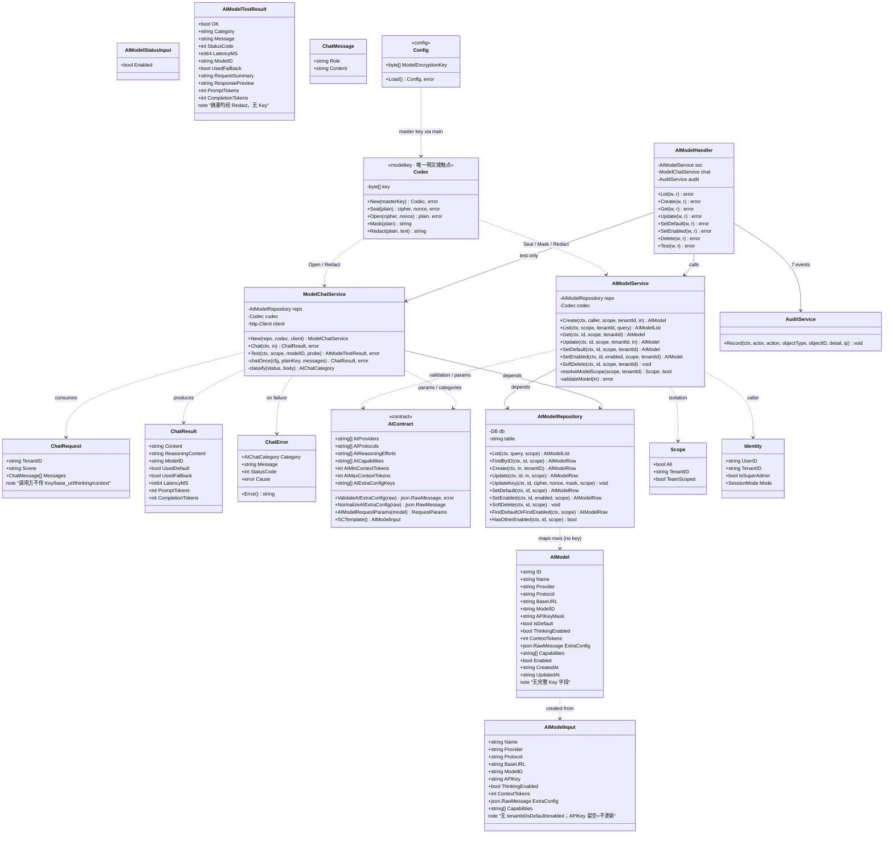
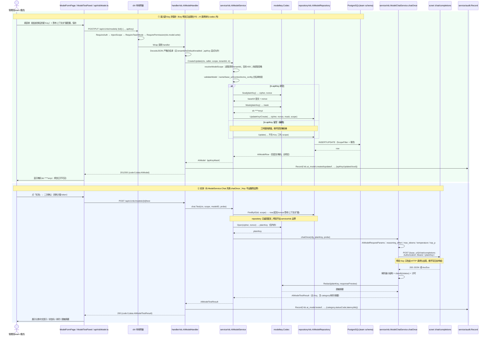
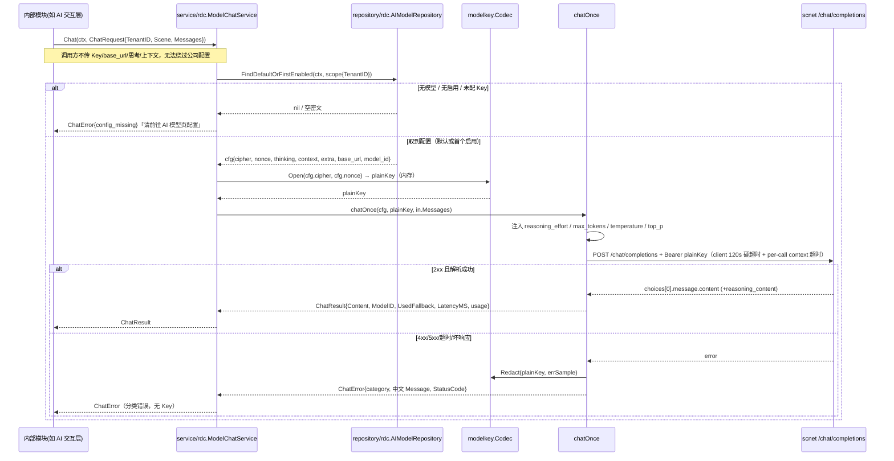
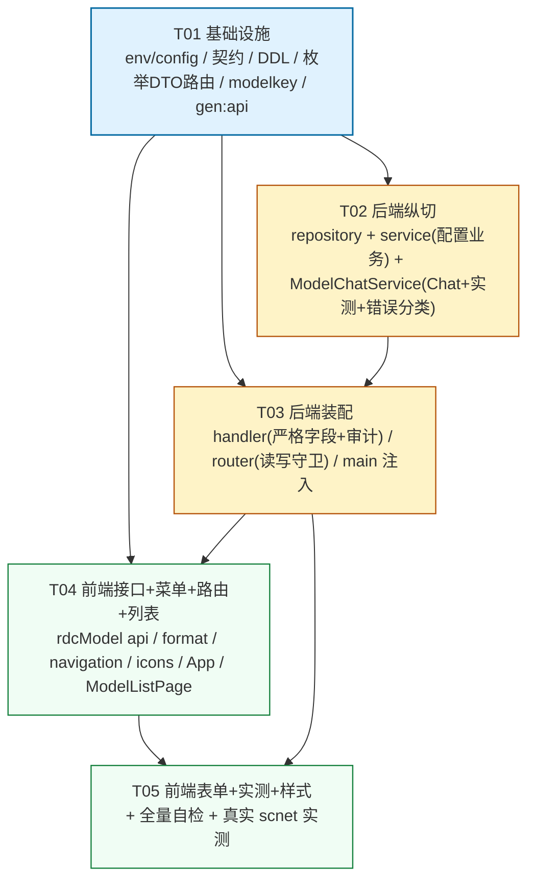

# Dandelion 研发中心（RDC）增量 · 第 5 菜单「AI模型」系统设计与任务分解

| 项 | 内容 |
| --- | --- |
| 文档类型 | 系统设计 + 有序任务分解（架构师交付物） |
| 架构师 | 高见远（Gao）· Architect |
| 上游输入 | `deliverables/software-company/ai-model-prd.md`（许清楚，Q1–Q8）+ team-lead 转达的用户拍板（8 条，见 §0）+ 现有代码基线 |
| 基线事实来源 | `api/openapi.yaml`（契约 SSOT，当前 60 paths）、`server/internal/repository/schema.sql`（DDL SSOT）、`internal/contract/contract.go`（权限/菜单/路由，当前 APIRoutes 60）、`internal/config/config.go`（唯一 `os.Getenv`）、`internal/repository/filter.go`（`ScopeFilter`）、router/handler/service 分层、`service/audit.Service` |
| 项目根目录 | `/Users/linanan/Desktop/dandelion`（下文路径均相对此根） |
| 强制规范 | `AGENTS.md`（优先级：当前代码与测试 > `api/openapi.yaml` > AGENTS.md > docs 设计稿） |
| 本版范围 | 配置管理（CRUD / 默认 / 思考 / 上下文 / 扩展配置）+ Key 加密入库 + 统一 Go 调用接口 + 一次真实 scnet 实测 |
| 明确不做 | Agent 执行、模型训练、多协议（Anthropic/Responses）、统计限流、主密钥轮换；不建前端可直调的 LLM 路由 |
| 模式限定 | 仅 team；team 专属表（不进 FOREACH）；solo 不可见、不可达、`RequireTeamMode` → 403 |

---

## 0. 用户拍板（本设计的硬约束，逐条落地）

| # | 拍板结论 | 本设计落点 |
| --- | --- | --- |
| 1 | API Key AES-GCM 加密入库；主密钥 env `RDC_MODEL_ENCRYPTION_KEY` 经 config 统一读取、缺失/非法即启动失败；明文绝不写仓库/.env/日志/响应，只显示末 4 位掩码；Key 编辑留空=不更新 | §1 D1、§3.2、§7.1、§7.7 |
| 2 | 新增读点 `rdc.model.read` + 写点 `rdc.model.write`；菜单 Actions 挂写点；前端按 `can(me,'rdc.model.write')` 隐藏写入口；`AutoGrantBuiltin=false` | §1 D6、§3.3、§7.4 |
| 3 | 隔离=公司（tenant）；先 `ScopeFilter` 再叠条件；跨公司 404；超管选目标公司代配，未指定不展示任何公司 Key 配置；solo 403 | §1 D3、§3.5、§7.4 |
| 4 | 统一调用接口=后端 Go 服务 `ModelService.Chat`，按公司+场景取配置，不注册前端路由；首版 OpenAI 兼容（scnet `https://api.scnet.cn/api/llm/v1`）；错误分类清晰 | §1 D4、§3.7、§4.2 |
| 5 | 思考模式开关 + 上下文长度，按公司逐模型保存 | §1 D5、§3.1/3.2 |
| 6 | `extra_config` 首版就加具体字段并校验；能力标签首版只展示不参与调度 | §1 D5、§3.6 |
| 7 | 默认联动：启用兜底（无默认取第一个启用）+ 软删（`enabled=false`）+ 默认被停用时强制先指定新默认；切换默认事务互斥 | §1 D7、§3.8 |
| 8 | 实测：用轮换后的新 Key 加密入库，同一调用实现打一次真实 scnet `/chat/completions`，记录脱敏摘要与耗时，验证思考/上下文参数注入生效 | §1 D4、§4.1、§5 T05 |

---

# Part A · 系统设计

## 1. 实现方案概述（关键决策）

### D1 · Key 加解密唯一入口 = `internal/modelkey`，config 是主密钥唯一读取处

- 新建 `server/internal/modelkey/modelkey.go`（**唯一**接触 Key 明文的包），对外只暴露 `Codec.Seal/Open`、`Mask`、`Redact` 四类能力：
  - `New(masterKey []byte) (*Codec, error)`：校验主密钥恰好 32 字节（AES-256），拷贝持有，不共享切片；失败即返回错误供 main 中止启动。
  - `Seal(plain string) (ciphertextB64, nonceB64 string, err error)`：`crypto/aes` + `crypto/cipher` GCM，随机 12 字节 nonce（`crypto/rand`），返回两段 base64（密文含 tag、nonce）。
  - `Open(ciphertextB64, nonceB64 string) (plain string, err error)`：仅内存解密，调用方用完即弃。
  - `Mask(plain string) string`：唯一掩码函数，规则见 §7.1。
  - `Redact(plain, text string) string`：把文本中出现的明文 Key 与常见密钥模式替换为 `[已隐藏]`，用于实测响应摘要。
- `config.go` 增加字段 `ModelEncryptionKey []byte`：`get("RDC_MODEL_ENCRYPTION_KEY","")` → base64 解码 → 长度必须为 32，否则 `Load()` 返回 error 触发 fail-fast。**不设默认值**（与 `AUTH_SECRET` 的"默认即拒绝"策略一致）。明文主密钥不进任何日志/DTO。
- 落库形态：`api_key_ciphertext` / `api_key_nonce` 两段 base64 文本 + `api_key_mask`（写入时算好的掩码，读列表**不解密**）。任何 repository 读方法都不返回明文；`AIModel`/`AIModelTestResult` 等 DTO 无完整 Key 字段，编译器层面杜绝回显。

### D2 · 配置实体 `team.rdc_ai_model`：team 专属、不在 FOREACH

- 写在 `schema.sql`「六 · 研发中心」段末尾（与 `rdc_dev_task` 等同例），**`FOREACH s IN ARRAY ARRAY['team','solo']` 之外**；`solo` 无此表。`RequireTeamMode` 是硬边界，不为永远为空的 solo 造表。
- `tenant_id UUID REFERENCES tenants(id)` 提供公司隔离；仓储固定 `PartitionTeam.Table("rdc_ai_model")`，无 `.For(mode)`。

### D3 · 隔离与超管代配（PRD Q2 的落地口径）

- 所有列表/详情/写操作：先 `repository.ScopeFilter(0,"m",scope)` 再叠业务条件；越界/不存在统一 404。归属字段 `tenant_id` 从 scope 取，**请求体不含 tenantId**（DecodeJSON 白名单不含它）。
- 超管（`scope.All`）代配：各端点接受**查询参数** `?tenantId=<uuid>`：
  - service 内 `resolveModelScope(scope, tenantId)`：非超管一律忽略该参数（用自己的 `scope.TenantID`，防止越权切换）；超管且 `tenantId` 合法 UUID → 返回 `contract.Scope{All:false, TenantID:tenantId, TeamScoped:false}` 作为过滤范围，并标记 `IsDelegate=true` 供审计写 `target_tenant_id`；
  - 超管未带 `tenantId`：**列表返回空 items**（"未指定不默认展示任何公司 Key 配置"），所有写操作返回 400「请先选择目标公司」。
- 审计 detail 在代配时附 `targetTenantID` 与 `delegated:true`。

### D4 · 统一调用 `ModelService.Chat` 与"实测"共用同一份 HTTP 实现

- 新建 `server/internal/service/rdc/model_chat.go`：`Chat(ctx, ChatRequest)` 按公司+场景选配置；`Test(ctx, scope, modelID, probe)` 按 id 选指定模型；**两者都调用私有 `chatOnce(ctx, resolvedConfig, messages)`**——全仓唯一的 scnet HTTP 调用点，杜绝第二份客户端（呼应 AGENTS「不建第二套 HTTP 客户端」）。
- `ChatRequest` 只含 `TenantID`（调用方从自己 scope 取）、`Scene`、`Messages`；**不含** Key/base_url/思考/上下文——调用方无法绕过公司配置。
- `chatOnce` 只做四件事：组装 OpenAI 兼容 body（含 `reasoning_effort`/`max_tokens`/`temperature`/`top_p`）→ `http.NewRequestWithContext` + `Authorization: Bearer <plainKey>` → 发请求（client 硬超时 + per-call context 超时）→ 解析最小响应结构并按状态码分类错误。**明文 Key 只在此函数栈内出现**，不进 DTO、不进日志、不进响应。
- 错误分类 6 类（§3.7）；上游 error body 一律不回显、不记原文，摘要经 `modelkey.Redact` 脱敏。

### D5 · 思考开关 / 上下文长度 / 扩展配置

- `thinking_enabled`（bool，默认 false）是主开关；`context_tokens`（int，默认 8192，合法区间 1024–393216）是上下文预算。
- 注入映射（单一函数 `contract.AIModelRequestParams(model)`）：
  - `thinking_enabled=false` → 请求体 `reasoning_effort:"none"`；
  - `thinking_enabled=true` → `reasoning_effort` 取 `extra_config.reasoningEffort`（默认 `high`）；
  - `context_tokens` → 请求体 `max_tokens`（OpenAI 兼容协议里唯一可注入的 token 预算项；上游把它当"最大输出 token"，设计文档如实标注这一语义差）。
- 若实测发现 scnet 该模型不支持某参数（400/422），返回 `parameter_error` 中文提示，不静默丢弃。
- `extra_config` 首版具体字段 + 白名单校验见 §3.6。

### D6 · 权限：读写分离，`AutoGrantBuiltin=false`

- `contract.Permissions` 增 2 项：`rdc.model.read`（查看 AI 模型）、`rdc.model.write`（配置模型 / Key / 实测）。
- `contract.Menus` 增第 5 项 `{Key:"/rdc/models", ViewPermission: PermissionRDCModelRead, Actions:[{Key: PermissionRDCModelWrite}]}`，`AutoGrantBuiltin` 留零值 false；`AllMenuKeys`/`DefaultMenuKeys` 由既有函数自动投影，无需改逻辑。
- 路由守卫：读 2 操作挂 read，写 6 操作挂 write；前端 `navigation.ts`/`App.tsx` 用 read 作门槛，页面内写入口用 `can(me,'rdc.model.write')` 隐藏（与 `rdc.requirement` 一致）。

### D7 · 默认模型联动（写入不变量）

- 写顺序在**同一事务**：`UPDATE ... SET is_default=false WHERE tenant_id=$1` → `UPDATE ... SET is_default=true WHERE id=$2 AND tenant_id=$1 AND enabled=true`；`uq_rdc_ai_model_default (tenant_id) WHERE is_default` 唯一索引兜底（不是 CHECK）。
- 首个启用模型自动成为默认；`ModelService.Chat` 再做读时兜底（无默认但有启用 → 取第一个启用，`UsedFallback=true`）。
- 停用 / 软删默认模型：若该公司**另有启用模型** → 400「请先指定新的默认模型」；若它是唯一启用模型 → 允许停用，同时清 `is_default=false`（之后调用返回 `config_missing`，符合"无启用模型"口径）。**不变式：禁用行的 `is_default` 恒为 false。**
- "删除"=`enabled=false`（软删），不物理删行；审计动作区分 `deleted` 与 `status`。

### D8 · 预置 scnet 模型的反占位口径

- **采用"可选模板"，不为每家公司自动插数据**：`contract` 与前端各保留一份 `scnet / DeepSeek-V4.1-Flash-1017` 模板常量（provider/protocol/base_url/model_id/capabilities/默认 context_tokens），在"新增模型"页以"从模板填入"按钮展示；用户仍需自行填 Key 并保存。空公司库里没有任何模型行，不造假数据；契约测试锁住两份模板常量一致。

### 1.2 技术栈（零新增依赖）

| 层 | 沿用 |
| --- | --- |
| 后端 | Go 1.24 + chi v5 + pgx/v5 stdlib + PostgreSQL 16；标准库 `crypto/aes`、`crypto/cipher`、`crypto/rand`、`encoding/base64`、`encoding/json`、`net/http`、`context` 完成加密与 LLM 调用 |
| 前端 | React 18 + TS + Vite 5 + `@seakoi/console-kit` 根入口；`pages → api → client.ts` |
| 契约 / DDL | 既有 `make gen:api`、`schema.sql` 幂等 `//go:embed` |

**不引入**：任何 LLM SDK、新 ORM、新迁移框架、新 UI 库、第二份加密实现或第二份 HTTP 客户端。

---

## 2. 文件清单

> 标记：**新** / **改** / **生成**（`schema.d.ts` 禁手改）。所有新增手写文件顶部写中文四要素注释：**职责 / 输入 / 输出 / 边界**；单文件 ≤ 400 行（故服务层拆 `model_service.go` 与 `model_chat.go`）。

### 2.1 契约、DDL、配置（事实来源层）

| 路径 | 标记 | 职责 |
| --- | --- | --- |
| `api/openapi.yaml` | 改 | 新增 5 个 paths / 8 个操作、AIModel 系列 schema、x-常量（`x-rdc-ai-providers`、`x-rdc-ai-protocols`、`x-rdc-ai-capabilities`、`x-rdc-ai-reasoning-efforts`、`x-rdc-ai-context-range`、`x-rdc-ai-extra-config`、`x-rdc-ai-test-categories`）；不写任何 Key 字段进响应 schema。 |
| `server/internal/repository/schema.sql` | 改 | 「六 · 研发中心」段末尾新增 `team.rdc_ai_model` + 2 索引（循环外、team 专属）。 |
| `server/internal/contract/contract.go` | 改 | 5 路由常量入 `APIRoutes`（**保留 `RouteBuildVersions` 与全部既有 60 条**）；2 权限点 + 菜单第 5 项；AIModel DTO 全套（列表项仅 `apiKeyMask`）；reasoning effort / provider / protocol / capability 枚举与默认值；context 区间；`extra_config` 字段白名单与校验/规范化函数；错误分类常量；scnet 模板常量。 |
| `server/internal/contract/contract_test.go` | 改 | 路径数（60→65）、权限/菜单数、枚举与 x-常量一致、`extra_config` 白名单与边界、模板常量、DTO 无完整 Key 字段断言。 |
| `server/internal/config/config.go` | 改 | `ModelEncryptionKey []byte` + `RDC_MODEL_ENCRYPTION_KEY` 读取/解码/长度校验/fail-fast。 |
| `.env.example` | 改 | 增注释行 `RDC_MODEL_ENCRYPTION_KEY=`（**空占位、无真实密钥**），附生成命令注释 `openssl rand -base64 32`。 |
| `README.md` | 改 | 配置章节新增该环境变量说明（生成方式、必填、丢失无法解密存量 Key）。 |
| `deploy/docker-compose.yml`、`deploy/dandelion.service` | 改 | 增加环境变量注入位（引用 .env，**不写明文**）。 |
| `web/src/api/schema.d.ts` | 生成 | `make gen:api` 产物，入库，禁手改。 |

### 2.2 后端

| 路径 | 标记 | 职责 |
| --- | --- | --- |
| `server/internal/modelkey/modelkey.go` | 新 | 唯一 Key 明文接触点：`Codec.Seal/Open` + `Mask` + `Redact`。 |
| `server/internal/modelkey/modelkey_test.go` | 新 | AES-GCM roundtrip、篡改 nonce/密文失败、掩码金标准、Redact 不残留 Key、错误不回显密文。 |
| `server/internal/repository/rdc/ai_model_repository.go` | 新 | 唯一 SQL 出入口：分页列表（ScopeFilter + enabled/关键字）、详情、新增、更新资料、更新 Key 三列、设默认事务、启停/软删、取默认或首个启用（供 Chat）、存在性检查。 |
| `server/internal/repository/rdc/ai_model_repository_test.go` | 新 | 跨公司 404、默认唯一性与切换互斥、软删后 enabled=false、列表不读明文、租户失败关闭。 |
| `server/internal/service/rdc/model_service.go` | 新 | 配置业务：字段/URL/context/extra_config 校验、scope 投影（超管代配）、默认联动、Key 加解密编排（调 modelkey）、审计数据组装、管理员选型兜底；不碰 HTTP。 |
| `server/internal/service/rdc/model_chat.go` | 新 | `Chat` + `Test` + 私有 `chatOnce`：选配置、组装请求、发 HTTP、解析响应、6 类错误分类、脱敏摘要；唯一 scnet 调用实现。 |
| `server/internal/service/rdc/model_service_test.go` | 新 | 留空不更新 Key、超管代配 scope、默认被停用拦截、context/extra_config 越界、跨公司 404 的纯逻辑用例。 |
| `server/internal/service/rdc/model_chat_test.go` | 新 | 用 `httptest.Server` 冒充 scnet：参数注入（reasoning_effort/max_tokens）、401→auth_failed、400→parameter_error、429/5xx→rate_limited、超时→network_error、坏 JSON→response_error；断言 Key 不进任何返回的摘要/错误。 |
| `server/internal/handler/rdc/ai_model_handler.go` | 新 | HTTP 语义：分页/筛选/tenantId 取参，`DecodeJSON` 严格白名单（无 tenantId/isDefault/enabled/apiKeyMask），调 service，成功分支写审计，统一响应外壳。 |
| `server/internal/handler/rdc/ai_model_handler_test.go` | 新 | 请求体塞 tenantId/isDefault → 400；solo → 403；无对应权限点 → 403；审计 action 断言；响应体不含完整 Key。 |
| `server/internal/app/router.go` | 改 | `Deps.RDCModel` 注入；5 paths / 8 ops 挂 team 专区，读挂 read、写挂 write；补 405 `Allow` 映射（子路径优先）。 |
| `server/cmd/server/main.go` | 改 | 构造 modelkey codec（用 `cfg.ModelEncryptionKey`，失败则中止）、repo、service（注入共享 `http.Client`）、handler，注入 `app.Deps`。 |

### 2.3 前端

| 路径 | 标记 | 职责 |
| --- | --- | --- |
| `web/src/api/rdcModel.ts` | 新 | 8 个接口唯一消费处：列表/详情/新增/编辑/设默认/启停/软删/实测；类型只从 `./schema` 引、请求只经 `./client`；列表带 `tenantId` 查询参数。 |
| `web/src/utils/format.ts` | 改 | provider / protocol / capability / reasoning effort / 错误分类中文标签 + scnet 模板常量（与 contract 对齐）。 |
| `web/src/components/navigation.ts` | 改 | 「研发中心」分组新增第 5 项 `/rdc/models`，`permission:'rdc.model.read'`。 |
| `web/src/components/icons.tsx` | 改 | 新增 `model` 图标（节点/网络语义）。 |
| `web/src/App.tsx` | 改 | 新增 `/rdc/models`、`/rdc/models/new`、`/rdc/models/:id/edit` 三条懒加载路由；列表页挂 read，表单页挂 write；统一 `<TeamModeGate>`。 |
| `web/src/pages/rdc/ModelListPage.tsx` | 新 | 列表 + 筛选（启用态）+ 服务端分页（页码进 URL）+ States 三态 + 空态卡片；名称进详情抽屉；行操作（编辑/设默认/启停/软删）与「新增」「实测」入口按 `can(me,'rdc.model.write')` 隐藏；超管显示「目标公司」选择（未选显示空态提示）。 |
| `web/src/pages/rdc/ModelFormPage.tsx` | 新 | 新建/编辑复用；字段：名称/provider/protocol/base_url/model_id/Key/思考开关/上下文/扩展配置/能力标签（只读）；"从模板填入"按钮；Key 输入框留空文案「留空即不修改」，显示掩码占位；保存后即时生效提示。 |
| `web/src/pages/rdc/ModelTestPanel.tsx` | 新 | 实测面板：二次确认（消耗少量 token）、调实测接口、展示分类中文提示 / 状态码 / 耗时 / 请求摘要 / 响应预览（均已脱敏，无 Key）。 |
| `web/src/styles.scss` | 改 | 模型列表列、Key 掩码样式、扩展配置表单、实测结果卡片、超管公司选择提示；沿用主色 `#0369a1`。 |

### 2.4 设计产物（本文件之外）

| 路径 | 标记 | 职责 |
| --- | --- | --- |
| `deliverables/software-company/ai-model-class-diagram.mermaid` | 新 | 本文 §3.9 类图单独提取。 |
| `deliverables/software-company/ai-model-sequence-diagram.mermaid` | 新 | 本文 §4 两张时序图单独提取（含 Key 不出服务边界标注）。 |

> `docs/class-diagram.mermaid` / `docs/sequence-diagram.mermaid` 属其他特性，本次不覆盖。

---

## 3. 数据结构与接口

### 3.1 DDL 草案（`schema.sql`「六 · 研发中心」段末尾，循环之外，team 专属）

```sql
-- 六·增补 · AI 模型配置（team 专属，不进 FOREACH 循环）。
-- RequireTeamMode 是模式边界；tenant_id 提供公司隔离；
-- api_key_ciphertext / api_key_nonce 存 base64(AES-GCM 密文/12B nonce)，绝不明文；
-- api_key_mask 写入时算好，列表读取不解密；
-- provider / protocol / capability / reasoning effort 不加 CHECK（枚举唯一来源是 openapi.yaml）。
CREATE TABLE IF NOT EXISTS team.rdc_ai_model (
  id                  UUID        PRIMARY KEY DEFAULT gen_random_uuid(),
  tenant_id           UUID        REFERENCES tenants(id),
  name                TEXT        NOT NULL,
  provider            TEXT        NOT NULL DEFAULT 'scnet',       -- scnet；枚举见 openapi
  protocol            TEXT        NOT NULL DEFAULT 'openai',      -- 首版 openai，其余预留
  base_url            TEXT        NOT NULL,                       -- 形如 https://api.scnet.cn/api/llm/v1
  model_id            TEXT        NOT NULL,                       -- 传给 LLM 的 model 参数
  api_key_ciphertext  TEXT        NOT NULL DEFAULT '',            -- base64 密文；明文绝不入库
  api_key_nonce       TEXT        NOT NULL DEFAULT '',            -- base64 nonce
  api_key_mask        TEXT        NOT NULL DEFAULT '',            -- sk-****wxyz；读不解密
  is_default          BOOLEAN     NOT NULL DEFAULT false,
  thinking_enabled    BOOLEAN     NOT NULL DEFAULT false,
  context_tokens      INTEGER     NOT NULL DEFAULT 8192,          -- 1024..393216，service 校验
  extra_config        JSONB       NOT NULL DEFAULT '{}'::jsonb,   -- 白名单字段，见 §3.6
  capabilities        JSONB       NOT NULL DEFAULT '[]'::jsonb,   -- 能力标签，首版只展示
  enabled             BOOLEAN     NOT NULL DEFAULT true,          -- 软删/停用均置 false
  created_at          TIMESTAMPTZ NOT NULL DEFAULT now(),
  updated_at          TIMESTAMPTZ NOT NULL DEFAULT now()
);
-- 列表形态：租户 + 启用态 + 时间倒序（默认模型置顶由 ORDER BY is_default DESC 完成）。
CREATE INDEX IF NOT EXISTS idx_rdc_ai_model_tenant_enabled_created
  ON team.rdc_ai_model (tenant_id, enabled, created_at DESC);
-- 每公司至多一个默认模型（唯一索引不是 CHECK；切换默认在事务内先清后置）。
CREATE UNIQUE INDEX IF NOT EXISTS uq_rdc_ai_model_default
  ON team.rdc_ai_model (tenant_id) WHERE is_default;
```

**字段对齐表**

| DB 列 | Go 字段 | JSON 字段 | 来源 / 规则 |
| --- | --- | --- | --- |
| `id` | `AIModel.ID` | `id` | UUID，服务端。 |
| `tenant_id` | —（不进 DTO） | — | 从 scope/tenantId 取，仅过滤；请求体不接受。 |
| `name` | `AIModel.Name` | `name` | 必填 ≤100 字，公司内可重名。 |
| `provider` | `AIModel.Provider` | `provider` | 枚举 `scnet`（见 openapi）。 |
| `protocol` | `AIModel.Protocol` | `protocol` | 首版 `openai`，其余预留。 |
| `base_url` | `AIModel.BaseURL` | `baseUrl` | http(s) 绝对地址、无 query/userinfo，service 校验。 |
| `model_id` | `AIModel.ModelID` | `modelId` | 必填，调用时作 `model` 参数。 |
| `api_key_ciphertext`/`nonce` | —（不进 DTO） | — | 仅 repository/modelkey 接触；DTO 无对应字段。 |
| `api_key_mask` | `AIModel.APIKeyMask` | `apiKeyMask` | 写入时算好的掩码，唯一可回显的 Key 相关字段。 |
| `is_default` | `AIModel.IsDefault` | `isDefault` | 事务互斥；禁用行恒 false。 |
| `thinking_enabled` | `AIModel.ThinkingEnabled` | `thinkingEnabled` | 思考主开关。 |
| `context_tokens` | `AIModel.ContextTokens` | `contextTokens` | 1024–393216，默认 8192。 |
| `extra_config` | `AIModel.ExtraConfig` | `extraConfig` | 规范化后的 JSON 对象（见 §3.6）。 |
| `capabilities` | `AIModel.Capabilities` | `capabilities` | 字符串数组，首版只读展示。 |
| `enabled` | `AIModel.Enabled` | `enabled` | 软删/停用置 false。 |
| `created_at`/`updated_at` | `AIModel.CreatedAt/UpdatedAt` | `createdAt/updatedAt` | UTC RFC3339。 |

### 3.2 契约常量与 DTO（`internal/contract`）

```go
// 路由常量（+5；APIRoutes 长度 60 → 65，与 openapi paths 数一一对应；
// 已含 RouteBuildVersions 与全部既有 RDC 需求/dev/review/delivery/interaction 路径，绝不丢失）。
const (
    RouteRDCModels       = APIPrefix + "/rdc/models"
    RouteRDCModelByID    = APIPrefix + "/rdc/models/{id}"
    RouteRDCModelDefault = APIPrefix + "/rdc/models/{id}/default"
    RouteRDCModelStatus  = APIPrefix + "/rdc/models/{id}/status"
    RouteRDCModelTest    = APIPrefix + "/rdc/models/{id}/test"
)

// 权限点常量（+2）。
const (
    PermissionRDCModelRead  = "rdc.model.read"
    PermissionRDCModelWrite = "rdc.model.write"
)

// 枚举与边界（与 openapi 的 x-rdc-ai-* 一一对应，契约测试锁死）。
const (
    AIProviderSCNet = "scnet"
    AIProtocolOpenAI = "openai"
    AIReasoningNone = "none"
    AIReasoningLow  = "low"
    AIReasoningHigh = "high"
    AIReasoningMax  = "max"
    AIDefaultReasoning = AIReasoningHigh
    AIMinContextTokens = 1024
    AIMaxContextTokens = 393216
    AIDefaultContextTokens = 8192
    AIExtraTimeoutMinMS = 1000
    AIExtraTimeoutMaxMS = 120000
    AIExtraTimeoutDefaultMS = 30000
    ModelCallHardTimeout = 120 * time.Second // http.Client.Timeout 硬上限
    MaxAINameLen = 100
)
var AIProviders = []string{AIProviderSCNet}
var AIProtocols = []string{AIProtocolOpenAI}                    // 首版只此一项
var AIReasoningEfforts = []string{none, low, high, max}
var AICapabilities = []string{"文本生成", "深度思考", "视觉理解"} // 首版只展示

// extra_config 字段白名单与规范化：未知键写入时 400，读取时忽略（向后兼容）。
var AIExtraConfigKeys = []string{"temperature", "topP", "reasoningEffort", "timeoutMs"}
// ValidateAIExtraConfig(raw json.RawMessage) (normalized json.RawMessage, error)
// NormalizeAIExtraConfig(raw json.RawMessage) json.RawMessage  // 读时填默认值、忽略未知键

// DTO —— 列表项绝不含完整 Key。
type AIModel struct {
    ID, Name, Provider, Protocol, BaseURL, ModelID string
    APIKeyMask        string          `json:"apiKeyMask"`
    IsDefault         bool            `json:"isDefault"`
    ThinkingEnabled   bool            `json:"thinkingEnabled"`
    ContextTokens     int             `json:"contextTokens"`
    ExtraConfig       json.RawMessage `json:"extraConfig"`
    Capabilities      []string        `json:"capabilities"`
    Enabled           bool            `json:"enabled"`
    CreatedAt, UpdatedAt string
}
type AIModelList struct { Items []AIModel `json:"items"`; Page }

// 输入 DTO —— 关键：无 tenantId / isDefault / enabled / apiKeyMask。
// APIKey 留空表示"不更新"（service 识别，绝不把掩码当 Key 回写）。
type AIModelInput struct {
    Name, Provider, Protocol, BaseURL, ModelID string
    APIKey          string          `json:"apiKey,omitempty"`
    ThinkingEnabled bool            `json:"thinkingEnabled"`
    ContextTokens   int             `json:"contextTokens"`
    ExtraConfig     json.RawMessage `json:"extraConfig"`
    Capabilities    []string        `json:"capabilities"`
}
type AIModelStatusInput struct { Enabled bool `json:"enabled"` }
type AIModelQuery struct {
    Page PageQuery
    Enabled *bool      // nil=全部
    TenantID string    // 仅超管查询参数，service 投影
}

// 错误分类（对调用方/页面统一口径）。
type AIChatCategory string
const (
    AIChatConfigMissing AIChatCategory = "config_missing"
    AIChatAuthFailed    AIChatCategory = "auth_failed"
    AIChatBadParameter  AIChatCategory = "parameter_error"
    AIChatRateLimited   AIChatCategory = "rate_limited"
    AIChatNetwork       AIChatCategory = "network_error"
    AIChatBadResponse   AIChatCategory = "response_error"
)
```

**`openapi.yaml` 契约扩展（SSOT 片段）**

```yaml
x-rdc-ai-providers: [scnet]
x-rdc-ai-protocols: [openai]
x-rdc-ai-capabilities: [文本生成, 深度思考, 视觉理解]
x-rdc-ai-reasoning-efforts: [none, low, high, max]
x-rdc-ai-context-range: { min: 1024, max: 393216, default: 8192 }
x-rdc-ai-extra-config:
  temperature:      { type: number, min: 0, max: 2, default: 1 }
  topP:             { type: number, exclusiveMin: 0, max: 1, default: 1 }
  reasoningEffort:  { type: string, enum: [none, low, high, max], default: high }
  timeoutMs:        { type: integer, min: 1000, max: 120000, default: 30000 }
x-rdc-ai-test-categories: [config_missing, auth_failed, parameter_error, rate_limited, network_error, response_error]
```

### 3.3 OpenAPI 路径清单（5 个路径 / 8 个操作；`servers.url=/api/v1`，统一外壳 `{code,data,message}`）

| 方法 | 路径 | 查询/请求体 | 成功响应 | 权限 |
| --- | --- | --- | --- | --- |
| GET | `/rdc/models` | `page,pageSize,enabled,tenantId` | `200 AIModelListResponse` `{items,total,page,pageSize}` | read |
| POST | `/rdc/models` | `AIModelInput` | `201 AIModelResponse` | write |
| GET | `/rdc/models/{id}` | 路径 `id`(uuid) | `200 AIModelResponse`；越界 404 | read |
| PUT | `/rdc/models/{id}` | `AIModelInput`（apiKey 留空=不更新） | `200 AIModelResponse` | write |
| POST | `/rdc/models/{id}/default` | 空 body | `200 AIModelResponse`；事务互斥 | write |
| POST | `/rdc/models/{id}/status` | `AIModelStatusInput{enabled}` | `200 AIModelResponse`；默认停用联动 | write |
| DELETE | `/rdc/models/{id}` | 路径 `id` | `200`；软删（enabled=false） | write |
| POST | `/rdc/models/{id}/test` | 空 body（用该模型已存 Key） | `200 AIModelTestResultResponse` | write |

**新增 schema**：`AIModel`、`AIModelInput`、`AIModelStatusInput`、`AIModelTestResult`、`AIModelResponse`、`AIModelListResponse`、`AIModelTestResultResponse`，以及 `AIReasoningEffort`/`AIProvider`/`AIProtocol`/`AICapability`/`AITestCategory` enum。**响应 schema 不定义完整 Key 字段**，仅 `apiKeyMask`。

**契约一致性**：新增 5 paths ⇒ `APIRoutes` +5（60→65）；超管代配走查询参数 `tenantId`，不新增 path。

### 3.4 `ModelService.Chat` 接口签名与调用方约定

```go
// server/internal/service/rdc/model_chat.go
type ChatMessage struct { Role string; Content string } // system|user|assistant
type ChatRequest struct {
    TenantID string         // 必填：调用方从自己 scope 取；不由前端传
    Scene    string         // 场景标识，首版只记录/预留，不改变选模
    Messages []ChatMessage
    // 不含 Key / base_url / thinking / context：全部由服务端按模型配置注入
}
type ChatResult struct {
    Content, ReasoningContent, ModelID string
    UsedDefault, UsedFallback bool
    LatencyMS int64
    PromptTokens, CompletionTokens int
}
type ChatError struct {
    Category AIChatCategory
    Message  string // 中文可读，绝不含 Key/密文/完整请求体
    StatusCode int
    Cause error
}
func (e *ChatError) Error() string

type ModelChatService struct { /* repo, codec, http.Client */ }
func NewModelChatService(repo ModelRepository, codec *modelkey.Codec, client *http.Client) *ModelChatService
// Chat 按公司+场景取配置（默认→首个启用兜底），解密 Key，调用 LLM。
func (s *ModelChatService) Chat(ctx context.Context, in ChatRequest) (ChatResult, error)
// Test 对指定模型实测：与 Chat 共用 chatOnce，返回脱敏摘要与耗时。
func (s *ModelChatService) Test(ctx context.Context, scope contract.Scope, modelID string, probe []ChatMessage) (AIModelTestResult, error)
```

- 调用方（未来 AI 交互层等）`main.go` 注入 `*ModelChatService`，只传 `TenantID+Scene+Messages`；Key 与协议细节完全不暴露。
- **不注册 HTTP 路由**：`RouteRDC*` 里没有 `/chat`。前端只能通过"实测"端点触发，且实测也只是调用同一实现。

### 3.5 隔离与审计口径

| 操作 | action | objectType | detail 要点（无 Key） |
| --- | --- | --- | --- |
| 新增 | `rdc.ai_model.created` | `rdc_ai_model` | `{modelId,name,provider,baseUrl}` |
| 编辑 | `rdc.ai_model.updated` | `rdc_ai_model` | `{modelId,name,fieldsChanged:["name","contextTokens",...]}`（**不记 apiKey 值，只记 `apiKeyUpdated:bool`**） |
| 设默认 | `rdc.ai_model.default_set` | `rdc_ai_model` | `{modelId,previousDefaultId}` |
| 启停 | `rdc.ai_model.enabled` / `rdc.ai_model.disabled` | `rdc_ai_model` | `{modelId,enabled}` |
| 软删 | `rdc.ai_model.deleted` | `rdc_ai_model` | `{modelId,name}` |
| 实测 | `rdc.ai_model.tested` | `rdc_ai_model` | `{modelId,category,statusCode,latencyMs}`（**不记响应体/Key**） |

- 全部写在 handler 成功分支之后，经 `audit.Service.Record(ctx, caller, ...)`，失败只记日志不回滚；team 模式天然落 `team.audit_logs`。代配时 detail 附加 `targetTenantID`、`delegated:true`。

### 3.6 `extra_config` 具体字段定义（Q3 落地，首版就校验）

| JSON 键 | 类型 | 取值范围 | 默认 | 注入到 scnet 请求 | 校验规则 |
| --- | --- | --- | --- | --- | --- |
| `temperature` | number | 0 ≤ x ≤ 2 | `1` | `temperature` | 非数值/越界 → 400 |
| `topP` | number | 0 < x ≤ 1 | `1` | `top_p` | 非数值/越界 → 400 |
| `reasoningEffort` | string enum | `none`/`low`/`high`/`max` | `high`（思考开启时生效） | `reasoning_effort`（与 `thinking_enabled` 联动，见 D5） | 非枚举 → 400 |
| `timeoutMs` | integer | 1000 ≤ x ≤ 120000 | `30000` | per-call `context.WithTimeout`（不得超 `ModelCallHardTimeout`） | 非整数/越界 → 400 |

- **写入**：`contract.ValidateAIExtraConfig` 用 `json.RawMessage` + `map[string]json.RawMessage` 逐键校验；未知键 → 400（明确白名单）；缺省键填默认值后规范化回写。
- **读取**：`contract.NormalizeAIExtraConfig` 忽略未知键并补默认值，保证后续迭代加字段不需迁移历史数据。
- **能力标签 `capabilities`**：只读展示，不进选模逻辑；值域 `文本生成/深度思考/视觉理解`（模板给出，用户可改，但不校验到白名单以外——首版只展示）。

### 3.7 错误分类（面向调用方与页面）

| 类别 | 触发 | 中文提示（模板） |
| --- | --- | --- |
| `config_missing` | 公司无模型 / 无启用 / 未配 Key / 场景模型不存在 | 该公司尚未配置可用模型，请前往 AI 模型页配置 |
| `auth_failed` | 上游 401 / 403 | 密钥无效或已失效，请更新 Key |
| `parameter_error` | 上游 400 / 422（模型不存在、思考/上下文参数不支持或越界） | 模型或参数不被支持，请检查模型 ID 与思考 / 上下文配置 |
| `rate_limited` | 上游 429 / 5xx | 供应商繁忙或限流，请稍后重试 |
| `network_error` | 连接失败 / 读超时 / context deadline | 网络不可达或调用超时，请稍后重试 |
| `response_error` | 2xx 但 JSON 异常 / 空 choices / 空 content | 供应商响应异常 |

所有错误**不含 Key、密文或完整请求体**；上游 error body 不回显、不记原文，摘要经 `modelkey.Redact` 脱敏后仅服务端可见。

### 3.8 默认联动与兜底伪代码（工程师必读）

```text
Create(in, scope):
  if 该公司无 enabled 行 → is_default=true else false
  if in.APIKey != "" → Seal → 写 ciphertext/nonce/mask；否则三列保持空（新建无 Key 允许，调用报 config_missing）
SetDefault(id, scope):
  BEGIN; UPDATE ... SET is_default=false WHERE tenant_id=$t;
        UPDATE ... SET is_default=true, updated_at=now() WHERE id=$id AND tenant_id=$t AND enabled=true;
        COMMIT  // 影响 0 行 → 404/400
SetEnabled(id, false, scope) / SoftDelete(id, scope):
  row = FindByID(id, scope) // 越界 404
  if row.is_default && 该公司存在其它 enabled 行 → 400「请先指定新的默认模型」
  UPDATE ... SET enabled=false, is_default=false, updated_at=now() WHERE id=$id AND tenant($t)
Chat(in):
  cfg = repo.FindDefault(scope) ?? repo.FindFirstEnabled(scope)  // 后者 UsedFallback=true
  if cfg==nil || cfg.ciphertext=='' → ChatError(config_missing)
  plain = codec.Open(cfg.ciphertext, cfg.nonce)
  return chatOnce(cfg, plain, in.Messages)
```

### 3.9 类图（Mermaid）



---

## 4. 程序调用流程（Mermaid 时序图）

### 4.1 录入新 Key → 加密入库 → 实测（含 Key 不出服务边界标注）



### 4.2 其他模块通过 `ModelService.Chat` 统一调用（无 HTTP 路由）



### 4.3 列表 / 详情 / 设默认 / 启停 / 软删要点（不单独画图）

- **列表**：`GET /rdc/models?page&pageSize&enabled&tenantId` → handler 取参 → `resolveModelScope`（超管代配投影）→ repo `ScopeFilter(0,"m",scope)` + `AddIf(enabled)` + `ORDER BY is_default DESC, created_at DESC` + count + `filter.Next` 分页。
- **详情**：UUID 校验 → `FindByID`（ScopeFilter + id）→ 404 越界；返回的 DTO 只有掩码。
- **设默认 / 启停 / 软删**：均先 `FindByID` 确认可见（越界 404），再按 §3.8 伪代码在事务内执行；写审计。

---

## 5. 待明确事项 / 已记录的假设

| 编号 | 事项 | 本设计处理 | 需确认? |
| --- | --- | --- | --- |
| C1 | scnet / DeepSeek-V4.1-Flash-1017 是否支持 `reasoning_effort` 及具体取值 | 按公开 DeepSeek OpenAI 兼容文档注入 `reasoning_effort`（none/low/high/max），单一映射函数 `AIModelRequestParams`；实测若 400/422 即返回 `parameter_error`，一处可改 | 建议实测时确认；不阻塞 |
| C2 | 超管代配交互（`?tenantId=` 查询参数 vs 专用页面） | 采用查询参数；未指定时列表空态、写操作 400，不默认展示任何公司 Key 配置 | 建议确认交互文案；不阻塞 |
| C3 | `context_tokens` 语义 | OpenAI 兼容协议只有 `max_tokens`（最大输出），本设计如实映射并标注语义差；不伪造"上下文窗口"参数 | 已按 PRD §5.2 处理 |
| C4 | 主密钥丢失的存量数据 | 文档明示"丢失将无法解密存量 Key，需重新录入"；本版不做轮换/迁移（Q8） | 无需确认（Q8 已定） |
| C5 | 用户对话中泄露的旧 Key | lead 已提示轮换；本设计/代码/测试/文档均不含其明文；实测必须用轮换后的新 Key | 请确认轮换已完成再执行 T05 实测 |
| C6 | 实测消耗 token 的授权 | T05 实测前二次确认提示"消耗少量 token"，需用户知悉授权 | 执行前确认 |
| C7 | 能力标签参与调度 | 首版只读展示（PRD R11 后续迭代）；字段预留、不进选模逻辑 | 无需确认（已拍板） |
| C8 | `AUTH_SECRET` 与 `RDC_MODEL_ENCRYPTION_KEY` 是否能同值 | 设计上各自独立、长度校验相同；不强制不同值，但文档建议分别生成 | 建议 |

---

# Part B · 任务分解

## 6. 依赖包

**无新增依赖**，`go.mod` / `package.json` 均不改。

- 后端复用：`chi/v5`、`pgx/v5/stdlib`、`database/sql`、`encoding/json`、`encoding/base64`、`net/http`、`context`；加密用标准库 `crypto/aes` + `crypto/cipher` + `crypto/rand`；契约测试用 `gopkg.in/yaml.v3`（已存在）。
- 前端复用：`@seakoi/console-kit` 根入口（`Table`/`Drawer`/`Modal`/`Select`/`Segmented`/`Input` 等）、`react-router-dom`、`schema.d.ts` 类型。
- 工具链已存在：`make gen:api`、`make test`、`npm --prefix web run build`、`make build`。

## 7. 任务列表（按依赖顺序，5 个任务）

> T01 承担"项目基础设施"角色：环境变量/config、契约（事实来源）、DDL、枚举/DTO/路由常量、加密 helper、生成物，全部收敛在一个任务，不分散。

### T01 · 基础设施：环境变量、契约、DDL、枚举/DTO/路由常量、加密 helper、生成物

- **优先级**：P0 · **依赖**：无
- **涉及文件**：`server/internal/config/config.go`、`.env.example`、`README.md`、`deploy/docker-compose.yml`、`deploy/dandelion.service`、`api/openapi.yaml`、`server/internal/repository/schema.sql`、`server/internal/contract/contract.go`、`server/internal/contract/contract_test.go`、`web/src/api/schema.d.ts`（生成）、`server/internal/modelkey/modelkey.go`（新）、`server/internal/modelkey/modelkey_test.go`（新）
- **做什么**：
  1. config 增 `ModelEncryptionKey []byte`：`get("RDC_MODEL_ENCRYPTION_KEY","")` → base64 解码 → 长度 32，否则 fail-fast；同步 `.env.example`（空占位+生成命令注释）、README、deploy 两处；
  2. `openapi.yaml` 增 5 paths / 8 ops、AIModel 系列 schema、全部 `x-rdc-ai-*` 扩展；`schema.sql` 增 `team.rdc_ai_model` + 2 索引（循环外）；
  3. `contract.go` 增 5 路由常量入 `APIRoutes`（**保留全部既有路径**）、2 权限点、菜单第 5 项、AIModel DTO 全套、枚举/边界/extra_config 白名单与校验规范化函数、错误分类、scnet 模板常量；
  4. `contract_test.go` 增路径数（65）、权限/菜单数、枚举与 x-常量一致、extra_config 白名单/边界、模板、DTO 无完整 Key 字段断言；
  5. `modelkey.go` 实现 `New/Seal/Open/Mask/Redact`（标准库 AES-GCM），`modelkey_test.go` 覆盖 roundtrip/篡改/掩码金标准/Redact/错误不回显；
  6. `make gen:api` 生成并入库 `schema.d.ts`。
- **验收点**：
  1. `cd server && go test ./internal/contract/... ./internal/modelkey/...` 全绿：路径数 65、枚举一致、白名单/边界、DTO 无 Key 字段、AES-GCM roundtrip 与篡改失败；
  2. 缺 `RDC_MODEL_ENCRYPTION_KEY` 或长度非法时 `config.Load()` 返回 error（启动失败），合法 32 字节 base64 通过；
  3. `make gen:api` 后 `git diff --exit-code -- web/src/api/schema.d.ts` 无差异；
  4. DDL 空库/存量库各执行一次均幂等；team 有 `rdc_ai_model`，solo 无 `rdc_` 表。

### T02 · 后端纵切：repository + service（配置业务 + Chat + 错误分类）

- **优先级**：P0 · **依赖**：T01
- **涉及文件**：`server/internal/repository/rdc/ai_model_repository.go`（新）、`server/internal/repository/rdc/ai_model_repository_test.go`（新）、`server/internal/service/rdc/model_service.go`（新）、`server/internal/service/rdc/model_chat.go`（新）、`server/internal/service/rdc/model_service_test.go`（新）、`server/internal/service/rdc/model_chat_test.go`（新）
- **做什么**：
  1. `AIModelRepository`：列表（ScopeFilter + enabled + 分页 + 默认置顶）、详情、新增、更新资料、更新 Key 三列、设默认事务、启停、软删、`FindDefaultOrFirstEnabled`、`HasOtherEnabled`；表名由 `PartitionTeam.Table` 生成，禁手写拼接；
  2. `AIModelService`：`resolveModelScope`（超管代配投影/未指定拦截）、`validateModel`（name/base_url/context/extra_config 白名单）、默认联动（首个启用为默认、默认被停用拦截）、Key 加解密编排（调 codec）、审计数据组装；
  3. `ModelChatService`：`Chat` + `Test` + 私有 `chatOnce`（唯一 scnet 调用）；`http.Client{Timeout:120s}` + per-call `context.WithTimeout(timeoutMs)`；请求体注入 `reasoning_effort`/`max_tokens`/`temperature`/`top_p`；6 类错误分类；摘要经 `Redact`；响应体限量读取（≤1MB）；
  4. 测试：`httptest` 冒充 scnet 覆盖参数注入与 6 类错误；默认联动/兜底/跨公司/留空不更新 Key 的逻辑用例。
- **验收点**：
  1. AES-GCM roundtrip 通过；空 Key 编辑后密文/nonce/mask 三列不变；掩码末 4 位正确、无完整 Key；
  2. 设默认事务互斥：切换后仅一条 `is_default=true`；禁用默认且另有启用 → 400；唯一启用可禁用且 `is_default` 被清；无默认但有启用 → Chat 返回 `UsedFallback=true`；
  3. 跨公司 id 详情/编辑/设默认/启停/软删 → 404；超管未带 tenantId 写 → 400，列表 → 空；非超管带 tenantId 被忽略；
  4. `httptest`：401→auth_failed、400/422→parameter_error、429/5xx→rate_limited、超时→network_error、坏 JSON→response_error；思考开/关分别注入 `reasoning_effort=high/none`，`context_tokens` 注入 `max_tokens`；断言 Key 不进 `ChatResult`/`ChatError`/`AIModelTestResult` 任何字段；
  5. 分层检查：repository 无业务判断、service 无 `*http.Request`（chat 用 context + 入参）、无第二份 HTTP 客户端。

### T03 · 后端装配：handler、路由守卫、依赖注入与审计

- **优先级**：P0 · **依赖**：T01、T02
- **涉及文件**：`server/internal/handler/rdc/ai_model_handler.go`（新）、`server/internal/handler/rdc/ai_model_handler_test.go`（新）、`server/internal/app/router.go`（改）、`server/cmd/server/main.go`（改）
- **做什么**：
  1. `AIModelHandler` 8 个方法：读分页/筛选/tenantId、`DecodeJSON` 严格白名单（`tenantId/isDefault/enabled/apiKeyMask` 入 body → 400）、调 service、成功分支写 §3.5 的 7 类审计（Key 更新只记 `apiKeyUpdated:bool`）、`handler.OK/OKWithStatus`；
  2. `router.go`：`Deps.RDCModel`（含 service + chat）注入；5 paths / 8 ops 挂 team 专区，读 2 操作 `RequirePermission(rdc.model.read)`、写 6 操作 `RequirePermission(rdc.model.write)`；补 405 `Allow`（`/rdc/models`→GET,POST；`/{id}`→GET,PUT,DELETE；`/{id}/default|status|test`→POST，子路径优先判定）；
  3. `main.go`：`modelkey.New(cfg.ModelEncryptionKey)` 失败即中止；构造共享 `http.Client{Timeout:120s}`、repo、service、chat、handler 注入 `app.Deps`。
- **验收点**：
  1. 请求体塞 `tenantId/isDefault/enabled/apiKeyMask` → 400；solo 令牌 8 操作全 403；team 令牌无对应 read/write 点各 403；超管全通；
  2. 方法不匹配 → 405 + 正确 `Allow` + JSON 外壳；
  3. 7 类操作各写一条审计且 detail 无 Key；代配 detail 含 `target_tenant_id`/`delegated`；审计写失败不影响业务返回；
  4. 任一响应体（含错误）不出现完整 Key 或密文；
  5. `cd server && make test` 全绿（含契约一致性，路径数 65）。

### T04 · 前端接口层 + 菜单/路由 + 列表页

- **优先级**：P0 · **依赖**：T01（类型）、T03（接口）
- **涉及文件**：`web/src/api/rdcModel.ts`（新）、`web/src/utils/format.ts`（改）、`web/src/components/navigation.ts`（改）、`web/src/components/icons.tsx`（改）、`web/src/App.tsx`（改）、`web/src/pages/rdc/ModelListPage.tsx`（新）
- **做什么**：
  1. `rdcModel.ts`：8 个 API 函数，复用 `pageQuery()` + `URLSearchParams` 拼 `enabled/tenantId`；类型只从 `./schema` 引、请求只经 `./client`；
  2. `format.ts`：provider/protocol/capability/reasoning effort/错误分类中文标签 + scnet 模板常量（与 contract 对齐）；
  3. `navigation.ts`「研发中心」增第 5 项 `/rdc/models`（`permission:'rdc.model.read'`）；`icons.tsx` 增 `model` 图标；
  4. `App.tsx`：新增 3 条懒加载路由 `/rdc/models`（read）、`/rdc/models/new` 与 `/rdc/models/:id/edit`（write），统一 `<TeamModeGate>`；不改 01–04 路由；
  5. `ModelListPage`：列（名称=详情入口 / modelId / provider / protocol / baseUrl / 默认标记 / 思考 / 上下文 / Key 掩码 / 状态 / 更新时间）+ 服务端分页（`usePageState` 页码进 URL、`replace`）+ 启用态筛选（`Controls.Segmented`）+ States 三态 + 空列表空态卡片不挂分页条；新增/编辑/设默认/启停/软删/实测入口按 `can(me,'rdc.model.write')` 隐藏；超管显示「目标公司」选择，未选时空态提示"请先选择目标公司"。
- **验收点**：
  1. 列表列显示掩码而非完整 Key；筛选与分页可叠加、页码经 `replace` 进 URL；空列表无分页条；
  2. 无 `rdc.model.write` 的账号看不到任何写入口；solo 直输显示"仅团队模式可用"且不发请求；超管未选公司不发列表请求；
  3. `npm --prefix web run build` 类型检查通过；无直接 import antd / qrcode.react；未改 01–04 页面。

### T05 · 前端表单/实测/样式 + 全量自检 + 真实 scnet 实测

- **优先级**：P0 · **依赖**：T04（并需 T03 接口就绪）
- **涉及文件**：`web/src/pages/rdc/ModelFormPage.tsx`（新）、`web/src/pages/rdc/ModelTestPanel.tsx`（新）、`web/src/styles.scss`（改）
- **做什么**：
  1. `ModelFormPage`：新建/编辑复用；字段齐全（名称/provider/protocol/base_url/model_id/Key/思考开关/上下文/扩展配置 4 字段/能力标签只读）；"从模板填入"按钮；Key 输入框留空文案「留空即不修改」，编辑时显示掩码占位；提交后提示"保存后即时生效于下一次调用"；
  2. `ModelTestPanel`：二次确认（写清"将消耗少量 token"）→ 调实测接口 → 展示分类中文提示 / 状态码 / 耗时 / 脱敏请求摘要 / 响应预览；失败只提示不回滚配置；
  3. `styles.scss`：列表列、掩码、扩展配置表单、实测卡片、超管公司选择提示，沿用主色 `#0369a1`；
  4. **全量自检**：`make gen:api` → `git diff --exit-code -- web/src/api/schema.d.ts` → `make test` → `npm --prefix web run build` → `make build`；
  5. **真实 scnet 实测**（用户授权后）：确认旧 Key 已轮换 → 用轮换后的新 Key 在界面录入并保存 → 触发实测 → 记录请求/响应摘要（**不含 Key**）与耗时、思考/上下文参数注入生效证据，作为验收证据归档。
- **验收点**：
  1. 编辑时 Key 留空保存后掩码不变、密文不变；填新 Key 后掩码更新；实测失败不回滚配置；
  2. 实测摘要/错误提示/日志/审计全仓搜索无完整 Key 与密文；`Redact` 生效；
  3. 全量自检五条命令全通过；所有新增文件四要素注释齐全；未引入新依赖；未改主色；
  4. 真实实测成功返回 2xx 且摘要含 modelId/耗时/思考与上下文参数；若上游不支持某参数，得到分类中文提示而非静默失败。

## 8. 共享知识 / 跨文件约定（工程师必读）

1. **加密与掩码唯一入口**：只有 `modelkey.Codec.Seal/Open` 接触 Key 明文，`Mask` 是唯一掩码函数（规则：含 `-` 前缀时保留 `-` 及之前字符 + `****` + 末 4 位，如 `sk-****wxyz`；长度 ≤8 全打码为 `****`）；`Redact` 是唯一脱敏函数。任何 handler/DTO/repository/日志不得出现完整 Key。**掩码函数/加密函数各只有一份**，禁止在页面或 service 里另写。
2. **Key 不回显约定**：所有响应 DTO（含错误、审计 detail、实测摘要）只有 `apiKeyMask`；`AIModelInput.APIKey` 仅入站；编辑留空=不更新三列（ciphertext/nonce/mask），禁止把掩码串当 Key 回写。
3. **extra_config 白名单**：首版仅 `temperature`(0–2,默认1)、`topP`(0–1,默认1)、`reasoningEffort`(none/low/high/max,默认high)、`timeoutMs`(1000–120000,默认30000)；写入时未知键→400、缺键填默认，读取时忽略未知键并补默认；能力标签只展示不调度。
4. **错误分类**：6 类见 §3.7，统一中文提示；上游 error body 不回显、不记原文；分类在 `chatOnce.classify` 一处完成。
5. **权限口径**：`rdc.model.read` 守菜单/列表/详情；`rdc.model.write` 守新增/编辑/删除/设默认/启停/实测（全部写操作）；前端一律用 `can(me,'rdc.model.write')` 隐藏写入口，`me=null` 按无权限；`TeamModeGate`/`RequireTeamMode` 是模式硬边界。`AutoGrantBuiltin=false`，与其他 RDC 菜单一致。
6. **审计 action 命名**：`rdc.ai_model.created/updated/default_set/enabled/disabled/deleted/tested`（见 §3.5）；Key 更新只记布尔；代配附 `target_tenant_id`/`delegated`；失败只记日志不回滚。
7. **预置口径**：scnet DeepSeek 模板是"可选模板"（按钮填入），**不为任何公司自动插数据**；模板常量 contract 与前端各一份、契约测试锁一致。
8. **隔离**：所有查询先 `repository.ScopeFilter(0,"m",scope)` 再 `AddIf`；越界 404；`tenant_id` 只从 scope/超管 tenantId 取，请求体不接受；超管未指定 tenantId 时列表空、写 400。
9. **契约/DDL 变更顺序**：`openapi.yaml` → `contract.go`/`APIRoutes` → `schema.sql` → `make gen:api` → 前端 api → 测试。paths 数必须等于 `APIRoutes` 长度（65）；**保留 `RouteBuildVersions` 与全部既有 RDC 路径**；禁手改 `schema.d.ts`。
10. **分页**：后端 `handler.ReadPage`（默认 10 / 上限 200 / 0 全量），前端 `usePageState`（进 URL、`replace`）、`pageQuery()`；空列表不渲染分页条。
11. **注释与拆分**：新增手写文件顶部中文注释写清"职责 / 输入 / 输出 / 边界"；单文件 ≤400 行（服务层拆 `model_service.go` 与 `model_chat.go` 正是为此）；后端分层不越界、前端 api 只经 client；不引入第二份 HTTP 客户端或第二份加密实现。
12. **主密钥运维**：`RDC_MODEL_ENCRYPTION_KEY` 必须 base64 编码的 32 字节（`openssl rand -base64 32`），缺失/非法启动失败；丢失将无法解密存量 Key（需重新录入），本版不做轮换。

## 9. 任务依赖图（Mermaid）



**关键路径**：`T01 → T02 → T03 → T04 → T05`。T04 的类型依赖 T01、接口依赖 T03，可在 T03 收尾时并行起步；T05 的真实实测必须在用户确认旧 Key 已轮换后进行。

---

**（本设计只做架构与任务分解，不含实现代码。工程师按 T01 → T05 顺序批量实现；Key 明文、用户对话中泄露的旧 Key 均不在本设计任何位置出现。）**
