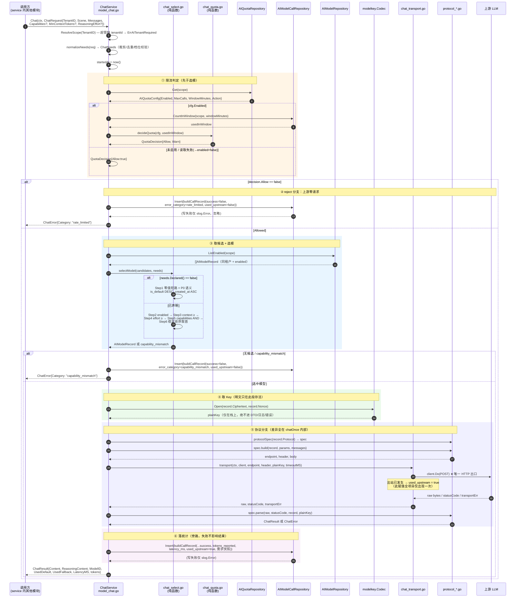
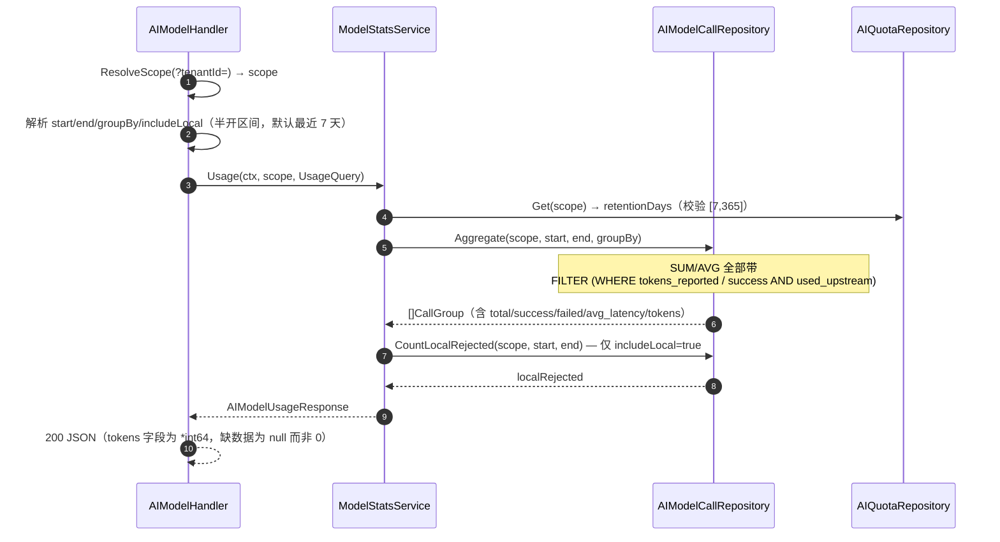
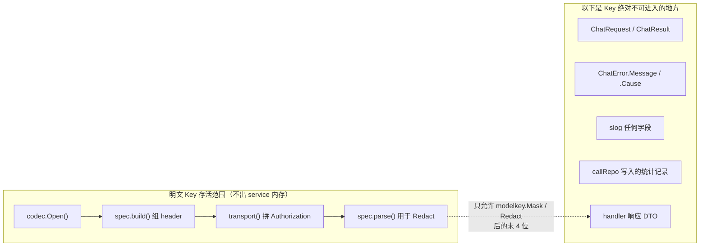

# Dandelion 研发中心（RDC）第 5 菜单「AI模型」· P1 扩展系统设计与任务分解

| 项 | 内容 |
| --- | --- |
| 文档类型 | 增量系统设计 + 有序任务分解（架构师交付物） |
| 架构师 | 高见远（Gao）· Architect |
| 上游输入 | `deliverables/software-company/ai-model-p1-prd.md`（P1 增量 PRD，532 行）+ P0 设计 `ai-model-design.md` + P0 实现代码基线 + team-lead 转达的用户拍板（5 项）+ 用户追加代码质量硬要求 |
| 基线事实 | `api/openapi.yaml`（契约 SSOT，当前 **65** paths）、`server/internal/repository/schema.sql`（DDL SSOT）、`server/internal/contract/contract.go`（APIRoutes 65 条）、`internal/contract/ai_model.go`、`internal/modelkey`、`internal/service/rdc/model_chat.go`、`internal/repository/rdc/ai_model_repository.go`、`internal/app/router.go`、`web/src/api/rdcModel.ts` |
| 项目根 | `/Users/linanan/Desktop/dandelion`（下文路径均相对此根） |
| 强制规范 | `AGENTS.md`（优先级：当前代码与测试 > `api/openapi.yaml` > AGENTS.md > docs 设计稿） |
| 本版范围 | ①多协议（openai / anthropic / openai_responses）②能力调度（上下文 / 思考强度 / 能力标签硬筛 + 稳定排序）③调用统计 + 软限流 |
| 明确不做 | 场景级配置、Key 轮换提醒、计费/配额周期重置、模型自动故障转移、前端直调 LLM 路由、多供应商模板商店 |
| 模式限定 | 仅 team（`RequireTeamMode`）；新表全部 team 专属，写在 `FOREACH` 循环之外 |
| 零新增依赖 | `go.mod` / `package.json` 均不改（见 §7） |

---

## 0. 用户拍板与本版硬约束（逐条落点）

| # | 拍板结论（不可违背） | 本设计落点 |
| --- | --- | --- |
| 1 | 多协议：`protocol` 扩为 `openai` / `anthropic` / `openai_responses`；**协议差异全部收在 `chatOnce` 内部**；`provider` 不扩展（协议=报文形态，provider=接入源，正交）；UI 可表单选协议、列表显示协议 | §1.3、§3.2、§3.5、§4.3、T03/T05 |
| 2 | 能力调度：`ChatRequest` 平铺加三个**可选**字段 `Capabilities []string` / `MinContextTokens int` / `ReasoningEffort string`；**零值 = 未声明 = 完全走 P0 原 SQL/排序**；声明后**先硬筛后叠加**（启用 → `context_tokens >= MinContextTokens` → 思考档位按 `none=0<low=1<high=2<max=3` **≥ 匹配** → 能力标签 **AND**）；稳定排序 `is_default DESC, created_at ASC`；无匹配返回 `capability_mismatch`，**绝不静默降级** | §1.4、§3.3、§4.1、§4.2 |
| 3 | 统计 + 软限流：新表 `team.rdc_ai_model_call`；token 未回 `tokens_reported=false`（不用 0 冒充）；失败计入总数但成败分计；平均耗时只算成功且已出站；阈值存**独立表 `team.rdc_ai_model_quota`** 并**留扩展口子**；默认 `enabled=false` / `max_calls=1000` / `window_minutes=60` / `action=warn`；统计保留 90 天可配；**软限流先于选模**；`warn` 记告警日志照常调用、`reject` 返回 `rate_limited`；滑动窗口；**被拒记录不计入窗口**；统计权限复用 `rdc.model.read` | §1.5、§3.4、§4.2、§4.4 |
| 4 | 其余按 PRD 建议：改协议不清空 base_url 只提示；`extra_config` 优先于 `thinking_enabled` 矛盾；思考强度不精确匹配；统计默认不含本地拒绝（给开关）；协议思考折算值以实测校准，不接受则报 `parameter_error` | §4.3、§4.5、§8 |
| 5 | 本次不做：场景级配置（场景只作统计维度）、Key 轮换提醒、计费/配额周期重置、模型自动故障转移、前端直调 LLM 路由 | 全文不含对应表/路由/入口 |

### 0.1 工程硬约束（违反即返工）

| # | 约束 | 落点 |
| --- | --- | --- |
| E1 | 契约 SSOT 在 `api/openapi.yaml`；DDL 不加 CHECK；禁手改 `web/src/api/schema.d.ts`；`contract.APIRoutes` 与 YAML paths **严格相等**（65 → 本次 +2 = **67**） | §3.2、§3.6、T01 |
| E2 | 分层：handler 无 SQL/业务；service 无 `*http.Request`；repository 无业务判断；`internal/config` 唯一 `os.Getenv` | §2、§8 条目 1 |
| E3 | Key 安全：`internal/modelkey` 仍是唯一明文接触点；任何 DTO/日志/响应不含完整 Key；**`chatOnce` 仍是唯一 HTTP 出口**，三协议分支必须在 `chatOnce` 内部，全仓不允许第二处 `client.Do` | §1.3、§3.5、§8 条目 3、条目 12 |
| E4 | 零新增第三方依赖 | §7 |
| E5 | 代码简单优雅、单一职责、无冗余、注释"一看就懂"、单文件 ≤ 400 行、单函数 ≤ 50 行；`model_chat.go` 加三协议必然超 400 行 → **必须拆分** | §1.2、§2、§8 条目 14 |
| E6 | `ai_model_qa_e2e_test.go:576` 反射锁三字段必然失败 → 改为**白名单断言**（允许新增字段，但不得含 Key/base_url/凭据）；这是**有意变更**，不是放宽契约 | §3.3、T05 |

---

# Part A · 系统设计

## 1. 实现方案概述

### 1.1 三块核心决策（一句话版）

1. **协议差异只存在于"报文层"**：`chatOnce` 变成"装配 → 传输 → 解析"三段，协议只在装配与解析两处分支；传输（超时 / `client.Do` / 状态码分类 / 脱敏）**只有一份**。
2. **调度从 SQL 里搬出来变成纯函数**：repository 只做"取同租户启用模型（可带粗筛）"，`selectModel(候选, 需求)` 是可单测纯函数；零值需求直接跳过它，走 P0 原 SQL 路径——这是向后兼容的**唯一**保证方式。
3. **"调用事实"与"限流事实"都落在一张表里**：出站与否用 `used_upstream` 区分，token 是否可信用 `tokens_reported` 区分；限流窗口只数 `used_upstream=true` 的行，因此"被拒不计入窗口"是**数据口径的自然结果**，不需要额外白名单。

### 1.2 代码质量硬要求 → 可执行约束（本次设计的第一优先级）

> 用户原话：「代码要尽量简单，优雅，结构清晰，遵循代码设计原则，比如单一原则。不可冗余代码，需要完美注释，开发者一看就懂你的代码逻辑。」
> 下列 5 组约束是**验收项**，不是建议。工程师实现后须按 §9.2 自查清单逐项自检并回报结论。

#### 1.2.1 单一职责：落到"一个文件只做一件事"

`model_chat.go` 现有 266 行，加三协议必然超 400 行。按**"构造 / 传输 / 解析 / 编排 / 限流 / 落库"六件事**拆为 7 个文件，每文件**唯一职责一句话**，超出这句话的代码不许放进该文件：

| 文件（`server/internal/service/rdc/`） | 唯一职责（一句话） | 明确**不做**什么（写进文件顶部"边界"） |
| --- | --- | --- |
| `model_chat.go` | **编排**：`Chat` / `Test` 的流程串联（校验需求 → 限流 → 选模 → 取 Key → 出站 → 落库） | 不构造报文、不发 HTTP、不解析响应、不写 SQL |
| `chat_select.go` | **选模纯函数**：`selectModel(候选 []AIModelRecord, 需求 ChatNeeds) (AIModelRecord, error)` + 需求归一 `normalizeNeeds` | 不查库、不做 IO、不认识 `http`/`sql`；**不得**在此文件读环境变量或写日志 |
| `chat_quota.go` | **软限流判定纯函数 + 阈值归一**：`decideQuota(阈值 QuotaConfig, 已用次数 int) QuotaDecision` | 不查库（次数由调用方传入）、不返回 HTTP 错误、不动统计表 |
| `chat_record.go` | **调用记录归一**：把一次调用的事实折成 `contract.AIModelCallRecord`（含 `TokensReported` / `UsedUpstream` 判定规则） | 不写 SQL、不做限流、不发请求；不碰 Key |
| `chat_transport.go` | **唯一传输层**：per-call 超时装配、`http.Client.Do`、body 限量读取、状态码→错误分类、`Redact` | **不构造请求体、不解析协议响应字段**；不认识 `protocol` 枚举值 |
| `protocol_common.go` | **三协议共用层**：消息归一（system 提取）、`ChatResult` 装配、usage 归一、思考档位→各协议参数的折算表 | **不含任何单一协议特有的字段名**；出现 `"x-api-key"`/`"anthropic-version"`/`"input"` 之类的字面量即违规 |
| `protocol_openai.go` / `protocol_anthropic.go` / `protocol_responses.go` | 每文件只描述**该协议的差异**：端点后缀、认证头、请求体、响应体结构、响应→`ChatResult` 提取 | 只做"build / parse"两件事；不 `client.Do`、不加超时、不做重试、不判断限流与统计 |

**函数级单一职责**：拆完后不允许再出现"构造请求 + 发请求 + 解析 + 落库"揉在一个函数里；`chatOnce` 保留名字与语义（唯一出口），但函数体被压到 ~25 行，只做三句调用：

```go
// chatOnce 是全仓唯一 LLM HTTP 出口：按协议构造 → 唯一传输 → 按协议解析。
func chatOnce(ctx context.Context, client *http.Client, record contract.AIModelRecord, plainKey string,
    messages []ChatMessage) (ChatResult, error) {
    spec := protocolSpec(record.Protocol)              // protocol_*.go 提供
    params := contract.AIModelRequestParams(record.AIModel)
    endpoint, header, body, buildErr := spec.build(record, params, messages) // 纯函数
    if buildErr != nil { return ChatResult{}, buildErr }
    raw, statusCode, transportErr := transport(ctx, client, endpoint, header, plainKey, params.TimeoutMS)
    if transportErr != nil { return ChatResult{}, transportErr }
    return spec.parse(raw, statusCode, record, plainKey)                     // 纯函数
}
```

#### 1.2.2 禁止冗余：共用层与差异层的边界（硬性）

- **禁止三份近似代码 copy-paste**。三协议共享的部分必须只有一份实现，落在 `protocol_common.go`：

| 共用能力 | 唯一实现（签名） | 被谁复用 |
| --- | --- | --- |
| 消息归一（把 `[]ChatMessage` 拆成 `system` 文本 + 非 system 消息） | `func splitSystem(messages []ChatMessage) (system string, rest []ChatMessage)` | openai（system 留在 messages 里，调用方选 false）/ anthropic / responses |
| 空消息兜底探针 | `func withDefaultProbe(messages []ChatMessage) []ChatMessage` | 三协议 + `Test` |
| usage 归一（不同字段名 → 统一两值） | `func usageFrom(prompt, completion int) (promptTokens, completionTokens int, reported bool)` | 三协议解析器 |
| `ChatResult` 装配（含 `Redact` 与 `LatencyMS`） | `func buildChatResult(record contract.AIModelRecord, plainKey, content, reasoning string, prompt, completion int, started time.Time) ChatResult` | 三协议解析器 |
- **思考档位折算表**只有一份，且**只有一张表**（不是三处 switch）：

```go
// thinkingPlan 把平台四档统一折算成各协议参数；返回的是"待写入请求体的字段值"，
// 数值口径与 PRD §5.2 折算表一致，且三协议共享同一张表 —— 改档位只改这里。
type thinkingPlan struct {
    OpenAIEffort    string // openai: reasoning_effort
    AnthropicBudget int    // anthropic: thinking.budget_tokens，0 = 不传该字段
    ResponsesEffort string // openai_responses: reasoning.effort，空 = 不传
}
func planThinking(effort string) thinkingPlan // none→{"none",0,""} / low→{"low",1024,"low"} / high→{"high",4096,"medium"} / max→{"max",8192,"high"}
```

- **禁止无意义抽象**：不新增只被调用一次的 interface（现有 `aiModelService`/`aiChatService` 是为 fake 测试而存在，保留）；不造无行为的包装类型；不引入"协议注册器 + 反射"这类过度设计——三协议用 `switch record.Protocol` 分发到三个 `spec` 值即可。
- **错误分类只有一处**：`classifyUpstreamStatus(status int)` 留在 `chat_transport.go`，三协议共用；协议解析器只允许返回 `response_error`（空响应），**不允许各自发明状态码映射**。新增 `capability_mismatch` 与软限流 `rate_limited` 属于**本地**分类，由 `chat_select.go` / `chat_quota.go` 产出，与上游分类互不越界。
- **单一来源（SSOT）清单**（禁止多处各自定义）：

| 语义 | 唯一来源 | 消费方 |
| --- | --- | --- |
| 协议枚举与顺序 | `contract.AIProtocols`（+ YAML `x-rdc-ai-protocols`，契约测试锁一致） | service 校验、`protocolSpec`、前端 `AI_PROTOCOL_OPTIONS` |
| 思考档位序 `none<low<high<max` | `contract.AIReasoningRank(effort) int` 纯函数 | `chat_select.go` 档位匹配、表单提示 |
| 思考档位→各协议参数 | `protocol_common.go` 的 `planThinking` 单表 | 三协议 `build` |
| `extra_config` 字段名与默认值 | `contract.AIExtraConfigKeys` + `defaultAIExtraConfig`（已有） | 校验、读取补默认、前端 |
| 错误分类目录 | `contract.AIChatCategories`（扩 1 值） | `AIChatMessage`、YAML `x-rdc-ai-test-categories`、前端标签 |
| 统计口径（三类计数） | `contract.AIModelCallStats` 字段语义 + §8 条目 7 口径表 | repository 聚合 SQL、前端统计页 |
| 限流默认值 | `contract.AIQuotaDefaults()` | repository 读不到行时补默认、前端展示 |

#### 1.2.3 注释要求：写"为什么"，不是"做了什么"

- 新增文件顶部**四要素注释**（职责 / 输入 / 输出 / **边界**），且边界必须写清"这个文件不做什么"——三协议拆分后这条最关键，否则后人会把协议差异塞回共用层。示例（`protocol_common.go` 顶部）：

```go
// protocol_common.go · 三协议共用的报文层能力：消息归一、usage 归一、结果装配、思考档位折算。
// 职责：把「协议无关」的公共动作收敛成一份实现，供 protocol_openai / _anthropic / _responses 复用。
// 输入：ChatMessage 列表、各协议已解析出的 content / reasoning / usage 原始值。
// 输出：统一的 ChatResult 与 thinkingPlan；文案经 modelkey.Redact。
// 边界：本文件**不允许**出现任何单一协议特有的字段名或请求头字面量（如 x-api-key / input /
// max_output_tokens）；它们只能写在对应 protocol_*.go 里。新增协议时应"只加一个文件"，
// 若必须改本文件，说明抽象漏了——先补函数再改，不要复制粘贴。
```

- **反直觉处必须写理由**（下列 6 处强制，缺一即返工）：
  1. 零值需求为什么不进 `selectModel`（"零值即未声明，必须走 P0 原 SQL，否则升级会改变存量调用命中的模型"）；
  2. 思考强度为什么用 **≥** 而非 `==`（"精确相等会让管理员调高某模型档位后低档请求突然失配，属隐式耦合"）；
  3. 为什么**不静默降级到默认模型**（"会产出看起来成功但能力不对的结果，是比报错更难查的 bug"）；
  4. 限流窗口为什么只数 `used_upstream=true`（"被拒记录若计入，拒绝会自激计数，超限后永远无法恢复"）；
  5. `tokens_reported=false` 为什么不用 0 冒充（"0 会被算进平均值，系统性拉低 token 均值，误导容量判断"）；
  6. Key 只在 `invoke` 解密一次、为什么协议层只收 `plainKey string`（"明文只在单个函数栈内存在，协议层拿不到 Codec 就不可能把它写进日志或 DTO"）。
- 函数注释沿用 P0 既有中文四要素风格；**不加** `TODO`/`FIXME`/英文占位注释。

#### 1.2.4 结构清晰：调度算法必须是可单测纯函数

- **取舍（必须写进代码注释）**：`context_tokens` 比较下推 SQL（`m.context_tokens >= ?`）可少取行，但思考档位匹配与能力 AND 涉及 JSONB 与档位序，下推会让"筛选顺序"变成 SQL 语义、无法单测且难读。因此采取：

| 环节 | 位置 | 理由 |
| --- | --- | --- |
| `tenant_id` + `enabled=true` | **SQL（必须）** | 隔离与"是否启用"是硬边界，且走索引 |
| `context_tokens >= ?` | **SQL（可选粗筛）** | 单值比较、可走索引、无歧义；**允许下推但不依赖它**——纯函数仍重复判断，保证单测与 SQL 解耦 |
| 思考档位 ≥、能力 AND | **service 纯函数** | 涉及档位序与集合包含，SQL 表达需 JSONB 操作符 + CASE，可读性与可测性都差 |
| `is_default DESC, created_at ASC` | **纯函数内排序比较器** | 与 SQL 的 `LIMIT 1` 语义等价，单测可直接断言"默认者胜出/早创建的胜出" |

- 结论：repository 新增 `ListEnabled(ctx, scope, minContextTokens int)`（`minContextTokens=0` 表示不筛），返回**全部同租户启用模型**（含 `capabilities` / `thinking_enabled` / `extra_config` / `context_tokens`）；`selectModel` 在 service 层做档位与能力筛选 + 稳定排序。**不把全部筛选硬编码进 SQL。**
- 函数 ≤ 50 行、文件 ≤ 400 行；超了先拆文件，不许拉长。

### 1.3 三协议适配：差异点收敛在"装配 + 解析"两处

- 新增 `protocolSpec` 三值（实现分散在三个 `protocol_*.go`），由 `protocolSpec(protocol string)` 按 `switch` 返回：

```go
// protocolSpec 是"某协议的报文形态"的唯一描述；新增协议 = 新增一个实现文件 + 一个 case。
// 本接口只有两个方法，且都是纯函数：不含超时、不含 client.Do、不含重试、不含统计。
type protocolSpec interface {
    build(record contract.AIModelRecord, params contract.AIRequestParams, messages []ChatMessage) (endpoint string, header http.Header, body []byte, err error)
    parse(raw []byte, statusCode int, record contract.AIModelRecord, plainKey string, started time.Time) (ChatResult, error)
}
```

- 认证头差异只写在各自的 `build` 里（openai → `Authorization: Bearer`；anthropic → `x-api-key` + `anthropic-version: 2023-06-01`；responses → `Authorization: Bearer`）。`transport` 只负责"把 header 原样带上 + 超时 + Do + 读 body + 状态码分类"，**不认识协议**。
- 未知协议值（历史脏数据）：`protocolSpec` 返回 nil → `chatOnce` 返回 `parameter_error`（"模型协议不受支持"），不 panic、不回显原值。

### 1.4 能力调度：零值短路 + 硬筛 + 稳定排序

- `ChatRequest` 新增三字段全零值 → `needs.declared == false` → **直接调用 P0 现有 `FindDefaultOrFirstEnabled`**（同一 SQL、同一 `ORDER BY is_default DESC, created_at ASC LIMIT 1`）。P0 方法**保留不删**，这是兼容性的物理保证（e2e 断言零值请求结果与 P0 完全一致）。
- 任一非零 → `normalizeNeeds` 归一（非法值 → `parameter_error`，不落库、不出站）→ 限流 → `ListEnabled` → `selectModel`。
- 筛选顺序**语义上不可交换**：`enabled` → `context_tokens >= min` → `effortRank(model) >= effortRank(request)` → `capabilities ⊇ request`（AND）。
- 排序：`is_default DESC`，其次 `created_at ASC`（字符串 RFC3339 可比较，与 SQL 同序）。
- 无候选：`capability_mismatch`，文案列出**声明了的**维度与公司实际最大值（"公司最高 131072"），便于自助排障。

### 1.5 统计 + 软限流：一张记录表 + 一张阈值表

- 判定顺序固定：`参数校验` → `软限流` → `选模` → `取 Key 解密` → `出站` → `落记录`。限流先于选模（理由：限流保护成本与 Key，与"选哪个模型"无关；且保证超限时报 `rate_limited` 而不是被能力错误掩盖）。
- 记录**不阻塞业务**：写记录失败只 `log` 告警，`Chat` 结果不变（C2）。
- 阈值独立表，每公司一行；**扩展口子**：判定逻辑只认四元组 `(metric, window, limit, action)`，当前 `metric` 只有 `calls`，未来加 `tokens` 不改调用方；表内 `extra_config JSONB` 预留（未知键忽略、缺失补默认，与 `extra_config` 既有做法一致）。

---

## 2. 文件清单（新增 / 修改，含唯一职责与行数预算）

> 标记：**新** / **改** / **生成**（`schema.d.ts` 禁手改）。所有新增手写文件顶部写中文四要素注释，边界含"不做什么"。

### 2.1 契约、DDL、配置（事实来源层）

| 路径 | 标记 | 唯一职责（一句话） | 预算 |
| --- | --- | --- | --- |
| `api/openapi.yaml` | 改 | 协议枚举扩 2 值；`AITestCategory` 加 `capability_mismatch`；新增 2 paths（统计查询 / 阈值读写）与配套 schema；`x-rdc-ai-*` 同步 | — |
| `server/internal/repository/schema.sql` | 改 | 新增 `team.rdc_ai_model_call` + `team.rdc_ai_model_quota` 两表与索引（FOREACH 循环之外） | — |
| `server/internal/contract/ai_model.go` | 改 | 协议枚举扩 2 值、档位序纯函数 `AIReasoningRank`、`AIChatCapabilityMismatch` 类别与文案、需求归一与校验、统计/阈值 DTO、quota 默认值、调用记录的"是否计入统计/窗口"纯判定 | ≤ 520（拆 `ai_model_usage.go`，见下） |
| `server/internal/contract/ai_model_usage.go` | **新** | 统计与限流相关契约：`AIModelCallQuery` / `AIModelCallStats` / `AIQuotaConfig` / `AIQuotaInput` / 默认值与边界/分组枚举 | ≤ 220 |
| `server/internal/contract/ai_model_test.go` | 改 | 锁协议 3 值、档位序、`capability_mismatch` 文案、quota 默认值、记录判定纯函数、DTO 无 Key | ≤ 260 |
| `server/internal/contract/contract.go` | 改 | 2 条新路由常量入 `APIRoutes`（65 → 67）、`ResourceAIModelCall`（可选） | — |
| `server/internal/contract/contract_test.go` | 改 | 路径数 67 与 YAML paths 严格相等 | — |

### 2.2 后端 service（本次拆分重点，7 文件）

| 路径 | 标记 | 唯一职责（一句话） | 预算 |
| --- | --- | --- | --- |
| `server/internal/service/rdc/model_chat.go` | 改 | **编排**：`Chat` / `Test` 串联（需求校验→限流→选模→取 Key→出站→落记录） | ≤ 170 |
| `server/internal/service/rdc/chat_select.go` | **新** | **选模纯函数** + 需求归一（`normalizeNeeds` / `selectModel`） | ≤ 130 |
| `server/internal/service/rdc/chat_quota.go` | **新** | **限流判定纯函数**（`decideQuota`）+ 阈值归一（`normalizeQuota`） | ≤ 90 |
| `server/internal/service/rdc/chat_record.go` | **新** | **调用记录归一**（`buildCallRecord`：`usedUpstream` / `tokensReported` 判定） | ≤ 90 |
| `server/internal/service/rdc/chat_transport.go` | **新** | **唯一传输层**（超时装配 / `client.Do` / body 限量 / 状态码分类 / Redact） | ≤ 110 |
| `server/internal/service/rdc/protocol_common.go` | **新** | **三协议共用层**（消息归一 / usage 归一 / 结果装配 / `planThinking` 折算单表） | ≤ 150 |
| `server/internal/service/rdc/protocol_openai.go` | **新** | 仅 openai 差异（`/chat/completions`、Bearer、`messages`、`reasoning_effort`） | ≤ 80 |
| `server/internal/service/rdc/protocol_anthropic.go` | **新** | 仅 anthropic 差异（`/messages`、`x-api-key` + `anthropic-version`、顶层 `system`、`thinking`、`content[]`） | ≤ 110 |
| `server/internal/service/rdc/protocol_responses.go` | **新** | 仅 openai_responses 差异（`/responses`、`input`、`max_output_tokens`、`reasoning.effort`、`output[]`） | ≤ 110 |
| `server/internal/service/rdc/chat_select_test.go` | **新** | 筛选顺序（上下文档 4 例、档位 3 例、AND/超集、默认不豁免、零值短路、非法入参） | ≤ 200 |
| `server/internal/service/rdc/chat_quota_test.go` | **新** | warn/reject/未启用/窗口边界/被拒不计入（纯函数 + fake 计数） | ≤ 120 |
| `server/internal/service/rdc/protocol_test.go` | **新** | 三协议 mock：URL 后缀、认证头、请求体关键字段、响应提取、折算表 | ≤ 260 |
| `server/internal/service/rdc/model_chat_test.go` | 改 | 保留原有 6 类错误用例，新增限流/统计不阻塞/记录字段断言 | ≤ 260 |
| `server/internal/service/rdc/model_service.go` | 改 | 协议校验文案、按协议校验 `temperature` 上限（anthropic 0–1） | ≤ 350 |

### 2.3 后端 repository / handler / 装配

| 路径 | 标记 | 唯一职责（一句话） |
| --- | --- | --- |
| `server/internal/repository/rdc/ai_model_repository.go` | 改 | 新增 `ListEnabled`（同租户启用模型全量，可带 `minContextTokens` 粗筛）；P0 `FindDefaultOrFirstEnabled` **保留** |
| `server/internal/repository/rdc/ai_model_call_repository.go` | **新** | `rdc_ai_model_call` 的唯一 SQL：`Insert` / `Aggregate`（分组统计）/ `CountSince`（窗口计数）/ `DeleteExpired` |
| `server/internal/repository/rdc/ai_model_quota_repository.go` | **新** | `rdc_ai_model_quota` 的唯一 SQL：`Find`（无行 → `sql.ErrNoRows`）/ `Upsert` |
| `server/internal/repository/rdc/ai_model_usage_repository_test.go` | **新** | 窗口计数只数 `used_upstream=true`、分组聚合、保留期删除、跨租户失败关闭 |
| `server/internal/handler/rdc/ai_model_usage_handler.go` | **新** | 统计查询 + 阈值读写的 HTTP 语义（取参 / 白名单解码 / 审计 / 响应外壳） |
| `server/internal/handler/rdc/ai_model_usage_handler_test.go` | **新** | 权限 403、请求体塞 tenantId → 400、超管未带 tenantId → 400、审计 detail 无敏感值 |
| `server/internal/app/router.go` | 改 | 2 条新路由注册（读挂 `rdc.model.read`、写挂 `rdc.model.write`）+ `allowedMethods` 映射 + 路径派发 |
| `server/cmd/server/main.go` | 改 | 注入 call/quota 仓储与 usage handler；`Chat` 依赖装配（配额仓储 + 记录仓储） |

### 2.4 前端

| 路径 | 标记 | 唯一职责（一句话） |
| --- | --- | --- |
| `web/src/api/rdcModel.ts` | 改 | 新增统计查询 / 阈值读写 3 个函数；类型只从 `./schema` 引 |
| `web/src/utils/format.ts` | 改 | 协议 3 项标签、`capability_mismatch` 文案、分组/动作标签（**唯一**文案入口） |
| `web/src/pages/rdc/ModelListPage.tsx` | 改 | 协议筛选、统计入口、限流设置入口、能力标签说明 |
| `web/src/pages/rdc/ModelFormPage.tsx` | 改 | 协议 3 项 + 端点/认证只读提示 + 按协议 `temperature` 上限 + 配置矛盾提示 |
| `web/src/pages/rdc/ModelUsagePage.tsx` | **新** | 统计视图（时间范围/分组进 URL、摘要卡、分布表、超阈值提示条、三态） |
| `web/src/pages/rdc/ModelQuotaModal.tsx` | **新** | 阈值设置弹窗（启用/次数/窗口/动作 + 影响面文案） |
| `web/src/App.tsx`、`web/src/components/navigation.ts` | 改 | 新增 `/rdc/models/usage` 路由（read 门槛）+ 菜单不变（同菜单内跳转） |
| `web/src/styles.scss` | 改 | 统计摘要卡、分布条、超阈值提示条（琥珀色）、弹窗说明 |

### 2.5 设计产物（本文件之外）

| 路径 | 标记 |
| --- | --- |
| `deliverables/software-company/ai-model-p1-class-diagram.mermaid` | 新（§3 类图） |
| `deliverables/software-company/ai-model-p1-sequence-diagram.mermaid` | 新（§5 时序图） |

### 2.6 既有测试的**有意变更**（清单，工程师逐条改）

| 文件:行 | 现状 | 本次改为 | 理由 |
| --- | --- | --- | --- |
| `server/internal/app/ai_model_qa_e2e_test.go:576` | `reflect.DeepEqual(fields, []string{"TenantID","Scene","Messages"})` | **白名单断言**：字段名必须 ⊆ `{TenantID, Scene, Messages, Capabilities, MinContextTokens, ReasoningEffort}`，且**不得**出现名字含 `Key`/`BaseURL`/`Ciphertext`/`Nonce`/`Token`（`MinContextTokens` 例外用显式允许集） | 三个新增字段是设计所需的"选择条件"；安全边界由"禁 Key/base_url/凭据"保证，不是"禁新增字段" |
| `server/internal/contract/ai_model_test.go` `TestAIEnumsMatchContract` | `x-rdc-ai-protocols` ↔ `AIProtocols` 深比对 | 同步扩 3 值（YAML 与 Go 同序） | 枚举单一来源 |
| 同上 `TestAIDTOWhitelist` | 入站白名单 10 字段 | 不变（**新增字段不在 `AIModelInput` 里**，属 `ChatRequest`，不走 HTTP） | 请求体白名单不扩大 |
| `server/internal/contract/contract_test.go:222` | 路径数 == `APIRoutes`（65） | 67 | 新增 2 path |

---

## 3. 数据结构与接口

### 3.1 DDL（`schema.sql`，「六 · 研发中心」段末尾，FOREACH 循环之外，team 专属）

```sql
-- 六·增补 · AI 模型调用记录（team 专属，不进 FOREACH 循环，solo 无此表）。
-- 一行 = 一次 Chat/Test 调用事实（含未出站的本地失败，用 used_upstream 区分）。
-- 不设物理外键：记录是历史事实，删模型不得抹掉历史；model_id 保留 UUID 原值 + 名称/标识快照。
-- tokens_reported=false 表示上游未上报 usage（此时两个 token 列恒为 0，不是"真的用了 0"）。
-- 枚举唯一来源是 openapi.yaml，DDL 不加 CHECK。
CREATE TABLE IF NOT EXISTS team.rdc_ai_model_call (
  id                    UUID        PRIMARY KEY DEFAULT gen_random_uuid(),
  tenant_id             UUID        NOT NULL REFERENCES public.tenants(id),
  model_id              UUID,                              -- 可为 NULL：无匹配/限流拒绝时没有目标模型
  model_name            TEXT        NOT NULL DEFAULT '',   -- 快照：模型改名后历史仍可读
  model_identifier      TEXT        NOT NULL DEFAULT '',   -- 快照：上游 model 标识
  protocol              TEXT        NOT NULL DEFAULT '',   -- 快照：当次使用的协议
  scene                 TEXT        NOT NULL DEFAULT '',   -- 调用方场景标识，空串=未声明
  success               BOOLEAN     NOT NULL DEFAULT false,
  error_category        TEXT        NOT NULL DEFAULT '',   -- 成功为空；失败为 7 类之一
  status_code           INTEGER     NOT NULL DEFAULT 0,    -- 上游状态码；本地失败为 0
  prompt_tokens         INTEGER     NOT NULL DEFAULT 0,
  completion_tokens     INTEGER     NOT NULL DEFAULT 0,
  tokens_reported       BOOLEAN     NOT NULL DEFAULT false,
  latency_ms            BIGINT      NOT NULL DEFAULT 0,    -- 本地拒绝为 0；不含写记录耗时
  used_upstream         BOOLEAN     NOT NULL DEFAULT false,-- 是否真的发出上游请求（限流窗口只数 true）
  used_default          BOOLEAN     NOT NULL DEFAULT false,
  used_fallback         BOOLEAN     NOT NULL DEFAULT false,
  requested_capabilities JSONB      NOT NULL DEFAULT '[]'::jsonb,
  requested_min_context  INTEGER    NOT NULL DEFAULT 0,
  requested_effort       TEXT       NOT NULL DEFAULT '',
  created_at            TIMESTAMPTZ NOT NULL DEFAULT now()
);
-- 统计与限流窗口：同租户 + 时间倒序；窗口 count(*) 只走这条索引的 range scan。
CREATE INDEX IF NOT EXISTS idx_rdc_ai_model_call_tenant_created
  ON team.rdc_ai_model_call (tenant_id, created_at DESC);
-- 按时间 + 出站性筛（限流窗口查询用部分索引，避免把被拒行算进去）。
CREATE INDEX IF NOT EXISTS idx_rdc_ai_model_call_upstream
  ON team.rdc_ai_model_call (tenant_id, created_at DESC) WHERE used_upstream;
-- 按模型分组统计。
CREATE INDEX IF NOT EXISTS idx_rdc_ai_model_call_tenant_model_created
  ON team.rdc_ai_model_call (tenant_id, model_id, created_at DESC);

-- 六·增补 · AI 模型软限流阈值（team 专属，每公司一行）。
-- 关注点单一：不复用 public.system_settings（那里已是 Webhook / 外部 API Key / Git 路径的集合体）。
-- 判定只认四元组 (metric, window, limit, action)；当前 metric 只有 calls，
-- 未来加 token 维度不改调用方，新维度配置写进 extra_config（未知键忽略、缺失补默认）。
CREATE TABLE IF NOT EXISTS team.rdc_ai_model_quota (
  tenant_id       UUID        PRIMARY KEY REFERENCES public.tenants(id),
  enabled         BOOLEAN     NOT NULL DEFAULT false,
  max_calls       INTEGER     NOT NULL DEFAULT 1000,
  window_minutes  INTEGER     NOT NULL DEFAULT 60,
  action          TEXT        NOT NULL DEFAULT 'warn',   -- warn | reject
  extra_config    JSONB       NOT NULL DEFAULT '{}'::jsonb,
  created_at      TIMESTAMPTZ NOT NULL DEFAULT now(),
  updated_at      TIMESTAMPTZ NOT NULL DEFAULT now()
);
```

**为什么两张表而不是一张**：`quota` 是"配置"（每公司 1 行、会被 UPDATE），`call` 是"事实"（每调用 1 行、只追加）。放一起会让 UPDATE 撞上追加写热点，也让统计全表扫描配置行。**为什么 `call.model_id` 可空**：本地拒绝时没有目标模型，硬塞 UUID 会造假。

### 3.2 契约扩展：YAML 与 Go 同序同集合

**YAML `x-rdc-ai-*`（第 123–135 行段）**

```yaml
x-rdc-ai-protocols: [openai, anthropic, openai_responses]
x-rdc-ai-test-categories: [config_missing, auth_failed, parameter_error, rate_limited,
                          network_error, response_error, capability_mismatch]
x-rdc-ai-quota:
  defaults: {enabled: false, maxCalls: 1000, windowMinutes: 60, action: warn}
  actions: [warn, reject]
  maxCallsRange: {min: 1, max: 1000000}
  windowMinutesRange: {min: 1, max: 10080}
x-rdc-ai-usage:
  groupBy: [model, protocol, scene, day]
  retentionDays: 90
x-rdc-ai-protocol-endpoints:      # 只做「表单只读提示」展示，不参与调用逻辑
  openai: {suffix: /chat/completions, auth: "Authorization: Bearer"}
  anthropic: {suffix: /messages, auth: "x-api-key + anthropic-version"}
  openai_responses: {suffix: /responses, auth: "Authorization: Bearer"}
```

**Go（`contract/ai_model.go`）**

```go
const (
    AIProtocolOpenAI         = "openai"
    AIProtocolAnthropic      = "anthropic"
    AIProtocolOpenAIResponses = "openai_responses"
)
var AIProtocols = []string{AIProtocolOpenAI, AIProtocolAnthropic, AIProtocolOpenAIResponses}

// AIChatCapabilityMismatch：有启用模型但无一条满足声明条件，绝不回落默认模型。
const AIChatCapabilityMismatch AIChatCategory = "capability_mismatch"
var AIChatCategories = []string{ /* 原 6 类 */ , string(AIChatCapabilityMismatch) }

// AIReasoningRank 是思考档位的唯一序函数（none<low<high<max）；未知值返回 -1。
// 为什么集中一处：调度匹配、表单提示、协议折算都依赖这个序，散落多处必然失配。
func AIReasoningRank(effort string) int {
    switch effort {
    case AIReasoningNone: return 0
    case AIReasoningLow:  return 1
    case AIReasoningHigh: return 2
    case AIReasoningMax:  return 3
    default:              return -1
    }
}

// AIModelOfferedEffort 返回模型"可提供"的思考档位：thinking_enabled=false → none；
// true 则取 extra_config 的配置档位（配置与开关矛盾时以 extra_config 为准，沿用 P0）。
func AIModelOfferedEffort(model AIModel) string

// AIModelMaxTemperature 按协议返回 temperature 上限：anthropic 为 1，其余 2。
// 为什么"校验按协议走"：配置期 400 优于调用期被上游拒。
func AIModelMaxTemperature(protocol string) float64
```

### 3.3 调度入参与纯函数（`ChatRequest` 扩展 + `chat_select.go`）

```go
// ChatRequest 是内部模块唯一入参。新增三字段全为可选：
// 全零值 == 未声明 == 走 P0 原 SQL 与排序（向后兼容的物理保证）。
type ChatRequest struct {
    TenantID          string
    Scene             string
    Messages          []ChatMessage
    Capabilities      []string // AND 语义；空 = 不约束
    MinContextTokens  int      // 0 = 不约束；模型 context_tokens >= 此值
    ReasoningEffort   string   // "" = 不约束；模型可提供档位 >= 请求档位
}

// ChatNeeds 是归一后的需求；Declared=false 表示三项全零，调用方应直接走 P0 路径。
type ChatNeeds struct {
    Declared         bool
    Capabilities     []string
    MinContextTokens int
    Effort           string
    EffortRank       int
}

// normalizeNeeds 只做"零值判定 + 合法性校验"，不做筛选。
// 非法（白名单外能力 / 非四档 / 负数）返回 parameter_error：属调用方 bug，不落库、不出站。
func normalizeNeeds(in ChatRequest) (ChatNeeds, error)

// selectModel 是选模的唯一实现（纯函数，无 IO）：硬筛 → 稳定排序 → 取首。
// 筛选顺序不可交换：enabled 由调用方保证，其次上下文，其次思考档位，最后能力 AND。
// 无候选时返回 capability_mismatch，message 只列"声明了的"维度 + 公司实际最大值。
func selectModel(candidates []contract.AIModelRecord, needs ChatNeeds) (contract.AIModelRecord, error)
```

**级联判定（逐行对应 PRD B2–B8）**

```go
func selectModel(candidates []contract.AIModelRecord, needs ChatNeeds) (contract.AIModelRecord, error) {
    matched := make([]contract.AIModelRecord, 0, len(candidates))
    for _, model := range candidates {
        if needs.MinContextTokens > 0 && model.ContextTokens < needs.MinContextTokens {
            continue // 上下文不足：直接排除，绝不放宽取"最接近"
        }
        if needs.EffortRank > 0 && contract.AIReasoningRank(contract.AIModelOfferedEffort(model.AIModel)) < needs.EffortRank {
            continue // 档位不足：模型可提供档位必须 >= 请求档位
        }
        if !hasAllCapabilities(model.Capabilities, needs.Capabilities) {
            continue // AND：请求的每一项都必须具备
        }
        matched = append(matched, model)
    }
    if len(matched) == 0 {
        return contract.AIModelRecord{}, newCapabilityMismatch(candidates, needs)
    }
    sort.SliceStable(matched, func(i, j int) bool {
        if matched[i].IsDefault != matched[j].IsDefault {
            return matched[i].IsDefault // 默认优先，但只在硬约束通过者之间
        }
        return matched[i].CreatedAt < matched[j].CreatedAt // RFC3339 字符串可直接比较，与 SQL 同序
    })
    return matched[0], nil
}
```

> 注：`needs.EffortRank > 0` 表示"声明了非 none 档位"；请求 `none` 等价于不约束（任何模型都能提供 ≥ none）。

### 3.4 统计与阈值 DTO（`contract/ai_model_usage.go`）

```go
// AIQuotaConfig 是阈值配置的读取投影；缺行时用 AIQuotaDefaults() 补齐，不返回零值。
type AIQuotaConfig struct {
    Enabled       bool   `json:"enabled"`
    MaxCalls      int    `json:"maxCalls"`
    WindowMinutes int    `json:"windowMinutes"`
    Action        string `json:"action"`      // warn | reject
    UpdatedAt     string `json:"updatedAt"`
}

// AIQuotaInput 是写请求体：无 tenantId（超管用 ?tenantId=）。
type AIQuotaInput struct {
    Enabled       bool   `json:"enabled"`
    MaxCalls      int    `json:"maxCalls"`
    WindowMinutes int    `json:"windowMinutes"`
    Action        string `json:"action"`
}

// AIQuotaDefaults 是默认阈值的唯一来源（默认不启用，避免升级后突然拒绝调用）。
func AIQuotaDefaults() AIQuotaConfig

// QuotaDecision 是限流判定结果。
// Allow=false 时 service 必须"上游零请求 + 落一条 used_upstream=false 记录"。
type QuotaDecision struct {
    Allow  bool   // false = 拒绝（action=reject 且已达上限）
    Warn   bool   // true = 已达上限但放行（action=warn），service 记 slog.Warn
    Reason string // 中文可上屏，含实际次数与阈值；不含 Key
}

// decideQuota 是限流唯一判定（纯函数）：阈值关闭 / 窗口内次数未达上限 → 放行；
// 达到上限 → 按 action 决定"照常调用（warn）"或"拒绝（reject）"。
// 窗口计数只数 used_upstream=true 的行，因此被拒记录天然不计入，不会自激。
func decideQuota(cfg AIQuotaConfig, usedCalls int) QuotaDecision

// AIModelCallQuery 是统计查询条件；范围为半开区间 [Start, End)。
type AIModelCallQuery struct {
    Start       time.Time
    End         time.Time
    GroupBy     []string // model | protocol | scene | day，可组合
    IncludeLocal bool     // 默认 false：不含本地拒绝/无匹配等未出站记录
    TenantID    string   // 仅超管查询参数
}

// AIModelCallStats 是统计响应：总量 + 分组明细，口径严格按 §4.4 表。
// token 与耗时为指针：NULL 表示"没有可用数据"，与 0 严格区分（见 §8 条目 7）。
type AIModelCallStats struct {
    TotalCalls          int                   `json:"totalCalls"`          // 含成功与失败
    SuccessCalls        int                   `json:"successCalls"`
    FailedCalls         int                   `json:"failedCalls"`
    LocalRejected       int                   `json:"localRejected"`       // 仅 includeLocal=true 时非零
    PromptTokens        *int64                `json:"promptTokens"`        // 仅 tokens_reported=true 求和
    CompletionTokens    *int64                `json:"completionTokens"`    // 同上
    TokensUnreported    int                   `json:"tokensUnreported"`    // tokens_reported=false 的条数
    AvgSuccessLatencyMS *int64                `json:"avgSuccessLatencyMs"` // 仅 success && used_upstream
    FailureCategories   []AICallCategoryCount `json:"failureCategories"`
    Groups              []AICallGroup         `json:"groups"`
    Quota               AIQuotaConfig         `json:"quota"`
    QuotaState          string                `json:"quotaState"`          // ok | exceeded（warn 模式提示条用）
}
```

> **为什么没有"失败平均耗时"**：失败请求的耗时取决于失败在多早发生（DNS 失败 10ms vs 上游超时 30s），混在一起求平均没有任何业务含义，还会诱导误判。§4.4 口径只允许"成功且已出站"的平均耗时就够了。

**YAML schema 名 ↔ Go 类型名对照（命名唯一口径，避免两套名字漂移）**

| OpenAPI schema | Go 类型（`contract` 包） | 说明 |
| --- | --- | --- |
| `AIQuotaConfig` | `AIQuotaConfig` | 同名（既有命名习惯：YAML 与 Go 一致） |
| `AIQuotaInput` | `AIQuotaInput` | 同上 |
| `AIQuotaResponse` | —（handler 直接序列化 `AIQuotaConfig`） | 响应外壳由 OpenAPI 的 `$ref` 组合表达，**不额外造 Go 包装类型**（"无意义包装"是明令禁止的冗余） |
| `AIModelCallStats` | `AIModelCallStats` | 同名 |
| `AIModelCallGroup` | `AICallGroup` | 分组明细。**Go 侧去掉 `Model` 前缀**，因为分组维度可以是 protocol / scene / day，不一定是 model；YAML 名保留 `AIModelCall*` 前缀以聚拢在 AI 模型域下 |
| `AIModelUsageResponse` | —（handler 直接序列化 `AIModelCallStats`） | 同上，响应外壳不造 Go 包装 |
| `AICallCategoryCount` | `AICallCategoryCount` | 仅 Go 侧存在（作为 `FailureCategories` 元素内联在 stats 里，YAML 用内联 `object` 描述，不单列 schema） |

> 这张表是"名字只有一处定义"的落点：`schema.d.ts` 由 YAML 生成，Go 侧按本表对应。**榜上有名的映射关系不得在代码里再写一份字符串别名。**

### 3.5 协议请求/响应映射表（**照此写代码**，唯一权威口径）

**端点与认证**

| 协议 | 端点 | 认证头 | 额外必需头 |
| --- | --- | --- | --- |
| `openai` | `{base_url}/chat/completions` | `Authorization: Bearer <key>` | `Content-Type: application/json` |
| `anthropic` | `{base_url}/messages` | `x-api-key: <key>`（**不带** `Authorization`） | `anthropic-version: 2023-06-01`（后端写死，不暴露给用户）+ `Content-Type` |
| `openai_responses` | `{base_url}/responses` | `Authorization: Bearer <key>` | `Content-Type: application/json` |

**请求体字段映射**

| 语义 | openai | anthropic | openai_responses |
| --- | --- | --- | --- |
| 模型标识 | `model` | `model` | `model` |
| 对话内容 | `messages[]`（含 `role=system`） | `messages[]`（**仅** user/assistant）+ 顶层 `system` 字符串（无 system 消息则不传） | `input`（**消息数组**，元素 `{role, content}`；锁定数组形态，不用字符串形态——数组可保多轮与角色，且与 `messages` 语义一一对应） |
| 输出上限 | `max_tokens` | `max_tokens`（**必填**，取 `params.MaxTokens`） | `max_output_tokens` |
| 温度 | `temperature` | `temperature`（0–1） | `temperature` |
| 核采样 | `top_p` | `top_p` | `top_p` |
| 思考开关/强度 | `reasoning_effort`（四档原值） | `thinking: {type:"enabled", budget_tokens:N}`；`none` 时不传 | `reasoning: {effort:"low"\|"medium"\|"high"}`；`none` 时不传 |

**思考档位折算（`planThinking` 单表，唯一来源）**

| 平台档位 | openai `reasoning_effort` | anthropic `budget_tokens` | responses `effort` |
| --- | --- | --- | --- |
| `none` | `"none"` | 0（不传 `thinking`） | `""`（不传 `reasoning`） |
| `low` | `"low"` | 1024 | `"low"` |
| `high` | `"high"` | 4096 | `"medium"` |
| `max` | `"max"` | 8192 | `"high"` |

> **为什么用折算表**：三协议对"思考强度"不是一个维度（档位串 / token 预算 / 三档枚举）。平台四档是统一词汇，翻译只发生在协议层；`AIRequestParams` 语义保持不变。
> **实测校准**：若上游对折算值回 400/422，按 `parameter_error` 返回并中文提示"模型不支持该思考强度参数"，**不静默忽略参数**（PRD §8 Q8）。

**响应提取（→ `ChatResult` 的唯一映射）**

| 输出 | openai | anthropic | openai_responses |
| --- | --- | --- | --- |
| `Content` | `choices[0].message.content` | `content[]` 中 `type=="text"` 的 `text` 顺序拼接（`\n` 连接） | `output_text`；为空则 `output[]` 中 `type=="message"` 的 `content[].text` 拼接 |
| `ReasoningContent` | `choices[0].message.reasoning_content` | `content[]` 中 `type=="thinking"` 的 `thinking` 拼接 | `output[]` 中 `type=="reasoning"` 的 `summary[].text` 拼接（无则空） |
| prompt tokens | `usage.prompt_tokens` | `usage.input_tokens` | `usage.input_tokens` |
| completion tokens | `usage.completion_tokens` | `usage.output_tokens` | `usage.output_tokens` |
| 空响应 | `choices` 空 或 content+reasoning 皆空 → `response_error` | `content[]` 空或全是未知 type → `response_error` | `output_text` 与 `output[]` 皆空 → `response_error` |

**三协议共用的响应结构体骨架**（`protocol_common.go` 只提供 `usageFrom` / `buildChatResult`，各协议自持 `type xxxResponse struct`，**不共享**响应 struct——它们的 JSON 形状本就不同，强行统一反而制造冗余映射层）。

### 3.6 OpenAPI 新增 paths（+2 → 67）

| Path | 方法 | operationId | 权限 | 说明 |
| --- | --- | --- | --- | --- |
| `/rdc/models/usage` | GET | `getAIModelUsage` | `rdc.model.read` | 半开区间 `[start,end)`；`groupBy` 逗号分隔多值；`includeLocal` 布尔；`tenantId` 仅超管 |
| `/rdc/models/quota` | GET / PUT | `getAIModelQuota` / `updateAIModelQuota` | GET → `rdc.model.read`；PUT → `rdc.model.write` | 一公司一行；PUT 为整行覆盖；超管必须带 `?tenantId=` |

新增 schema：`AIQuotaConfig`、`AIQuotaInput`、`AIQuotaResponse`、`AIModelCallStats`、`AIModelCallGroup`、`AIModelUsageResponse`（Go 侧对应关系见 §3.4 的「YAML ↔ Go 命名对照表」，**不得再造第二套命名**）；`AITestCategory` 枚举 + `capability_mismatch`；`AIProtocol` 枚举 + 2 值。

**路由注意**：`/rdc/models/usage` 与 `/rdc/models/quota` 会与 `/rdc/models/{id}` 冲突——chi 静态段优先于参数段，**注册顺序上把 `/rdc/models/usage`、`/rdc/models/quota` 写在 `/rdc/models/{id}` 之前**；`allowedMethods` 映射同步；`allowedMethodsFor` 的路径派发先判这两个精确路径（`path == RouteRDCModelUsage` → `GET`；`path == RouteRDCModelQuota` → `GET, PUT`），再进 `RouteRDCModels+"/"` 分支。

### 3.7 类图（数据模型 + 纯函数 + service 协作）

> 与 P0 既有类（`AIModel` / `AIModelRecord` / `AIModelRepository`）只画改动与新增；`+` 公开 / `-` 私有 / `$` 包级纯函数。
>
> **维护约定**：本图与 `ai-model-p1-class-diagram.mermaid` 内容一致；**改图时以本文件为准，独立文件同步覆盖**（独立文件只为工具渲染方便，不是第二份事实来源）。

```mermaid
classDiagram
    direction LR

    %% ===== 契约层：既有 DTO 扩展 =====
    class AIModel {
        +String ID
        +String TenantID
        +String Name
        +String Provider
        +String Protocol
        +String BaseURL
        +String ModelID
        +String APIKeyMask
        +bool ThinkingEnabled
        +int ContextTokens
        +int TimeoutMS
        +float64 Temperature
        +float64 TopP
        +int MaxTokens
        +[]String Capabilities
        +RawMessage ExtraConfig
        %% P1：Protocol 取值扩为 openai|anthropic|openai_responses
    }

    class AIModelRecord {
        +AIModel AIModel
        +String Ciphertext
        +String Nonce
        %% Ciphertext/Nonce 均为 json:"-"，绝不进 DTO/日志
    }

    class ChatRequest {
        +String TenantID
        +String Scene
        +[]ChatMessage Messages
        +[]String Capabilities
        +int MinContextTokens
        +String ReasoningEffort
        %% 三个新字段全零值 == 未声明 == P0 行为
    }

    class ChatResult {
        +String Content
        +String ReasoningContent
        +String ModelID
        +bool UsedDefault
        +bool UsedFallback
        +int64 LatencyMS
        +int PromptTokens
        +int CompletionTokens
        +bool TokensReported
    }

    class ChatError {
        +string Category
        +string Message
        +int StatusCode
        +error Cause
    }

    class ChatNeeds {
        +bool Declared
        +[]String Capabilities
        +int MinContextTokens
        +String Effort
        +int EffortRank
        +Declared() bool
    }

    class QuotaDecision {
        +bool Allow
        +bool Warn
        +string Reason
    }

    %% ===== 契约层：新增统计与阈值 =====
    class AIModelCallRecord {
        +String ID
        +String TenantID
        +String ModelID
        +String ModelName
        +String ModelIdentifier
        +String Protocol
        +String Scene
        +bool Success
        +String ErrorCategory
        +int StatusCode
        +*int64 PromptTokens
        +*int64 CompletionTokens
        +bool TokensReported
        +int64 LatencyMS
        +bool UsedUpstream
        +bool UsedDefault
        +bool UsedFallback
        +[]String RequestedCapabilities
        +int RequestedMinContext
        +String RequestedEffort
        +String CreatedAt
    }

    class AIQuotaConfig {
        +bool Enabled
        +int MaxCalls
        +int WindowMinutes
        +string Action
        +RawMessage ExtraConfig
        +string UpdatedAt
    }

    class AIQuotaInput {
        +bool Enabled
        +int MaxCalls
        +int WindowMinutes
        +string Action
    }

    class AIModelCallQuery {
        +time.Time Start
        +time.Time End
        +[]string GroupBy
        +bool IncludeLocal
        +string TenantID
    }

    class AIModelCallStats {
        +int TotalCalls
        +int SuccessCalls
        +int FailedCalls
        +int LocalRejected
        +*int64 PromptTokens
        +*int64 CompletionTokens
        +int TokensUnreported
        +*int64 AvgSuccessLatencyMS
        +[]AICallCategoryCount FailureCategories
        +[]AICallGroup Groups
    }

    %% ===== 协议适配层：唯一差异承载 =====
    class protocolSpec {
        <<interface>>
        +build(model, params, messages) 返回 endpoint+header+body
        +parse(raw, statusCode, model, plainKey) 返回 ChatResult
    }

    class protocolOpenAI {
        +build()
        +parse()
    }
    class protocolAnthropic {
        +build()
        +parse()
    }
    class protocolResponses {
        +build()
        +parse()
    }

    class protocol_common {
        <<package>>
        +$splitSystem(messages) 返回 system+rest
        +$planThinking(effort) thinkingPlan
        +$usageFrom(prompt, completion, reported) 返回 usage
        +$buildChatResult(model, plainKey, content, reasoning) 返回 ChatResult
        +$withDefaultProbe(messages) []ChatMessage
    }

    class thinkingPlan {
        +string OpenAIEffort
        +int AnthropicBudget
        +string ResponsesEffort
    }

    %% ===== service：编排 + 纯函数 =====
    class ModelChatService {
        -AIModelRepository modelRepo
        -AIModelCallRepository callRepo
        -AIQuotaRepository quotaRepo
        -modelkey.Codec codec
        -http.Client client
        +Chat(ctx, req) 返回 ChatResult
        +Test(ctx, scope, id) 返回 AIModelTestResult
        -invoke(ctx, model, needs, req) 返回 ChatResult
    }

    class chat_select {
        <<package>>
        +$normalizeNeeds(req) 返回 ChatNeeds
        +$selectModel(candidates, needs) 返回 AIModelRecord
        +$hasAllCapabilities(model, needs) 返回 bool
        +$newCapabilityMismatch(candidates, needs) 返回 error
    }

    class chat_quota {
        <<package>>
        +$normalizeQuota(cfg) 返回 AIQuotaConfig
        +$decideQuota(cfg, usedCalls) 返回 QuotaDecision
    }

    class chat_record {
        <<package>>
        +$buildCallRecord(in) AIModelCallRecord
    }

    class chat_transport {
        <<package>>
        +$transport(ctx, client, endpoint, header, plainKey, timeoutMS) 返回 raw+status+err
    }

    class ModelStatsService {
        -AIModelCallRepository callRepo
        -AIQuotaRepository quotaRepo
        +Usage(ctx, scope, query) 返回 AIModelCallStats
        +GetQuota(ctx, scope) 返回 AIQuotaConfig
        +UpdateQuota(ctx, scope, input) 返回 AIQuotaConfig
    }

    %% ===== repository =====
    class AIModelRepository {
        <<interface>>
        +FindDefaultOrFirstEnabled(scope) 返回 model+usedDefault
        +ListEnabled(scope) 返回 models
        +HasOtherEnabled() bool
    }

    class AIModelCallRepository {
        <<interface>>
        +Insert(ctx, record) 返回 error
        +Aggregate(ctx, scope, query) 返回 stats
        +CountInWindow(ctx, scope, minutes) 返回 count
        +DeleteExpired(ctx, before) 返回 affected
    }

    class AIQuotaRepository {
        <<interface>>
        +Find(ctx, scope) 返回 cfg
        +Upsert(ctx, scope, input) 返回 cfg
    }

    class modelkey_Codec {
        <<interface>>
        +Seal(plain) 返回 ciphertext+nonce+mask
        +Open(ciphertext, nonce) 返回 plain
        +Mask(plain) 返回 mask
        +Redact(s) 返回 s
    }

    %% ===== handler =====
    class AIModelUsageHandler {
        -ModelStatsService svc
        -audit auditor
        +GetUsage(w, r)
        +GetQuota(w, r)
        +UpdateQuota(w, r)
    }

    %% ===== 关系 =====
    AIModelRecord *-- AIModel : 内嵌
    ChatRequest ..> ChatMessage : 含
    ChatNeeds ..> ChatRequest : normalizeNeeds 产出
    AIModelCallRecord ..> ChatResult : buildCallRecord 折入
    AIModelCallStats *-- AIModelCallQuery : 由查询决定
    AIModelCallStats *-- AIQuotaConfig : 附带当前阈值

    protocolOpenAI ..|> protocolSpec : 实现
    protocolAnthropic ..|> protocolSpec : 实现
    protocolResponses ..|> protocolSpec : 实现
    protocolOpenAI ..> protocol_common : 复用共用层
    protocolAnthropic ..> protocol_common : 复用共用层
    protocolResponses ..> protocol_common : 复用共用层
    protocol_common ..> thinkingPlan : planThinking 产出

    ModelChatService --> AIModelRepository : 取候选
    ModelChatService --> AIModelCallRepository : 落记录/窗口计数
    ModelChatService --> AIQuotaRepository : 读阈值
    ModelChatService --> modelkey_Codec : 解密取 Key
    ModelChatService ..> chat_select : selectModel
    ModelChatService ..> chat_quota : decideQuota
    ModelChatService ..> chat_record : buildCallRecord
    ModelChatService ..> chat_transport : transport（唯一 client.Do）
    ModelChatService ..> protocolSpec : chatOnce 内按协议分派

    ModelStatsService --> AIModelCallRepository : 聚合
    ModelStatsService --> AIQuotaRepository : 读/写阈值
    AIModelUsageHandler --> ModelStatsService : 调用
```



**类图的四条设计声明**

1. **`protocolSpec` 只有两个方法**（`build` / `parse`），都是纯函数式的"输入→输出"。**不加** `timeout()` / `auth()` / `retry()` —— 超时归 `transport`，认证头是 `build` 的返回值，重试本版不做。这是"不造无意义接口层"的具体落点。
2. **`chat_*` / `protocol_common` 都是包级纯函数，不是类型**。它们没有状态，做成 struct 只会多一层 `New()`。Go 里包级函数就是这个职责的正当形态。
3. **`ModelChatService` 是唯一持有 `codec` 的类型**。`chat_transport` / `protocol_*` 只接收已解密的 `plainKey` 字符串，不认识 `modelkey` 包 —— 这样"Key 从哪来"只有一个答案。
4. **`AIModelCallRepository` 与 `AIQuotaRepository` 分开**，不合并成"AI 统计仓储"。理由：两张表生命周期不同（一个高频写入、一个极少变动），合并后接口里会出现一半方法用不上的"胖接口"。

---

## 4. 调度、限流与统计规则

### 4.1 调度算法 Step 1–5（`chat_select.go`，纯函数，可单测）

```
selectModel(candidates []contract.AIModelRecord, needs ChatNeeds) (contract.AIModelRecord, error)

Step 1  零值短路
        if !needs.Declared() {                       // 三字段全零值
            return findDefaultOrFirst(candidates)    // = P0 行为，is_default DESC, created_at ASC
        }

Step 2  硬筛 enabled
        pool = candidates 中 record.Enabled == true
        if pool 为空 → capability_mismatch("没有已启用的模型可用")

Step 3  硬筛 context_tokens
        if needs.MinContextTokens > 0 {
            pool = pool 中 record.ContextTokens >= needs.MinContextTokens
        }
        if pool 为空 → capability_mismatch("没有满足上下文长度要求的模型")

Step 4  硬筛思考强度（≥ 匹配）
        if needs.ReasoningEffort != "" {
            want = effortRank(needs.ReasoningEffort)   // none=0 < low=1 < high=2 < max=3
            pool = pool 中 AIReasoningRank(AIModelOfferedEffort(record.AIModel)) >= want
        }
        if pool 为空 → capability_mismatch("没有满足思考强度要求的模型")

Step 5  硬筛能力标签（AND）
        for _, cap := range needs.Capabilities {       // 全都要有
            pool = pool 中 record.Capabilities 包含 cap
            if pool 为空 → capability_mismatch("没有满足能力标签 ["+cap+"] 的模型")
        }

Step 6  稳定排序取首个
        sort pool by (IsDefault DESC, CreatedAt ASC)  // 与 P0 SQL 同序
        return pool[0]
```

**关键判定点：`needs.Declared()` 是"未声明走原 SQL"的唯一开关**

```go
// Declared 三个字段全零值即视为未声明，完全沿用 P0 语义。
// 之所以用「全零值」而不是「任一非零」，是因为 P1 的三个字段是可选增量：
// 老前端/老调用方不传任何字段时，行为必须与 P0 逐字节一致（PRD §1.3 兼容口径）。
func (n ChatNeeds) Declared() bool {
	return len(n.Capabilities) > 0 || n.MinContextTokens > 0 || n.ReasoningEffort != ""
}
```

**为什么是"硬筛 + 稳定排序"而不是"打分"**

| 维度 | 打分模型 | 硬筛 + 稳定排序（本设计） |
| --- | --- | --- |
| 语义 | "尽量满足"——会返回一个不满足要求的模型 | "满足即选，不满足即报错"——语义诚实 |
| 可解释性 | 需要解释为什么 128K 的 C 输给了 32K 的 B | 排序键只有两个，且与 P0 完全一致，用户一看就懂 |
| 风险 | 静默降级：请求"视觉能力"却拿到纯文本模型，错误发生在业务层 | 调用前就返回 `capability_mismatch`，问题定位在调度层 |
| 可测 | 需要断言分数 | 用 fixture（A/B/C/D）断言唯一命中，断言成本低 |

> PRD §5.1 已定：**绝不静默降级到默认模型**。打分模型天然是"降级"的近义词，所以不采用。

**为什么 `context_tokens >= MinContextTokens` 用 ≥ 而不是 ==**

模型上下文长度是**容量上限**而非精确档位：用户说"至少要 16K"，32K 的模型完全能承载 16K 的请求，把它排除掉是错的。同理思考强度 `>=`：声明 `low` 的请求用 `high` 模型能跑（多花点钱），但不能用 `none` 模型（能力不足）。**唯一例外**是能力标签——标签是布尔事实（"有没有视觉"），不存在"更多"，所以必须精确包含（AND）。

**模型的"可提供档位"只有一处定义**（在 `contract` 包，因为它的入参是 `AIModel`）

```go
// AIModelOfferedEffort 返回模型"可提供"的思考档位（供调度匹配使用）。
//
// 为什么放在 contract 而不是 protocol_common：它的唯一输入是 AIModel，不涉及任何协议；
// 放在协议层会让"调度"反向依赖"协议"，方向错。
// 为什么复用 AIModelRequestParams：关思考 → none 的判定已在 P0 存在，
// 再写一份 if !model.ThinkingEnabled { return none } 就是第二份语义副本。
func AIModelOfferedEffort(model AIModel) string {
	return AIModelRequestParams(model).ReasoningEffort
}
```

> `selectModel` 直接调 `contract.AIModelOfferedEffort(model.AIModel)`，**不设** `effectiveEffort` 之类的中间包装函数——只被调用一次且无附加逻辑的包装就是冗余。

**SQL 与纯函数的职责边界（取舍理由）**

| 筛选条件 | 位置 | 理由 |
| --- | --- | --- |
| `tenant_id` / 软删 | SQL（P0 已有） | 数据隔离是仓储层天职，绝不能漏到 service |
| `enabled = true` | SQL **和** 纯函数双重确认 | SQL 减少传输量；纯函数再判一次让 `selectModel` 可脱离 DB 单测（PRD §5.1 Step 2） |
| `context_tokens >=` | SQL **可**下推，但**本设计不下推** | 下推后纯函数会失去这条规则的可见性，且 Step 顺序（先 context 后 effort）在 SQL 里难以表达为可读语句；候选集是同租户启用模型（量级 ≤ 数十），全量取出在内存筛的成本可忽略。**只有这一处是"故意不优化"**，注释必须写明 |
| 档位 / 能力 AND | 纯函数 | 需要档位序表与标签集合运算，SQL 表达会变成 `JSONB @> ` 字符串拼接，可读性崩塌 |
| 排序 | 纯函数比较器 | 必须与 P0 SQL 的 `is_default DESC, created_at ASC` **逐字同序**；写在排序表里一处定义，两处（SQL / 内存）引用同一注释指向 |

### 4.2 一次 `Chat` 的判定顺序（六步，顺序不可调换）

```
① ResolveScope  → 拿 tenant（超管缺 ?tenantId= → ErrAITenantRequired）
② needs 归一化  → normalizeNeeds(req)：裁剪空白、去重、档位合法性校验
③ 限流判定      → decideQuota(...)  ── reject 则 立即返回 rate_limited，④⑤⑥ 全不执行
④ 取候选模型    → repo.ListEnabled(scope)（同租户 + enabled，`is_default DESC, created_at ASC`）
⑤ 选模          → selectModel(candidates, needs)
⑥ 取 Key + 调用 → codec.Open → transport → spec.parse
⑦ 落统计        → callRepo.Insert(buildCallRecord(...))  （失败仅记日志，不影响 ⑥ 结果）
```

**为什么限流必须先于选模**

若先选模再限流，被拒绝的请求会走完整个选模流程（含一次 DB 查询 + 可能的解密前置准备），并且**会污染统计**——用户看到的"模型被调用次数"里混进了从未出站的请求。先判定，`reject` 时⑦仍要落一条 `used_upstream=false` 的记录（供审计排查"谁在刷"），但这条记录**不参与**下一次窗口计算。

**"未出站"统一口径（唯一判定字段 `used_upstream`）**

| 失败发生在 | `success` | `error_category` | `used_upstream` | 计入限流窗口 |
| --- | --- | --- | --- | --- |
| 限流拒绝（`action=reject`） | `false` | `rate_limited` | `false` | **否** |
| 未找到满足条件的模型 | `false` | `capability_mismatch` | `false` | **否** |
| 无启用模型 / 无 Key | `false` | `config_missing` | `false` | **否** |
| 出站后 401/403 | `false` | `auth_failed` | `true` | 是 |
| 出站后 429 / 5xx | `false` | `rate_limited` | `true` | 是 |
| 出站后 400/422 | `false` | `parameter_error` | `true` | 是 |
| 出站后网络错误/超时 | `false` | `network_error` | `true` | 是 |
| 出站后响应不可解析/空 | `false` | `response_error` | `true` | 是 |
| 成功 | `true` | `""` | `true` | 是 |

> **注意区分两个 `rate_limited`**：一个是平台自己的软限流（`used_upstream=false`，主动拒绝），一个是上游返回 429（`used_upstream=true`，被动挨打）。它们共享错误类别（对调用方语义一致："现在太挤了，稍后再试"），靠 `used_upstream` 区分归因。这是**有意的复用**，避免给前端多一个几乎相同的错误文案。

**`chat_transport.go` 负责置 `used_upstream=true` 的唯一时机**

`transport()` 在 `client.Do` **返回后**（无论 err 是否为 nil）即视为已出站——因为请求体已经写出去了。这一行赋值只出现一次，是整个 `used_upstream` 语义的单一来源。

### 4.3 协议配置期校验（`validateAIModelInput` 扩展）

| 校验 | 规则 | 失败提示 |
| --- | --- | --- |
| 协议白名单 | 必须 ∈ `AIProtocols`（3 值） | "协议不在支持范围" |
| 基础地址 | 三协议都必填且 `NormalizeAIBaseURL` 通过 | 沿用 P0 |
| `temperature` 区间 | `anthropic` 协议限定 `[0, 1]`；`openai`/`openai_responses` 沿用 `[0, 2]` | "Anthropic 协议的温度取值范围为 0–1" |
| 协议切换 | 改 `protocol` **不清空** `base_url`，仅在响应里带提示（前端展示"请确认基础地址与服务商匹配"） | 不阻断 |
| 思考开关矛盾 | `extra_config.reasoningEffort` 与 `thinkingEnabled` 冲突时 **`extra_config` 优先**（沿用 P0 `AIModelRequestParams` 逻辑） | 不阻断 |

> **为什么 temperature 区间要在配置期卡而不是调用期卡**：配置期拦截 = 用户当场就知道自己填错了；调用期拦截 = 生产环境中一次真实对话失败。同一个规则，越早暴露成本越低。

**协议枚举扩展的契约同步点**

`openapi.yaml` 的 `x-rdc-ai-protocols: [openai, anthropic, openai_responses]` 与 `components.schemas.AIProtocol.enum` 必须同时改；`contract.AIProtocols` 与它们深比对（既有 `contract/ai_model_test.go` 断言）。**三处不同步即测试红**，这是有意的护栏。

### 4.4 统计口径（写进 SQL 的一句一等公民）

| 指标 | 口径 | 对应 SQL |
| --- | --- | --- |
| 总调用次数 | 所有记录，含成功与失败 | `COUNT(*)` |
| 成功次数 | `success = true` | `COUNT(*) FILTER (WHERE success)` |
| 失败次数 | `success = false` | `COUNT(*) FILTER (WHERE NOT success)` |
| 平均耗时 | **仅成功且已出站**的记录 | `AVG(latency_ms) FILTER (WHERE success AND used_upstream)` |
| token 合计 | **仅 `tokens_reported = true`** 的记录求和 | `SUM(prompt_tokens) FILTER (WHERE tokens_reported)` |
| 本地拒绝数 | `used_upstream = false`，**默认不计入**，`includeLocal=true` 时单列 | `COUNT(*) FILTER (WHERE NOT used_upstream)` |

> **`tokens_reported = false` 就是"不知道"，不是"零"**。上游未返回 usage（如流式截断、错误响应）时，若把它当 0 求和，会让"平均 token/次"系统性偏低，用户据此做容量规划会踩坑。所以 `prompt_tokens`/`completion_tokens` 允许为 `NULL`，且统计一律带 `FILTER (WHERE tokens_reported)`。DTO 里对应的 Go 字段用 `*int64`（指针）而非 `int64`，让"缺数据"在类型系统里可见。

**时间区间为半开区间 `[start, end)`**：`created_at >= start AND created_at < end`。理由是连续多天分组求和时不会重复计入边界那一毫秒——这是时间序列统计的通行约定。默认区间为最近 7 天（`end` = 当前整点，`start` = `end - 7*24h`）。

**保留期**：默认 90 天，读取 `quota.extra_config.retentionDays`，缺省 90，合法区间 `[7, 365]`。清理走 `callRepo.DeleteExpired(ctx, before)`。

### 4.5 软限流规则（`chat_quota.go`，纯函数）

```go
// decideQuota 只做判定，不写库、不取时钟（now 由调用方传入 → 可单测）。
func decideQuota(cfg contract.AIQuotaConfig, usedInWindow int) QuotaDecision
```

| 输入 | 输出 |
| --- | --- |
| `!cfg.Enabled` | `{Allow:true, Warn:false}`（默认关闭，绝不影响存量行为） |
| `usedInWindow < cfg.MaxCalls` | `{Allow:true, Warn:false}` |
| `usedInWindow >= cfg.MaxCalls && cfg.Action == "warn"` | `{Allow:true, Warn:true}`（记告警日志，**照常调用**） |
| `usedInWindow >= cfg.MaxCalls && cfg.Action == "reject"` | `{Allow:false}`（返回 `rate_limited`） |

**窗口计算（滑动，非固定桶）**

```sql
SELECT COUNT(*) FROM team.rdc_ai_model_call
WHERE tenant_id = $1
  AND used_upstream = true                    -- 「被拒不计入」的实现根基
  AND created_at >= now() - ($2 || ' minutes')::interval
```

> **为什么用 `used_upstream` 而不是 `success`**：限流要防的是"对上游的实际压力"。上游返回 429/5xx 的请求确实打出去了，算压力；平台自己在出站前就拒掉的请求没出去，不算压力。用 `used_upstream` 让这条规则成为数据口径的自然结果，而不是一个需要额外维护的特例判断——**这是"减法优于加法"的一处体现**。同时它天然杜绝自激：`reject` 产生的记录 `used_upstream=false`，不会让下一分钟的窗口越算越满。

**阈值默认值（Q5 拍板）**

| 字段 | 默认 | 说明 |
| --- | --- | --- |
| `enabled` | `false` | **默认关闭**。P1 上线不改任何存量的调用行为 |
| `max_calls` | `1000` | 每窗口允许的出站调用次数 |
| `window_minutes` | `60` | 滑动窗口长度 |
| `action` | `warn` | 超限只告警，不阻断 |

**扩展口子（`extra_config`）**

```json
{ "retentionDays": 90, "burstMultiplier": 1.5, "alertWebhook": "" }
```

`AIQuotaConfig.ExtraConfig` 用 `json.RawMessage` 原样存取，Go 侧只解析已知键（`retentionDays`），未知键**原样保留**。加新能力（如按场景限流、突发倍数、告警 webhook）时**不改 DDL**，只加解析字段——这是"留扩展口子"的具体形状。

> **为什么不复用 `system_settings`**：那是全局键值表，语义是"平台级单例配置"。限流阈值是**每公司一行**的业务配置，塞进全局表会变成 `key = "ai_quota:<tenant_id>"` 的字符串拼接 + 前缀扫描，既没法加唯一约束，也没法用外键。独立表的代价只是一张 DDL，换来的是类型安全与索引能力。

### 4.6 统计与限流的写入失败策略

| 场景 | 策略 | 理由 |
| --- | --- | --- |
| 调用成功，写统计失败 | **不影响**返回结果，只记 `slog.Error` | 统计是旁路，不能因为记账失败让用户丢掉已经花钱拿到的回答 |
| `reject` 时写统计失败 | 忽略错误 | 同上 |
| 读 quota 配置失败 | 视为 `enabled=false`（放行）+ 记 `slog.Warn` | 失败开放（fail-open）：限流是保护性措施，配置读不到时宁可放行也不能让整个功能挂掉。**注意这与仓储层"失败关闭"的隔离原则不冲突**——隔离失败关闭是为了防越权，限流失败开放是为了保可用性 |

---

## 5. 程序调用流程

### 5.1 一次 `Chat` 的完整时序（含限流拒绝分支）



### 5.2 `GET /rdc/models/usage` 时序



### 5.3 Key 安全在调用链上的可视边界



> **设计约束**：`record.Ciphertext` / `record.Nonce` 在 `contract.AIModelRecord` 上带 `json:"-"`；`ChatRequest` 通过 `ai_model_qa_e2e_test.go` 的白名单断言锁死"不得出现 Key 相关字段"（见 §2.6）。两条护栏叠加，任何一次误加字段都会被测试拦下。

---

## 6. 任务列表（有序，按实现依赖）

> **共 5 个任务**。T01 是项目基础设施（契约 SSOT + DDL + 代码生成），其余四个按层次推进。每个任务的"验收点"都强制包含**代码审查自查清单**（见 §9.2），工程师实现后逐项自检并在报告里给出结论。

### T01 · 契约与数据层基础设施

| 项 | 内容 |
| --- | --- |
| **优先级** | P0 |
| **依赖** | 无（起点） |
| **涉及文件** | 改：`api/openapi.yaml`、`server/internal/repository/schema.sql`、`server/internal/contract/ai_model.go`、`server/internal/contract/contract.go`<br/>新：`server/internal/contract/ai_model_usage.go`、`server/internal/contract/ai_model_test.go`（改）、`server/internal/contract/contract_test.go`（改）<br/>生成：`web/src/api/schema.d.ts`（`make gen:api`，**禁手改**） |

**做什么**

1. `openapi.yaml`：`AIProtocol` enum 扩为 `[openai, anthropic, openai_responses]`；`x-rdc-ai-protocols` 同步同序；`AITestCategory` 加 `capability_mismatch`；`x-rdc-ai-test-categories` 同步；新增 2 paths（`/rdc/models/usage`、`/rdc/models/quota`）与 6 个 schema（`AIQuotaConfig` / `AIQuotaInput` / `AIQuotaResponse` / `AIModelCallStats` / `AIModelCallGroup` / `AIModelUsageResponse`）；温度区间在 `x-rdc-ai-*` 里按协议标注。paths 总数 **65 → 67**。
2. `schema.sql`：在 AI 模型段（FOREACH 循环**之外**，team 专属）追加 `team.rdc_ai_model_call` 与 `team.rdc_ai_model_quota` 两表 + 3 索引（含部分索引 `WHERE used_upstream`）。**DDL 不加 CHECK 约束**（枚举合法性归服务层）。
3. `contract/ai_model.go`：`AIProtocols` 扩 3 值；`AIReasoningRank(effort) int`（`none=0<low=1<high=2<max=3`）；`AIChatCapabilityMismatch` 常量 + 中文文案 + 塞进 `AIChatCategories` / `IsValidAIChatCategory`；`AIModelCallRecord` 结构体；`AIReasoningRank` 与枚举校验。
4. `contract/ai_model_usage.go`（新）：统计/阈值专属契约——`AIModelCallQuery`（含 `GroupBy` / `IncludeLocal` / 半开区间校验）、`AIModelCallStats`（`PromptTokens *int64` / `CompletionTokens *int64` 指针）、`AIQuotaConfig` / `AIQuotaInput`（`ExtraConfig json.RawMessage`）、`AIQuotaDefaults()`（`Enabled:false, MaxCalls:1000, WindowMinutes:60, Action:"warn"`）、`AIQuotaActions`、`AIUsageGroupBy`、`AIRetentionDays` 默认 90 与 `[7,365]` 校验。
5. `contract/contract.go`：`RouteRDCModelUsage` / `RouteRDCModelQuota` 两条常量 + 入 `APIRoutes`（65 → 67）。
6. 测试：`contract_test.go` 路径数改 67；`ai_model_test.go` 同步 3 值枚举深比对、档位序、新错误文案、quota 默认值、`AIModelCallRecord` 无 Key 字段断言。

**验收点**

- [ ] `make gen:api` 无 diff 残留，`schema.d.ts` 含 `AIQuotaConfig` / `AIModelUsageResponse` / `'anthropic' | 'openai_responses'`。
- [ ] `go test ./internal/contract/...` 全绿；`paths` 数断言为 **67**；`x-rdc-ai-protocols` ↔ `AIProtocols` 深比对通过。
- [ ] `psql` 执行 `schema.sql` 幂等（重复执行不报错）；`solo` schema 下**无**这两张表。
- [ ] `AIReasoningRank` 有 4 个档位 + 1 个非法值的单测。
- [ ] `AIQuotaDefaults()` 的值与 PRD Q5 完全一致（`false/1000/60/warn`）。
- [ ] **代码审查自查清单**（§9.2 四项）全部通过并在报告里写明结论。

---

### T02 · 仓储层（记录与阈值两表的唯一 SQL 出口）

| 项 | 内容 |
| --- | --- |
| **优先级** | P0 |
| **依赖** | T01 |
| **涉及文件** | 新：`server/internal/repository/rdc/ai_model_call_repository.go`、`server/internal/repository/rdc/ai_model_quota_repository.go`、`server/internal/repository/rdc/ai_model_usage_repository_test.go`<br/>改：`server/internal/repository/rdc/ai_model_repository.go` |

**做什么**

1. `ai_model_call_repository.go`：`Insert` / `Aggregate`（按 `groupBy` 动态分组，SUM/AVG 全带 `FILTER`）/ `CountInWindow`（**只数 `used_upstream = true`**）/ `DeleteExpired`。复用既有 `ScopeFilter`/`ApplyTeam`/`ApplyTenant` 条件构造器，跨租户失败关闭。
2. `ai_model_quota_repository.go`：`Find(scope)`（无行返 `sql.ErrNoRows`，由 service 补默认值）/ `Upsert`（`ON CONFLICT (tenant_id) DO UPDATE`）。
3. `ai_model_repository.go`：新增 `ListEnabled(scope) ([]AIModelRecord, error)`（同租户 + `enabled = true`，`ORDER BY is_default DESC, created_at ASC`）。**保留** P0 的 `FindDefaultOrFirstEnabled`（`Test` 探活路径继续用，不删）。
4. 测试：窗口计数只数 `used_upstream=true`（造 3 条 `false` + 2 条 `true`，断言 2）；分组聚合的 `FILTER` 口径；保留期删除边界；跨租户 `1 = 0` 失败关闭。

**验收点**

- [ ] `CountInWindow` 的单测能证明"被拒绝的记录不计入窗口"（这是限流不自激的关键证明）。
- [ ] `Aggregate` 的 `avg_latency` 在"全失败"时返回 `NULL`/`0` 而非脏值；`tokens` 在 `tokens_reported=false` 时为 `NULL`。
- [ ] `ListEnabled` 的排序与 P0 `FindDefaultOrFirstEnabled` **逐行一致**（同一 fixture 下取首个元素相同）。
- [ ] 仓储层文件**无**业务判断（不出现 `if effort >= ...`、不出现错误类别字符串常量）。
- [ ] **代码审查自查清单**四项通过并写明结论。

---

### T03 · 协议适配层与传输层（`chatOnce` 拆分落地）

| 项 | 内容 |
| --- | --- |
| **优先级** | P0 |
| **依赖** | T01 |
| **涉及文件** | 新：`server/internal/service/rdc/chat_transport.go`、`protocol_common.go`、`protocol_openai.go`、`protocol_anthropic.go`、`protocol_responses.go`、`protocol_test.go`<br/>改：`server/internal/service/rdc/model_chat.go`（移除其中内联的 HTTP/解析逻辑，改调 `spec.build/parse` + `transport`） |

**做什么**

1. `protocol_common.go`：`splitSystem(messages)`（提取 system + 剩余消息）、`planThinking(effort)`（四档→三协议参数**单表**）、`usageFrom(...)`、`buildChatResult(...)`（含 `Redact`、`LatencyMS`）、`withDefaultProbe(messages)`。**不含任何单一协议字段名**。
2. `protocol_openai.go` / `protocol_anthropic.go` / `protocol_responses.go`：各自实现 `protocolSpec` 的 `build` 与 `parse`，**只写差异**（端点后缀、认证头、body 形状、响应提取、空响应判定）。`temperature` 上限按协议区分（anthropic `[0,1]`）。
3. `chat_transport.go`：`transport(ctx, client, endpoint, header, plainKey, timeoutMS)` —— per-call 超时夹紧、`client.Do`（**全项目唯一**）、`io.LimitReader(body, maxUpstreamBody+1)`、`classifyUpstreamStatus`、`Redact`。出站后置 `used_upstream = true`（返回结构体带该标志）。
4. `model_chat.go` 收敛为编排：`chatOnce` 目标形态 ~25 行（见 §1.2.1）。
5. `protocol_test.go`：三协议各用 mock server 断言 URL 后缀 / 认证头（`Bearer` vs `x-api-key` + `anthropic-version`）/ 请求体关键字段（`messages` vs `system`+`messages` vs `input`；`max_tokens` vs `max_output_tokens`；`thinking.budget_tokens` vs `reasoning.effort`）/ 响应提取 / 空响应判 `response_error`。

**验收点**

- [ ] 全仓库 `client.Do` 出现次数 **== 1**，且位于 `chat_transport.go`（可用 `grep -rn "client.Do" server/internal/service/rdc/` 证明）。
- [ ] `grep -rn "x-api-key\|anthropic-version\|max_output_tokens" server/internal/service/rdc/protocol_common.go` **零命中**（共用层不含协议差异）。
- [ ] `grep -rn "reasoning_effort\|budget_tokens\|reasoning.effort" server/internal/service/rdc/` 只在 `planThinking` 一张表出现（折算值单一来源）。
- [ ] 单文件 ≤ 400 行、单函数 ≤ 50 行（`wc -l` + 人工确认）。
- [ ] 既有 `model_chat_test.go` 的 6 类错误用例**全部仍绿**（证明重构未改变行为）。
- [ ] **代码审查自查清单**四项通过并写明结论（本任务重点查"冗余检查"与"职责检查"）。

---

### T04 · 调度 / 限流 / 记录纯函数 + service 编排 + HTTP 入口

| 项 | 内容 |
| --- | --- |
| **优先级** | P0 |
| **依赖** | T01、T02、T03 |
| **涉及文件** | 新：`server/internal/service/rdc/chat_select.go`、`chat_select_test.go`、`chat_quota.go`、`chat_quota_test.go`、`chat_record.go`、`server/internal/service/rdc/ai_model_stats_service.go`、`server/internal/handler/rdc/ai_model_usage_handler.go`、`ai_model_usage_handler_test.go`<br/>改：`model_chat.go`（接入限流/选模/落库）、`model_chat_test.go`、`model_service.go`（协议校验文案 + temperature 区间）、`server/internal/app/router.go`、`server/cmd/server/main.go` |

**做什么**

1. `chat_select.go`：`ChatNeeds` / `normalizeNeeds` / `selectModel`，严格按 §4.1 Step 1–6 实现；`needs.Declared()` 零值短路是硬要求。
2. `chat_quota.go`：`decideQuota(cfg, usedInWindow)` 纯函数 + `normalizeQuota`（补默认值、区间校验）。不取时钟。
3. `chat_record.go`：`buildCallRecord(...)` 单点判定 `used_upstream` / `tokens_reported`（见 §4.2 口径表）。
4. `model_chat.go`：`Chat` 走 §4.2 六步；`reject` 提前返回；写记录失败仅 `slog.Error`；`Test` 保持 P0 行为（`FindDefaultOrFirstEnabled`）。
5. `ai_model_stats_service.go`：统计查询（读 quota 拿 `retentionDays` → 聚合 → 可选本地拒绝数）+ quota 读写（无行时返回 `AIQuotaDefaults()`）。
6. `ai_model_usage_handler.go`：2 paths / 3 ops，白名单解码（**拒绝 `tenantId` 入 body**），审计 action `rdc.ai_model.quota_updated`。
7. `router.go`：`/rdc/models/usage`、`/rdc/models/quota` **注册在 `/rdc/models/{id}` 之前**；`allowedMethods` 映射 + `allowedMethodsFor` 精确路径优先。
8. `main.go`：注入 `aiModelCallRepo` / `aiModelQuotaRepo` / `statsService` / `usageHandler`。
9. 测试：`chat_select_test.go` 用 PRD §3.2 fixture（A 8K 无思考 文本 / B 32K 高思考 视觉 / C 128K 低思考 文本 / D 32K 高思考 文本），请求"视觉 + ≥16K + high"断言**只命中 B**；另测零值短路、AND、`>=` 超集、默认不豁免硬约束、非法档位。`model_chat_test.go` 新增限流 reject（断言上游零请求 + 仍落记录）、写记录失败不阻塞、字段断言。

**验收点**

- [ ] PRD §3.2 fixture 下 `selectModel` **只返回 B**，且"仅声明 `MinContextTokens=16384`"时返回 B 或 C 中的 `is_default` 者/更早创建者（按 §4.1 Step 6）。
- [ ] 三字段全零值时，`selectModel` 结果与 P0 `FindDefaultOrFirstEnabled` 一致（有对照单测）。
- [ ] `reject` 分支：mock 上游**收到 0 个请求**，且 `rdc_ai_model_call` 落了 1 条 `used_upstream=false`。
- [ ] `chat_select.go` / `chat_quota.go` 的导出函数**无** `context` / `*sql` / `*http` 依赖（可单测的证明）。
- [ ] `grep -rn "capability_mismatch"` 只在 `contract` 定义一次 + service 引用，**无**散落字符串。
- [ ] 新路由 403 测试（无 `rdc.model.read`）与超管缺 `?tenantId=` → 400 测试通过。
- [ ] **代码审查自查清单**四项通过并写明结论（本任务重点查"注释检查"与"单一来源检查"）。

---

### T05 · 前端 + 既有测试断言修正 + 全量自检

| 项 | 内容 |
| --- | --- |
| **优先级** | P1 |
| **依赖** | T01–T04 |
| **涉及文件** | 改：`web/src/api/rdcModel.ts`、`web/src/utils/format.ts`、`web/src/pages/rdc/ModelListPage.tsx`、`web/src/pages/rdc/ModelFormPage.tsx`、`web/src/App.tsx`、`web/src/components/navigation.ts`、`web/src/styles.scss`、`server/internal/app/ai_model_qa_e2e_test.go`<br/>新：`web/src/pages/rdc/ModelUsagePage.tsx`、`web/src/pages/rdc/ModelQuotaModal.tsx` |

**做什么**

1. 前端：协议 3 项标签 + `capability_mismatch` 文案 + 分组/动作标签进 `format.ts`（**唯一文案入口**）；表单加协议选择与按协议 temperature 上限、端点/认证只读提示、配置矛盾提示；列表加协议筛选 + 统计/限流入口；新增统计页（时间范围与分组进 URL、摘要卡、分布表、三态）+ 阈值弹窗。
2. `rdcModel.ts`：新增 `getAIModelUsage` / `getAIModelQuota` / `updateAIModelQuota`，类型**只从 `./schema` 引**。
3. `ai_model_qa_e2e_test.go:576` 改**白名单断言**（见 §2.6）：允许 `{TenantID, Scene, Messages, Capabilities, MinContextTokens, ReasoningEffort}`，禁止任何名字含 `Key`/`BaseURL`/`Ciphertext`/`Nonce`/`Token`（`MinContextTokens` 显式放行）。
4. 全量自检：`go build ./... && go vet ./... && go test ./...`；`cd web && npm run lint && npx tsc --noEmit && npm run build`。

**验收点**

- [ ] `ai_model_qa_e2e_test.go` 三条既有断言（path 后缀 `/ok/chat/completions`、`Authorization: Bearer`、关闭思考注入 `reasoning_effort:"none"`）**仍全部通过**——证明重构与白名单改动未松动安全边界。
- [ ] 新增一条断言：`ChatRequest` 反射字段集**不含** Key/base_url 类字段（白名单外的字段即失败）。
- [ ] `npx tsc --noEmit` 零错误，且 `schema.d.ts` 未经手改（`git diff` 只来自 `make gen:api`）。
- [ ] 前端文案 `grep`：`capability_mismatch` 的中文只在 `format.ts` 出现。
- [ ] 统计页三态（loading / empty / error）与超阈值提示条人工过一遍。
- [ ] 全量命令全绿，输出贴进报告。
- [ ] **代码审查自查清单**四项通过并写明结论（本任务为交付前最后一道，四项全部必须逐条给出证据）。

---

## 7. 依赖包

### 7.1 后端

**零新增**。全部能力由现有依赖覆盖：

| 能力 | 现成依赖 | 说明 |
| --- | --- | --- |
| HTTP 调用（三协议） | 标准库 `net/http` | 三个协议都是 JSON over HTTP，无需 SDK |
| JSON 编解码 | 标准库 `encoding/json` | `json.RawMessage` 承载 `extra_config` |
| 加解密 | `crypto/aes`、`crypto/cipher`（已有 `internal/modelkey`） | 不改 |
| 路由 | `github.com/go-chi/chi/v5` | 静态段优先，无需额外中间件 |
| DB | `github.com/jackc/pgx/v5` | 复用 `ScopeFilter` |
| 日志 | 标准库 `log/slog` | warn/reject 告警复用现有 logger |

> **明确拒绝**：不引入 `anthropic-sdk-go` / `openai-go` 等官方 SDK。理由：①会让"唯一 HTTP 出口"分裂（SDK 自带 client 与 `http.Client` 双通道）；②SDK 自动重试会破坏 per-call 超时与 `used_upstream` 语义；③三协议报文差异已经被收敛成两张映射表，SDK 反而增加抽象层。

### 7.2 前端

**零新增**。UI 组件、状态、路由、图表能力均沿用：

| 能力 | 现成依赖 |
| --- | --- |
| 组件 / 弹窗 / 表单 | `@seakoi/console-kit`（根入口命名导出） |
| 路由 | `react-router-dom` |
| HTTP | 现有 `web/src/api` 封装的 fetch 客户端 |
| 分布可视化 | 现有样式 + 原生 div 条（**不引入图表库**，统计页只需进度条与表格） |

---

## 8. 共享知识（工程师必读，实现时逐条对照）

> 共 16 条，编号稳定性等同于契约——文中"§8 条目 N"的引用指向这里的第 N 条，**不要重排**（新增条目追加到末尾）。

1. **契约 SSOT 与生成物**：`api/openapi.yaml` 是唯一事实来源。`web/src/api/schema.d.ts` **只能**由 `make gen:api` 生成，禁手改。改 YAML 的顺序：改 YAML → `make gen:api` → 改 Go 契约 → 跑 `contract_test.go`（paths 数必须 67）。

2. **协议差异的唯一入口是两张表**：①§3.5 的"三协议映射表"（报文形态）；②`planThinking` 的"档位折算单表"（思考参数）。任何新增协议只改这两处 + 加一个 `protocol_xxx.go`，**不得**在 `model_chat.go` / `chat_transport.go` / `protocol_common.go` 里写 `if protocol == ...`。

3. **`chatOnce` 仍是唯一 HTTP 出口**：`client.Do` 全项目只出现一次，在 `chat_transport.go`。三协议分支全部在 `chatOnce` 内部（通过 `protocolSpec` 多态），**不允许**第二处出站。

4. **错误分类扩展**：在 P0 六类基础上新增 `capability_mismatch`。共 7 类，定义在 `contract.AIChatCategories` + `AIChatMessage` 一处。前端文案只从 `format.ts` 的 `AI_TEST_CATEGORY_LABELS` 取。新增类别必须同步 YAML `AITestCategory` enum 与 `x-rdc-ai-test-categories`。

5. **调度零值语义（向后兼容硬要求）**：`ChatRequest` 的 `Capabilities` / `MinContextTokens` / `ReasoningEffort` 全零值 == 未声明 == 完全走 P0 SQL 与排序，**逐字节等同 P0 行为**。`Declared()` 是唯一开关。

6. **调度筛选顺序不可调换**：enabled → context `>=` → effort `>=` → capabilities AND → 稳定排序（`is_default DESC, created_at ASC`）。`>=` 用于容量/强度，精确用于布尔标签。**无匹配绝不静默降级**，返回 `capability_mismatch`。

7. **统计口径三条铁律**：
   - 总次数含失败；成功/失败分开计；**平均耗时只算"成功且已出站"**。
   - token 未回时 `tokens_reported = false`，token 字段写 `NULL`，**绝不写 0 冒充**；Go DTO 用 `*int64`。
   - 本地拒绝（`used_upstream = false`）默认不计入统计，`includeLocal=true` 时单列。

8. **限流窗口与"被拒不计入"**：滑动窗口（非固定桶）；窗口计数条件固定为 `used_upstream = true`。这一条同时实现"被拒不计入"与"杜绝自激"，**不要**再加额外的 `error_category != 'rate_limited'` 判断（那会产生第二份语义副本）。

9. **限流先于选模**：`reject` 时上游零请求。`warn` 只记 `slog.Warn` 后照常调用。`quota.enabled` 默认 `false`，缺省 / 读取失败一律视为放行（fail-open）。

10. **权限口径**：统计查询复用 `rdc.model.read`；阈值读写 GET → `rdc.model.read`、PUT → `rdc.model.write`。**不新增权限点**。超管 `scope.All` 必须带 `?tenantId=`，否则 `ErrAITenantRequired`（400）。

11. **审计 action 命名**：`rdc.ai_model.quota_updated`（仅 PUT 阈值时记一条）。审计 detail 记 `changedFields` + 前后值，**不得**含任何 Key 片段；`scope.All` 时加 `targetTenantID` / `delegated`。

12. **Key 不回显 DTO 约定**：`ChatRequest` 只能有 6 个字段（白名单见 §2.6）；`ChatResult` 不含 Key；`ChatError.Message/Cause` 不含 Key；`slog` 不含 Key；统计记录不含 Key。明文只在 `codec.Open()` → `transport()` 的栈帧内存在。`AIModel.ApiKeyMask`（末 4 位）是唯一允许对外暴露的形态。

13. **quota 的扩展方式**：加新配置项 → 写进 `extra_config`（`json.RawMessage` 原样存取，未知键保留）→ 在 `AIQuotaConfig` 加解析字段。**不改 DDL**。已知键目前只有 `retentionDays`（默认 90、`[7,365]`）。

14. **注释与拆分纪律**：每个新文件头部四要素（职责 / 输入 / 输出 / **边界：这个文件不做什么**）；关键逻辑写"为什么"；单函数 ≤50 行、单文件 ≤400 行（超了先拆再看是否真的需要）。反直觉取舍必须有理由：为什么 `>=` 而非 `==`、为什么不静默降级、为什么限流先于选模、为什么 `used_upstream` 而非 `success`。

15. **失败策略的两个方向别搞混**：数据隔离失败 **关闭**（`1 = 0`，防越权）；限流/统计失败 **开放**（放行 + warn 日志，保可用性）。写统计失败永不影响调用结果。

16. **契约数字**：paths 65 → **67**；`APIRoutes` 同步 67；`AIProtocols` 1 → **3**；`AIChatCategories` 6 → **7**。这三个数字是 `contract_test.go` 的断言核心，改契约时一起改。

---

## 9. 待明确事项

### 9.1 需产品或后续确认（不阻塞本次实现，已给默认处理）

| # | 事项 | 本设计的默认处理 | 风险 |
| --- | --- | --- | --- |
| 1 | **Anthropic / Responses 思考折算值需实测校准**（`budget_tokens` 1024/4096/8192、`effort` low/medium/high 的对应关系） | 按 §3.5 表实现，一次真实调用校准。若上游回 400/422 → `parameter_error` + 中文提示具体参数，**不静默忽略** | 折算表可能要调数值，但**只改一处**（`planThinking`） |
| 2 | **`DeleteExpired` 的定时触发入口**未定（cron / 启动协程 / 外部调度） | 本次**只提供 repository 方法 + 单测**，不接任何调度器；在 `main.go` 留一行注释指向此待办 | 无（未接调度则不会误删） |
| 3 | **`input` 数组形态锁定**（Responses API 也支持字符串形态） | 锁定**消息数组** `[{role, content}]`，理由见 §3.5：可保多轮与角色，与 `messages` 一一对应 | 若上游某版本只接受字符串，需改一处 `protocol_responses.go` |
| 4 | **超管 usage 汇总口径**（`scope.All` 且未带 `tenantId` 时） | 与 P0 list 一致：**返回空页 + 提示"请先选择目标公司"**，不做跨公司聚合 | 后续若需跨公司看板，加 `groupBy=tenant` 参数（扩展口子已留） |
| 5 | **保留期配置落点**（`extra_config.retentionDays` vs 独立列） | 落 `extra_config`（不改 DDL，见 §8 条目 13） | 若将来需按公司差异化 + 索引查询，再升级为列 |
| 6 | **流式（SSE）响应** | 本次**不做**（PRD §0.3）。`tokens_reported=false` 的语义已为将来流式留好位置 | 无 |
| 7 | **`capability_mismatch` 的 HTTP 状态码** | 定为 **409 Conflict**（资源存在但无法满足条件），文案"没有满足条件的模型，请调整能力/上下文/思考强度要求" | 若前端拦截器按 4xx 统一处理，需确认 409 不被当成"表单错误" |

### 9.2 代码审查自查清单（工程师实现后**逐项**自检并在报告里给结论）

> 这不是建议，是交付门槛。每一项都要给出**可验证的证据**（grep 输出 / wc 结果 / 测试名 / 代码片段位置），不接受"已确认"这类无证据回答。

**① 冗余检查：是否存在两份近似实现**

```bash
# 唯一 HTTP 出口
grep -rn "client.Do" server/internal/service/rdc/          # 必须 == 1
# 共用层不许含协议差异
grep -rn "x-api-key\|anthropic-version\|max_output_tokens\|/responses" server/internal/service/rdc/protocol_common.go   # 必须 0
# 换算表单一来源：JSON 键名只允许出现在各协议 build/parse；
# 档位→数值的映射只允许出现在 protocol_common.go 的 planThinking 单表。
grep -rn "budget_tokens\|reasoning_effort\|reasoning.effort" server/internal/service/rdc/
#   期望命中：protocol_openai.go / protocol_anthropic.go / protocol_responses.go（JSON 键）
#             protocol_common.go（仅 planThinking 的 numeric 值，不含 JSON 键）
#   期望零命中：model_chat.go / chat_select.go / chat_transport.go / chat_record.go
# 错误类别字符串不许散落
grep -rn "\"capability_mismatch\"\|\"rate_limited\"" server/internal/   # 只有 contract 定义处 + 必要引用
```
- [ ] 没有"同一份 messages 转换逻辑写两遍"（三协议共用 `splitSystem`）
- [ ] 没有"usage 归一写两遍"（共用 `usageFrom`）
- [ ] 没有"错误分类写两遍"（只在 `chat_transport.go` 的 `classifyUpstreamStatus`）
- [ ] 没有只为被调用一次的 interface / 无行为包装类型

**② 职责检查：每个文件是否只做一件事**

对照 §1.2.1 的七文件职责表逐行核对：

| 文件 | 唯一职责 | 不该出现的代码 |
| --- | --- | --- |
| `model_chat.go` | 编排 | `json.Marshal` / `client.Do` / 字段提取 |
| `chat_select.go` | 选模 | DB / IO / 日志 / 时间 |
| `chat_quota.go` | 限流判定 | DB / 时钟（窗口起止由调用方算好，本文件不取 `now`） |
| `chat_record.go` | 记录归一 | SQL / Key / HTTP |
| `chat_transport.go` | 传输 | 请求体构造 / 协议字段解析 |
| `protocol_common.go` | 三协议共用 | 任何单一协议字段名 |
| `protocol_*.go` | 单协议差异 | `client.Do` / 超时 / 限流 / 统计 |

- [ ] 每个文件 ≤400 行（`wc -l`），每个函数 ≤50 行
- [ ] 每个新文件头四要素齐全（含**边界**那段"不做什么"）
- [ ] 导出函数名能一眼看出职责（`selectModel` / `decideQuota` / `buildCallRecord` / `transport`，不用 `process` / `handle` / `do`）

**③ 注释检查：反直觉处是否写明理由**

这几处**必须有**"为什么"，缺一处即不合格：

- [ ] `needs.Declared()` 处：为什么"三字段全零值"而不是"任一非零"
- [ ] `selectModel` Step 3/4 处：为什么用 `>=` 而非 `==`
- [ ] `selectModel` 末尾处：为什么硬筛 + 稳定排序而非打分、为什么**不静默降级**
- [ ] `CountInWindow` SQL 处：为什么用 `used_upstream` 而非 `success`（"被拒不计入"）
- [ ] `tokens_reported` 处：为什么 `NULL` 不写 0（"不知道 ≠ 零"）
- [ ] `codec.Open()` 调用处：Key 明文只在此段存活
- [ ] §4.1"context 不下推 SQL"处：这是唯一的故意不优化，要写明理由
- [ ] `quota` 读取失败 fail-open 处：与"隔离失败关闭"的区别

**④ 单一来源检查：协议 / 档位 / 字段名 / 统计口径是否只有一处定义**

- [ ] 协议枚举：`contract.AIProtocols` + `x-rdc-ai-protocols` + `AIProtocol` enum 三处同值（有深比对测试兜底）
- [ ] 档位序：`AIReasoningRank` 一处
- [ ] 档位→协议参数：`planThinking` 一处
- [ ] `extra_config` 键名：`contract.AIExtraConfigKeys` 一处
- [ ] 统计口径 SQL 片段：`Aggregate` 一处（`FILTER` 条件不重复出现）
- [ ] 中文文案：后端 `AIChatMessage` / 前端 `format.ts`，各一处
- [ ] 错误类别：`contract.AIChatCategories` 一处

---

## 附录 · 交付物索引

| 文件 | 内容 |
| --- | --- |
| `deliverables/software-company/ai-model-p1-design.md` | 本文档（系统设计 + 任务分解，§0–§9） |
| `deliverables/software-company/ai-model-p1-class-diagram.mermaid` | §3 类图（数据模型 + service 纯函数） |
| `deliverables/software-company/ai-model-p1-sequence-diagram.mermaid` | §5 调用流程时序图 |


