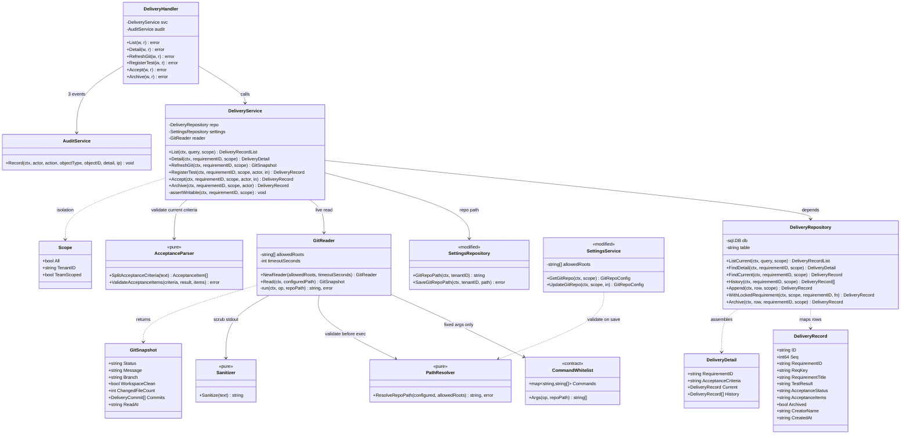
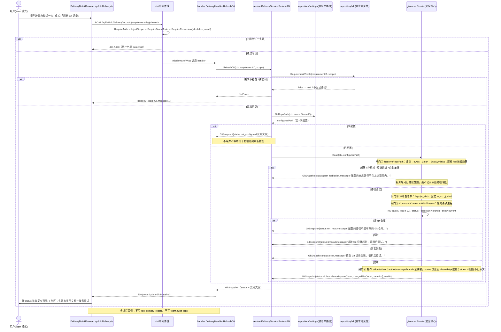
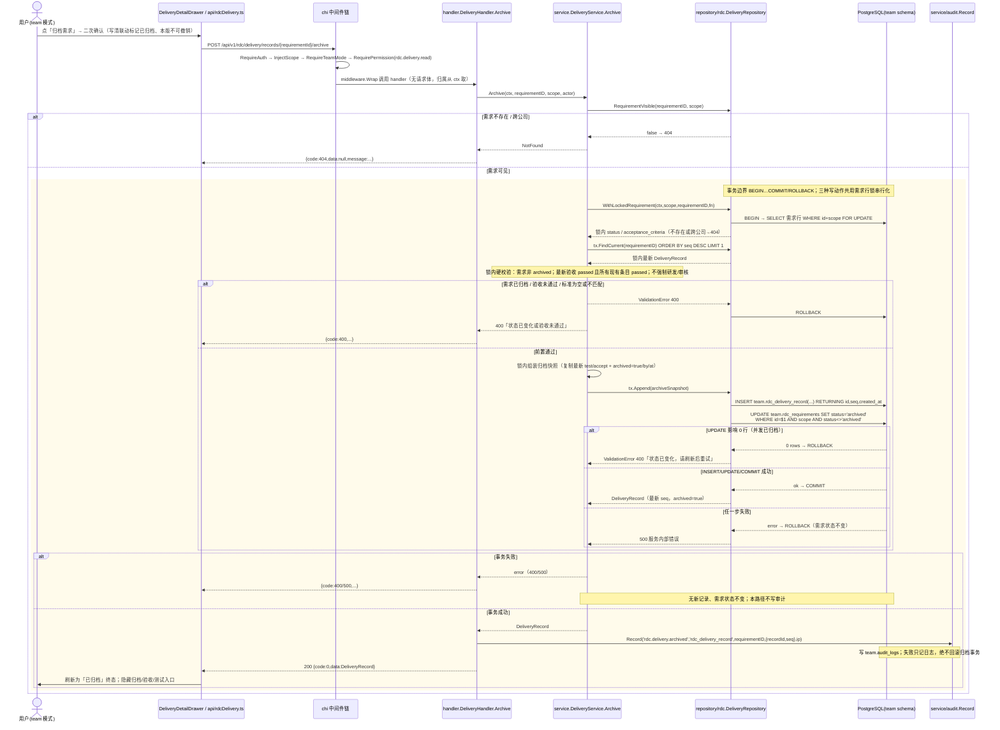
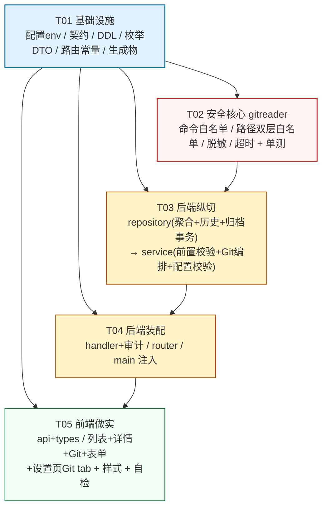

# Dandelion 研发中心（RDC）增量 · 需求交付中心「交付证据与归档闭环」系统设计与任务分解

| 项 | 内容 |
| --- | --- |
| 文档类型 | 系统设计 + 有序任务分解（架构师交付物） |
| 架构师 | 高见远（Gao）· Architect |
| 上游输入 | `deliverables/software-company/rdc-delivery-prd.md`（许清楚）+ V1.0/V1.1/研发编排/人工审核设计基线 + team-lead 转达的用户 8 项最终裁决（Q1–Q8） |
| 项目根目录 | `/Users/linanan/Desktop/dandelion`（下文路径均相对此根） |
| 强制规范 | `AGENTS.md`（生效优先级高于 `docs/` 设计稿；当前代码与测试 > `api/openapi.yaml` > AGENTS.md） |
| 本版范围 | **只把「04 需求交付中心」从骨架页升级为做实页**：Git 记录直读 / 测试报告人工登记 / 验收逐条确认 / 需求归档闭环 |
| 明确不动 | 01 需求中心（含 V1.1 项目与图片）、02 AI研发中心、03 人工审核中心；菜单形态、权限点、`/p/:key/*` 一律不动 |
| 模式限定 | 仅 team；solo 不可见、不可直接访问（沿用 V1.0 起的所有基线） |
| 安全底线 | S1 命令白名单 / S2 路径双层白名单 / S3 超时兜底 / S4 输出脱敏 / S5 只读副作用——任一不满足即本版不合格 |

> **最新隔离裁决**：跨 Windows/macOS 独立执行器阶段详见 `deliverables/software-company/rdc-delivery-git-isolation-design.md`。用户已选 B（允许 Git 配置触发的子进程在隔离域内派生，但不得读未授权文件、写宿主/原仓库或联网），非标准仓库按运维逐项批准真实路径并纳入只读快照后受控允许。本文早期 D1 的 A/B 候选以该补充文档为准；两平台真实原型尚未验证，Git 直读不得启用，也不得回退普通 CLI。

---

# Part A · 系统设计

## 1. 实现方案概述

### 1.1 技术栈（零新增依赖）

完全沿用现有基线：

| 层 | 沿用内容 |
| --- | --- |
| 后端 | Go 1.24 + chi v5 + pgx/v5 stdlib + PostgreSQL 16；`handler → service → repository` 按功能名归位到 `rdc/` |
| Git 直读 | **标准库 `os/exec` + `context`**（`exec.CommandContext` + `context.WithTimeout`），不引入 go-git / 任何第三方命令库 |
| 前端 | React 18 + TypeScript + Vite 5 + `@seakoi/console-kit` 根入口命名导出；`pages → api → client.ts` |
| 契约 | `api/openapi.yaml` 唯一事实来源 → `make gen:api` 生成 `web/src/api/schema.d.ts`（入库、禁手改） |
| DDL | `server/internal/repository/schema.sql`，幂等、`//go:embed`，启动由应用自身账号执行 |

**不引入**：新 ORM、新迁移框架、新权限点、Git 第三方库、第二份枚举目录、第二份路径校验逻辑。

### 1.2 关键架构决策（按重要性排序）

#### 决策 D1（安全核心）· Git 执行器独立成 `internal/gitreader`，不塞进 handler/service

四道闸门全部收敛在一个独立包内；客户端仅提供需求 ID，不能提供 Git op / argv / 仓库路径，service 从当前公司设置读取路径并调用固定的 `Reader.Read(ctx, configuredPath)`：

1. **命令白名单与非交互执行**：`gitreader/command.go` 使用包内私有的固定操作枚举和 argv 模板（`revparse`/`log`/`status`/`branch`），如 `log → {"log","-n","10","--date=iso-strict","--pretty=format:..."}`；只拼 `-C <已校验绝对路径>`、包内固定安全覆盖项（如 `-c core.fsmonitor=false`、`-c core.hooksPath=/dev/null`）与模板，禁止任何 shell、客户端 op/argv/path、客户端自定义 Git `-c` 或外网子命令。固定可执行文件路径由运维启动配置或可信 PATH 解析一次，不从请求/仓库读取；子进程设置 `GIT_CONFIG_NOSYSTEM=1`、隔离 HOME/XDG_CONFIG_HOME、`GIT_CONFIG_GLOBAL=/dev/null`、`GIT_CONFIG_SYSTEM=/dev/null`、`GIT_TERMINAL_PROMPT=0`、`GCM_INTERACTIVE=never`、`GIT_PAGER=cat`、`PAGER=cat`、`GIT_OPTIONAL_LOCKS=0`，stdin 接 `os.DevNull`；忽略调用进程传入的 `GIT_CONFIG_*`、`GIT_ASKPASS`、`SSH_ASKPASS` 等危险环境变量。**这仍不足以保证只读/无任意命令**：仓库本地 `.git/config` + `.gitattributes` 可配置 `filter.<name>.process/clean`，`git status --porcelain` 可能间接执行外部程序；Git CLI 无通用可靠的“关闭所有自定义 filter”开关。不得仅凭固定 argv、禁 hooks/fsmonitor、隔离 HOME 或枚举 filter 名宣称 S1/S5 已满足。
2. **路径双层白名单**（唯一入口 `gitreader/path.go::ResolveRepoPath`）：
   - 平台级 env 根目录白名单 `RDC_GIT_ROOTS`（`config.go` 读取，`filepath.Abs`+`filepath.Clean`+`EvalSymlinks` 规范化）——**这是 S2 的安全边界，UI 不可改**；
   - 公司级具体仓库路径（`system_settings.git_repo_path`，设置页可填）；
   - 校验顺序：非空 → `filepath.IsAbs`（必须绝对路径）→ `filepath.Clean` → `EvalSymlinks`（解析符号链接，防软链逃逸）→ 对每个允许根做 `filepath.Rel(root, resolved)` 前缀边界判定（`..` 开头或等于 `..` 即越界，拒绝白名单外路径）。**用 `filepath.Rel` 而非字符串 `HasPrefix`**，避免 `/srv/repos2` 被 `/srv/repos` 误放行；须拒绝 Git 指向白名单外的 `gitdir`/worktree 元数据目录（或明确禁用该仓库形态）。
3. **超时与输出大小双兜底**：每次命令用 `context.WithTimeout` + `exec.CommandContext`；超时杀子进程并返回 `status:timeout`。stdout/stderr 分离，分别经硬上限的 writer/reader（例如 stdout 256 KiB、stderr 16 KiB；超过即终止子进程并返回友好错误），**不得用无界 `CombinedOutput`**；最近 10 条 commit 的 `-n 10` 不能替代输出字节限制，恶意长 message 或大量变更文件也不能放大内存/响应。
4. **所有可回显自由文本统一脱敏**：`gitreader/sanitize.go::Sanitize` 是唯一出口，至少覆盖 author、commit message（含展开全文）、branch，以及任何将来可能回显的 status 文件名；匹配 `gh[pousr]_...`、`xox[baprs]-...`、`AKIA...`、`Authorization: ...`、长十六进制串等。**本版 status 只解析出 `workspaceClean` 与 `changedFileCount`，不返回原始文件名；branch 必须先净化再回传**。stderr 一律不回显、不记原文（只记错误类别），服务端日志不记完整绝对路径或凭据。短 SHA（7 位）作为校验过格式的结构化标识独立处理，不能把任意自由文本误当 SHA 免脱敏。

**S1/S5 阻断门槛（必须先解决，再实现/上线 Git 刷新）**：上述固定 Git 命令的**直接语义**只读，但受仓库配置驱动的子进程可能执行任意命令，因此当前 CLI 方案**尚不满足用户硬安全底线**。工程师必须证明以下二选一并以恶意仓库集成测试验收：(A) 在可信 OS 级隔离中执行 Git（独立、无宿主写权限/无网络的沙箱，阻断 Git 派生子进程及其额外 exec；同时仍能正常完成固定只读命令），隔离失败时 fail-closed；(B) 改用经审查、不会执行仓库配置命令的纯解析方案，同时覆盖最近 10 commit、branch 与工作区 clean/dirty/changedCount，且**不得引入新依赖或改变用户功能口径**。若不能证明 A/B，**禁止上线/声称 Git 刷新做实**；本版交付按硬安全约束阻断，需向用户说明而非降标或静默隐藏风险。不 `fetch`、不切分支、不跑测试，Git 刷新成功时仍不写 `rdc_delivery_record` 或审计（Q8）。

**失败不抛 HTTP 错误**：Git 读取的各类失败以 `GitSnapshot.status` 表达（`ok | not_configured | path_forbidden | not_repo | timeout | error`）+ 友好中文文案，接口统一返回 `200`；只有 `requirementId` 越界/不存在才是 404。这样既不回显路径，前端也能按状态分别处理（未配置时隐藏刷新按钮、越界不重试等，对齐 PRD §5.3）。

#### 决策 D2（Q3 裁决落地）· 一公司一仓：双层配置 + 设置页 UI

- **平台层（安全边界，UI 不可改）**：`RDC_GIT_ROOTS` 环境变量（逗号分隔多个允许根目录，如 `/srv/repos,/data/git`），`config.go` 统一读取并规范化到 `Config.GitAllowedRoots`。`.env.example` / `README.md` / `deploy` 三处同步（AGENTS §7 变更配方）。**为空时 Git 直读整体不可用（status=not_configured）**。
- **公司层（可在设置页配置）**：`system_settings` 幂等加列 `git_repo_path TEXT NOT NULL DEFAULT ''`（沿用「每公司一行、tenant_id 唯一」模型，空串=未配置）。仓库路径**必须落在平台允许根目录内**。Git 读取只用精确匹配 `tenant_id = scope.TenantID` 的公司行；公司无行或路径空时返回 `not_configured`，**绝不调用设置仓储的 `LoadForDelivery` 或回退 `tenant_id IS NULL` 的平台行，更不能读取其他公司的仓库路径**。超管 `scope.All` 的平台行仅供其本人访问，不作为普通公司的兜底。
- **写入时校验 + 读取时再校验（防御纵深）**：设置页保存路径时，`settings.Service.UpdateGitRepo` 先调同一个 `ResolveRepoPath(path, allowedRoots)` 校验，越界直接 400——**杜绝「通过配置 UI 让后端读任意路径」**；Git 读取时 `gitreader` 再校验一次（防止 env 变更或手工改库导致的漂移）。两个校验点是同一个纯函数，无第二份实现。
- **配置 UI 落点**：**并入现有平台设置页** `web/src/pages/platform/SettingsPage.tsx`（`Segmented` 加一个「Git 仓库」tab），不新建独立页面——理由：复用既有「公司设置」导航与 `settings.read`/`settings.write` 权限，不新增菜单/路由/权限点，符合「不新增写点」与 AGENTS「不新建第二套配置系统」。允许根目录作为只读提示展示，帮助管理员正确填写。
- **权限口径澄清**：交付中心 4 个动作全部沿用 `rdc.delivery.read`；仓库配置复用**既有** `settings.read`/`settings.write`（这两个点早已存在），**本版不新增任何权限点**。

#### 决策 D3（Q6 裁决落地）· 一需求多条交付历史：append-only + 取最新为当前

- `rdc_delivery_record` **不加 `UNIQUE(requirement_id)`**。测试登记 / 验收确认 / 归档每次写动作都**追加一条完整快照行**（复制当前 test/acceptance 字段 + 覆盖本次变更），历史可追溯多轮。
- **当前记录 = 该 `requirement_id` 下 `seq` 最大的一行**（`BIGSERIAL` 单调列，`created_at` 同秒时提供稳定排序）。列表按**需求聚合**：先在租户范围内用 `DISTINCT ON (requirement_id) ... ORDER BY requirement_id, seq DESC` 取各需求最新记录，再在外层按验收/归档状态筛选与分页；不能先按状态过滤再选最新（否则旧状态误作当前）。详情返回 `Current`（最新）+ `History`（全部或分页，倒序）。
- 归档快照含 `archived=true` + 归档人/时间；「验收可重新提交覆盖」（Q2）通过**追加新行**实现——当前结论永远取最新行，不物理覆盖历史。

#### 决策 D4（Q2 裁决落地）· 验收标准仍只在展示层拆条；服务端独立复核逐条结果，不新增条目表

- `web/src/utils/rdcAcceptance.ts::splitAcceptanceCriteria(text): {index,text}[]` 与 `server/internal/service/rdc/acceptance.go::SplitAcceptanceCriteria(text)` 是**同构纯函数**，规则写在此处为共享契约：把 `\r\n`/`\r` 统一为 `\n`，按换行拆，trim、丢弃空行；每个非空行若包含从行首开始的 `1.`/`1、`/`1)` 或 `-`/`•` 列表标记，逐标记拆开并剥离标记；未含列表标记的非空行保持为一条；丢弃空条目，结果按顺序编号为连续的 `0..N-1`。两端用同一组固定测试向量（空白、换行、序号、混合、单行多序号、CRLF）锁定数量、索引、文本一致性；不修改需求表、也不新增条目表。
- 用户逐条确认后提交 `DeliveryAcceptInput{result,note,items:[{index,result}]}`。后端从**数据库中的** `acceptance_criteria` 现值按同一确定性规则算出 N（不信任请求体传入的条目数/文本），要求 N>0、items 长度恰为 N，索引集合恰为 `0..N-1`、无缺失/重复/越界、每项结果仅 `passed|failed`。`result=passed` 时所有条目必须 `passed`；`result=failed` 时至少一项必须 `failed`。不满足返回 400 且不写库；合法 items 按索引排序后作为 JSON 文本存 `acceptance_items`。验收标准为空或拆后 N=0 时禁止提交任何验收与归档，返回 400「需求尚未填写验收标准」；需求中心不在本版改动。
- **Q1 裁决**：验收只要求需求 `status != archived`，**不强制**研发/审核完成；研发/审核进度仅作只读参考展示（本版甚至可不展示，不设假数据）。
- **Q2 裁决**：`result=failed` 可提交（落库、写审计），但归档前置硬校验 `acceptance_status == passed`，故不通过不可归档；重新验收追加新行覆盖当前态。若验收标准后来发生变化（本版需求侧无编辑入口），归档事务内同样按当前文本与最新快照复核，旧快照不满足现有条目时拒绝归档。

#### 决策 D5（Q4/Q1 裁决落地）· 归档：终态、不可撤销、单一事务联动

- 前置硬校验（服务端）：需求存在且属于当前 scope、`status != archived`、当前记录 `acceptance_status == passed` 且逐条结果对当前验收标准有效。接口外的预读仅作展示，不作为归档决策依据。
- **所有三种写动作共用一把需求行锁**：测试登记、验收确认、归档在各自事务开始后，先以带 scope 的 `SELECT ... FROM team.rdc_requirements WHERE id=$1 ... FOR UPDATE` 锁定需求行；锁成功后再读当前最新交付快照，校验非 archived 与动作前置条件，最后插入完整快照。这样并发测试/验收/归档按同一需求串行化，避免归档后插入更晚的未归档快照。
- **归档同一事务**：① 带 scope 锁需求行并读取 `acceptance_criteria`/status；② 锁内读取 `ORDER BY seq DESC LIMIT 1` 的最新验收快照，验证 `passed`、items 对当前条目全部 `passed`；③ `INSERT rdc_delivery_record` 归档快照；④ `UPDATE team.rdc_requirements SET status='archived' WHERE id=$1 AND scope AND status<>'archived'`；⑤ COMMIT。`UPDATE` 影响 0 行（并发状态变化）或任一步失败 → ROLLBACK；杜绝「交付显示已归档、需求仍研发中」及并发新记录覆盖归档终态。service 负责验收业务判断，repository 提供事务内 `WithLockedRequirement(ctx,scope,id,fn)` 与 tx-scoped 的 `FindCurrent/Append/MarkArchived`，回调只执行 service 已定义的规则，不让 repository 反向依赖 service。
- **不可撤销**：无 unarchive 接口、无回退路径；UI 二次确认写清影响面（对齐 AGENTS §6）。联动写的是 V1.0 需求表的 `status` 列（枚举已含 `archived`，无需改枚举）。

#### 决策 D6（Q5 裁决落地）· 测试报告只做「摘要 + 外部链接」

- `test_result ∈ {not_registered, passed, failed}`、`test_summary`（≤2000）、`test_report_ref`（外部 CI 报告 URL，≤500）。**本版不上传报告文件**（`rdc_requirement_attachment` 仅图片，不适用）；不写 `uploads/`，不新增 `stage` 接口。

#### 决策 D7（Q8 裁决落地）· 审计范围

| 操作 | 写审计 | action | objectType | objectID | detail 要点 |
| --- | --- | --- | --- | --- | --- |
| Git 刷新 | ❌ 读操作不写 | — | — | — | — |
| 测试登记 | ✅ | `rdc.delivery.test_registered` | `rdc_delivery_record` | requirementId | `{recordId, seq, result}` |
| 验收确认 | ✅ | `rdc.delivery.accepted` | `rdc_delivery_record` | requirementId | `{recordId, seq, result, itemCount}` |
| 归档 | ✅（事务提交后） | `rdc.delivery.archived` | `rdc_delivery_record` | requirementId | `{recordId, seq}` |
| 仓库配置变更 | ✅ | `rdc.delivery.repo_configured` | `settings` | tenantId | `{configured:true/false}`（**不记完整路径**，防泄漏） |

全部经 `audit.Service.Record` 写 `team.audit_logs`（team 模式天然落 team 分区），**失败只记日志，绝不回滚业务写**。审计写在 handler 成功分支之后（与 role/user/review 一致）。

#### 决策 D8 · team 专属表不进 FOREACH，单仓储固定绑定 team 分区

沿用 V1.0 决策 D3 / 研发编排 D4：`CREATE TABLE team.rdc_delivery_record` 写在 `schema.sql`「六 · 研发中心」段、`FOREACH` 循环之外；仓储固定 `repository.PartitionTeam.Table("rdc_delivery_record")`，不提供 `.For(mode)`。`RequireTeamMode` 已是硬边界，不为永远为空、不可达的 solo 造表。

#### 决策 D9 · 隔离与权限（全程只 `rdc.delivery.read`）

- 路由链：`RequireAuth → InjectScope → RequireTeamMode → RequirePermission(rdc.delivery.read)`；前端写入口**不做写点判断**（不出现 `can(me,'...write')`），`me=null` 由上层 Gate 兜底。
- 所有交付记录查询先 `repository.ScopeFilter(0, alias, scope)` 再叠业务条件；越界/不存在 → 404（不泄漏存在性）。`tenant_id`/`creator_user_id` 只从 scope/身份取，请求体不接受。
- 状态枚举唯一来源 `api/openapi.yaml`，DDL 不加 CHECK（沿用基线惯例）。

---

## 2. 文件清单

> 标记：**新** / **改** / **生成**（`schema.d.ts` 由 `make gen:api` 产出，禁手改）。所有新增手写文件顶部写中文四要素注释：**职责 / 输入 / 输出 / 边界**；单文件尽量 ≤ 400 行——故后端按功能拆 `delivery_*.go`，Git 执行器拆 4 个小文件（各单一职责）。

### 2.1 配置 / 契约 / DDL（事实来源层）

| 路径 | 标记 | 职责 |
| --- | --- | --- |
| `server/internal/config/config.go` | 改 | 新增 `RDC_GIT_ROOTS`（逗号分隔、Abs+Clean+EvalSymlinks 规范化）、`RDC_GIT_TIMEOUT_SECONDS`（秒，默认 5、上限 30），进 `Config.GitAllowedRoots`/`GitTimeoutSeconds`；仍是全仓唯一 `os.Getenv` 处。 |
| `.env.example` | 改 | 新增两个 env 变量的样例与注释（安全边界说明）。 |
| `README.md` | 改 | §4 环境变量表新增两行 + 一公司一仓配置说明。 |
| `deploy/docker-compose.yml` | 改 | server.environment 挂载 `RDC_GIT_ROOTS` / `RDC_GIT_TIMEOUT_SECONDS`（卷映射仓库根目录的说明）。 |
| `api/openapi.yaml` | 改 | 新增 6 条交付路径 + 2 条仓库配置路径（共 8 path）；`TestResult`/`AcceptanceStatus`/`GitStatus` 枚举、`x-constants.rdcGitTimeoutSeconds`/`rdcGitMaxCommits`、全套 DTO/响应 schema。 |
| `server/internal/repository/schema.sql` | 改 | 「六 · 研发中心」段末尾新增 `team.rdc_delivery_record` + 索引（循环外）；`system_settings` 幂等加列 `git_repo_path`。 |
| `server/internal/contract/contract.go` | 改 | 8 路由常量入 `APIRoutes`；测试/验收/Git 状态枚举与切片；交付 DTO 全套；Git 上限与资源名常量；`Settings` 加 Git 仓库字段。 |
| `server/internal/contract/contract_test.go` | 改 | 钉住新枚举与 openapi 一致、路由数一致性（既有测试自动覆盖 paths 数）。 |
| `web/src/api/schema.d.ts` | 生成 | `make gen:api` 产物，前端类型唯一来源，必须入库。 |

### 2.2 后端（安全核心 + 分层归位到 `rdc/`）

| 路径 | 标记 | 职责 |
| --- | --- | --- |
| `server/internal/gitreader/command.go` | 新 | 命令白名单：`allowedCommands` map（固定 argv 模板）+ `Args(op, absPath)`；无 shell 入口。 |
| `server/internal/gitreader/path.go` | 新 | 路径双层白名单唯一入口 `ResolveRepoPath`（Abs/Clean/EvalSymlinks + 前缀边界）。 |
| `server/internal/gitreader/sanitize.go` | 新 | 输出脱敏唯一入口 `Sanitize`，净化 author/message/branch 等全部可回显自由文本；status 文件名不回显。 |
| `server/internal/gitreader/reader.go` | 新 | `Reader.Read(ctx, configuredPath)`：路径与 gitdir 校验 → 白名单命令（隔离环境/配置）→ `CommandContext`+超时+输出字节上限 → 固定格式解析与脱敏 → `GitSnapshot`。 |
| `server/internal/gitreader/reader_test.go` | 新 | 单测：白名单拒任意命令、越界/软链/外部 gitdir、超时杀进程、输出字节上限、危险配置与环境隔离、分支/message 脱敏、status 不泄漏文件名、非 git 仓库。 |
| `server/internal/repository/rdc/delivery_repository.go` | 新 | 交付记录唯一 SQL 出入口：列表聚合、详情；测试/验收/归档事务统一先锁需求行再读最新快照，追加快照；归档事务内联动需求状态。 |
| `server/internal/repository/rdc/delivery_repository_test.go` | 新 | 多条历史、当前取最新、跨租户隔离、归档原子性，以及并发验收/测试登记/归档串行化与归档终态。 |
| `server/internal/repository/settings/repository.go` | 改 | `system_settings.git_repo_path` 读写（`GitRepoPath`/`SaveGitRepoPath`），沿用 tenant 定位与幂等建行。 |
| `server/internal/service/rdc/acceptance.go` | 新 | 服务端同构纯函数 `SplitAcceptanceCriteria` 与逐条结果校验：从数据库现有标准算 N、检查索引覆盖/结论一致性；与前端共享固定测试向量。 |
| `server/internal/service/rdc/delivery_service.go` | 新 | 业务层：Git 读取编排、验收结果校验与归档规则；事务内前置由仓储锁行后读取当前快照执行，不碰 HTTP。 |
| `server/internal/service/rdc/delivery_service_test.go` | 新 | 两端拆条向量、空标准/缺失/重复/越界/伪 passed 拒绝、failed 可提交不可归档、当前记录与事务内前置。 |
| `server/internal/service/settings/service.go` | 改 | `GetGitRepo`/`UpdateGitRepo`：写入时经 `ResolveRepoPath` 校验（注入 allowedRoots），返回配置项与边界提示。 |
| `server/internal/handler/rdc/delivery_handler.go` | 新 | HTTP 语义：分页/筛选取参、`DecodeJSON` 严格字段（测试/验收输入）、调 service、3 类审计、统一响应。 |
| `server/internal/handler/rdc/delivery_handler_test.go` | 新 | 严格字段（越权字段 400）、审计 action 断言、路径参数缺失 400。 |
| `server/internal/handler/settings/handler.go` | 改 | `GetGitRepo`/`UpdateGitRepo` 两个 handler + 配置变更审计。 |
| `server/internal/app/router.go` | 改 | `Deps.RDCDelivery` 注入；6 条交付路径注册到 team 专区（全挂 `rdc.delivery.read`）；2 条配置路径注册到 settings 专区（`settings.read/write`）；补 405 `Allow` 映射。 |
| `server/cmd/server/main.go` | 改 | 构造 `gitreader.NewReader(cfg.GitAllowedRoots, cfg.GitTimeoutSeconds)`、delivery 仓储/服务/handler 并注入；settings service 注入 allowedRoots。 |

> `service/rdc/service.go`（需求）、`dev_service.go`、`review_service.go`、`storage/paths.go`、`contract.Menus`、`Permissions`、`authz`、`TeamModeGate`、`navigation.ts`、`icons.tsx`、`App.tsx`、`RdcPlaceholderPage.tsx`、01/02/03 页面 **确认不改**。

### 2.3 前端（API / 类型 / 页面 / 样式）

| 路径 | 标记 | 职责 |
| --- | --- | --- |
| `web/src/api/rdcDelivery.ts` | 新 | 交付接口唯一消费处：列表、详情、Git 刷新、测试登记、验收、归档；类型取自 `schema.d.ts`，请求只经 `client.ts`。 |
| `web/src/api/settings.ts` | 改 | 新增 `getGitRepo`/`updateGitRepo`（仓库配置读写）。 |
| `web/src/utils/format.ts` | 改 | 测试结论 / 验收结论 / Git 状态的中文标签唯一镜像（`Record<枚举,string>`，漏值编译报错）。 |
| `web/src/utils/rdcAcceptance.ts` | 新 | 纯函数 `splitAcceptanceCriteria`：按换行/序号拆条，剥离序号，返回 `{index,text}[]`。 |
| `web/src/pages/rdc/DeliveryCenterPage.tsx` | 改 | 骨架 → 做实列表页：筛选、服务端分页（`usePageState` 页码进 URL）、三态、按需求聚合行、空列表不挂分页条、点需求开详情抽屉。 |
| `web/src/pages/rdc/DeliveryDetailDrawer.tsx` | 新 | 详情抽屉：需求信息 + 4 证据段 + 历史列表 + 各动作入口（二次确认），只读研发/审核进度参考（无假数据）。 |
| `web/src/pages/rdc/DeliveryGitPanel.tsx` | 新 | Git 面板：提交列表（短 SHA/作者/时间/message 首行+展开）、工作区状态、分支；进详情自动读一次 + 手动刷新按钮；按 status 渲染友好文案。 |
| `web/src/pages/rdc/DeliveryEvidenceForms.tsx` | 新 | 测试登记表单 + 验收逐条勾选表单（用 `splitAcceptanceCriteria`）+ 归档确认（写清不可撤销）。 |
| `web/src/pages/platform/SettingsPage.tsx` | 改 | `Segmented` 新增「Git 仓库」tab：路径输入、允许根目录只读提示、保存（越界错误即时显示）。 |
| `web/src/styles.scss` | 改 | 交付列表列/状态徽标、Git 面板、验收条目、确认文案、设置页 Git tab 样式（沿用主色 `#0369a1`）。 |

### 2.4 设计产物（本文件之外）

| 路径 | 标记 | 职责 |
| --- | --- | --- |
| `deliverables/software-company/rdc-delivery-class-diagram.mermaid` | 新 | 本文 §3.7 类图单独提取。 |
| `deliverables/software-company/rdc-delivery-sequence-diagram.mermaid` | 新 | 本文 §4 两张时序图单独提取（含安全校验点、失败路径、事务边界）。 |

> `docs/class-diagram.mermaid` / `docs/sequence-diagram.mermaid` 属于其他特性，本次不覆盖。

---

## 3. 数据结构与接口

### 3.1 DDL 草案（`schema.sql`「六 · 研发中心」段末尾，循环之外，team 专属）

```sql
-- 增量 5：公司级 Git 仓库路径（一公司一仓）。空串=未配置；
-- 真实读取边界是平台 env 的 RDC_GIT_ROOTS，本列只存「公司想读哪个仓库」，
-- 写入时经 ResolveRepoPath 校验必须落在允许根目录内（settings service），读取时再校验一次。
ALTER TABLE system_settings
  ADD COLUMN IF NOT EXISTS git_repo_path TEXT NOT NULL DEFAULT '';

-- 交付记录：append-only，一需求多条历史（Q6），故不加 UNIQUE(requirement_id)。
-- seq 是单调排序列，用于「取最新一条为当前状态」的稳定排序（created_at 同秒兜底）。
-- 不存 git 快照：Git 是实时只读投影（Q8 刷新不写库）；本表只存测试/验收/归档证据。
-- 枚举列（test_result/acceptance_status）不加 CHECK——唯一来源是 api/openapi.yaml。
-- creator_user_id 沿用裸 TEXT 惯例（不加 users 外键，账号删除后历史仍可读）。
CREATE TABLE IF NOT EXISTS team.rdc_delivery_record (
  id                UUID        PRIMARY KEY DEFAULT gen_random_uuid(),
  seq               BIGSERIAL   UNIQUE,
  requirement_id    UUID        NOT NULL REFERENCES team.rdc_requirements(id),
  tenant_id         UUID        REFERENCES tenants(id),
  test_result       TEXT        NOT NULL DEFAULT 'not_registered',
  test_summary      TEXT        NOT NULL DEFAULT '',
  test_report_ref   TEXT        NOT NULL DEFAULT '',
  test_registered_by TEXT       NOT NULL DEFAULT '',
  test_registered_at TIMESTAMPTZ,
  acceptance_status TEXT        NOT NULL DEFAULT 'pending',
  acceptance_items  TEXT        NOT NULL DEFAULT '[]',  -- JSON: [{index,result}]
  acceptance_note   TEXT        NOT NULL DEFAULT '',
  accepted_by       TEXT        NOT NULL DEFAULT '',
  accepted_at       TIMESTAMPTZ,
  archived          BOOLEAN     NOT NULL DEFAULT false,
  archived_by       TEXT        NOT NULL DEFAULT '',
  archived_at       TIMESTAMPTZ,
  creator_user_id   TEXT        NOT NULL DEFAULT '',
  created_at        TIMESTAMPTZ NOT NULL DEFAULT now()
);

-- 列表：租户 + 需求聚合取当前（DISTINCT ON 用 (requirement_id, seq DESC)）；
-- 详情历史：租户 + requirement_id + seq DESC。
CREATE INDEX IF NOT EXISTS idx_rdc_delivery_tenant_req_seq
  ON team.rdc_delivery_record (tenant_id, requirement_id, seq DESC);
CREATE INDEX IF NOT EXISTS idx_rdc_delivery_tenant_seq
  ON team.rdc_delivery_record (tenant_id, seq DESC);
```

> 需求无删除路径，`requirement_id` 外键不设级联（与研发编排一致）。归档联动写的是 `team.rdc_requirements.status`，该列已存在且枚举已含 `archived`，**无需改需求表 DDL**。

**字段对齐表**

| DB 列 | Go 字段 | JSON 字段 | 来源 / 规则 |
| --- | --- | --- | --- |
| `id / seq` | `DeliveryRecord.ID / Seq` | `id / seq` | 服务端；seq 单调，取最新用 |
| `requirement_id` | `DeliveryRecord.RequirementID` | `requirementId` | 绑定需求，必填，scope 校验 |
| `req_key/title/status`（JOIN `rdc_requirements`） | `ReqKey/RequirementTitle/RequirementStatus` | `reqKey/requirementTitle/requirementStatus` | 投影，仅展示/筛选 |
| `project_name`（JOIN `team.projects`） | `ProjectName` | `projectName` | 投影；空串即「未归属项目」 |
| `test_result/summary/report_ref` | `TestResult/TestSummary/TestReportRef` | 同名 | 人工登记；`not_registered/passed/failed` |
| `test_registered_by/at` | `TestRegisteredBy/At` | 同名 | 服务端 from Identity / now |
| `acceptance_status` | `AcceptanceStatus` | `acceptanceStatus` | `pending/passed/failed` |
| `acceptance_items`（JSON 文本） | `AcceptanceItems string` | `acceptanceItems` | `[{index,result}]`，服务端按当前标准同构拆条，校验完整索引及结论一致性 |
| `acceptance_note/by/at` | 同名字段 | 同名字段 | 服务端时间/身份 |
| `archived/by/at` | `Archived/ArchivedBy/ArchivedAt` | 同名 | 归档时写，终态 |
| `creator_user_id` → JOIN users/people | `CreatorName`（投影，`creatorUserId` 不进 DTO） | `creatorName` | 裸 TEXT 存储，姓名 JOIN 投影 |
| `tenant_id` | —（不进 DTO） | — | scope 过滤，请求体不接受 |
| `created_at` | `CreatedAt` | `createdAt` | UTC RFC3339 |

### 3.2 契约常量 / DTO（`internal/contract`）

```go
// 路由常量（+8；APIRoutes 长度 44 → 52，与 openapi.yaml paths 数一一对应；
// 已含 RouteBuildVersions、3 条 RDC 需求路径、dev 5 条、review 5 条，绝不丢失）。
const (
    RouteRDCDeliveryRecords     = APIPrefix + "/rdc/delivery/records"
    RouteRDCDeliveryByReq       = APIPrefix + "/rdc/delivery/records/{requirementId}"
    RouteRDCDeliveryGitRefresh  = APIPrefix + "/rdc/delivery/records/{requirementId}/git/refresh"
    RouteRDCDeliveryTest        = APIPrefix + "/rdc/delivery/records/{requirementId}/test"
    RouteRDCDeliveryAccept      = APIPrefix + "/rdc/delivery/records/{requirementId}/accept"
    RouteRDCDeliveryArchive     = APIPrefix + "/rdc/delivery/records/{requirementId}/archive"
    RouteSettingsGitRepo        = APIPrefix + "/settings/git-repo"
)
// 注：GET/PUT /settings/git-repo 同路径不同方法，只占 1 个路由常量。

// 枚举（与 openapi.yaml 同序，契约测试锁死）。
const (
    TestNotRegistered = "not_registered"
    TestPassed        = "passed"
    TestFailed        = "failed"
    AcceptPending     = "pending"
    AcceptPassed      = "passed"
    AcceptFailed      = "failed"
    GitOK             = "ok"
    GitNotConfigured  = "not_configured"
    GitPathForbidden  = "path_forbidden"
    GitNotRepo        = "not_repo"
    GitTimeout        = "timeout"
    GitError          = "error"
)
var TestResults        = []string{TestNotRegistered, TestPassed, TestFailed}
var AcceptanceStatuses = []string{AcceptPending, AcceptPassed, AcceptFailed}
var GitStatuses        = []string{GitOK, GitNotConfigured, GitPathForbidden, GitNotRepo, GitTimeout, GitError}

// 上限 / 资源名（与 x-constants 对齐）。
const (
    RDCDefaultGitTimeoutSeconds = 5
    RDCMaxGitTimeoutSeconds     = 30
    RDCGitMaxCommits            = 10
    MaxTestSummaryLen           = 2000
    MaxTestReportRefLen         = 500
    MaxAcceptanceNoteLen        = 2000
    MaxAcceptanceItems          = 500
    ResourceDeliveryRecord      = "交付记录"
)

// DTO —— 列表项即「一需求的当前交付记录」
type DeliveryRecord struct {
    ID, RequirementID, ReqKey, RequirementTitle, ProjectName, RequirementStatus string
    TestResult, TestSummary, TestReportRef, TestRegisteredBy, TestRegisteredAt string
    AcceptanceStatus, AcceptanceItems, AcceptanceNote, AcceptedBy, AcceptedAt string
    Archived bool
    ArchivedBy, ArchivedAt, CreatorName, CreatedAt string
    Seq int64
}
type DeliveryDetail struct {
    RequirementID, ReqKey, Title, Description, AcceptanceCriteria, RequirementStatus, ProjectName string
    Current DeliveryRecord
    History []DeliveryRecord `json:"history"` // 倒序，含 Current 为首位；非 nil
}
type DeliveryCommit struct {
    Sha, ShortSha, Author, Time, Subject string
}
type GitSnapshot struct {
    Status, Message, Branch string
    WorkspaceClean          bool `json:"workspaceClean"`
    ChangedFileCount        int  `json:"changedFileCount"`
    Commits                 []DeliveryCommit `json:"commits"`
    ReadAt                  string `json:"readAt"`
}
type AcceptanceItemResult struct {
    Index  int    `json:"index"`
    Result string `json:"result"` // passed | failed
}
type TestRegisterInput struct {
    Result    string `json:"result"`    // passed | failed
    Summary   string `json:"summary"`
    ReportRef string `json:"reportRef"`
}
type DeliveryAcceptInput struct {
    Result string                 `json:"result"` // passed | failed
    Note   string                 `json:"note"`
    Items  []AcceptanceItemResult `json:"items"`
}
type GitRepoConfig struct {
    GitRepoPath string   `json:"gitRepoPath"`
    AllowedRoots []string `json:"allowedRoots"` // 只读提示，来自 env
    Configured  bool      `json:"configured"`
}
type GitRepoInput struct {
    GitRepoPath string `json:"gitRepoPath"` // 空串=清除配置
}
type DeliveryQuery struct {
    Page              PageQuery
    Keyword           string // 匹配 reqKey / 需求标题 ILIKE
    AcceptanceStatus  string // 可选筛选
    Archived          string // "true"/"false"/""（不筛）
}
type DeliveryRecordList struct {
    Items []DeliveryRecord `json:"items"`
    Page
}

// Settings DTO 增量（沿用既有 Settings，新增一字段供设置页一次取全）
type Settings struct {
    Webhook          WebhookConfig        `json:"webhook"`
    APIKeyConfigured bool                 `json:"apiKeyConfigured"`
    AvailableFields  []WebhookFieldOption `json:"availableFields"`
    GitRepo          GitRepoConfig        `json:"gitRepo"`
}
```

### 3.3 OpenAPI 路径清单（8 条新增路径；`servers.url = /api/v1`，统一外壳 `{code,data,message}`）

| 方法 | 路径 | 查询 / 请求体 | 成功响应 | 说明 |
| --- | --- | --- | --- | --- |
| GET | `/rdc/delivery/records` | `page,pageSize,keyword,acceptanceStatus,archived` | `200 DeliveryRecordListResponse` `{items,total,page,pageSize}` | 按需求聚合，一人一行取当前态；scope 决定范围。 |
| GET | `/rdc/delivery/records/{requirementId}` | 路径 `requirementId`(uuid) | `200 DeliveryDetailResponse` | 需求信息 + acceptance_criteria + Current + History（倒序）；越界 404。 |
| POST | `/rdc/delivery/records/{requirementId}/git/refresh` | 路径 `requirementId` | `200 GitSnapshotResponse` | 只读；失败以 status 表达、恒 200；不写库不写审计。 |
| POST | `/rdc/delivery/records/{requirementId}/test` | `TestRegisterInput` | `200 DeliveryRecordResponse` | 追加测试快照；写 `test_registered` 审计；已归档需求 400。 |
| POST | `/rdc/delivery/records/{requirementId}/accept` | `DeliveryAcceptInput` | `200 DeliveryRecordResponse` | 追加验收快照；`failed` 可提交；写 `accepted` 审计。 |
| POST | `/rdc/delivery/records/{requirementId}/archive` | 路径 `requirementId` | `200 DeliveryRecordResponse` | 单事务联动需求 status=archived；二次确认由 UI 承担；写 `archived` 审计。 |
| GET | `/settings/git-repo` | — | `200 GitRepoConfigResponse` | 读公司仓库配置 + 平台允许根提示（`settings.read`）。 |
| PUT | `/settings/git-repo` | `GitRepoInput` | `200 GitRepoConfigResponse` | 写入前经 `ResolveRepoPath` 校验越界 400；写 `repo_configured` 审计（`settings.write`）。 |

**新增 / 修改 schema**：`TestResult`（enum 3）、`AcceptanceStatus`（enum 3）、`GitStatus`（enum 6）、`DeliveryRecord`、`DeliveryDetail`、`DeliveryCommit`、`GitSnapshot`、`TestRegisterInput`、`DeliveryAcceptInput`、`AcceptanceItemResult`、`GitRepoConfig`、`GitRepoInput` 及对应 `*Response`（沿用 `allOf: ApiResponse`）；`Settings` 加 `gitRepo` 字段；`x-constants` 加 `rdcGitTimeoutSeconds: 5`、`rdcGitMaxCommits: 10`。

**契约一致性**：新增 8 个 paths ⇒ `APIRoutes` 同步新增 8 常量（6 交付 + `RouteSettingsGitRepo`；**保留 `RouteBuildVersions` 与既有全部 RDC 路径**）；总数 44 → 52，以契约测试实际计数为准。

### 3.4 列表聚合与当前记录 SQL 口径（工程师必读）

```text
基表：team.rdc_delivery_record d
JOIN ：LEFT JOIN team.rdc_requirements r ON r.id = d.requirement_id
       LEFT JOIN team.projects pj ON pj.id = r.project_id
       LEFT JOIN public.users u ON u.id::text = d.creator_user_id
       LEFT JOIN public.people p ON p.id = u.person_id
隔离：先 repository.ScopeFilter(0,"d",scope)，再 AddIf 业务条件
列表（按需求聚合取当前）：
  SELECT DISTINCT ON (d.requirement_id) <columns>
  FROM ... WHERE <scope> -- 先取每个需求最新记录，勿在此内层按 acceptanceStatus/archived 过滤
  ORDER BY d.requirement_id, d.seq DESC
  —— 外层再按 keyword / acceptanceStatus / archived 筛选、count(*)、LIMIT/OFFSET
筛选：keyword → r.req_key ILIKE ? OR r.title ILIKE ?；acceptanceStatus → current.acceptance_status = ?；
      archived → current.archived = ?（"true"/"false"）
详情：FindCurrent（scope + requirement_id，ORDER BY seq DESC LIMIT 1）；
      History（scope + requirement_id，ORDER BY seq DESC，可分页）；
      acceptance_criteria / title / reqKey / status / projectName 从 r 与 pj 同查回读。
追加：Append 复制 FindCurrent 的 test/acceptance 字段到新行，覆盖本次变更字段，creator_user_id=actor，
      tenant_id 从 scope；seq 由 BIGSERIAL 自增。
```

> 「当前记录」唯一口径 = `ORDER BY seq DESC LIMIT 1`；列表「当前」= `DISTINCT ON (requirement_id) ... ORDER BY requirement_id, seq DESC`。两处必须同口径，由 `delivery_repository_test.go` 钉死。

### 3.5 前端类型来源

```ts
// api/rdcDelivery.ts：只从 ./schema 引类型、只经 ./client 发请求
export type DeliveryRecord = Schemas['DeliveryRecord'];
export type DeliveryDetail = Schemas['DeliveryDetail'];
export type GitSnapshot = Schemas['GitSnapshot'];
export type TestResult = Schemas['TestResult'];
export type AcceptanceStatus = Schemas['AcceptanceStatus'];
export interface DeliveryListQuery extends PageQuery {
  keyword?: string; acceptanceStatus?: AcceptanceStatus; archived?: boolean;
}
export function listDeliveryRecords(q?: DeliveryListQuery): Promise<PagedList<DeliveryRecord>>
export function getDeliveryDetail(requirementId: string): Promise<DeliveryDetail>
export function refreshDeliveryGit(requirementId: string): Promise<GitSnapshot>
export function registerDeliveryTest(requirementId: string, in: TestRegisterInput): Promise<DeliveryRecord>
export function acceptDelivery(requirementId: string, in: DeliveryAcceptInput): Promise<DeliveryRecord>
export function archiveDelivery(requirementId: string): Promise<DeliveryRecord>
```

状态中文标签在 `web/src/utils/format.ts` 用 `Record<枚举,string>` 镜像，漏一个枚举值编译报错；拆条唯一实现在 `utils/rdcAcceptance.ts` 纯函数；不手改 `schema.d.ts`。

### 3.6 审计事件约定（Q8）

见 §1.2 D7 表。均写在对应 handler 成功分支之后，经 `audit.Record` 写 `team.audit_logs`（失败只记日志不回滚）；Git 刷新不写审计；仓库配置 detail **不记完整路径**。

### 3.7 类图（Mermaid）



---

## 4. 程序调用流程（Mermaid 时序图）

两张完整时序图已单独提取到 `deliverables/software-company/rdc-delivery-sequence-diagram.mermaid`，含安全校验点、失败路径与事务边界。此处内嵌同内容。

### 4.1 Git 刷新（四道安全闸门 + 失败路径，只读不写）



### 4.2 归档联动需求状态（单一事务，失败回滚）



### 4.3 其余操作要点（不单独画图）

- **列表**：同读权限守卫 → `handler.List` 读 `page/pageSize/keyword/acceptanceStatus/archived` → `service.List` 归一化 → `repository.ListCurrent`（§3.4 的 `DISTINCT ON` 聚合 + 隔离 + 分页）→ `PagedList`。页码进 URL（`usePageState` + `replace`），空列表不渲染分页条。
- **详情**：`service.Detail` → `FindCurrent` + `History` + 需求投影（含 `acceptance_criteria`）；越界 404。
- **测试登记 / 验收**：严格 `DecodeJSON`（测试 `result/summary/reportRef`；验收 `result/note/items`；未知字段 400）→ service 调仓储 `WithLockedRequirement`（事务内 scope 锁需求行）→ 锁内复核 `status != archived`、读取最新快照并复制字段 → 验收从库中当前 `acceptance_criteria` 同构拆条并验证所有索引及结论 → `tx.Append` 新快照 → COMMIT 后写审计 → 200。空验收标准或伪造 passed 拒绝，不写库。
- **仓库配置**：`GET/PUT /settings/git-repo` 在 settings 专区（`settings.read/write`）→ `UpdateGitRepo` 经 `ResolveRepoPath(path, allowedRoots)` 校验（空串=清除配置）→ 仓储 upsert → 审计 detail 不记完整路径。

---

## 5. 待明确事项 / 已记录的假设

| 编号 | 事项 | 本设计处理 | 需确认? |
| --- | --- | --- | --- |
| D1 | 超管（`scope.All`）访问交付中心 | 沿用 V1.0 A2：超管 `All` 视作可见全部需求的当前态；仓库配置落到平台兜底行（`tenant_id IS NULL`）；Git 用同一 `RDC_GIT_ROOTS` 边界 | 建议确认；不阻塞 |
| D2 | 一公司一仓未配置时 | Git 以 `status=not_configured` + 友好文案表达，前端隐藏刷新按钮；不回退平台或别家公司仓库路径 | 无需确认，符合 PRD §5.3 |
| D3 | 允许根目录用于容器部署 | `deploy/docker-compose.yml` 需把宿主仓库目录挂进容器并写进 `RDC_GIT_ROOTS`（容器内绝对路径） | 运维确认实际路径；不阻塞开发 |
| D4 | 历史列表是否分页 | 默认详情 `History` 取最近 50 条倒序（覆盖多轮足够），不额外分页；如需翻页后续加 `page` | 建议确认；不阻塞 |
| D5 | Git 提交 message 展示全文 | 展示 subject 首行，展开按钮显示脱敏后全文（subject 已脱敏；如需 full message 再解析 `%B`，本版固定格式仅取 subject） | 建议确认；不阻塞 |
| D6 | `RDC_GIT_TIMEOUT_SECONDS` 上限 30s | 配置 >30 直接 fail-fast，防止长时悬挂（S3）；契约常量锁死 | 无需确认 |
| D7 | 验收拆条规则 | §1.2 D4 是确定性规范；Go `service/rdc/acceptance.go` 与 TS `utils/rdcAcceptance.ts` 同构纯函数并以固定向量校验一致，需求表/条目表均不改 | 无需确认 |

---

# Part B · 任务分解

## 6. 依赖包

**无新增依赖**，`go.mod` / `package.json` 均不改。

- 后端复用：`chi/v5`、`pgx/v5/stdlib`、契约测试 `gopkg.in/yaml.v3`（已存在）；Git 直读用**标准库** `os/exec`、`context`、`os`、`path/filepath`、`regexp`、`strings`、`bufio`。
- 前端复用：`@seakoi/console-kit` 根入口（`Table`/`Drawer`/`Segmented`/`Modal`/`Button`/`Input`/`TextArea` 等）、`react-router-dom`、`schema.d.ts` 类型。
- 工具链已存在：`make gen:api`、`make test`、`npm --prefix web run build`、`make build`。

## 7. 任务列表（按依赖顺序，5 个任务）

> T01 承担「项目基础设施」角色：配置（安全边界）+ 契约（事实来源）+ DDL（建表入口）+ 枚举/DTO/路由常量（代码级入口）+ 生成物入库，全部收敛在一个任务，不分散。

### T01 · 基础设施：配置 env、契约、DDL、枚举/DTO、路由常量与生成物

- **优先级**：P0 · **依赖**：无
- **涉及文件**：`server/internal/config/config.go`、`.env.example`、`README.md`、`deploy/docker-compose.yml`、`api/openapi.yaml`、`server/internal/repository/schema.sql`、`server/internal/contract/contract.go`、`server/internal/contract/contract_test.go`、`web/src/api/schema.d.ts`（生成）
- **做什么**：
  1. `config.go` 加 `RDC_GIT_ROOTS`（逗号分隔、Abs+Clean+EvalSymlinks 规范化）与 `RDC_GIT_TIMEOUT_SECONDS`（默认 5、上限 30、越界 fail-fast）；三处同步（`.env.example`/`README`/`deploy`）。
  2. `openapi.yaml` 增 8 paths、3 组枚举、`x-constants` 两项、全套 DTO/响应 schema；`Settings` 加 `gitRepo`。
  3. `schema.sql` 加 `system_settings.git_repo_path`（幂等 ALTER）+ `team.rdc_delivery_record` 与 3 索引（循环外）。
  4. `contract.go` 加 8 路由常量入 `APIRoutes`（**保留 `RouteBuildVersions` 与既有全部 RDC 路径**，总数 44→52）、枚举/切片、上限与资源名、全套 DTO；`contract_test.go` 钉枚举与路由数。
  5. `make gen:api` 生成并入库 `schema.d.ts`。
- **验收点**：
  1. `cd server && go test ./internal/contract/...` 全绿：枚举与 openapi 同序、`APIRoutes` 长度 == openapi paths 数（≈52，以测试为准）；`RDC_GIT_TIMEOUT_SECONDS=31` 启动 fail-fast；
  2. `make gen:api` 后 `git diff --exit-code -- web/src/api/schema.d.ts` 无差异；
  3. DDL 空库与存量库各执行一次均成功（幂等）；`team` 有 `rdc_delivery_record`、`git_repo_path` 存在，solo 无 `rdc_` 表，且 `rdc_delivery_record` 无 `UNIQUE(requirement_id)`；
  4. 三处 env 同步齐全；新增手写文件四要素注释齐全。

### T02 · 安全核心：`internal/gitreader` 四件套 + 单测

- **优先级**：P0 · **依赖**：T01
- **涉及文件**：`server/internal/gitreader/command.go`（新）、`path.go`（新）、`sanitize.go`（新）、`reader.go`（新）、`reader_test.go`（新）
- **做什么**：按 §1.2 D1 落地四道闸门——私有固定 argv 白名单（无 shell/客户端命令/路径）、`ResolveRepoPath` 双层白名单（含外部 gitdir 防护）、`Sanitize` 净化所有可回显自由文本、`Reader.Read` 的 `CommandContext`+超时+stdout/stderr 独立字节上限；隔离 Git 配置/环境、禁 pager/提示/外网；status 仅返回 clean/dirty + changedCount。单测覆盖安全边界。
- **验收点**：
  1. 安全阻断验收：`push/pull/reset/clean` 与客户端 op/argv/path 均无入口；在恶意仓库（本地 config + .gitattributes 的 filter.process/clean、fsmonitor、pager/alias/ASKPASS、外部 gitdir）中，必须用可观测集成测试证明 A 沙箱阻断派生命令/写宿主/联网且固定功能仍可用，或 B 纯解析方案不执行配置命令；**仅固定 argv/隔离 HOME/core.fsmonitor=false 不算通过**。没有 A/B 证据就阻断 Git 交付；
  2. 路径单测：`/srv/repos/../etc`、指向 `/etc` 的软链、`/srv/repos2/x`（根为 `/srv/repos`）、指向根外的 gitdir/worktree 元数据全部拒绝；合法路径通过；
  3. 超时与上限单测：慢命令超时杀子进程，超长 commit message/status/stdout 超限立即终止并返回友好失败；stderr 独立限额且原文不进响应/日志；
  4. 脱敏单测：author、message（含全文）、branch 中 `ghp_…`、`xoxb-…`、`Authorization: Bearer …`、长十六进制均被替换；status 的恶意文件名不返回，仅有 clean/dirty 与 changedCount；
  5. `cd server && go test ./internal/gitreader/...` 全绿。

### T03 · 后端纵切：repository + service（含归档事务与仓库配置校验）

- **优先级**：P0 · **依赖**：T01、T02
- **涉及文件**：`server/internal/repository/rdc/delivery_repository.go`（新）、`delivery_repository_test.go`（新）、`server/internal/repository/settings/repository.go`（改）、`server/internal/service/rdc/acceptance.go`（新）、`delivery_service.go`（新）、`delivery_service_test.go`（新）、`server/internal/service/settings/service.go`（改）
- **做什么**：
  1. `DeliveryRepository`：`ListCurrent`（先取最新再筛选）、`FindDetail`（Current+History）；测试/验收/归档三动作均以 `WithLockedRequirement` 开事务、scope 锁需求行，锁内读最新快照/执行插入，归档还在该事务条件更新需求状态；表名由 `PartitionTeam.Table` 生成。
  2. `settings.Repository.GitRepoPath` 精确读本公司行，缺行/空路径就 `not_configured`、**绝不走平台兜底**；`SaveGitRepoPath` 只写 scope 公司行；`settings.Service.UpdateGitRepo` 写入前经 `gitreader.ResolveRepoPath` 校验（空串=清除）。
  3. `acceptance.go` 与前端同构纯函数按 §1.2 D4 拆条；服务端基于库中标准算 N，拒绝空标准、缺失/重复/越界项及「有 failed 却报 passed」；`DeliveryService` 在锁内执行业务校验，`RefreshGit` 只读精确公司路径，`Archive` 锁内验证当前 `acceptance_status==passed` 且所有条目有效。
- **验收点**：
  1. 同一需求连续 3 次写动作产生 3 行、`seq` 递增，`FindCurrent` 取最新、`History` 倒序含全部；
  2. 事务并发测试：测试/验收/归档对同一需求经需求行锁串行，归档之后无法追加新快照；UPDATE 0 行或 INSERT 失败回滚，无新记录且需求状态不变；
  3. A 公司用 B 公司 `requirementId` 读写 → 404；A 公司未配置路径时不回退平台/B 公司路径；路径越界配置返回 400 且未落库；
  4. 同一组固定向量验证 Go 与 TS 拆条一致；空标准、items=[]、缺项/重复/越界、任一 failed 却报 passed 返回 400 且不写库；`result=failed` 且至少一项 failed 可提交，但不得归档；
  5. 归档前置在锁内复核最新快照与当前标准；`status=archived` / `acceptance=failed|pending` 拒绝；repository 无业务判断、service 无 HTTP；`go test ./internal/{repository,service}/...` 全绿。

### T04 · 后端装配：handler、路由守卫、依赖注入

- **优先级**：P0 · **依赖**：T01、T03
- **涉及文件**：`server/internal/handler/rdc/delivery_handler.go`（新）、`delivery_handler_test.go`（新）、`server/internal/handler/settings/handler.go`（改）、`server/internal/app/router.go`（改）、`server/cmd/server/main.go`（改）
- **做什么**：
  1. `DeliveryHandler` 6 方法：分页/筛选取参、严格 `DecodeJSON`（测试 `result/summary/reportRef`；验收 `result/note/items`）、调 service、3 类审计（成功分支后 `WithoutCancel`，失败只记日志）、统一响应。
  2. `settings.Handler` 加 `GetGitRepo`/`UpdateGitRepo` + `repo_configured` 审计（detail 不记路径）。
  3. `router.go`：`Deps.RDCDelivery`；6 条交付路径进 team 专区全挂 `rdc.delivery.read`；`GET/PUT /settings/git-repo` 进 settings 专区挂 `settings.read/write`；补 405 `Allow`（`/records` → `GET`；`/records/{id}` → `GET`；`/{id}/git/refresh|test|accept|archive` → `POST`；子路径优先于前缀判定）。
  4. `main.go`：构造 `gitreader.NewReader(cfg.GitAllowedRoots, cfg.GitTimeoutSeconds)`、delivery 仓储/服务/handler 并注入；settings service 注入 `cfg.GitAllowedRoots`。
- **验收点**：
  1. 测试/验收请求塞未知字段（含 `tenantId`/`requirementId`）→ 400；路径参数缺失 → 400；
  2. solo 令牌访问 6 条交付路径全 403；无 `rdc.delivery.read` 的 team 令牌 403；超管可达；配置路径无 `settings.write` 的 403；405 带正确 `Allow`；
  3. 测试/验收/归档各写一条审计且 detail 齐全；Git 刷新**不写审计**；审计写失败不影响业务返回；配置审计 detail 无完整路径；
  4. `cd server && make test` 全绿（含契约一致性）。

### T05 · 前端做实 + 设置页 Git tab + 样式 + 全量自检

- **优先级**：P0 · **依赖**：T01（类型）、T04（接口）
- **涉及文件**：`web/src/api/rdcDelivery.ts`（新）、`web/src/api/settings.ts`（改）、`web/src/utils/format.ts`（改）、`web/src/utils/rdcAcceptance.ts`（新）、`web/src/pages/rdc/DeliveryCenterPage.tsx`（改）、`web/src/pages/rdc/DeliveryDetailDrawer.tsx`（新）、`web/src/pages/rdc/DeliveryGitPanel.tsx`（新）、`web/src/pages/rdc/DeliveryEvidenceForms.tsx`（新）、`web/src/pages/platform/SettingsPage.tsx`（改）、`web/src/styles.scss`（改）
- **做什么**：
  1. `rdcDelivery.ts` 6 个 API 函数；`settings.ts` 加 `getGitRepo/updateGitRepo`；`format.ts` 三枚举中文标签；`rdcAcceptance.ts` 纯函数拆条。
  2. `DeliveryCenterPage`：标题+说明、`DataTable` 服务端分页（`usePageState` 进 URL）、keyword/验收结论/归档筛选、三态、空列表不挂分页条、点需求开详情。
  3. `DeliveryDetailDrawer`：需求信息（`acceptance_criteria` 只读展示）+ Git 面板 + 测试/验收/归档证据段 + 历史列表；各动作入口二次确认（归档写清不可撤销）；终态隐藏写入口；研发/审核进度若展示则只读、无假按钮。
  4. `DeliveryGitPanel`：进详情自动读一次 + 手动刷新按钮；提交列表（短 SHA/作者/时间/message 首行+展开）、工作区状态、分支；按 `GitSnapshot.status` 渲染友好文案（未配置隐藏刷新、越界不重试、超时可重试）。
  5. `DeliveryEvidenceForms`：测试摘要+外部链接表单；验收逐条勾选（`splitAcceptanceCriteria`）+ 结论 + 备注；`failed` 可提交提示不可归档。
  6. `SettingsPage`：`Segmented` 加「Git 仓库」tab，路径输入 + 允许根只读提示 + 保存（越界错误即时显示）。
  7. `styles.scss` 相应样式（沿用主色 `#0369a1`）；全量自检五连。
- **验收点**：
  1. 列表按需求聚合、筛选与分页叠加、页码进 URL；空列表无分页条；solo 直输显示「仅团队模式可用」且不发请求；
  2. Git 面板按 status 正确渲染；未配置不显示刷新按钮；失败文案不含完整路径/凭据；手动刷新按钮真实触发请求；
  3. 验收逐条勾选与后端 items 对齐；`failed` 提交成功但归档按钮不可用/点击返回 400；归档二次确认写明不可撤销；
  4. 设置页可配置/清除仓库路径，越界即时报错；审计 detail 不含完整路径；
  5. 自检五连通过：`make gen:api` → `git diff --exit-code -- web/src/api/schema.d.ts` → `make test` → `npm --prefix web run build` → `make build`；
  6. 新增文件四要素注释齐全；无占位/假按钮/第二份拆条或路径校验逻辑；未改主色；未改 01/02/03 页面与 `/p/:key/*`。

## 8. 共享知识 / 跨文件约定（工程师必读）

1. **命令白名单唯一位置及安全阻断**：`server/internal/gitreader/command.go` 的私有固定 op/argv；只拼已校验 `-C <abs>`、包内固定安全覆盖项与模板，禁 shell、禁客户端命令/路径/参数；隔离 Git 环境/配置，stdin 关闭，stdout/stderr 分离且限字节。但仓库本地 filter.process/clean 可由 `git status` 间接执行外部程序，固定 argv/禁 hooks/fsmonitor/隔离 HOME **不能单独满足 S1/S5**。必须先以恶意仓库测试证明 OS 级隔离或纯解析方案（§1.2 D1）；无证据即阻断 Git 直读交付。
2. **路径校验唯一入口**：`gitreader/path.go::ResolveRepoPath(configured, allowedRoots)`。写入与读取各调用一次；`IsAbs`+`Clean`+`EvalSymlinks`+`filepath.Rel` 校验（非 `HasPrefix`），拒绝外部 gitdir/worktree 元数据。`RDC_GIT_ROOTS`（env）是 UI 不可改的边界；公司 Git 路径精确按 tenant 读取，缺失不回退平台/其他公司配置。
3. **脱敏规则**：`gitreader/sanitize.go::Sanitize` 是输出唯一出口；author/message/branch 等所有自由文本统一脱敏（GitHub/Slack/AWS token、`Authorization:`、长十六进制）；status 只返回 clean/dirty + changedCount，绝不回显文件名；stderr 不回显不记原文，日志只记错误类别。Git status 友好文案见 PRD §5.3。
4. **当前记录选取口径**：唯一 = `ORDER BY seq DESC LIMIT 1`；列表先对需求 `DISTINCT ON (requirement_id) ... ORDER BY requirement_id, seq DESC` 取当前，再在外层按验收/归档状态筛选，不可先筛后取最新。`delivery_repository_test.go` 钉死。
5. **审计 action 命名**：`rdc.delivery.test_registered` / `rdc.delivery.accepted` / `rdc.delivery.archived` / `rdc.delivery.repo_configured`；objectType `rdc_delivery_record`（配置为 `settings`）；objectID 用 `requirementId`（配置为 tenantId）；Git 刷新不写审计；全部经 `audit.Record` 写 `team.audit_logs`，失败只记日志不回滚；配置审计 detail **不记完整路径**。
6. **归档原子性与串行化**：测试/验收/归档均在事务内先 scope 锁同一需求行 `FOR UPDATE`，再读最新交付快照；归档锁内确认需求非 archived、验收 passed 且现有逐条标准全部 passed，INSERT 归档快照 + 条件 UPDATE status=archived，0 行/失败整体 ROLLBACK。研发/审核不强制；终态不可撤销，UI 二次确认。
7. **多条历史与验收校验**：`rdc_delivery_record` 无 `UNIQUE(requirement_id)`；每次动作追加一条完整快照，「覆盖」= 取最新行。展示层拆条仍不改需求表/不新增条目表；Go `service/rdc/acceptance.go` 与 TS `utils/rdcAcceptance.ts` 同构纯函数，共享固定测试向量；服务端据数据库当前标准验完整索引集合与结论一致性（空标准、缺项、重复、越界、伪 passed 一律 400）。
8. **权限不变**：6 条交付路径全挂 `rdc.delivery.read`；前端写入口不做写点判断（`me=null` 由上层 Gate 兜底）；仓库配置复用既有 `settings.read/write`（不新增权限点）；`RequireTeamMode` 是真边界，`TeamModeGate` 只是体验层；**Sidebar / navigation.ts / App.tsx 不改**（`/rdc/delivery` 与设置页路由已存在）。
9. **隔离**：所有交付记录查询先 `repository.ScopeFilter(0, alias, scope)` 再 `AddIf`；越界一律 404；`tenant_id`/`creator_user_id` 只从 scope/身份取，请求体不接受（严格 `DecodeJSON` 已拒）。
10. **契约/DDL 变更顺序**：`openapi.yaml` → `contract.go`/`APIRoutes` → `schema.sql` → `make gen:api` → 前端 api → 测试。paths 数必须等于 `APIRoutes` 长度；**保留 `RouteBuildVersions` 与既有全部 RDC 路径**；禁手改 `schema.d.ts`。
11. **分页**：后端 `handler.ReadPage`（默认 10 / 上限 200 / 0 全量），前端 `usePageState`（进 URL、`replace`）、`pageQuery()` 拼串；空列表不渲染分页条；详情 `History` 默认取最近 50 条。
12. **反占位**：Git 失败态、未配置态都是诚实文案；无假「运行测试」按钮；研发/审核进度只作只读参考（无真实数据时宁可不展示，不造假数据）；无空 handler / 空路由 / TODO。
13. **注释规范**：新增手写文件顶部中文注释写清「职责 / 输入 / 输出 / 边界」；单文件尽量 ≤400 行（`gitreader` 拆 4 文件、`delivery_*.go` 分文件正是为此）；后端分层不越界、前端 api 只经 client。

## 9. 任务依赖图（Mermaid）



**关键路径**：`T01 → T02 → T03 → T04 → T05`。T02（安全核心）与 T03 的仓储层都只依赖 T01，但 service 依赖 `gitreader`，故安全核心须先于纵切完成；T05 的类型依赖 T01、接口依赖 T04。实际建议严格按关键路径推进，避免前端对接未定型接口。

---

**（本设计只做架构与任务分解，不含实现代码。工程师按 T01 → T05 顺序批量实现；S1–S5 安全底线在 T02 单测中必须逐条钉死。）**
