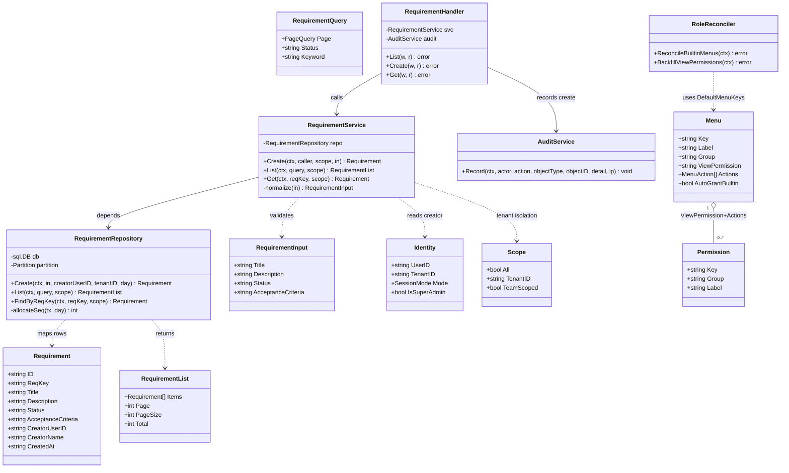
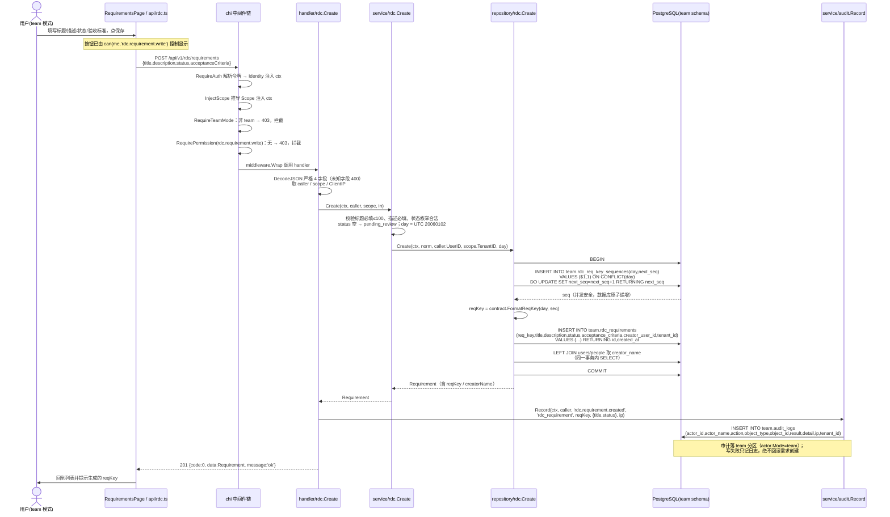
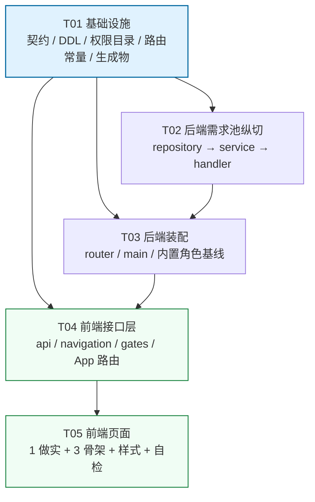

# Dandelion 研发中心（RDC）增量 · 系统设计与任务分解

| 项 | 内容 |
| --- | --- |
| 文档类型 | 系统设计 + 有序任务分解（架构师交付物） |
| 架构师 | 高见远（Gao）· Architect |
| 上游输入 | `deliverables/software-company/rdc-prd.md`（许清楚）+ team-lead 对 Q1/Q2 的裁决 |
| 项目根目录 | `/Users/linanan/Desktop/dandelion`（下文所有路径均相对此根） |
| 强制规范 | `AGENTS.md`（生效优先级高于 `docs/` 设计稿） |
| 本版范围 | 4 菜单权限/路由/导航全打通；需求池做实（列表/新建/详情）；其余 3 菜单为诚实骨架页 |
| 模式限定 | 仅 team；solo 不可见、不可直接访问 |

---

# Part A · 系统设计

## 1. 实现方案概述

### 1.1 技术栈（完全沿用，零新增依赖）

| 层 | 沿用内容 |
| --- | --- |
| 后端 | Go 1.24、`net/http` + chi v5、`database/sql` + pgx/v5 stdlib、PostgreSQL 16 |
| 后端分层 | `handler`（HTTP 语义）→ `service`（业务）→ `repository`（唯一 SQL）；跨层按功能名 `rdc/` 归位 |
| 前端 | React 18 + TypeScript + Vite 5、原生 CSS 变量、`@seakoi/console-kit` 根入口命名导出 |
| 前端分层 | `pages → api → client.ts`；页面三态走 `components/States.tsx`；路由守卫走 `App.tsx` |
| 契约 | `api/openapi.yaml` 为唯一事实来源 → `make gen:api` 生成 `web/src/api/schema.d.ts`（入库，禁手改） |
| DDL | `server/internal/repository/schema.sql`，幂等、`//go:embed`，启动由应用自身账号执行 |

**不引入**：新 ORM、新 migration 框架、新前端测试框架、新权限目录、新 HTTP 客户端、新 UI 组件库子路径（`console-kit/antd` 禁用）。

### 1.2 关键架构决策

#### 决策 D1（Q1 裁决落地）：写权限独立成点

采纳 `rdc.requirement.write`。它挂在 `/rdc/requirements` 菜单的 `Actions` 下（与 `build.write` 的挂法一致），**勾选菜单不自动授予，需在菜单树里单独勾选**。理由：与 `build.read`/`build.write` 分离惯例一致，避免"能看就能改"。

- 后端：列表/详情守 `rdc.requirement.read`，新建守 `rdc.requirement.write`。
- 前端："新建需求"按钮用 `can(me, 'rdc.requirement.write')` 隐藏；`/new` 路由用 `<PermissionGate permission="rdc.requirement.write">`。
- 服务端的 `service/role.derivePermissions` 已实现"操作权限必须挂在已勾菜单下"，因此写点列入 `Actions` 即可被正确授予，无需改角色推导逻辑。

#### 决策 D2（Q2 裁决落地）：验收标准作为选填字段随创建保存

`RequirementInput.acceptanceCriteria` 为选填多行文本，本版随需求一起落 `rdc_requirements.acceptance_criteria`；"附件管理 / AI 需求分析 / 验收标准独立模块"仅在需求中心页面内以说明块标注"后续迭代开放"，不做交互、不做假按钮。

#### 决策 D3（Q3 · 本次由架构师定夺）：`rdc_` 表**只在 team 分区建，不进 FOREACH 循环**

**结论**：在 `schema.sql` 中显式写 `CREATE TABLE IF NOT EXISTS team.rdc_requirements`（以及配套的 `team.rdc_req_key_sequences`），**不放进 `FOREACH s IN ARRAY ['team','solo']` 循环**；仓储层用单个 `*Repository` 固定绑定 `repository.PartitionTeam`，**不使用 `Partitioned[T]` 双份装配**。

**理由（权衡"遵循惯例"与"不为用不到的 solo 造表"）**：

1. **用户与路由的硬边界**：用户明确"只在团队模式下"，后端路由挂 `RequireTeamMode`，solo 会话在任何情况下都拿不到这些数据。为 solo 建一张永远为空、永远不可访问的表，违背 AGENTS.md §3「一个包/目录只因一个变化原因存在」「禁止空壳」。
2. **FOREACH 配方适用的是"两分区同构且都实际使用"的表**：AGENTS.md §7 的配方针对 `projects / builds / audit_logs` 这类两模式都写入、靠 `Partitioned[T].For(mode)` 消除 `if team/solo` 的业务表。研发中心不满足"两模式都使用"这个前提，套用配方只会制造无用副本。
3. **仓库已有 team-only 表/列的先例**：`project_members`、`team_projects`、`team_admins` 是团队专属关联表，建在循环之外并显式指向 `team.*`；`team.audit_logs` 的 `tenant_id/team_id` 也只对 team 分区加列。本决策与这些先例同构。
4. **更少出错面**：单仓储意味着不存在"忘记 `.For(mode)` 导致误入 solo"的可能；模式边界由路由中间件一处承担，代码中不出现 `if mode == team`。

**实现约束**：DDL 仍写在 `schema.sql`（DDL 唯一事实来源，`CREATE TABLE IF NOT EXISTS` 幂等）；表名在仓储构造时由 `repository.PartitionTeam.Table("rdc_requirements")` 生成，禁止手写字符串拼接。

#### 决策 D4：需求编号生成放在哪一层、如何保证并发唯一

- **格式**：`REQ-YYYYMMDD-NNN`（按 PRD 示例，序号 3 位、当天从 001 递增，如 `REQ-20250614-001`）。格式由 `contract.FormatReqKey(day, seq)` 唯一定义，宽度常量化（`contract.ReqSeqWidth = 3`），要改成 6 位只改这一个常量。
- **分层**：**service 触发生成，repository 原子分配，contract 定义格式**。service 校验完字段后取 UTC 日期 `day` 交给 repository；repository 在**同一个事务**里用 `INSERT ... ON CONFLICT (day) DO UPDATE SET next_seq = next_seq + 1 RETURNING next_seq` 拿到序号，调 `contract.FormatReqKey` 拼 key，再 `INSERT` 需求，最后 `COMMIT`。
- **并发唯一性**：序号分配的 UPSERT 是数据库级原子操作，天然无竞态；`rdc_requirements.req_key` 上再加 `UNIQUE` 作最终兜底。事务回滚时计数器一并回滚（允许序号复用，不承诺无空洞）。
- **禁止**用 `SELECT count(*)+1` 或 `max(seq)+1` 分配序号——并发下会撞唯一约束并把用户请求变成 500。

#### 决策 D5：归属字段与公司隔离

- `creator_user_id TEXT NOT NULL DEFAULT ''`：沿现有 `projects/builds.owner_user_id` 的**裸 TEXT** 惯例，不建指向 `users` 的外键（users 被删除时不能让历史需求变成不可读的悬挂行）。
- 展示名不冗余存列：查询时 `LEFT JOIN public.users u ON u.id::text = r.creator_user_id` + `LEFT JOIN public.people p ON p.id = u.person_id`，`creatorName = coalesce(nullif(p.name,''), u.username)`。
- `tenant_id UUID REFERENCES tenants(id)`：**必须有**，否则多公司共享一张需求表就是跨租户泄漏。列表/详情查询统一经 `repository.ScopeFilter(0, 'r', scope)`（超管看全部，公司账号只看本公司，无公司失败关闭）。新建归属从 `scope` 取，**请求体不含 tenantId/creatorUserId**（`DecodeJSON` 未知字段一律 400）。
- 超管（`scope.All`、TenantID 为空）在 team 模式新建时，`tenant_id` 落 NULL，需求成为平台级记录、仅超管可见；不做 403，避免"按钮可见但点了必失败"的坏体验。此假设见 §5 待明确事项 A2。

#### 决策 D6：权限自动授予的陷阱（必须处理）

现有 `repository/role.ReconcileBuiltinMenus` 会把 `contract.AllMenuKeys()` **全量插入所有内置角色的 `role_menus`**，`BackfillViewPermissions` 又会为勾了菜单的角色补 `ViewPermission`。若直接把 4 个 RDC 菜单加进 `Menus`，内置角色会在启动时被自动勾上 RDC 菜单（违反"内置角色默认不含"）。

**处理**：在 `contract.Menu` 增加内部字段 `AutoGrantBuiltin bool`（`json:"-"`，不进前端目录），语义"该菜单是否随内置角色自动授权"；现有 10 项菜单显式置 `true`，4 个 RDC 菜单留零值 `false`。新增 `contract.DefaultMenuKeys()` 只返回 `AutoGrantBuiltin == true` 的菜单，`ReconcileBuiltinMenus` 改用 `DefaultMenuKeys()` 而非 `AllMenuKeys()`。**`AllMenuKeys()` 语义不变**（超管全量、新建角色默认全量仍用它），既有测试 `TestAllMenuKeysMatchesCatalog` 继续通过。

- 团队默认读取基线 `service/authz.defaultPermissions()` 与 solo 基线 `soloPermissions()` **不加入任何 RDC 权限点**。
- 超管 `allPermissions()` 遍历 `contract.Permissions`，新增 5 个点自动进入全量，无需改动该文件。
- `service/role.builtinRoles` 的权限清单**不加入任何 RDC 点**。

#### 决策 D7：solo 超管直输 URL 的兜底

`allPermissions()` 不区分模式，solo 超管在前端 `can(me, 'rdc.requirement.read')` 为真，`PermissionGate` 会放行；后端 `RequireTeamMode` 虽会 403，但用户会看到一个必然报错的页面。**处理**：新增 `web/src/components/TeamModeGate.tsx`（与 `AdminGate`/`LevelGate` 同款"体验层"组件），读 `readSession()?.mode`，非 `team` 时渲染 `Empty('仅团队模式可用')`；4 个 RDC 路由统一 `<TeamModeGate><PermissionGate ...>…</PermissionGate></TeamModeGate>`（`TeamModeGate` 在外，先挡模式）。真正的边界仍是后端 403。

### 1.3 三个骨架菜单的"真实空态"定义

每个骨架菜单有**独立页面文件 + 独立路由 + 独立权限守卫**，内容是：标题、产品说明、子功能清单（只读卡片，逐项标注"后续迭代开放"）、统一后续开放文案。使用 `components/States.tsx` 的 `Empty` 作为空态主体；本版无异步请求，故不伪造 Loading/ErrorState（chunk 级加载/失败由 `App.tsx` 的 `PageBoundary` 兜底）。**不写空 handler、不注册空路由、不写 TODO、不放假数据**。规划中的接口（`/rdc/dev/workspaces` 等）仅在 PRD/本文档中作为文档级说明，不进 `openapi.yaml`、不进 `APIRoutes`、不建路由——否则契约一致性测试会失败。

---

## 2. 文件清单

> 标记：**新** = 新增文件；**改** = 修改现有文件；**生成** = 由 `make gen:api` 产出，禁止手改。
> 所有新增手写文件顶部必须写中文注释四件事：**职责 / 输入 / 输出 / 边界**。

### 2.1 契约与 DDL（事实来源层）

| 路径 | 标记 | 一句话职责 |
| --- | --- | --- |
| `api/openapi.yaml` | 改 | 新增 2 条需求池路径、状态枚举与 DTO/响应 schema；唯一契约事实来源。 |
| `server/internal/repository/schema.sql` | 改 | 在 FOREACH 循环之外新增 team 专属 `rdc_requirements`、`rdc_req_key_sequences` 与索引。 |
| `server/internal/contract/contract.go` | 改 | 新增 5 权限点、4 菜单、2 路由常量、状态枚举、reqKey 格式化/校验、资源与长度常量、`AutoGrantBuiltin`/`DefaultMenuKeys`。 |
| `server/internal/contract/contract_test.go` | 改 | 新增"需求状态枚举与契约一致"测试；路由数一致性由既有测试自动覆盖。 |
| `server/internal/contract/errors_test.go` | 改 | 钉住 4 个 RDC 菜单合法但不进内置角色默认菜单集合。 |
| `web/src/api/schema.d.ts` | 生成 | `make gen:api` 产物，前端 RDC 类型唯一来源，必须入库。 |

### 2.2 后端（分层归位到 `rdc/`）

| 路径 | 标记 | 一句话职责 |
| --- | --- | --- |
| `server/internal/repository/rdc/repository.go` | 新 | 唯一 SQL 出入口：绑定 team 分区，原子分配序号 + 创建、分页列表、按 reqKey 查详情。 |
| `server/internal/service/rdc/service.go` | 新 | 业务层：字段校验、状态缺省、触发编号生成、组装分页结果；不碰 HTTP。 |
| `server/internal/service/rdc/service_test.go` | 新 | 覆盖标题/描述/状态校验、缺省状态、请求体不含归属字段等纯逻辑。 |
| `server/internal/handler/rdc/handler.go` | 新 | HTTP 语义：分页/筛选取参、`DecodeJSON` 严格字段、调 service、写审计、统一响应。 |
| `server/internal/app/router.go` | 改 | `Deps` 注入 RDC handler；新增 team 专区，挂 `RequireTeamMode` + 读/写权限点；补 405 `Allow` 映射。 |
| `server/cmd/server/main.go` | 改 | 构造 RDC 仓储/服务/handler 并注入 `app.Deps`（装配层唯一变更点）。 |
| `server/internal/repository/role/repository.go` | 改 | `ReconcileBuiltinMenus` 由 `AllMenuKeys()` 改为 `DefaultMenuKeys()`，阻止 RDC 菜单自动授予内置角色。 |
| `server/internal/service/role/builtin_test.go` | 改 | 断言 4 个内置角色的默认权限完全不含 RDC 点。 |

> `server/internal/service/authz/service.go`、`server/internal/service/role/service.go`、`web/src/components/Sidebar.tsx` **确认无需改动**（原因见 §1.2 D6/D7、§7 共享知识）。

### 2.3 前端（API / 导航 / 守卫 / 页面）

| 路径 | 标记 | 一句话职责 |
| --- | --- | --- |
| `web/src/api/rdc.ts` | 新 | RDC 接口的唯一消费处：列表（分页+状态+关键字）、详情、新建，类型取自 `schema.d.ts`。 |
| `web/src/components/navigation.ts` | 新改 | 新增一级分组"研发中心"（与"分发"平级）及 4 个 platform 菜单项，各自带查看点。 |
| `web/src/components/icons.tsx` | 改 | 新增 4 个线性图标（需求/AI研发/审核/交付）供新菜单使用。 |
| `web/src/components/TeamModeGate.tsx` | 新 | 体验层模式守卫：非 team 会话渲染"仅团队模式可用"空态。 |
| `web/src/App.tsx` | 改 | 懒加载 6 个 RDC 页面并注册 5 条守卫路由（列表/新建/3 骨架）。 |
| `web/src/utils/format.ts` | 改 | 需求状态中文标签与筛选项的唯一镜像（类型由契约生成物约束）。 |
| `web/src/pages/rdc/RequirementsPage.tsx` | 新 | 需求池列表：服务端分页、状态筛选、关键字搜索、三态、详情抽屉、写权限按钮。 |
| `web/src/pages/rdc/RequirementFormPage.tsx` | 新 | 新建需求表单：标题/描述/状态/验收标准，成功后回列表并提示生成的 ID。 |
| `web/src/pages/rdc/RequirementDetailDrawer.tsx` | 新 | 需求详情抽屉：只读全字段 + 状态标签 + 创建人/时间 + 后续开放说明。 |
| `web/src/pages/rdc/RdcPlaceholderPage.tsx` | 新 | 3 个骨架页共用的纯展示外壳：标题/说明/子功能清单/后续开放文案（无请求）。 |
| `web/src/pages/rdc/DevCenterPage.tsx` | 新 | AI研发中心骨架页，传入自己的 5 个子功能清单。 |
| `web/src/pages/rdc/ReviewCenterPage.tsx` | 新 | 人工审核中心骨架页，传入自己的 4 个子功能清单。 |
| `web/src/pages/rdc/DeliveryCenterPage.tsx` | 新 | 需求交付中心骨架页，传入自己的 4 个子功能清单。 |
| `web/src/styles.scss` | 改 | 需求池筛选行、状态标签、骨架页子功能卡片样式（沿用主色 `#0369a1`）。 |

### 2.4 设计产物（本文件之外）

| 路径 | 标记 | 一句话职责 |
| --- | --- | --- |
| `deliverables/software-company/rdc-class-diagram.mermaid` | 新 | 本文 §3.5 类图单独提取，便于工具链消费。 |
| `deliverables/software-company/rdc-sequence-diagram.mermaid` | 新 | 本文 §4 "创建需求"时序图单独提取。 |

> 注意：`docs/class-diagram.mermaid` / `docs/sequence-diagram.mermaid` 是**既有文件、属于其他特性**，本次不覆盖。

---

## 3. 数据结构与接口

### 3.1 DDL 草案（`schema.sql` 末尾新增，放在 FOREACH 循环之外）

```sql
-- ---------------------------------------------------------------------------
-- 六 · 研发中心（团队专属，不进 FOREACH 循环）
-- 只在 team 模式提供服务：RequireTeamMode 是边界，不为用不到的 solo 造表。
-- 与 project_members / team.audit_logs.tenant_id 等同属"团队专属"先例。
-- ---------------------------------------------------------------------------

-- 需求池主表。req_key 是用户可见的稳定编号，UNIQUE 兜底并发分配；
-- creator_user_id 沿用裸 TEXT 惯例（不加 users 外键，账号删除后历史需求仍可读）；
-- tenant_id 提供公司隔离；status 不加 CHECK（枚举唯一来源是 api/openapi.yaml）。
CREATE TABLE IF NOT EXISTS team.rdc_requirements (
  id                  UUID        PRIMARY KEY DEFAULT gen_random_uuid(),
  req_key             TEXT        NOT NULL UNIQUE,
  title               TEXT        NOT NULL,
  description         TEXT        NOT NULL DEFAULT '',
  status              TEXT        NOT NULL DEFAULT 'pending_review',
  acceptance_criteria TEXT        NOT NULL DEFAULT '',
  creator_user_id     TEXT        NOT NULL DEFAULT '',
  tenant_id           UUID        REFERENCES tenants(id),
  created_at          TIMESTAMPTZ NOT NULL DEFAULT now()
);

-- 列表查询形态：租户 + 状态筛选 + 时间倒序；关键字用 ILIKE 另走全扫兜底（数据量小）。
CREATE INDEX IF NOT EXISTS idx_rdc_requirements_tenant_status_created
  ON team.rdc_requirements (tenant_id, status, created_at DESC);
CREATE INDEX IF NOT EXISTS idx_rdc_requirements_creator
  ON team.rdc_requirements (creator_user_id, created_at DESC);

-- 按日序号计数器：一行一天，序号分配的唯一来源。
-- UPSERT ... RETURNING 是并发安全的；事务回滚时计数一并回滚（允许复用，不承诺无空洞）。
CREATE TABLE IF NOT EXISTS team.rdc_req_key_sequences (
  day      DATE    PRIMARY KEY,
  next_seq INTEGER NOT NULL DEFAULT 1
);
```

**字段与契约对齐表**

| DB 列 | Go 字段 | JSON 字段 | 来源/规则 |
| --- | --- | --- | --- |
| `id` | `Requirement.ID` | `id` | UUID，服务端 |
| `req_key` | `Requirement.ReqKey` | `reqKey` | `REQ-YYYYMMDD-NNN`，唯一不可变 |
| `title` | `Requirement.Title` | `title` | 用户填，必填，≤100 字 |
| `description` | `Requirement.Description` | `description` | 用户填，必填，多行 |
| `status` | `Requirement.Status` | `status` | 枚举，默认 `pending_review` |
| `acceptance_criteria` | `Requirement.AcceptanceCriteria` | `acceptanceCriteria` | 选填，多行 |
| `creator_user_id` | `Requirement.CreatorUserID` | `creatorUserId` | 服务端从 `Identity.UserID` 取 |
| —（JOIN 投影） | `Requirement.CreatorName` | `creatorName` | `people.name` 优先，回落 `users.username` |
| `tenant_id` | —（不进 DTO） | — | 服务端从 `scope.TenantID` 取，仅用于过滤 |
| `created_at` | `Requirement.CreatedAt` | `createdAt` | 服务端，ISO 8601 UTC |

### 3.2 Go DTO / 契约常量（`internal/contract`）

```go
// 权限点：加入 Permissions 目录（超管 allPermissions 自动全量）。
const (
    PermissionRDCRequirementRead  = "rdc.requirement.read"
    PermissionRDCRequirementWrite = "rdc.requirement.write"
    PermissionRDCDevRead          = "rdc.dev.read"
    PermissionRDCReviewRead       = "rdc.review.read"
    PermissionRDCDeliveryRead     = "rdc.delivery.read"
)

// 路由常量（加入 APIRoutes，与 openapi.yaml paths 数一一对应）。
const (
    RouteRDCRequirements     = APIPrefix + "/rdc/requirements"
    RouteRDCRequirementByKey = APIPrefix + "/rdc/requirements/{reqKey}"
)

// 需求状态枚举：与 openapi.yaml 的 RequirementStatus.enum 同序，由契约测试锁死。
const (
    ReqStatusPendingReview    = "pending_review"     // 待评审（默认）
    ReqStatusConfirmed        = "confirmed"          // 已确认
    ReqStatusInDevelopment    = "in_development"     // 研发中
    ReqStatusPendingAcceptance = "pending_acceptance" // 待验收
    ReqStatusDelivered        = "delivered"          // 已交付
    ReqStatusArchived         = "archived"           // 已归档
)
var RequirementStatuses = []string{ /* 同上顺序 */ }
func IsValidRequirementStatus(string) bool

// 编号：格式唯一来源；宽度常量化，3→6 位只改这里。
const (
    ReqKeyPrefix = "REQ-"
    ReqSeqWidth  = 3
)
func FormatReqKey(day string, seq int) string   // REQ-20250614-001
func IsValidReqKey(key string) bool             // ^REQ-\d{8}-\d{3}$（宽度跟随 ReqSeqWidth）

// 资源名与长度上限。
const (
    ResourceRequirement = "需求"
    MaxReqTitleLen      = 100
    MaxReqDescLen       = 4000
    MaxReqAcceptanceLen = 2000
)

type Requirement struct {
    ID                  string `json:"id"`
    ReqKey              string `json:"reqKey"`
    Title               string `json:"title"`
    Description         string `json:"description"`
    Status              string `json:"status"`
    AcceptanceCriteria  string `json:"acceptanceCriteria"`
    CreatorUserID       string `json:"creatorUserId"`
    CreatorName         string `json:"creatorName"`
    CreatedAt           string `json:"createdAt"`
}

// 新建请求：恰好 4 字段；没有 reqKey / status 之外的服务端字段。
// status 传空时由 service 兜底为 pending_review；未知字段一律 400。
type RequirementInput struct {
    Title              string `json:"title"`
    Description        string `json:"description"`
    Status             string `json:"status"`
    AcceptanceCriteria string `json:"acceptanceCriteria"`
}

// 列表查询条件（service/repository 内部类型，非请求体）。
type RequirementQuery struct {
    Page    PageQuery
    Status  string
    Keyword string
}

type RequirementList struct {
    Items []Requirement `json:"items"`
    Page
}
```

**`contract.Menus` 新增 4 项**（`Group: "研发中心"`，路径与前端路由逐一对应；`AutoGrantBuiltin` 留零值 false）：

| Key（页面路径） | Label | Group | ViewPermission | Actions | AutoGrantBuiltin |
| --- | --- | --- | --- | --- | --- |
| `/rdc/requirements` | 需求中心 | 研发中心 | `rdc.requirement.read` | `rdc.requirement.write`（新建需求） | `false` |
| `/rdc/dev` | AI研发中心 | 研发中心 | `rdc.dev.read` | — | `false` |
| `/rdc/review` | 人工审核中心 | 研发中心 | `rdc.review.read` | — | `false` |
| `/rdc/delivery` | 需求交付中心 | 研发中心 | `rdc.delivery.read` | — | `false` |

### 3.3 OpenAPI 路径清单

`servers.url = /api/v1`，统一响应外壳 `{code, data, message}`（`code=0` 成功；失败 `code=HTTP 状态码`、`data=null`），分页统一 `?page=&pageSize=`。

| 方法 | 路径 | 查询/请求体 | 成功响应 | 说明 |
| --- | --- | --- | --- | --- |
| GET | `/rdc/requirements` | `page` (int, 默认1)、`pageSize` (int, 默认10/上限200/0=全量)、`status` (enum, 可选)、`keyword` (string, 可选，匹配 reqKey/title 的 ILIKE) | `200` `RequirementListResponse`：`{items, total, page, pageSize}` | 数据范围由 scope 决定，前端不传 tenant |
| POST | `/rdc/requirements` | `RequirementInput`（title/description/status/acceptanceCriteria） | `201` `RequirementResponse`：`Requirement` | reqKey 由服务端生成；写入审计 |
| GET | `/rdc/requirements/{reqKey}` | 路径参数 `reqKey`（`REQ-YYYYMMDD-NNN`） | `200` `RequirementResponse`：`Requirement` | 详情抽屉用；越界/不存在 → 404 |

**新增 schema**：`RequirementStatus`（enum，6 值）、`Requirement`、`RequirementInput`、`RequirementResponse`、`RequirementListResponse`（后两者沿用 `allOf: ApiResponse` 的现有写法）。

**契约一致性**：新增 2 条路径 ⇒ `contract.APIRoutes` 同步新增 2 个常量，`TestAPIRoutesMatchContract` 继续通过。3 个骨架菜单的规划接口**不写入契约**（见 §1.3）。

### 3.4 前端 API 类型来源

`web/src/api/rdc.ts` 只从 `./schema` 引类型、只经 `./client` 发请求：

```ts
import type { components } from './schema';
import { get, postJSON } from './client';
import type { PageQuery, PagedList } from './query';

type Schemas = components['schemas'];
export type Requirement = Schemas['Requirement'];
export type RequirementInput = Schemas['RequirementInput'];
export type RequirementStatus = Schemas['RequirementStatus'];
export type RequirementPage = PagedList<Requirement>;
```

- 状态中文标签在 `web/src/utils/format.ts` 用 `Record<RequirementStatus, string>` 镜像，漏一个枚举值会**编译报错**。
- 不手改 `schema.d.ts`；契约变更顺序固定：`openapi.yaml` → Go 常量 → `make gen:api` → 前端 API → 测试。

### 3.5 类图（Mermaid）



---

## 4. 程序调用流程 · 创建需求（Mermaid 时序图）



**列表 / 详情调用要点**（同构，不再单独画图）：

- 列表：`RequireAuth → InjectScope → RequireTeamMode → RequirePermission(read)` → `handler.List` 读 `page/pageSize/status/keyword` → `service.List` 归一化 → `repository.List` 用 `repository.ScopeFilter(0,'r',scope)` + `AddIf` 追加条件 + `LIMIT/OFFSET` → `Page`。
- 详情：同一读权限守卫 → `repository.FindByReqKey` 同样经 `ScopeFilter`；非本公司的 reqKey 返回 404，不泄漏存在性。
- 分页默认 10、上限 200、`pageSize=0` 全量；前端页码进 URL（`usePageState` + `replace`）。

---

## 5. 待明确事项 / 已记录的假设

| 编号 | 事项 | 本设计处理 | 需 team-lead / 用户确认? |
| --- | --- | --- | --- |
| A1 | **序号位数**：PRD 示例 `REQ-20250614-001` 是 3 位；team-lead 交办语提到"6 位序号如何生成" | 按 PRD 示例取 3 位，格式宽度常量 `ReqSeqWidth`，改 6 位只动一个常量 + 契约正则 | 建议确认；不阻塞实现 |
| A2 | **超管在 team 模式新建需求**：`scope.All` 无公司归属 | 允许创建，`tenant_id` 落 NULL（平台级，仅超管可见）；避免"按钮可见但必 403" | 请确认是否改为"超管不可新建" |
| A3 | **新建自定义角色默认全量菜单**：现有 `role.Create` 在 `menuKeys` 未传时用 `AllMenuKeys()`，因此新角色会默认含 4 个 RDC 菜单 | 保持既有语义（"新建=全量，勾选=收窄"）；"内置角色/团队基线默认不含"通过 D6 严格保证 | 若要求新角色也默认不含，需改 `AllMenuKeys()` 语义，影响面较大，建议本版不改 |
| A4 | **骨架页"三态"** | 无异步请求，使用 `States.Empty` 作为诚实空态；Loading/ErrorState 由 `PageBoundary` 在 chunk 级承担，不伪造请求三态 | 无需确认，符合"禁止假数据" |
| A5 | **详情按 reqKey 定位而非 UUID** | PRD 中"需求 ID"指 `reqKey`，用户可引用；路径设计为 `/rdc/requirements/{reqKey}` | 建议确认 |
| A6 | 状态枚举英文值 | `pending_review / confirmed / in_development / pending_acceptance / delivered / archived`，中文标签仅在 `format.ts` | 无需确认 |

---

# Part B · 任务分解

## 6. 依赖包

**无新增依赖**。后端 `go.mod`、前端 `package.json` 均不改动。

- 后端复用：`github.com/go-chi/chi/v5`、`github.com/jackc/pgx/v5/stdlib`、`gopkg.in/yaml.v3`（仅契约测试）、标准库 `database/sql`、`encoding/json`、`regexp`、`time`。
- 前端复用：`@seakoi/console-kit`（Drawer / Segmented / Table 等根入口命名导出）、`react-router-dom`、`@seakoi/console-kit` 表格类型。
- 生成工具链已存在：`make gen:api`（`npx openapi-typescript`）。

## 7. 任务列表（按依赖顺序，5 个任务）

> 本增量不新建项目脚手架；**T01 承担"项目基础设施"角色**：契约（配置事实来源）+ DDL（唯一建表入口）+ 权限/路由目录（代码级入口）+ 生成物入库，全部收敛在一个任务内，不分散。

### T01 · 基础设施：契约、DDL、权限目录与路由常量

- **优先级**：P0
- **依赖**：无
- **涉及文件**：
  - `api/openapi.yaml`（2 路径 + 5 schema + 状态枚举）
  - `server/internal/repository/schema.sql`（team 专属 2 表 + 索引）
  - `server/internal/contract/contract.go`（5 权限点、4 菜单、2 路由常量、`AutoGrantBuiltin`/`DefaultMenuKeys`、状态枚举、`FormatReqKey`/`IsValidReqKey`、资源名与长度上限）
  - `server/internal/contract/contract_test.go`（状态枚举一致性断言）
  - `server/internal/contract/errors_test.go`（RDC 菜单合法性 + 不进默认菜单集合）
  - `web/src/api/schema.d.ts`（`make gen:api` 生成物，入库）
- **做什么**：按 §3 落契约与 DDL；DDL 新增段放在 FOREACH 循环之外；`APIRoutes` 与 `openapi.yaml` paths 数量严格相等；`contract.Menu` 新增内部字段并给现有 10 项菜单置 `AutoGrantBuiltin: true`。
- **验收点**：
  1. `make gen:api` 后 `git diff --exit-code -- web/src/api/schema.d.ts` 无差异（生成物已入库）；
  2. `cd server && go test ./internal/contract/...` 全绿，含路径数、状态枚举、菜单唯一性、默认菜单集合 4 类断言；
  3. DDL 在空库与存量库各执行一次均成功（`CREATE TABLE IF NOT EXISTS` 幂等）；team 有表、solo 无 `rdc_` 表；
  4. 手写文件顶部"职责/输入/输出/边界"注释齐全。

### T02 · 后端需求池纵切：repository → service → handler

- **优先级**：P0
- **依赖**：T01
- **涉及文件**：
  - `server/internal/repository/rdc/repository.go`（新）
  - `server/internal/service/rdc/service.go`（新）
  - `server/internal/service/rdc/service_test.go`（新）
  - `server/internal/handler/rdc/handler.go`（新）
- **做什么**：按 §3/§4 实现 3 个接口。仓储固定绑定 `repository.PartitionTeam`，在一个事务里完成"原子分配序号 → 格式化 reqKey → INSERT → JOIN 创建人姓名 → COMMIT"；列表/详情统一 `ScopeFilter` + `AddIf`；service 做校验与状态兜底；handler 做严格 `DecodeJSON`、取分页/筛选参数、写审计 `rdc.requirement.created`。
- **验收点**：
  1. 并发 20 次创建得到 20 个不同 reqKey，序号连续且无重复；
  2. 标题/描述必填、状态非法值、超长字段均返回 400 中文文案；请求体塞 `reqKey`/`tenantId` 返回 400；
  3. A 公司账号查不到 B 公司需求（列表为空、详情 404）；solo 身份在仓储层不会被误路由（仓储无 `.For(mode)` 可用）；
  4. 分层检查：handler 无 SQL、repository 无业务判断、service 无 `*http.Request`；审计写失败不影响创建成功。

### T03 · 后端装配：路由守卫、依赖注入与内置角色基线

- **优先级**：P0
- **依赖**：T01、T02
- **涉及文件**：
  - `server/internal/app/router.go`（`Deps.RDC`、team 专区、3 条路由、`allowedMethods` 与 `allowedMethodsFor`）
  - `server/cmd/server/main.go`（构造仓储/服务/handler 并注入）
  - `server/internal/repository/role/repository.go`（`ReconcileBuiltinMenus` 改用 `DefaultMenuKeys()`）
  - `server/internal/service/role/builtin_test.go`（内置角色无 RDC 权限断言）
- **做什么**：新增 team 路由组：`RequireAuth → InjectScope → RequireTeamMode`，读接口叠 `RequirePermission(rdc.requirement.read)`、POST 叠 `RequirePermission(rdc.requirement.write)`；补 405 `Allow`：`/rdc/requirements` → `GET, POST`，`/rdc/requirements/` 前缀 → `GET`。
- **验收点**：
  1. solo 令牌访问 3 接口均 403；无读/写点的 team 令牌分别 403；超管全通；
  2. 方法不匹配返回 405 + 正确 `Allow` 头 + JSON 外壳；
  3. 启动后内置角色的 `role_menus` 不含 4 个 RDC 菜单、默认读取基线不含 RDC 权限点；超管 `allPermissions` 含全部 5 个新点；
  4. `cd server && make test` 全绿。

### T04 · 前端接口层、导航、模式守卫与路由

- **优先级**：P0
- **依赖**：T01、T03
- **涉及文件**：
  - `web/src/api/rdc.ts`（新）
  - `web/src/components/navigation.ts`（研发中心分组 + 4 菜单）
  - `web/src/components/icons.tsx`（4 图标）
  - `web/src/components/TeamModeGate.tsx`（新）
  - `web/src/App.tsx`（6 个 lazy + 5 条守卫路由）
  - `web/src/utils/format.ts`（状态标签与筛选项）
- **做什么**：4 个菜单全部 `scope:'platform'`、`envScoped:false`、各自 `permission`；5 条路由统一 `<TeamModeGate><PermissionGate permission=...>`；构造列表查询串时复用 `pageQuery()` 并追加 `status`/`keyword`。**不修改 Sidebar**：solo 白名单天然不含 `/rdc/*`，team 走既有 `canSeeNavItem + menuKeys` 交集。
- **验收点**：
  1. `navigation.ts` 的 4 个 `path`/`permission` 与 `contract.Menus` 的 Key/ViewPermission 逐条一致；
  2. team 有读点且勾选了菜单的角色能看到对应项；未授权角色看不到；solo（含超管）侧栏不出现研发中心；
  3. solo 直输 `/rdc/requirements` 显示"仅团队模式可用"，不发起任何 API 请求；无权限账号直输显示"无权访问"；
  4. `npm --prefix web run build` 类型检查通过；无直接 import antd / qrcode.react。

### T05 · 前端页面：需求池做实 + 3 骨架页 + 全量自检

- **优先级**：P0
- **依赖**：T04
- **涉及文件**：
  - `web/src/pages/rdc/RequirementsPage.tsx`（新）
  - `web/src/pages/rdc/RequirementFormPage.tsx`（新）
  - `web/src/pages/rdc/RequirementDetailDrawer.tsx`（新）
  - `web/src/pages/rdc/RdcPlaceholderPage.tsx`（新）
  - `web/src/pages/rdc/DevCenterPage.tsx`（新）
  - `web/src/pages/rdc/ReviewCenterPage.tsx`（新）
  - `web/src/pages/rdc/DeliveryCenterPage.tsx`（新）
  - `web/src/styles.scss`（追加样式）
- **做什么**：列表页用 `DataTable` 服务端分页（`usePageState`，页码进 URL）、`Controls.Segmented` 按状态筛选、关键字搜索、`States` 三态、点 reqKey 开 `DetailDrawer`；"新建需求"按钮按 `can(me,'rdc.requirement.write')` 显示。新建页用 `FormPage`，成功后回列表提示生成的 reqKey。3 骨架页复用 `RdcPlaceholderPage`，各自传入 PRD §4 规定的子功能清单与诚实文案。
- **验收点**：
  1. 列表/新建/详情全链路可用；空列表不挂分页条；详情只读、无编辑/删除假按钮；
  2. 3 骨架页有标题、说明、子功能清单、"后续迭代开放"文案；全仓 `grep -R "TODO"` 在新增目录零命中；无假数据、无空 handler；
  3. 提交前自检四连通过：`make gen:api`、`git diff --exit-code -- web/src/api/schema.d.ts`、`make test`、`npm --prefix web run build`、`make build`；
  4. 所有新增文件有中文四要素注释；未改主色；无第二份权限目录。

## 8. 共享知识 / 跨文件约定（工程师必读）

1. **需求 ID 生成**：格式只在 `contract.FormatReqKey`，宽度只改 `contract.ReqSeqWidth`；service 只传 UTC `day`；序号分配必须是 repository 事务里的 `INSERT ... ON CONFLICT DO UPDATE ... RETURNING`，**严禁** `count(*)+1`；`req_key UNIQUE` 是兜底。
2. **状态枚举**：唯一来源 `api/openapi.yaml` 的 `RequirementStatus.enum`；Go 侧 `contract.RequirementStatuses` 由契约测试锁序；DDL **不加 CHECK**；前端标签用 `Record<RequirementStatus,string>` 在 `format.ts` 镜像，漏值编译报错。
3. **归属与隔离**：`creator_user_id` 是裸 TEXT，不建 FK；`tenant_id` 只从 `scope` 取；所有列表/详情查询必须先 `repository.ScopeFilter(0,'r',scope)` 再 `AddIf` 业务条件；越界一律 404，不用 403 泄漏存在性。
4. **审计**：action 固定 `rdc.requirement.created`，objectType `rdc_requirement`，objectID 用 `reqKey`，detail `{title,status}`；写在 **handler.Create**（与 role/user 一致），经 `audit.Service.Record`，失败只记日志；team 模式天然落 `team.audit_logs`。
5. **权限点命名与授予**：4 个读点 + 1 个写点全部进 `contract.Permissions`；4 个读点分别作 4 菜单的 `ViewPermission`（勾选菜单自动授予）；`rdc.requirement.write` 作 `/rdc/requirements` 的 `Action`（需单独勾）；内置角色与默认基线**不含**任何 RDC 点，靠 `AutoGrantBuiltin=false` + `DefaultMenuKeys()` 保证。
6. **模式边界**：后端 `RequireTeamMode` 是唯一真正的模式边界；前端 `TeamModeGate` 只是体验层；**Sidebar 不改**。
7. **契约/DDL 变更顺序**：`openapi.yaml` → `contract.go`/`APIRoutes` → `schema.sql`（如涉及表）→ `make gen:api` → 前端 api 文件 → 测试。漏一处契约测试必挂。
8. **分页**：后端 `handler.ReadPage`（默认 10/上限 200/0 全量），前端 `usePageState`（页码进 URL、`replace`），`pageQuery()` 拼串；空列表不渲染分页条。
9. **反占位**：3 个骨架菜单不写空 handler、不注册空路由、不进 `openapi.yaml`；页面用真实空态组件，文案诚实说明"后续迭代开放"。
10. **注释规范**：每个新增手写文件顶部中文注释写清"职责 / 输入 / 输出 / 边界"四件事；单文件尽量 ≤400 行。

## 9. 任务依赖图（Mermaid）



**关键路径**：`T01 → T02 → T03 → T04 → T05`。T02 与 T04 的契约消费都只依赖 T01，可在 T03 完成后再合流；实际实现建议严格按关键路径推进，避免前端对接未定型的接口。
