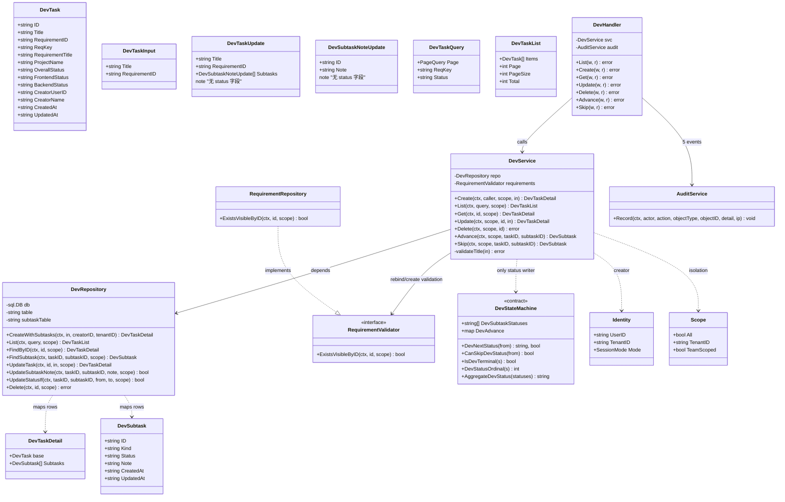
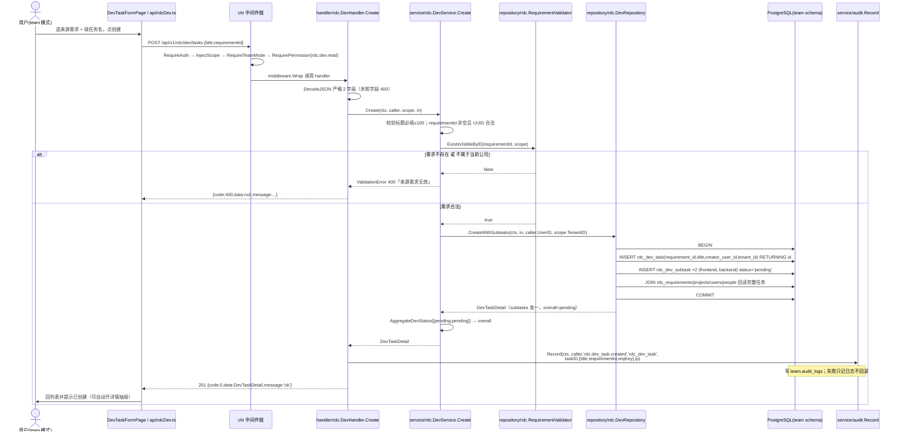
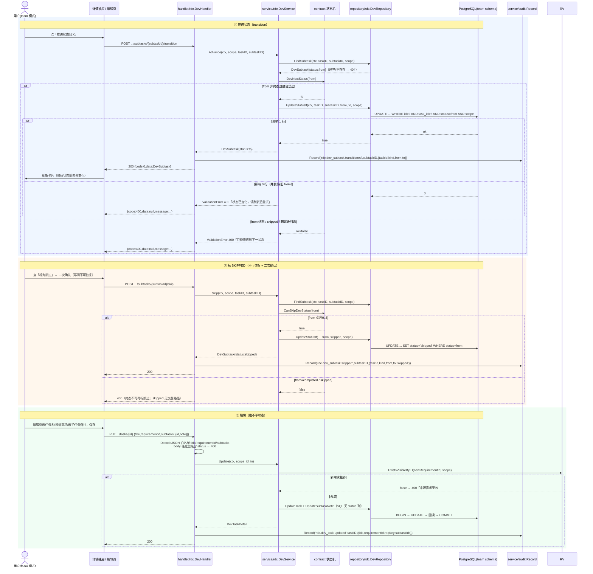
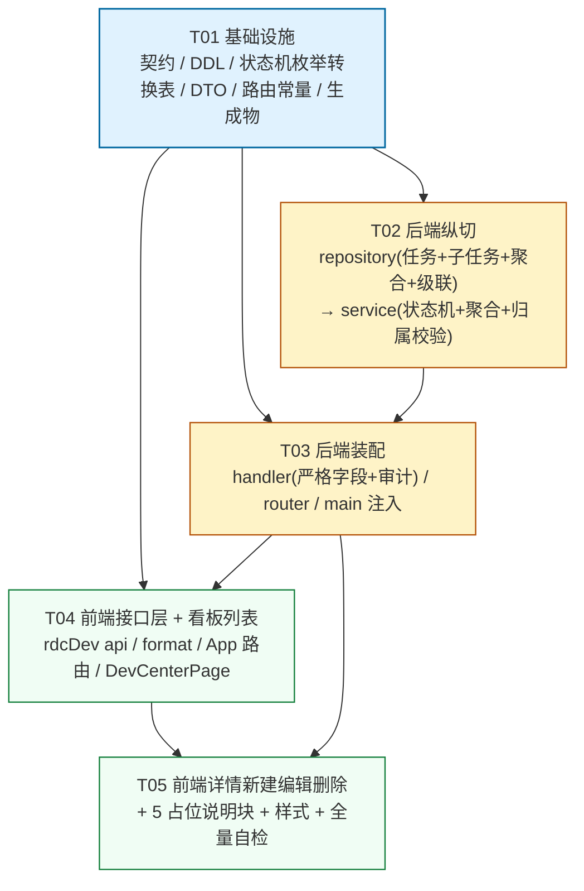

# Dandelion 研发中心（RDC）增量 · AI研发中心「研发任务编排层」系统设计与任务分解

| 项 | 内容 |
| --- | --- |
| 文档类型 | 系统设计 + 有序任务分解（架构师交付物） |
| 架构师 | 高见远（Gao）· Architect |
| 上游输入 | `deliverables/software-company/rdc-dev-prd.md`（许清楚）+ V1.0 `rdc-design.md` / V1.1 `rdc-v1.1-design.md` + team-lead 转达的用户拍板结论（Q1–Q5） |
| 项目根目录 | `/Users/linanan/Desktop/dandelion`（下文路径均相对此根） |
| 强制规范 | `AGENTS.md`（生效优先级高于 `docs/` 设计稿；当前代码与测试 > `api/openapi.yaml` > AGENTS.md） |
| 本版范围 | **只把「02 AI研发中心」从骨架页升级为做实页**：研发任务的创建 / 列表 / 详情 / 编辑 / 删除 + 子任务手动状态流转 |
| 明确不动 | 01 需求中心（含 V1.1 项目关联与图片）、03 人工审核中心、04 需求交付中心；菜单形态、权限点、`/p/:key/*` 一律不动 |
| 模式限定 | 仅 team；solo 不可见、不可直接访问（沿用 V1.0/V1.1） |

---

# Part A · 系统设计

## 1. 实现方案概述

### 1.1 关键架构决策（按重要性排序）

#### D1 · 状态机校验唯一来源 = `internal/contract`，openapi.yaml 是其 SSOT

- **单一事实来源**：`api/openapi.yaml` 新增两个扩展字段
  - `x-rdc-dev-statuses`：9 个状态值，顺序即进度序（`pending → ai_running → ai_completed → reviewing → waiting_commit → committed → validated → completed`，`skipped` 列末尾且不参与序比较）；
  - `x-rdc-dev-transitions`：`{"pending":"ai_running", ..., "validated":"completed"}`，**只有 8 条合法前进边**，终态（completed / skipped）不作为 key 出现。
- **Go 镜像**在 `contract/contract.go`：`DevSubtaskStatuses`（切片）、`DevAdvance`（map）、`DevNextStatus(from) (to string, ok bool)`、`CanSkipDevStatus(from) bool`、`IsDevTerminal(from) bool`、`DevStatusOrdinal(from) int`。`contract_test.go` 逐项与上述两个扩展比对锁死，漂移即测试失败。
- **唯一调用者**：只有 `service/rdc.DevService.Advance` / `.Skip` 调用这组函数。任何新增状态写入路径必须先过这里。
- **DDL 不加 CHECK**（沿用 V1.0/V1.1 惯例）：枚举的唯一来源是契约，数据库只存 TEXT。

#### D2 · 编辑与状态推进的职责边界（安全底线，必须落实）

用户口径是"暂时都可以改"，但**"编辑"入口绝不能绕过 8 态状态机**。设计上用四道闸门保证：

1. **编辑 DTO 没有 status 字段**：`contract.DevTaskUpdate = {title, requirementId, subtasks:[{id, note}]}`；`handler` 用 `handler.DecodeJSON(w, r, &in, "title/requirementId/subtasks")`，其 `DisallowUnknownFields` 会拒绝**任意层级**出现的 `status` 字段（含嵌在 `subtasks[]` 里的）→ 400。
2. **编辑 SQL 不碰 status**：repository 的编辑语句只 `UPDATE ... SET note=?, updated_at=?`（子任务）与 `SET title=?, requirement_id=?, updated_at=?`（任务），语句里根本没有 status 列。
3. **状态写入只走两条专用路径**：`POST .../transition`（前进一态）与 `POST .../skip`（标跳过），二者先过 `contract.DevNextStatus` / `CanSkipDevStatus` 校验，非法转换一律 400。
4. **SKIPPED 永久不可恢复**：`DevNextStatus("skipped")` 返回 `ok=false`，且全仓**不存在 unskip / 恢复接口**、编辑 DTO 也无 status —— 没有第二条路能写回非终态。

> 一句话记法：**编辑改"资料"，推进/跳过改"状态"；状态只有一个写入口，就是状态机。**

#### D3 · 整体状态不落列（Q1），按聚合推导，两处实现统一口径

- 任务表**没有 status 列**。整体状态 = 两条子任务按以下规则聚合：
  1. 排除 `skipped`；
  2. 若两条都被排除（都 SKIPPED）→ 整体为 `completed`（"两条都终态视为完成"）；
  3. 否则取剩余子任务中**状态序号最小**的一条（"进度最靠前 / 状态序号最小"），即瓶颈语义：任务整体只走到较慢的那条子任务。
- **展示唯一来源**：`contract.AggregateDevStatus([]string) string`（Go 纯函数），由 service 对详情/列表项统一赋值。
- **筛选来源**：列表 SQL 用等价的 `MIN(CASE status ...)` 聚合表达式（skipped → NULL，被 MIN 忽略），`COALESCE(min_ord, 7)` 即整体序号，与筛选参数序号比较。
- 两处必须一致：新增 `repository` 集成测试，构造全部代表性子任务组合，断言"SQL 筛出的任务集合 == Go 聚合结果满足条件的集合"，钉死 SQL 里的序号 CASE 与 contract 顺序不漂移。

#### D4 · team 专属表不进 FOREACH，单仓储固定绑定 team 分区

沿用 V1.0 决策 D3：`CREATE TABLE ... team.rdc_dev_task / team.rdc_dev_subtask` 写在 `schema.sql` "六 · 研发中心"段、**`FOREACH` 循环之外**；仓储固定 `repository.PartitionTeam.Table("rdc_dev_task")`，不提供 `.For(mode)`。理由：`RequireTeamMode` 已是硬边界，不为永远为空、永远不可达的 solo 造表；也避免"忘记 `.For(mode)` 误入 solo"。

#### D5 · 绑定真相 = `requirement_id`（Q5），一对多，reqKey 仅投影

- `rdc_dev_task.requirement_id UUID NOT NULL REFERENCES team.rdc_requirements(id)`；一条需求可对应任意多条任务，不设唯一约束。
- `reqKey` / 需求标题 / 项目名 **不冗余存列**，列表与详情均 `LEFT JOIN team.rdc_requirements r ON r.id = t.requirement_id` + `LEFT JOIN team.projects pj` 投影得到；需求中心本就无删除路径，外键不需要 `ON DELETE CASCADE`。
- 换绑需求时校验新 `requirementId` 在 `scope` 内可见（复用需求仓储新增 `ExistsVisibleByID`）；跨公司 → 400，不泄漏存在性细节。

#### D6 · 删除级联 + 审计全覆盖（Q3/Q4）

- `rdc_dev_subtask.task_id ... REFERENCES rdc_dev_task(id) ON DELETE CASCADE`：删任务即级联删两条子任务，无孤儿行。
- 5 类写操作全部写 `team.audit_logs`（team 模式天然落 team 分区），经 `audit.Service.Record`，**失败只记日志不回滚**：
  `rdc.dev_task.created` / `rdc.dev_task.updated` / `rdc.dev_task.deleted` / `rdc.dev_subtask.transitioned` / `rdc.dev_subtask.skipped`；detail 一律含 `taskId`，子任务事件另含 `kind/from/to`。

#### D7 · 权限与隔离：全程只用 `rdc.dev.read`

- 不新增写权限点（有意偏离读写分离惯例，以用户拍板为准）。7 个操作（列表/详情/新建/编辑/删除/推进/跳过）**全部**挂 `RequirePermission(rdc.dev.read)`；前端也不做写点判断（`me=null` 由上层 Gate 兜底）。
- 路由链：`RequireAuth → InjectScope → RequireTeamMode → RequirePermission(rdc.dev.read)`，沿用现有 team 专区写法。
- 所有查询先 `repository.ScopeFilter(0, "t", scope)` 再叠业务条件；越界/不存在 → 404（不泄漏存在性）。需求下拉与换绑校验同样按 scope 过滤。

#### D8 · 5 个占位子功能：反占位处理

`Git 工作区 / 开发环境 / 数据库 / Agent 调度 / 自动测试` 从骨架页**迁移到详情抽屉**的只读说明块（PRD §6.3），逐项标注"后续迭代开放"。约束：
- 不注册路由、不建 handler、不进 `openapi.yaml`、不进 `APIRoutes`（否则契约一致性测试失败）；
- **没有任何按钮 / 链接 / 请求**（无"执行/连接/创建工作区/调度 Agent/运行测试"）；
- 真实的状态推进按钮文案用"推进状态到 …"，不暗示触发真实研发动作；
- `03/04` 继续用未改动的 `RdcPlaceholderPage`，`DevCenterPage` 不再引用它。

### 1.2 技术栈（零新增依赖）

| 层 | 沿用 |
| --- | --- |
| 后端 | Go 1.24 + chi v5 + pgx/v5 stdlib + PostgreSQL 16；`handler → service → repository` 按功能名归位到 `rdc/` |
| 前端 | React 18 + TypeScript + Vite 5 + `@seakoi/console-kit` 根入口命名导出；`pages → api → client.ts` |
| 契约 | `openapi.yaml` → `make gen:api` 生成 `web/src/api/schema.d.ts`（入库，禁手改） |
| DDL | `server/internal/repository/schema.sql`，幂等、`//go:embed`，启动由应用自身账号执行 |

**不引入**：新 ORM、新迁移框架、新权限点、新 UI 组件库、第二份状态机或第二份枚举目录。

---

## 2. 文件清单

> 标记：**新** / **改** / **生成**（`schema.d.ts` 禁手改）。所有新增手写文件顶部写中文四要素注释：**职责 / 输入 / 输出 / 边界**；单文件尽量 ≤ 400 行（故后端按 `dev_*.go` 拆文件，不塞进既有需求文件）。

### 2.1 契约与 DDL（事实来源层）

| 路径 | 标记 | 职责 |
| --- | --- | --- |
| `api/openapi.yaml` | 改 | 新增 4 条路径（7 个操作）、9 值状态枚举、`x-rdc-dev-statuses`/`x-rdc-dev-transitions`、DTO/响应 schema。 |
| `server/internal/repository/schema.sql` | 改 | "六 · 研发中心"段末尾新增 `rdc_dev_task`、`rdc_dev_subtask` 及索引（循环外、team 专属）。 |
| `server/internal/contract/contract.go` | 改 | 状态枚举/转换表/聚合与序号函数、4 路由常量、资源名与长度上限、Dev DTO 全套。 |
| `server/internal/contract/contract_test.go` | 改 | 状态枚举 + 转换表 + 聚合金标准 + 路由数一致性断言（既有测试自动覆盖路径数）。 |
| `web/src/api/schema.d.ts` | 生成 | `make gen:api` 产物，前端类型唯一来源，必须入库。 |

### 2.2 后端（按功能归位到 `rdc/`）

| 路径 | 标记 | 职责 |
| --- | --- | --- |
| `server/internal/repository/rdc/dev_repository.go` | 新 | 研发任务 + 子任务唯一 SQL 出入口：单事务建任务并成对插子任务、聚合分页列表、按 id 详情、换绑/编辑、级联删、条件状态更新。 |
| `server/internal/repository/rdc/dev_repository_test.go` | 新 | 聚合 SQL 与 Go 聚合一致性、级联删除、条件状态更新（并发/陈旧 from 返回 0 行）测试。 |
| `server/internal/repository/rdc/repository.go` | 改 | 需求仓储新增 `ExistsVisibleByID(ctx, id, scope) bool`，供新建/换绑校验需求归属。 |
| `server/internal/service/rdc/dev_service.go` | 新 | 业务层：字段校验、需求归属校验、状态机唯一调用、聚合口径、审计事件数据组装；不碰 HTTP。 |
| `server/internal/service/rdc/dev_service_test.go` | 新 | 合法/非法转换、终态禁推进、SKIPPED 不可恢复、聚合 9 种组合、换绑越界、编辑拒 status 的纯逻辑用例。 |
| `server/internal/handler/rdc/dev_handler.go` | 新 | HTTP 语义：分页/筛选取参、严格 `DecodeJSON`（编辑白名单不含 status）、调 service、写 5 类审计、统一响应。 |
| `server/internal/handler/rdc/dev_handler_test.go` | 新 | 编辑请求塞 status（含嵌套）→ 400；路径参数缺失 → 400；审计 action 断言。 |
| `server/internal/app/router.go` | 改 | `Deps.RDCDev` 注入；4 条路径 / 7 个操作注册到 team 专区且全挂 `rdc.dev.read`；补 405 `Allow` 映射。 |
| `server/cmd/server/main.go` | 改 | 构造 dev 仓储/服务/handler 并注入 `app.Deps`（装配层唯一变更点）。 |

> `service/rdc/service.go`、`handler/rdc/handler.go`、`handler/rdc/multipart.go`、`storage/paths.go`、`contract.Menus`、`Permissions`、`authz`、`TeamModeGate`、`navigation.ts`、`icons.tsx`、`RdcPlaceholderPage.tsx`、03/04 骨架页 **确认不改**。

### 2.3 前端（API / 类型 / 页面 / 样式）

| 路径 | 标记 | 职责 |
| --- | --- | --- |
| `web/src/api/rdcDev.ts` | 新 | 研发任务接口唯一消费处：列表（分页+reqKey+状态）、详情、新建、编辑、删除、推进、跳过；类型取自 `schema.d.ts`。 |
| `web/src/utils/format.ts` | 改 | 状态中文标签 `Record<DevSubtaskStatus,string>` 与筛选项、子类型标签、整体状态文案的唯一镜像。 |
| `web/src/App.tsx` | 改 | 懒加载列表/新建/编辑页；`/rdc/dev`、`/rdc/dev/new`、`/rdc/dev/:id/edit` 三条路由统一 `<TeamModeGate><PermissionGate permission="rdc.dev.read">`（详情用抽屉，无独立路由）。 |
| `web/src/pages/rdc/DevCenterPage.tsx` | 改 | 从骨架页升级为真实看板/列表页：筛选、服务端分页、三态、点任务名开详情抽屉、新建入口。 |
| `web/src/pages/rdc/DevTaskFormPage.tsx` | 新 | 新建页：来源需求下拉（仅本公司，`listRequirements({pageSize:0})`）+ 任务名；提交后建任务并自动拆两子任务。 |
| `web/src/pages/rdc/DevTaskEditPage.tsx` | 新 | 编辑页：改任务名、换绑需求、改子任务备注；**不渲染任何 status 控件**，提供"去详情推进状态"提示。 |
| `web/src/pages/rdc/DevTaskDetailDrawer.tsx` | 新 | 详情抽屉：两张子任务卡片（状态标签 / 推进按钮 / 跳过二次确认 / 最近推进时间）+ 换绑需求信息 + 删除二次确认 + 编辑入口 + 5 占位说明块。 |
| `web/src/pages/rdc/DevPlaceholderFeatures.tsx` | 新 | 5 个占位子功能的纯文字说明块（只读卡片，无按钮/链接/请求），供详情抽屉复用。 |
| `web/src/styles.scss` | 改 | 看板筛选行、子任务卡片、状态徽标、确认弹窗文案、占位说明块样式（沿用主色 `#0369a1`）。 |

### 2.4 设计产物（本文件之外）

| 路径 | 标记 | 职责 |
| --- | --- | --- |
| `deliverables/software-company/rdc-dev-class-diagram.mermaid` | 新 | 本文 §3.7 类图单独提取。 |
| `deliverables/software-company/rdc-dev-sequence-diagram.mermaid` | 新 | 本文 §4 两张时序图单独提取（含失败路径）。 |

> `docs/class-diagram.mermaid` / `docs/sequence-diagram.mermaid` 属于其他特性，本次不覆盖。

---

## 3. 数据结构与接口

### 3.1 DDL 草案（`schema.sql`「六 · 研发中心」段末尾，循环之外，team 专属）

```sql
-- 增量 3：研发任务（一对多："多"侧外键指向需求；需求无删除路径，外键不设级联）。
-- 整体状态不落列：由两条子任务按 contract.AggregateDevStatus 聚合推导。
-- creator_user_id 沿用裸 TEXT 惯例（不加 users 外键，账号删除后历史任务仍可读）；
-- tenant_id 提供公司隔离；kind/status 不加 CHECK（枚举唯一来源是 api/openapi.yaml）。
CREATE TABLE IF NOT EXISTS team.rdc_dev_task (
  id              UUID        PRIMARY KEY DEFAULT gen_random_uuid(),
  requirement_id  UUID        NOT NULL REFERENCES team.rdc_requirements(id),
  title           TEXT        NOT NULL,
  creator_user_id TEXT        NOT NULL DEFAULT '',
  tenant_id       UUID        REFERENCES tenants(id),
  created_at      TIMESTAMPTZ NOT NULL DEFAULT now(),
  updated_at      TIMESTAMPTZ NOT NULL DEFAULT now()
);
-- 列表形态：租户 + 需求 + 时间倒序；单需求多任务的反向查询走 requirement_id 索引。
CREATE INDEX IF NOT EXISTS idx_rdc_dev_task_tenant_created
  ON team.rdc_dev_task (tenant_id, created_at DESC);
CREATE INDEX IF NOT EXISTS idx_rdc_dev_task_tenant_requirement
  ON team.rdc_dev_task (tenant_id, requirement_id, created_at DESC);

-- 增量 4：子任务。一任务恰好 frontend + backend 各一条，用唯一索引强制；
-- status 默认 pending；note 是编辑接口唯一可改的子任务属性（非状态）；
-- task_id 级联删除，保证删任务后无子任务孤儿行。
CREATE TABLE IF NOT EXISTS team.rdc_dev_subtask (
  id         UUID        PRIMARY KEY DEFAULT gen_random_uuid(),
  task_id    UUID        NOT NULL REFERENCES team.rdc_dev_task(id) ON DELETE CASCADE,
  kind       TEXT        NOT NULL,              -- frontend | backend，枚举见 openapi
  status     TEXT        NOT NULL DEFAULT 'pending',
  note       TEXT        NOT NULL DEFAULT '',   -- 可编辑的非状态配置
  created_at TIMESTAMPTZ NOT NULL DEFAULT now(),
  updated_at TIMESTAMPTZ NOT NULL DEFAULT now()
);
CREATE UNIQUE INDEX IF NOT EXISTS uq_rdc_dev_subtask_task_kind
  ON team.rdc_dev_subtask (task_id, kind);
CREATE INDEX IF NOT EXISTS idx_rdc_dev_subtask_task
  ON team.rdc_dev_subtask (task_id);
```

**字段对齐表**

| DB 列 | Go 字段 | JSON 字段 | 来源 / 规则 |
| --- | --- | --- | --- |
| `t.id` | `DevTask.ID` | `id` | UUID，服务端；详情/操作按 id 定位。 |
| `t.requirement_id` | `DevTask.RequirementID` | `requirementId` | 必填；新建/换绑均校验在 scope 内可见。 |
| —（JOIN `r.req_key`） | `DevTask.ReqKey` | `reqKey` | 投影，仅展示/筛选；不可改。 |
| —（JOIN `r.title`） | `DevTask.RequirementTitle` | `requirementTitle` | 投影，详情展示。 |
| —（JOIN `pj.name`） | `DevTask.ProjectName` | `projectName` | 投影；空串即"未归属项目"。 |
| `t.title` | `DevTask.Title` | `title` | 用户填，必填 ≤100 字，可编辑。 |
| `t.creator_user_id` | `DevTask.CreatorUserID` | `creatorUserId` | 服务端从 `Identity.UserID` 取，不可改。 |
| —（JOIN users→people） | `DevTask.CreatorName` | `creatorName` | 投影。 |
| `t.tenant_id` | —（不进 DTO） | — | 服务端从 `scope.TenantID` 取，仅用于过滤。 |
| `t.created_at/updated_at` | `DevTask.CreatedAt/UpdatedAt` | `createdAt/updatedAt` | UTC RFC3339。 |
| —（聚合推导） | `DevTask.OverallStatus` | `overallStatus` | `contract.AggregateDevStatus`，见 D3。 |
| —（JOIN 两条子任务） | `DevTask.FrontendStatus/BackendStatus` | `frontendStatus/backendStatus` | 列表两标签用。 |
| `s.id/kind/status/note` | `DevSubtask.*` | `id/kind/status/note` | `kind` 固定两值；`status` 只允许经状态机写。 |
| `s.updated_at` | `DevSubtask.UpdatedAt` | `updatedAt` | 最近推进时间。 |

### 3.2 契约常量 / DTO（`internal/contract`）

```go
// 路由常量（+4；APIRoutes 长度 34 → 38，与 openapi paths 数一一对应；
// 已含 RouteBuildVersions 与既有 3 条 RDC 需求路径，绝不丢失）。
const (
    RouteRDCDevTasks            = APIPrefix + "/rdc/dev/tasks"
    RouteRDCDevTaskByID         = APIPrefix + "/rdc/dev/tasks/{id}"
    RouteRDCDevSubtaskTransition = APIPrefix + "/rdc/dev/tasks/{id}/subtasks/{subtaskId}/transition"
    RouteRDCDevSubtaskSkip       = APIPrefix + "/rdc/dev/tasks/{id}/subtasks/{subtaskId}/skip"
)

// 9 个状态值：与 openapi.yaml 的 x-rdc-dev-statuses 同序，契约测试逐项锁死。
const (
    DevStatusPending       = "pending"
    DevStatusAIRunning     = "ai_running"
    DevStatusAICompleted   = "ai_completed"
    DevStatusReviewing     = "reviewing"
    DevStatusWaitingCommit = "waiting_commit"
    DevStatusCommitted     = "committed"
    DevStatusValidated     = "validated"
    DevStatusCompleted     = "completed"
    DevStatusSkipped       = "skipped"
)
var DevSubtaskStatuses = []string{ /* 上述 9 项，按进度序 */ }

// 合法前进边：与 openapi.yaml 的 x-rdc-dev-transitions 逐项锁死；终态不是 key。
var DevAdvance = map[string]string{
    DevStatusPending: DevStatusAIRunning,
    DevStatusAIRunning: DevStatusAICompleted,
    DevStatusAICompleted: DevStatusReviewing,
    DevStatusReviewing: DevStatusWaitingCommit,
    DevStatusWaitingCommit: DevStatusCommitted,
    DevStatusCommitted: DevStatusValidated,
    DevStatusValidated: DevStatusCompleted,
}
func DevNextStatus(from string) (string, bool)   // 合法前进；终态/skipped/非法 → ok=false
func CanSkipDevStatus(from string) bool          // 仅序 0..6（非终态）可跳过；completed/skipped → false
func IsDevTerminal(s string) bool                // completed | skipped
func DevStatusOrdinal(s string) int              // 0..7；skipped/未知 → -1（SQL MIN 口径的 Go 镜像）
func AggregateDevStatus(statuses []string) string // D3 聚合，展示唯一来源

// 子任务类型 / 资源名 / 上限
const (
    DevKindFrontend = "frontend"
    DevKindBackend  = "backend"
    ResourceDevTask     = "研发任务"
    ResourceDevSubtask  = "研发子任务"
    MaxDevTitleLen      = 100
    MaxDevNoteLen       = 500
)

// DTO —— 列表项含聚合状态与两条子任务状态
type DevSubtask struct {
    ID, Kind, Status, Note, CreatedAt, UpdatedAt string
}
type DevTask struct {
    ID, Title, RequirementID string
    ReqKey, RequirementTitle, ProjectName string // JOIN 投影
    OverallStatus, FrontendStatus, BackendStatus string
    CreatorUserID, CreatorName string
    CreatedAt, UpdatedAt string
}
type DevTaskDetail struct {
    DevTask
    Subtasks []DevSubtask `json:"subtasks"` // 恰好 2 条，前端/后端；非 nil
}
type DevTaskList struct {
    Items []DevTask `json:"items"`
    Page
}

// 输入 —— 关键：Update 里没有 status，嵌套结构也没有 status
type DevTaskInput struct {
    Title string `json:"title"`
    RequirementID string `json:"requirementId"`
}
type DevSubtaskNoteUpdate struct {
    ID string `json:"id"`
    Note string `json:"note"`
}
type DevTaskUpdate struct {
    Title string `json:"title"`
    RequirementID string `json:"requirementId"`
    Subtasks []DevSubtaskNoteUpdate `json:"subtasks"`
}
type DevTaskQuery struct {
    Page PageQuery
    ReqKey string // 精确匹配（来自需求下拉的完整编号）
    Status string // 整体状态筛选（8 值之一；skipped 不作为整体态）
}
```

**`openapi.yaml` 契约扩展（SSOT 片段）**

```yaml
x-rdc-dev-statuses: [pending, ai_running, ai_completed, reviewing, waiting_commit, committed, validated, completed, skipped]
x-rdc-dev-transitions:
  pending: ai_running
  ai_running: ai_completed
  ai_completed: reviewing
  reviewing: waiting_commit
  waiting_commit: committed
  committed: validated
  validated: completed
```

### 3.3 OpenAPI 路径清单（4 个路径 / 7 个操作；`servers.url = /api/v1`，统一外壳 `{code,data,message}`）

| 方法 | 路径 | 查询 / 请求体 | 成功响应 | 说明 |
| --- | --- | --- | --- | --- |
| GET | `/rdc/dev/tasks` | `page,pageSize,reqKey,status` | `200 DevTaskListResponse` `{items,total,page,pageSize}` | 数据范围由 scope 决定；`reqKey` 精确匹配，`status` 按整体态筛选。 |
| POST | `/rdc/dev/tasks` | `DevTaskInput` | `201 DevTaskDetailResponse` | 建任务 + 自动成对插 `pending` 子任务；写 `created` 审计。 |
| GET | `/rdc/dev/tasks/{id}` | 路径 `id`(uuid) | `200 DevTaskDetailResponse` | 详情含两子任务 + 需求投影；越界 404。 |
| PUT | `/rdc/dev/tasks/{id}` | `DevTaskUpdate`（**无 status**） | `200 DevTaskDetailResponse` | 改任务名/换绑需求/改子任务备注；写 `updated` 审计；body 含 status → 400。 |
| DELETE | `/rdc/dev/tasks/{id}` | 路径 `id` | `200` | 级联删两子任务；写 `deleted` 审计；越界 404。 |
| POST | `/rdc/dev/tasks/{id}/subtasks/{subtaskId}/transition` | 空 body | `200 DevSubtaskResponse` | 只前进一态；`DevNextStatus` 校验；写 `transitioned` 审计；非法 400。 |
| POST | `/rdc/dev/tasks/{id}/subtasks/{subtaskId}/skip` | 空 body | `200 DevSubtaskResponse` | 标 SKIPPED，永久不可恢复；`CanSkipDevStatus` 校验；写 `skipped` 审计。 |

**新增 schema**：`DevSubtaskStatus`（enum 9）、`DevSubtaskKind`（enum 2）、`DevSubtask`、`DevTask`、`DevTaskDetail`（`allOf: DevTask` + `subtasks`）、`DevTaskInput`、`DevTaskUpdate`、`DevSubtaskNoteUpdate`、`DevTaskResponse`、`DevTaskDetailResponse`、`DevTaskListResponse`、`DevSubtaskResponse`。

**契约一致性**：新增 4 个 paths ⇒ `APIRoutes` 同步加 4 常量（保留 `RouteBuildVersions` + 既有 3 条 RDC 路径）；5 个占位子功能的规划接口一律**不写入**契约。

### 3.4 列表筛选与聚合 SQL 口径（工程师必读）

```text
基表：team.rdc_dev_task t
JOIN：LEFT JOIN team.rdc_requirements r ON r.id = t.requirement_id
      LEFT JOIN team.projects pj ON pj.id = r.project_id
      LEFT JOIN public.users u ON u.id::text = t.creator_user_id
      LEFT JOIN public.people p ON p.id = u.person_id
      LEFT JOIN team.rdc_dev_subtask sf ON sf.task_id=t.id AND sf.kind='frontend'
      LEFT JOIN team.rdc_dev_subtask sb ON sb.task_id=t.id AND sb.kind='backend'
      LEFT JOIN (SELECT task_id,
                   MIN(CASE status WHEN 'pending' THEN 0 WHEN 'ai_running' THEN 1
                       WHEN 'ai_completed' THEN 2 WHEN 'reviewing' THEN 3
                       WHEN 'waiting_commit' THEN 4 WHEN 'committed' THEN 5
                       WHEN 'validated' THEN 6 WHEN 'completed' THEN 7 END) AS min_ord
                 FROM team.rdc_dev_subtask GROUP BY task_id) agg ON agg.task_id=t.id
隔离：先 repository.ScopeFilter(0,"t",scope)，再 AddIf 业务条件
筛选：reqKey → r.req_key = ?；status → COALESCE(agg.min_ord,7) = DevStatusOrdinal(?)
投影：overallStatus 由 service 调 contract.AggregateDevStatus([]string{sf.status, sb.status}) 赋值
分页：count(*) 同 WHERE；LIMIT/OFFSET 用 filter.Next(n)；created_at DESC
```

> `skipped` → `CASE` 返回 NULL 被 MIN 忽略；两条都 skipped → `min_ord IS NULL` → `COALESCE(...,7)` → 整体 `completed`，与 Go 聚合一致。

### 3.5 前端类型来源

```ts
// api/rdcDev.ts：只从 ./schema 引类型、只经 ./client 发请求
export type DevTask = Schemas['DevTask'];
export type DevTaskDetail = Schemas['DevTaskDetail'];
export type DevSubtask = Schemas['DevSubtask'];
export type DevSubtaskStatus = Schemas['DevSubtaskStatus'];
export interface DevTaskListQuery extends PageQuery { reqKey?: string; status?: DevSubtaskStatus }
export function listDevTasks(q: DevTaskListQuery = {}): Promise<PagedList<DevTask>>
export function getDevTask(id: string): Promise<DevTaskDetail>
export function createDevTask(in: DevTaskInput): Promise<DevTaskDetail>
export function updateDevTask(id: string, in: DevTaskUpdate): Promise<DevTaskDetail>
export function deleteDevTask(id: string): Promise<null>
export function advanceDevSubtask(taskId: string, subtaskId: string): Promise<DevSubtask>
export function skipDevSubtask(taskId: string, subtaskId: string): Promise<DevSubtask>
```

状态中文标签在 `web/src/utils/format.ts` 用 `Record<DevSubtaskStatus, string>` 镜像，漏一个枚举值编译报错；不手改 `schema.d.ts`。

### 3.6 审计事件约定

| 操作 | action | objectType | objectID | detail（要点） |
| --- | --- | --- | --- | --- |
| 新建任务 | `rdc.dev_task.created` | `rdc_dev_task` | taskID | `{title, requirementId, reqKey, creatorUserId}` |
| 编辑任务 | `rdc.dev_task.updated` | `rdc_dev_task` | taskID | `{title, requirementId, reqKey, subtaskIds}` |
| 删除任务 | `rdc.dev_task.deleted` | `rdc_dev_task` | taskID | `{title, reqKey, subtaskCount:2}` |
| 推进状态 | `rdc.dev_subtask.transitioned` | `rdc_dev_subtask` | subtaskID | `{taskId, kind, from, to}` |
| 标跳过 | `rdc.dev_subtask.skipped` | `rdc_dev_subtask` | subtaskID | `{taskId, kind, from, to:'skipped'}` |

均写在 `handler/rdc/dev_handler.go` 成功分支之后；`audit.Record` 失败只记日志，绝不回滚业务写。

### 3.7 类图（Mermaid）



---

## 4. 程序调用流程（Mermaid 时序图）

### 4.1 创建研发任务（自动拆两子任务）+ 审计



### 4.2 推进 / 跳过 / 编辑（含状态机校验、审计与失败路径）



### 4.3 列表 / 详情 / 删除要点（不单独画图）

- **列表**：同一读权限守卫 → `handler.List` 读 `page/pageSize/reqKey/status` → `service.List` 归一化 → `repository.List` 用 D3 SQL（先 `ScopeFilter`，再 `AddIf` reqKey/status）+ `count(*)` + `LIMIT/OFFSET`；service 对每行调 `AggregateDevStatus` 填 `overallStatus`。
- **详情**：`service.Get` 校验 UUID → `repository.FindByID`（`ScopeFilter` + id）→ 404 越界；`repository` 另取 2 条子任务填 `subtasks`。
- **删除**：二次确认（写清"任务与两条子任务一并删除、不可恢复"）→ `repository.Delete`（`ScopeFilter` + id，级联删子任务）→ 审计 `deleted`；越界 404。

---

## 5. 待明确事项 / 已记录的假设

| 编号 | 事项 | 本设计处理 | 需确认? |
| --- | --- | --- | --- |
| C1 | 需求无删除路径，`requirement_id` 外键不设级联 | 与 V1.0 决策一致；若将来需求可删，再评估 `ON DELETE SET NULL/RESTRICT` | 无需确认 |
| C2 | 超管（`scope.All`）新建/换绑需求时 | 沿用 V1.0 A2 / V1.1 B2：`tenant_id` 落 NULL（平台级），需求校验在 All 下放行任意可见需求 | 建议确认；不阻塞 |
| C3 | `reqKey` 筛选采用精确匹配（下拉传完整编号）而非模糊 | 与"按需求筛选"语义一致；若要模糊输入，把 `r.req_key = ?` 改为 `ILIKE` 即可（前端同步） | 建议确认 |
| C4 | 编辑范围取用户"暂时都可以改"：任务名 + 换绑需求 + 子任务备注 | 子任务真正可写的非状态属性只有 `note`；负责人分配属 P1（R12）本版不做；状态字段在 DTO/SQL 两层都不可达 | 已按 lead 底线设计 |
| C5 | 两条都 `SKIPPED` 的整体状态 | 按 lead "两条都终态视为完成" → 整体 `completed` | 已拍板 |
| C6 | 并发双击推进 | 条件更新 `WHERE status=from`，陈旧 from → 400 要求刷新，杜绝跳级 | 无需确认 |

---

# Part B · 任务分解

## 6. 依赖包

**无新增依赖**，`go.mod` / `package.json` 均不改。

- 后端复用：`chi/v5`、`pgx/v5/stdlib`、标准库 `database/sql`/`encoding/json`/`regexp`/`time`；契约测试用 `gopkg.in/yaml.v3`（已存在）。
- 前端复用：`@seakoi/console-kit` 根入口（`Table` / `Drawer` / `Segmented` / `Modal` 等）、`react-router-dom`、`schema.d.ts` 类型。
- 工具链已存在：`make gen:api`、`make test`、`npm --prefix web run build`、`make build`。

## 7. 任务列表（按依赖顺序，5 个任务）

> T01 承担"项目基础设施"角色：契约（事实来源）+ DDL（建表入口）+ 状态机/枚举/DTO/路由常量（代码级入口）+ 生成物入库，全部收敛在一个任务，不分散。

### T01 · 基础设施：契约、DDL、状态机/DTO、路由常量与生成物

- **优先级**：P0 · **依赖**：无
- **涉及文件**：`api/openapi.yaml`、`server/internal/repository/schema.sql`、`server/internal/contract/contract.go`、`server/internal/contract/contract_test.go`、`web/src/api/schema.d.ts`（生成）
- **做什么**：
  1. `openapi.yaml` 增 4 个 paths / 7 个操作、9 值枚举、`x-rdc-dev-statuses`/`x-rdc-dev-transitions`、§3.3 全部 schema；
  2. `schema.sql` "六 · 研发中心"段末尾加 2 表 + 3 索引（循环外、team 专属，见 §3.1）；
  3. `contract.go` 加 4 路由常量入 `APIRoutes`（**保留 `RouteBuildVersions` 与既有 3 条 RDC 路径**）、状态枚举/转换表/聚合与序号函数、资源名/上限、§3.2 全套 DTO（**`DevTaskUpdate` 及其嵌套不得有 status**）；
  4. `contract_test.go` 增"状态枚举/转换表/聚合金标准/路由数"断言；
  5. `make gen:api` 生成并入库 `schema.d.ts`。
- **验收点**：
  1. `cd server && go test ./internal/contract/...` 全绿：枚举与 `x-rdc-dev-statuses` 同序、转换表与 `x-rdc-dev-transitions` 相等、聚合金标准覆盖 C5、路径数一致（总数 38，以测试为准）；
  2. `make gen:api` 后 `git diff --exit-code -- web/src/api/schema.d.ts` 无差异；
  3. DDL 空库与存量库各执行一次均成功（幂等）；team 有 `rdc_dev_task`/`rdc_dev_subtask`，solo 无 `rdc_` 表；`DevTaskUpdate` 结构体与 openapi schema 均无 `status` 字段。

### T02 · 后端纵切：repository + service（含状态机与聚合）

- **优先级**：P0 · **依赖**：T01
- **涉及文件**：`server/internal/repository/rdc/dev_repository.go`（新）、`server/internal/repository/rdc/dev_repository_test.go`（新）、`server/internal/repository/rdc/repository.go`（改：`ExistsVisibleByID`）、`server/internal/service/rdc/dev_service.go`（新）、`server/internal/service/rdc/dev_service_test.go`（新）
- **做什么**：
  1. `DevRepository`：`CreateWithSubtasks` 单事务（插任务 → 成对插 pending 子任务 → JOIN 回读 → COMMIT）；`List` 按 §3.4 SQL（`ScopeFilter` 优先、reqKey/status、聚合 MIN、分页）；`FindByID`/`FindSubtask`/`UpdateTask`/`UpdateSubtaskNote`/`UpdateStatusIf`（条件更新返回影响行数）/`Delete`（级联）；表名由 `PartitionTeam.Table` 生成，禁手写拼接。
  2. `requirements.ExistsVisibleByID`：`ScopeFilter(0,'r',scope)` + `r.id::text = ?`。
  3. `DevService`：字段校验（标题≤100、note≤500、UUID）、需求归属校验、**仅在 `Advance`/`Skip` 调 contract 状态机**、聚合填 `overallStatus`、越界统一 404、组装审计所需数据；`Update` SQL 绝不写 status。
- **验收点**：
  1. 新建产出恰好 2 条子任务（frontend/backend，均 `pending`），重复 kind 被唯一索引拒绝；
  2. 状态机：8 条合法边各通过一次；跳级/回退/终态推进/终态跳过/skipped 再推进全部 400；
  3. SKIPPED 无任何写回路径（仓库全搜无 unskip、Update DTO 无 status）；
  4. 聚合：9 种子任务组合下 SQL 筛选结果 == Go `AggregateDevStatus` 判定结果；两条 skipped → overall=completed；
  5. `UpdateStatusIf` 陈旧 from 影响 0 行 → 400；删任务后子任务行数为 0；
  6. A 公司用 B 公司 `requirementId` 新建/换绑 → 400；跨公司任务 id 详情/编辑/删除/推进 → 404；分层检查：repository 无业务判断、service 无 `*http.Request`。

### T03 · 后端装配：handler、路由守卫与依赖注入

- **优先级**：P0 · **依赖**：T01、T02
- **涉及文件**：`server/internal/handler/rdc/dev_handler.go`（新）、`server/internal/handler/rdc/dev_handler_test.go`（新）、`server/internal/app/router.go`（改）、`server/cmd/server/main.go`（改）
- **做什么**：
  1. `DevHandler` 7 个方法：读分页/筛选参数、`DecodeJSON`（新建 `title/requirementId`；编辑 `title/requirementId/subtasks`，未知字段含嵌套 status → 400）、调 service、成功后写 §3.6 的 5 类审计、`handler.OK`/`OKWithStatus`。
  2. `router.go`：`Deps.RDCDev`；在 team 专区注册 4 paths / 7 操作，**全部** `RequirePermission(contract.PermissionRDCDevRead)`；补 405 `Allow`：`/rdc/dev/tasks` → `GET, POST`，`/rdc/dev/tasks/{id}` → `GET, PUT, DELETE`，transition/skip → `POST`（注意 `allowedMethodsFor` 里子路径优先于 `/rdc/dev/tasks/` 前缀判定）。
  3. `main.go`：构造 dev repo/service/handler 并注入（需求仓储同时作为 `RequirementValidator`）。
- **验收点**：
  1. 编辑请求 body 顶层或 `subtasks[]` 里塞 `status` → 400；未知字段 → 400；
  2. solo 令牌访问 7 个操作全 403；无 `rdc.dev.read` 的 team 令牌 403；超管全通；
  3. 方法不匹配 → 405 + 正确 `Allow` + JSON 外壳；
  4. 5 类操作各写一条审计且 detail 字段齐全；审计写失败不影响业务返回 200/201；
  5. `cd server && make test` 全绿（含契约一致性）。

### T04 · 前端接口层 + 看板列表页

- **优先级**：P0 · **依赖**：T01（类型）、T03（接口）
- **涉及文件**：`web/src/api/rdcDev.ts`（新）、`web/src/utils/format.ts`（改）、`web/src/App.tsx`（改）、`web/src/pages/rdc/DevCenterPage.tsx`（改）
- **做什么**：
  1. `rdcDev.ts`：7 个 API 函数，复用 `pageQuery()` + `URLSearchParams` 拼 `reqKey/status`；类型只从 `./schema` 引、请求只经 `./client`。
  2. `format.ts`：状态标签 `Record<DevSubtaskStatus,string>`、筛选项（8 值，不含 skipped）、子类型标签、整体状态文案。
  3. `App.tsx`：把 `/rdc/dev` 换成真实 `DevCenterPage`，新增 `/rdc/dev/new`、`/rdc/dev/:id/edit` 两条守卫路由，统一 `<TeamModeGate><PermissionGate permission="rdc.dev.read">`（不改 03/04 路由）。
  4. `DevCenterPage`：标题 + 说明（强调"仅平台编排"）+「新建研发任务」入口（不做写点判断）+ 需求下拉（复用 `listRequirements({pageSize:0})`）+ 状态 `Controls.Segmented` 筛选 + `DataTable` 服务端分页（`usePageState` 页码进 URL）+ 列（任务名详情入口 / reqKey / 项目名空值"未归属项目" / 两子任务状态 / 创建人 / 创建时间 / 整体状态）+ `States` 三态 + 空列表不挂分页条；点任务名开详情抽屉。
- **验收点**：
  1. 筛选（reqKey + 整体状态）可与分页叠加，页码经 `replace` 进 URL；空列表无分页条；
  2. 整体状态标签与 `AggregateDevStatus` 口径一致；solo 直输显示"仅团队模式可用"且不发请求；
  3. `npm --prefix web run build` 类型检查通过；无直接 import antd / qrcode.react；未改 01/03/04 页面。

### T05 · 前端详情/新建/编辑/删除 + 5 占位说明块 + 样式 + 全量自检

- **优先级**：P0 · **依赖**：T04（并需 T03 接口就绪）
- **涉及文件**：`web/src/pages/rdc/DevTaskFormPage.tsx`（新）、`web/src/pages/rdc/DevTaskEditPage.tsx`（新）、`web/src/pages/rdc/DevTaskDetailDrawer.tsx`（新）、`web/src/pages/rdc/DevPlaceholderFeatures.tsx`（新）、`web/src/styles.scss`（改）
- **做什么**：
  1. `DevTaskFormPage`：需求下拉（仅本公司，未选禁提交）+ 任务名（≤100）；成功回列表并提示；不提供选子任务类型/初始状态入口。
  2. `DevTaskEditPage`：改任务名、换绑需求、改子任务 `note`；**不渲染任何 status 控件**，显示"状态请到详情抽屉用推进按钮变更"提示。
  3. `DevTaskDetailDrawer`：绑定需求信息（reqKey/标题/项目名/创建人时间）+ 两张子任务卡片（状态中文标签 / "推进状态到 X"按钮由 `DevNextStatus` 镜像决定、终态禁用 / "标为跳过"二次确认且写清"不可恢复、看板不再计入该子任务" / 最近推进时间）+ 删除二次确认（写清"任务与两条子任务一并删除、不可恢复"）+ 编辑入口 + `<DevPlaceholderFeatures />`。
  4. `DevPlaceholderFeatures`：5 个占位子功能只读说明块，逐项"后续迭代开放"，**无按钮/链接/请求**。
  5. `styles.scss`：筛选行、子任务卡片、状态徽标、确认弹窗文案、占位块样式，沿用主色 `#0369a1`。
  6. 全量自检（提交前四连 + build）。
- **验收点**：
  1. 推进/跳过/删除均有二次确认或即时反馈；终态推进按钮不可用；SKIPPED 卡片无恢复入口；
  2. 全仓 `grep -R "TODO"` 新增目录零命中；5 占位块无 button/link/fetch；状态推进文案不含"执行/开始研发"；
  3. `make gen:api`、`git diff --exit-code -- web/src/api/schema.d.ts`、`make test`、`npm --prefix web run build`、`make build` 全通过；
  4. 所有新增文件四要素注释齐全；未改主色；未引入第二份状态机/权限目录。

## 8. 共享知识 / 跨文件约定（工程师必读）

1. **状态机唯一来源**：枚举与合法边在 `openapi.yaml` 的 `x-rdc-dev-statuses` / `x-rdc-dev-transitions`，Go 镜像在 `contract`（`DevSubtaskStatuses` / `DevAdvance` / `DevNextStatus` / `CanSkipDevStatus`），契约测试锁死。**只有 `DevService.Advance/Skip` 能写 status**；任何其他模块新增 status 写入前必须先过 contract 校验并同步更新本文档。
2. **编辑不碰状态**：`DevTaskUpdate` 与嵌套 `DevSubtaskNoteUpdate` 结构里没有 status；handler 白名单 `title/requirementId/subtasks` + `DisallowUnknownFields` 拒绝任意层级 status；repository 编辑 SQL 的 SET 列表不含 status。三处任一被改出 status 都要视为破坏安全底线。
3. **SKIPPED 不可恢复**：`DevNextStatus("skipped")=ok=false`、无 unskip 接口、编辑不可达；UI 二次确认必须写清"永久不可恢复、看板不再计入"。
4. **聚合口径两处实现**：展示唯一来源 `contract.AggregateDevStatus`（SKIPPED 排除；两条都排除 → completed；否则取序号最小）；筛选为 repository SQL 的等价 `MIN(CASE...)` + `COALESCE(min_ord,7)`，由 dev_repository_test 钉死一致。
5. **隔离**：所有任务/子任务读查询先 `repository.ScopeFilter(0,"t",scope)` 再 `AddIf`；越界一律 404；`tenant_id`/`creator_user_id` 只从 scope/身份取，请求体不接受；需求下拉与换绑经 `ExistsVisibleByID` 校验。
6. **权限不变**：7 个操作全挂 `rdc.dev.read`；前端不做写点判断（不出现 `can(me,'...write')`）；`RequireTeamMode` 是真边界，`TeamModeGate` 只是体验层；`Sidebar`/`navigation.ts` 不改。
7. **契约/DDL 变更顺序**：`openapi.yaml` → `contract.go`/`APIRoutes` → `schema.sql` → `make gen:api` → 前端 api → 测试。paths 数必须等于 `APIRoutes` 长度；**保留 `RouteBuildVersions` 与既有 3 条 RDC 路径**；禁手改 `schema.d.ts`。
8. **分页**：后端 `handler.ReadPage`（默认 10 / 上限 200 / 0 全量），前端 `usePageState`（进 URL、`replace`）、`pageQuery()` 拼串；空列表不渲染分页条。
9. **反占位**：5 个子功能只在详情抽屉做纯文字说明；不写空 handler、不注册路由、不进 openapi、无假按钮；03/04 骨架页与 `RdcPlaceholderPage` 保持不动。
10. **审计**：action 见 §3.6，全部写在 handler 成功分支，经 `audit.Record`，失败只记日志不回滚；team 模式天然落 `team.audit_logs`。
11. **注释规范**：新增手写文件顶部中文注释写清"职责 / 输入 / 输出 / 边界"；单文件尽量 ≤400 行（`dev_*.go` 分文件正是为此）；后端分层不越界、前端 api 只经 client。

## 9. 任务依赖图（Mermaid）



**关键路径**：`T01 → T02 → T03 → T04 → T05`。T04 的类型依赖 T01、接口依赖 T03，可在 T03 收尾时并行起步；实际建议按关键路径推进，避免前端对接未定型接口。

---

**（本设计只做架构与任务分解，不含实现代码。工程师按 T01 → T05 顺序批量实现。）**
