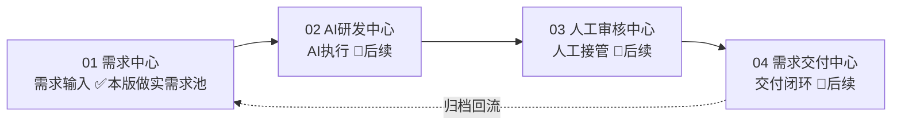

# Dandelion 研发中心（RDC）增量 PRD · 需求中心 V1

| 项 | 内容 |
| --- | --- |
| Language | 中文（与原始需求一致） |
| 技术栈 | 沿用现有：Go 1.24 + chi + pgx + PostgreSQL 16；React 18 + Vite + TS；`@seakoi/console-kit`。不引入新技术栈 |
| Project Name | `rdc_requirement_center` |
| 文档状态 | 简单 PRD（不做竞品/市场分析），待架构师接手 |
| 原始需求复述 | 在 Dandelion 的 team 模式下，新增与「分发」平级的一级分组「研发中心」，其下 4 个菜单（需求中心 / AI研发中心 / 人工审核中心 / 需求交付中心）。本次打全部菜单的权限与路由，并把「需求中心」的需求池做实（列表/创建/详情）；其余 3 个菜单只做真实空态页 + 接口占位说明。新增菜单受角色权限控制；不清楚处需提问决策；代码简单优雅、无冗余、中文注释。 |

---

## 1. 产品目标与本次范围

**产品目标（两句）**
1. 为团队模式建立"需求驱动研发"的统一入口：以需求 ID 为起点，串起 AI 执行、人工审核、交付归档四段闭环。
2. 用独立、可按需分配的菜单权限，把研发能力开放给指定角色，同时保证 solo 模式与未授权用户完全隔离。

**本次范围边界（严格遵守用户拍板结论）**

| 菜单 | 本次交付 | 边界说明 |
| --- | --- | --- |
| 01 需求中心 | ✅ **做实**：需求池列表 / 新建 / 详情（抽屉） | 附件管理、AI 需求分析、验收标准本版仅展示"后续开放"说明，不做功能 |
| 02 AI研发中心 | 🔲 骨架：真实空态页 + 接口占位说明 | Git 工作区 / 开发环境 / 数据库 / Agent 调度 / 自动测试均不实现 |
| 03 人工审核中心 | 🔲 骨架：真实空态页 + 接口占位说明 | 前端 Diff / 后端 Diff / 编辑器打开 / 人工提交均不实现 |
| 04 需求交付中心 | 🔲 骨架：真实空态页 + 接口占位说明 | Git 记录 / 测试报告 / 验收结果 / 需求归档均不实现 |
| 横向能力 | ✅ 4 个菜单的权限点、路由、导航全打通 | 仅 team 模式；solo 模式不可见、不可访问 |

> **反占位约束（呼应 AGENTS.md §3/§6）**：3 个骨架菜单必须是**真实页面**——有标题、模块说明、子功能清单和"将在后续迭代开放"的诚实文案，配合三态组件；**禁止** `TODO`、空页面、假数据、假按钮。接口占位仅以文档形式说明（见第 4 节），不写空 handler、不注册空路由，避免违反"导航项必须有对应后端"与契约一致性测试。

**四阶段闭环定位（本版仅第 1 段落库，其余为规划）**

---

## 2. 用户故事

1. **作为超级管理员**，我希望在角色管理里为「研发中心」4 个菜单单独勾选授权并分配给指定角色，以便只有被授权的成员能看到对应模块，其他人无感。
2. **作为研发负责人**，我希望在需求池新建需求时系统按 `REQ-YYYYMMDD-序号` 自动生成唯一需求 ID，以便每条需求都有稳定、可引用的编号，成为后续研发流程的事实起点。
3. **作为开发工程师**，我希望在需求池按状态筛选、按关键字搜索并点开需求看详情（需求描述、验收标准），以便快速定位我要处理的需求。
4. **作为未被授权的普通成员 / solo 模式用户**，我希望侧栏不出现研发中心菜单、直接输地址也被拦截，以便平台信息边界清晰、不越权。
5. **作为产品经理**，我希望打开 AI研发中心/人工审核中心/需求交付中心时看到明确的"后续迭代开放"说明与子功能清单，而不是空白页或假数据，以便准确理解版本进度。
6. **作为审计/QA**，我希望需求的新建动作写入审计日志且需求 ID 唯一不可变，以便过程可追溯、出问题能定位到人和时间。

---

## 3. 需求池 P0 / P1 / P2

> P0 = 本次必须交付；P1 / P2 = 后续菜单迭代（本版不实现）。

| 优先级 | 编号 | 需求 | 验收要点 |
| --- | --- | --- | --- |
| **P0** | R1 | 新增一级分组「研发中心」，与「分发」平级，含 4 个菜单项 | `navigation.ts` 加分组；team 模式下按权限显示；solo 白名单不含此组 |
| **P0** | R2 | 4 个独立查看权限点 + 菜单授权 | `contract.Permissions` 加 4 点；`contract.Menus` 加 4 菜单（Group=研发中心）；勾选菜单自动授予 ViewPermission；超管 `allPermissions` 全量；内置角色/团队基线**不默认授予**，按需分配 |
| **P0** | R3 | 4 条平台级路由 + 守卫 | 前端 `App.tsx` 用 `<PermissionGate>`；后端 `RequirePermission` + `RequireTeamMode`；越权 403 |
| **P0** | R4 | 需求池列表 | 服务端分页（页码进 URL）、状态筛选、关键字搜索、三态（loading/empty/error）、列定义 |
| **P0** | R5 | 需求池新建 | 表单校验；服务端生成 `REQ-YYYYMMDD-序号` 唯一需求 ID；创建人/时间落库；写审计日志 |
| **P0** | R6 | 需求池详情 | 点击需求 ID 用抽屉展示全字段；不单开详情路由 |
| **P0** | R7 | 独立数据模型 | `rdc_` 前缀表，team 分区；不与分发项目挂钩；复用 users/people 做归属 |
| **P0** | R8 | 契约与自检 | OpenAPI → DTO/APIRoutes → `make gen:api` → 前端 API → 测试；生成物入库；`make test` / `build` 通过 |
| **P1** | R9 | 需求池增强：编辑、状态流转、附件管理、验收标准独立模块、AI 需求分析 | 需求中心后续迭代 |
| **P1** | R10 | AI研发中心 5 个子功能（Git 工作区/开发环境/数据库/Agent 调度/自动测试） | 后续迭代，本版仅空态页 |
| **P1** | R11 | 人工审核中心 4 个子功能（前后端 Diff/编辑器打开/人工提交） | 后续迭代，本版仅空态页 |
| **P1** | R12 | 需求交付中心 4 个子功能（Git 记录/测试报告/验收结果/需求归档） | 后续迭代，本版仅空态页 |
| **P2** | R13 | 需求与 AI 任务/审核/交付记录的数据联动、跨阶段看板、状态机自动推进 | 远期，四段全部落地后再做 |

---

## 4. 四个菜单的页面设计与功能分解

### 通用约定
- 一级分组 `title = "研发中心"`，4 项均 `scope: 'platform'`、`envScoped: false`、`permission` 取各自查看点（平台级页面不带 `/p/:key` 前缀）。
- 列表页统一：`DataTable` 服务端分页、`page` 进 URL、`States.tsx` 三态；空列表不挂分页条。
- 表单页与列表页分离：新建走 `/new`（详情用抽屉，不单开路由）。
- 所有写入口经 `can(me, permission)` 控制，`me` 为 null 按无权限处理。

### 01 需求中心 — `/rdc/requirements`（权限 `rdc.requirement.read`）✅ 本版做实

**字段级定义（需求实体）**

| 字段 | 类型 | 来源/规则 | 说明 |
| --- | --- | --- | --- |
| 需求 ID | string | 服务端生成，`REQ-YYYYMMDD-序号` | 例 `REQ-20250614-001`；日期=创建日，序号当天从 001 递增；全平台唯一、创建后不可改；列表点击进详情 |
| 标题 | string | 用户填 | 必填，建议 ≤ 100 字 |
| 描述 | string | 用户填 | 必填，多行文本，说明背景与目标 |
| 状态 | enum | 默认「待评审」 | 待评审 / 已确认 / 研发中 / 待验收 / 已交付 / 已归档；本版仅承载字段与筛选，流转逻辑留 P1 |
| 验收标准 | string | 用户填 | 需求输入的一部分；本版作为描述区的一个可选多行字段随创建保存，独立模块留 P1（**若用户另有决策见第 7 节 Q2**） |
| 创建人 | string | `users` / `people` 关联 | 展示姓名；不重复存名字段（关联投影） |
| 创建时间 | datetime | 服务端 | 展示用，不可改 |

**三个页面**

| 页面 | 路由 | 元素与操作 |
| --- | --- | --- |
| 列表页 | `/rdc/requirements` | 列：需求 ID（详情入口）/ 标题 / 状态 / 创建人 / 创建时间；筛选：`Segmented` 按状态 + 关键字搜索（ID/标题）；主操作「新建需求」（按写权限显示，见 Q1）；三态组件；服务端分页 |
| 新建页 | `/rdc/requirements/new` | 字段：标题（必填）、描述（必填）、状态（默认待评审）、验收标准（选填）；需求 ID 表单不填、由服务端生成；提交成功回列表并提示生成的 ID；取消返回列表 |
| 详情抽屉 | 列表页点击需求 ID 打开 | 只读展示全部字段 + 状态标签 + 创建人/时间；本版不提供编辑/删除按钮（P1 再加），避免假操作 |

> 子功能「附件管理 / AI需求分析 / 验收标准（独立模块）」本版在需求中心页面内以说明块列出并标注"后续迭代开放"，不做交互。

### 02 AI研发中心 — `/rdc/dev`（权限 `rdc.dev.read`）🔲 骨架

- 页面：真实空态页，标题「AI研发中心」+ 一段产品说明（AI 自动执行研发任务的中枢）。
- 子功能清单（只读卡片，标注后续开放）：Git 工作区、开发环境、数据库、Agent 调度、自动测试。
- 接口占位说明（**文档级，不落代码**）：规划资源 `/api/rdc/dev/workspaces`、`/api/rdc/dev/agents`、`/api/rdc/dev/test-runs`，均为后续迭代新增，本版不注册路由、不建 handler。

### 03 人工审核中心 — `/rdc/review`（权限 `rdc.review.read`）🔲 骨架

- 页面：真实空态页，标题「人工审核中心」+ 说明（AI 产出由人工最终把关后提交）。
- 子功能清单：前端 Diff、后端 Diff、编辑器打开、人工提交。
- 接口占位说明：规划 `/api/rdc/review/diffs`、`/api/rdc/review/submit`，本版不落代码。

### 04 需求交付中心 — `/rdc/delivery`（权限 `rdc.delivery.read`）🔲 骨架

- 页面：真实空态页，标题「需求交付中心」+ 说明（留存交付证据并归档需求，形成闭环）。
- 子功能清单：Git 记录、测试报告、验收结果、需求归档。
- 接口占位说明：规划 `/api/rdc/delivery/records`、`/api/rdc/delivery/archive`，本版不落代码。

---

## 5. 权限设计

| 查看点 | 菜单 | 路径 | 归属分组 | 授权方式 |
| --- | --- | --- | --- | --- |
| `rdc.requirement.read` | 需求中心 | `/rdc/requirements` | 研发中心 | 勾选菜单自动授予 |
| `rdc.dev.read` | AI研发中心 | `/rdc/dev` | 研发中心 | 勾选菜单自动授予 |
| `rdc.review.read` | 人工审核中心 | `/rdc/review` | 研发中心 | 勾选菜单自动授予 |
| `rdc.delivery.read` | 需求交付中心 | `/rdc/delivery` | 研发中心 | 勾选菜单自动授予 |

- **每菜单 1 个独立查看点**；写入 `contract.Permissions`（`Group:"研发中心"`）与 `contract.Menus`（`ViewPermission` 对应上表）。用户勾选菜单由 `service/role` 自动授予其 ViewPermission，无需单独勾权限点。
- **超管全量**：新点自动进入 `allPermissions`，超管无需配置即可见全部 4 菜单。
- **按需分配**：内置角色与团队默认读取基线（build.read/project.read/directory.read）**不含**这 4 点；由管理员在角色管理里对指定角色显式勾选菜单授权。这与"授权只做减法"的现有模型一致。
- **只服务 team**：前端 Sidebar 的 solo 白名单不含研发中心；后端 `RequireTeamMode` 对 solo 会话拒绝。`RequirePermission` 做逐接口边界（前端隐藏只是投影）。
- **写权限**：见第 7 节 Q1（默认建议新增独立写点 `rdc.requirement.write`，不复用查看点）。

---

## 6. 数据模型初稿（`rdc_` 前缀，仅列实体与关键字段）

> 风格对齐现有 `snake_case` / UUID 主键 / `created_at TIMESTAMPTZ DEFAULT now()`；归属复用 `users` / `people`（存 id，展示名关联投影），**不与 `projects` 挂钩**，仅 team 模式使用。DDL 与分区放置（team 专属 vs 循环同构）交架构师定夺（见 Q3）。

**P0 实体（本版建表）**

| 表 | 关键字段 | 说明 |
| --- | --- | --- |
| `rdc_requirements` | `id`(UUID PK)、`req_key`(TEXT UNIQUE，需求 ID)、`title`、`description`、`status`、`acceptance_criteria`、`creator_user_id`、`created_at` | 需求池主表；`req_key` 唯一且不可变；`status` 枚举值唯一来源在 OpenAPI |

**P1 预留实体（本版不建表，仅规划命名与关系）**

| 表 | 关键字段（规划） | 归属菜单 |
| --- | --- | --- |
| `rdc_requirement_attachments` | `id`、`requirement_id`(FK)、`original_file_name`、`relative_path`、`file_size`、`uploader_user_id`、`created_at` | 01 需求中心 |
| `rdc_dev_workspaces` / `rdc_agent_tasks` / `rdc_test_runs` | `id`、`requirement_id`、`git_repo`、`env`、`status`、时间戳 | 02 AI研发中心 |
| `rdc_review_records` / `rdc_diffs` | `id`、`requirement_id`、`reviewer_user_id`、`diff_payload`、`result`、`created_at` | 03 人工审核中心 |
| `rdc_delivery_records` / `rdc_acceptances` | `id`、`requirement_id`、`git_commit`、`test_report_ref`、`accepted`、`archived_at` | 04 需求交付中心 |

- 审计：需求新建写入 `team.audit_logs`（`actor_name` 冗余，只追加），复用现有审计机制，不另建审计表。
- 枚举（状态等）唯一来源放 `api/openapi.yaml`，DDL 不加 CHECK（沿用现有惯例）。

---

## 7. 待确认问题（请 lead 转用户决策）

1. **Q1｜写权限粒度**：需求池的「新建」是否用独立写点 `rdc.requirement.write`（挂在需求中心菜单的 Actions 下，勾选菜单不自动给、需单独勾），还是"有查看点即可新建"？
   - 建议：**独立写点**，与现有 `build.read`/`build.write` 分离惯例一致，避免"能看就能改"。若采纳，PRD 中「新建需求」按钮按 `rdc.requirement.write` 隐藏。
2. **Q2｜验收标准落位**：本版是否把"验收标准"作为需求新建表单里的一个选填字段随需求保存（本 PRD 默认如此），还是完全推迟到后续独立模块、本版连字段都不放？
   - 建议：**本版放选填字段**，成本极低且需求输入更完整，不影响后续做独立模块。
3. **Q3｜分区放置**：研发中心只服务 team 模式，表是放进 `schema.sql` 的 `FOREACH team/solo` 循环保持两分区同构（成本：solo 也建空表），还是只在 `team` 分区建（成本：装配层不能复用 `Partitioned` 双份范式）？
   - 此项偏技术实现，需架构师给出方案后回填，**不阻塞本 PRD**；如用户有偏好请一并告知。

> 除上述 3 项外无其他阻塞性问题；其余设计图细节按"按菜单块逐步实现、避免假大空"原则处理。
