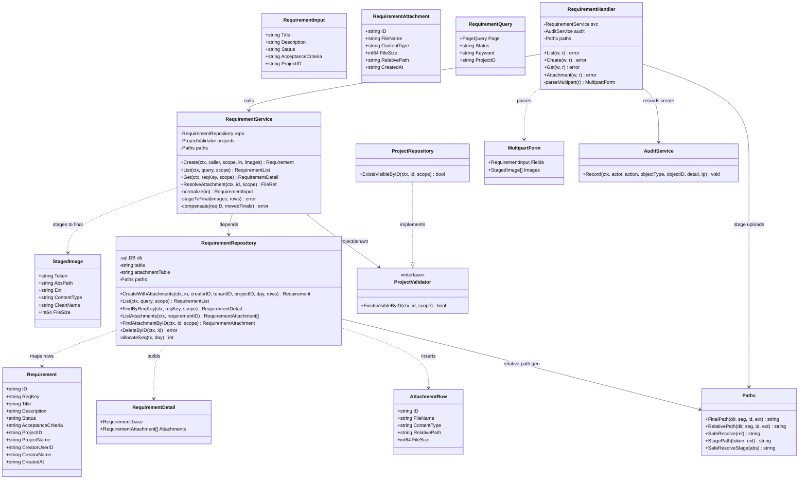
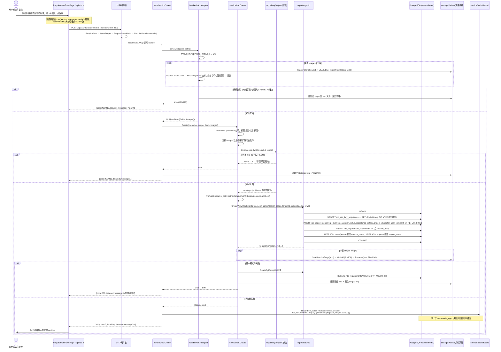
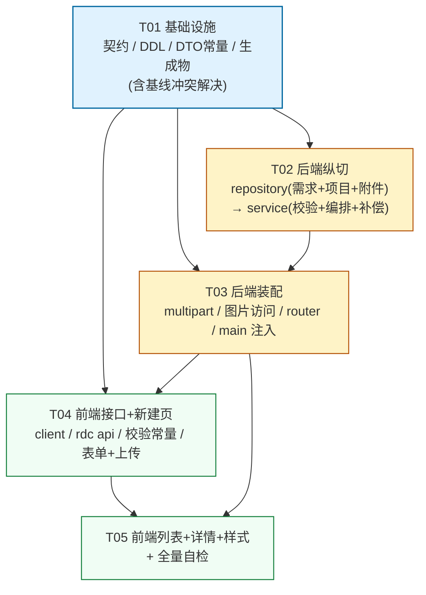

# Dandelion 研发中心（RDC）增量 V1.1 · 系统设计与任务分解

| 项 | 内容 |
| --- | --- |
| 文档类型 | 系统设计 + 有序任务分解（架构师交付物） |
| 架构师 | 高见远（Gao）· Architect |
| 上游输入 | `deliverables/software-company/rdc-v1.1-prd.md`（许清楚）+ V1.0 `rdc-prd.md`/`rdc-design.md` + team-lead 核实的仓库现状与用户拍板结论 |
| 项目根目录 | `/Users/linanan/Desktop/dandelion`（下文路径均相对此根） |
| 强制规范 | `AGENTS.md`（生效优先级高于 `docs/` 设计稿；当前代码与测试 > `api/openapi.yaml` > AGENTS.md） |
| 本版范围 | **仅改「需求中心」一个菜单**：需求关联项目 + 多图上传/访问/展示；其余 3 菜单、权限点、菜单形态、`/p/:key/*` 一律不动 |
| 模式限定 | 仅 team；solo 不可见、不可访问（沿用 V1.0） |

---

## ⚠️ 0. 开工前必读：基线仓库处于未解决的合并冲突状态

架构师在落笔前实测了仓库现状，必须先处理，否则任何实现都无法编译：

- `git status`：`server/internal/contract/contract.go` 为 `UU`（both modified），`server/public/index.html` 为 `UD`（deleted by us）。
- `contract.go` 内有 3 处 `<<<<<<< / ======= / >>>>>>>` 标记（约 79、235、295 行）：冲突的实质是「upstream 的 `RouteBuildVersions` + 构建版本能力」与「本 feature 分支的 RDC 需求池」两股改动未合流。
- `cd server && go build ./...` 当前失败：`internal/app/router.go:86:11: undefined: contract.RouteBuildVersions`。

**处置（归入 T01 验收点）**：由工程师先把两股改动**合并保留**（不是二选一）——`contract.go` 同时保留 `RouteBuildVersions` 常量与 `RouteRDCRequirements`/`RouteRDCRequirementByKey`，`APIRoutes` 同时含两者；解决 `index.html` 的 `UD`。本设计的所有改动都建立在冲突解决后的基线上。若工程师发现冲突范围超出预期，**立即回报 team-lead，不要自行丢弃任一侧**。

---

# Part A · 系统设计

## 1. 实现方案概述

### 1.1 技术栈（零新增依赖）

完全沿用 V1.0：Go 1.24 + chi v5 + pgx/v5 + PostgreSQL 16；React 18 + TypeScript + Vite 5；`@seakoi/console-kit` 根入口（`Upload.Dragger` 已覆盖，无需新组件）；契约 `api/openapi.yaml` → `make gen:api` 生成 `web/src/api/schema.d.ts`；DDL 唯一事实来源 `server/internal/repository/schema.sql`（幂等、`//go:embed`）。

**不引入**：新存储系统、新 HTTP 客户端、新权限点、新前端路由形态、第二套路径拼接逻辑。

### 1.2 关键架构决策

#### D1 · `project_id` 存量兼容：可空列 + 新写入必填 + `ON DELETE SET NULL`

- DDL：`ALTER TABLE team.rdc_requirements ADD COLUMN IF NOT EXISTS project_id UUID REFERENCES team.projects(id) ON DELETE SET NULL;`
  - **不加 `NOT NULL`**：V1.0 存量需求无归属，列值为 `NULL`，列表/详情显示「未归属项目」（R6）。
  - **新写入一律必填**：校验放在 service（见 D6），不放 DB 约束，避免存量行违反约束。
  - **`ON DELETE SET NULL`**：项目被删除时，其需求自动降级为「未归属项目」，既不留悬挂外键，也**不需要改动项目删除逻辑**（`CountUsage` 无需感知 RDC）。
- 项目名 `projectName` **不冗余存列**：沿用 V1.0 `creatorName` 的 JOIN 投影惯例，查询时 `LEFT JOIN team.projects pj ON pj.id = r.project_id`，`coalesce(pj.name,'')`。空串即「未归属项目」的判定依据。
- 新增索引 `(tenant_id, project_id, created_at DESC)` 支撑「租户内按项目筛选 + 时间倒序」。

#### D2 · 附件存储目录：`rdc/requirements/{attachmentID}.{ext}`，全程走 storage 包

- 复用现有 `storage.Paths` 的三个能力，**不修改 `paths.go`、不手写路径字符串**：
  - 生成：`paths.RelativePath(contract.RDCImageDir, contract.RDCImageRequirementSeg, attID, ext)` → `rdc/requirements/{attID}.{ext}`；
  - 落盘：`paths.FinalPath(...)` → `storage/uploads/rdc/requirements/{attID}.{ext}`；
  - 读取：`paths.SafeResolve(relativePath)` → 前缀校验，天然拦截 `../` 越界。
- 两个固定分段常量 `RDCImageDir="rdc"`、`RDCImageRequirementSeg="requirements"` 定义在 `contract`，单一来源；与包上传的 `{env}/{platform}/{id}.{ext}` 物理隔离，不互相污染。
- **路径不含 `reqKey`**：`reqKey` 由 repository 事务内分配，若路径依赖它则 service 无法在事务前算出 `relative_path`，会把路径生成挤进 repository（违反分层）或拆成两个事务（放大孤儿风险）。改用 service 预生成的 UUID 作文件名，service 可在事务前算好全部 `relative_path` 传入 repository，分层干净、补偿简单。**仍在 team-lead 给的自由度内，且满足全部硬约束**（storage 生成 / SafeResolve 覆盖 / 与包上传隔离 / 不另起规范）。
- 扩展名**只由 MIME 白名单派生**（`http.DetectContentType` 嗅探前 512 字节 → `contract.RDCImageExts` 映射到规范扩展名），**绝不取用户文件名**；用户文件名仅经 `storage.CleanFileName` 清洗后作展示字段 `file_name`。

#### D3 · 上传时机：一次性 multipart；顺序 = 先 stage → 后 DB 事务 → 再搬文件 → 失败补偿

采纳 PRD 建议的「一次性提交」（图片是需求输入的一部分，避免「建了需求却没传图」中间态）。失败补偿的三段式（详见 §4 时序图）：

1. **handler 解析 multipart**：文本字段进严格白名单（拒绝未知字段，等价于 `DecodeJSON` 的严格性）；`images[]` 每片流式写入 `storage/tmp`（`paths.StagePath(token, ext)`），单片 ≤5MB、总数 ≤9，边读边嗅探 MIME。解析期任一失败 → 立即删除已 stage 的临时文件 → 返回 400/413。
   - 注意：现有 `AttachStageTmp` 只在 context 存**单个**路径，无法覆盖多图；多图清理由 handler/service 显式持有 `[]StagedImage` 并在所有失败路径遍历清理（详见 §7 共享知识第 5 条）。
2. **service 编排 + repository 单事务落库**：service 校验项目归属、复校图片约束、生成附件 UUID 与 `relative_path`，调 `repository.CreateWithAttachments`；事务内「原子分配序号 → reqKey → INSERT 需求（含 project_id）→ INSERT 附件行 → JOIN 创建人姓名 → COMMIT」。事务失败 → 回滚，临时文件由失败路径清理。
3. **DB 提交后搬文件**：逐张 `SafeResolveStage(tmp)` → `os.MkdirAll(finalDir)` → `os.Rename(tmp, final)`。文件系统无事务，故 **DB 先提交、文件后搬**（与 AGENTS「账号删除：文件在事务提交后才删」同一原则）；任一 rename 失败 → **补偿**：`repository.DeleteByID(reqID)`（级联删附件）+ 删除已搬的最终文件 + 清理剩余临时文件 → 500。全程无孤儿需求、无孤儿文件。

#### D4 · 图片访问：`GET /api/v1/rdc/requirement-attachments/{id}`，登录 + 权限 + 租户，非公开

- 与「包下载公开」刻意不同：此接口挂 `RequireAuth → InjectScope → RequireTeamMode → RequirePermission(rdc.requirement.read)`。
- 按 **attachment id** 定位（不暴露 `relative_path`，缩小攻击面）：仓储 JOIN 需求后先 `ScopeFilter(0,'a_r',scope)`，跨租户/不存在统一 404，不泄漏存在性；再 `paths.SafeResolve(relativePath)` → 流式输出，带 `X-Content-Type-Options: nosniff`、`Content-Disposition: inline`、`Cache-Control: private`。
- **鉴权与 `` 的矛盾**：本应用靠 `Authorization: Bearer` 头鉴权，裸 `` 不带该头 → 必然 401。方案：前端新增 `client.getBlob(path)`（复用 Bearer/超时/401 处理，不解 `{code,data,message}` 外壳），详情抽屉 `getRequirementAttachment(id)` 取 Blob → `URL.createObjectURL` 渲染，关闭时 `revokeObjectURL`。这样图片接口保持受保护，不开公开口子。

#### D5 · 只加 1 条路径，3 个骨架菜单规划接口不进契约

RDC 路径由 V1.0 的 2 条增至 **3 条**：`GET/POST /rdc/requirements`、`GET /rdc/requirements/{reqKey}`、**新增** `GET /rdc/requirement-attachments/{id}`。`openapi.yaml` paths 数与 `contract.APIRoutes` 数量必须同步为 3（契约一致性测试）。其余 3 菜单的规划接口仍**不写入契约、不注册路由**。

---

## 2. 文件清单

> 标记：**新** / **改** / **生成**（`schema.d.ts` 由 `make gen:api` 产出，禁手改）。所有新增手写文件顶部写中文四要素注释：**职责 / 输入 / 输出 / 边界**；单文件尽量 ≤400 行。

### 2.1 契约与 DDL（事实来源层）

| 路径 | 标记 | 一句话职责 |
| --- | --- | --- |
| `api/openapi.yaml` | 改 | POST 改 multipart、列表加 `projectId` 参数、详情加附件、新增图片访问路径与相关 schema。 |
| `server/internal/repository/schema.sql` | 改 | `rdc_requirements` 加可空 `project_id`（FK+索引）；新增 team 专属 `rdc_requirement_attachment` 表与索引（循环外）。 |
| `server/internal/contract/contract.go` | 改 | 需求 DTO 加 `projectId/projectName`、新增附件与详情 DTO、图片常量/白名单、附件路由常量；**并解决基线合并冲突**。 |
| `server/internal/contract/contract_test.go` | 改 | 钉住图片白名单/上限常量与契约、路由数一致性（既有测试自动覆盖新增路径）。 |
| `web/src/api/schema.d.ts` | 生成 | `make gen:api` 产物，前端类型唯一来源，必须入库。 |

### 2.2 后端（按功能归位到 `rdc/`）

| 路径 | 标记 | 一句话职责 |
| --- | --- | --- |
| `server/internal/repository/rdc/repository.go` | 改 | 单事务建需求+附件、列表/详情加 `projectName` JOIN 与 `projectId` 筛选、附件 CRUD、补偿删除。 |
| `server/internal/repository/project/repository.go` | 改 | 新增 `ExistsVisibleByID(ctx,id,scope)`：供应商校验项目存在且属于当前租户。 |
| `server/internal/service/rdc/service.go` | 改 | 项目归属校验、图片复校、生成附件路径、编排事务与「搬文件+失败补偿」、组装详情。 |
| `server/internal/service/rdc/service_test.go` | 改 | 补 `projectId` 必填、图片数量/体积/白名单校验、缺陷路径（无项目/越界项目）单测。 |
| `server/internal/handler/rdc/handler.go` | 改 | 列表读 `projectId`、POST 走 multipart 解析、详情返回附件、新增图片访问 handler、写审计。 |
| `server/internal/handler/rdc/multipart.go` | 新 | 专用 multipart 解析：严格文本字段白名单 + 多图 stage（嗅探 MIME/限长/限量/清理）。 |
| `server/internal/handler/rdc/handler_test.go` | 新 | multipart 解析单测：未知字段拒绝、非图片/超限/超量拒绝、字段提取。 |
| `server/internal/app/router.go` | 改 | `Deps` 注入 paths（经 handler）；注册图片访问路由与读权限；补 405 `Allow` 映射。 |
| `server/cmd/server/main.go` | 改 | 把 `paths` 与 team 项目仓储注入 RDC handler/service（装配层唯一变更点）。 |

> `server/internal/storage/paths.go` **确认不改**（复用 `FinalPath`/`RelativePath`/`SafeResolve`）；权限点目录、`contract.Menus`、`ReconcileBuiltinMenus`、`TeamModeGate`、`navigation.ts`、3 个骨架页 **确认不改**。

### 2.3 前端（API / 类型 / 页面 / 样式）

| 路径 | 标记 | 一句话职责 |
| --- | --- | --- |
| `web/src/api/rdc.ts` | 改 | 列表加 `projectId`、新建改 `postForm`、详情取附件、新增 `getRequirementAttachment` Blob 取图。 |
| `web/src/api/client.ts` | 改 | 新增 `getBlob(path)`：带 Bearer 的二进制 GET（不解外壳），供受保护图片使用。 |
| `web/src/utils/format.ts` | 改 | 新增「未归属项目」统一文案与图片约束中文提示的唯一镜像。 |
| `web/src/utils/rdcUpload.ts` | 新 | 前端图片校验：格式白名单/5MB/9 张的常量镜像与 `validateImageFiles`，与后端复校一一对应。 |
| `web/src/pages/rdc/RequirementFormPage.tsx` | 改 | 新增「所属项目」必选下拉 + `Upload.Dragger` 多图区（beforeUpload 返回 false）。 |
| `web/src/pages/rdc/RequirementsPage.tsx` | 改 | 新增「项目」筛选下拉（复用 `useProjects`）+ 项目列（空值显示未归属项目）。 |
| `web/src/pages/rdc/RequirementDetailDrawer.tsx` | 改 | 展示项目名 + 图片缩略图网格（Blob objectURL，可点击预览，关闭清理）。 |
| `web/src/styles.scss` | 改 | 项目筛选行、项目列、图片上传/网格/预览样式（沿用主色 `#0369a1`）。 |

### 2.4 设计产物（本文件之外）

| 路径 | 标记 | 一句话职责 |
| --- | --- | --- |
| `deliverables/software-company/rdc-v1.1-class-diagram.mermaid` | 新 | 本文 §3.6 类图单独提取。 |
| `deliverables/software-company/rdc-v1.1-sequence-diagram.mermaid` | 新 | 本文 §4 时序图单独提取（含成功与失败补偿路径）。 |

> 注意：`docs/class-diagram.mermaid` / `docs/sequence-diagram.mermaid` 属于其他特性，本次不覆盖。

---

## 3. 数据结构与接口

### 3.1 DDL 草案（`schema.sql`「六 · 研发中心」段，循环之外，team 专属）

```sql
-- 增量 1：需求归属项目。可空以兼容 V1.0 存量；ON DELETE SET NULL 让项目删除后需求降级为"未归属"，
-- 不产生悬挂外键、也无需改项目删除逻辑。
ALTER TABLE team.rdc_requirements
  ADD COLUMN IF NOT EXISTS project_id UUID REFERENCES team.projects(id) ON DELETE SET NULL;

-- 列表筛选形态：租户 + 项目 + 时间倒序。
CREATE INDEX IF NOT EXISTS idx_rdc_requirements_tenant_project_created
  ON team.rdc_requirements (tenant_id, project_id, created_at DESC);

-- 增量 2：需求图片附件（一需求多图）。仅图片类型；相对路径由 storage 包生成，
-- 本表只存字符串，读取时经 SafeResolve 前缀校验。FK 级联保证删需求即清附件行。
CREATE TABLE IF NOT EXISTS team.rdc_requirement_attachment (
  id             UUID        PRIMARY KEY DEFAULT gen_random_uuid(),
  requirement_id UUID        NOT NULL REFERENCES team.rdc_requirements(id) ON DELETE CASCADE,
  file_name      TEXT        NOT NULL,           -- CleanFileName 清洗后的展示名，不参与拼路径
  content_type   TEXT        NOT NULL,           -- 白名单内 MIME
  file_size      BIGINT      NOT NULL,           -- ≤ 5MB
  relative_path  TEXT        NOT NULL,           -- rdc/requirements/{attID}.{ext}
  created_at     TIMESTAMPTZ NOT NULL DEFAULT now()
);
CREATE INDEX IF NOT EXISTS idx_rdc_requirement_attachment_req
  ON team.rdc_requirement_attachment (requirement_id, created_at);
CREATE UNIQUE INDEX IF NOT EXISTS uq_rdc_requirement_attachment_path
  ON team.rdc_requirement_attachment (relative_path);
```

**字段对齐表**

| DB 列 | Go 字段 | JSON 字段 | 来源 / 规则 |
| --- | --- | --- | --- |
| `project_id` (可空 UUID) | `Requirement.ProjectID` | `projectId` | 新建必填；存量为空；`ON DELETE SET NULL` |
| —（JOIN `team.projects.name`） | `Requirement.ProjectName` | `projectName` | 投影；空串即「未归属项目」 |
| `req_key` | `Requirement.ReqKey` | `reqKey` | 原样沿用，格式不变 |
| 其余主表列 | 同 V1.0 | 同 V1.0 | 不改语义 |
| 附件表各列 | `RequirementAttachment.*` | `id/fileName/contentType/fileSize/createdAt` | `relativePath` **不进对外 DTO** |

### 3.2 Go DTO / 契约常量增量（`internal/contract`）

```go
// 路由：新增图片访问（总 RDC 路径数 2 → 3，与 openapi.yaml paths 数一致）。
const RouteRDCRequirementAttachment = APIPrefix + "/rdc/requirement-attachments/{id}"

// 存储分段与图片约束——所有层（handler 校验 / service 复校 / 前端镜像）的唯一来源。
const (
    RDCImageDir             = "rdc"
    RDCImageRequirementSeg  = "requirements"
    MaxRDCImageBytes        = 5 << 20 // 单张 5MB
    MaxRDCImages            = 9       // 单需求最多 9 张
    ResourceRequirementAttachment = "需求图片"
)
// ext → MIME；规范扩展名由白名单派生，禁止取用户文件名。
var RDCImageExts = map[string]string{
    "png": "image/png", "jpg": "image/jpeg", "jpeg": "image/jpeg",
    "webp": "image/webp", "gif": "image/gif",
}
// RDCImageExtOf(contentType string) (ext string, ok bool)：MIME → 规范扩展名（jpg/jpeg 归 jpg）。

// Requirement 增量两字段（附 V1.0 原字段）。
type Requirement struct {
    // ...V1.0 原 9 字段...
    ProjectID   string `json:"projectId"`   // 存量为空
    ProjectName string `json:"projectName"` // JOIN 投影，空串=未归属
}

// 详情专用：列表不带 attachments，避免 N+1 与大响应体。
type RequirementDetail struct {
    Requirement
    Attachments []RequirementAttachment `json:"attachments"` // 空切片非 nil → []
}
type RequirementAttachment struct {
    ID          string `json:"id"`
    FileName    string `json:"fileName"`
    ContentType string `json:"contentType"`
    FileSize    int64  `json:"fileSize"`
    CreatedAt   string `json:"createdAt"`
}

// 新建请求：文本字段；multipart 的 images[] 另走文件部分。
type RequirementInput struct {
    // ...V1.0 原 4 字段...
    ProjectID string `json:"projectId"` // 必填，非空即拒
}

type RequirementQuery struct {
    // ...Page / Status / Keyword...
    ProjectID string // 可选筛选
}

// 事务内落附件的行（service 生成 id 与 relative_path 后传入，repository 只做 SQL）。
type AttachmentRow struct {
    ID, FileName, ContentType, RelativePath string
    FileSize                                int64
}
```

### 3.3 OpenAPI 路径清单（`servers.url = /api/v1`，统一外壳 `{code,data,message}`）

| 方法 | 路径 | 查询 / 请求体 | 成功响应 | 增量说明 |
| --- | --- | --- | --- | --- |
| GET | `/rdc/requirements` | `page,pageSize,status,keyword,**projectId**`(可选 uuid 字符串) | `200 RequirementListResponse` | 列表项加 `projectId/projectName` |
| POST | `/rdc/requirements` | **multipart/form-data**：`title*,description*,status,acceptanceCriteria,**projectId***(文本) + `images`(array binary, 0..9) | `201 RequirementResponse` | 由 `application/json` 改为 multipart |
| GET | `/rdc/requirements/{reqKey}` | 路径 `reqKey` | `200 RequirementDetailResponse` | 加 `projectId/projectName/attachments[]` |
| GET | `/rdc/requirement-attachments/{id}` | 路径 `id`(uuid) | `200 image/*` 二进制流 | **新增**；登录+读权限+租户；跨租户 404 |

**新增 / 修改 schema**：`Requirement`（+2 字段）、`RequirementAttachment`、`RequirementDetail`（`allOf: Requirement` + `attachments`）、`RequirementCreateMultipart`（multipart 请求体）、`RequirementDetailResponse`；`RequirementInput` 保留为文本字段说明但 POST 不再用它收 JSON。

**契约一致性**：paths 由 2 → 3 ⇒ `contract.APIRoutes` 同步新增 `RouteRDCRequirementAttachment`（T01）。3 个骨架菜单规划接口仍不进契约。

**前端 multipart 请求体定义要点**（`openapi.yaml`）：
```yaml
requestBody:
  required: true
  content:
    multipart/form-data:
      schema:
        type: object
        required: [title, description, projectId]
        properties:
          title: { type: string, maxLength: 100 }
          description: { type: string, maxLength: 4000 }
          status: { $ref: '#/components/schemas/RequirementStatus' }
          acceptanceCriteria: { type: string, maxLength: 2000 }
          projectId: { type: string, format: uuid, description: 所属项目 id，必填，须属本公司 }
          images:
            type: array
            maxItems: 9
            items: { type: string, format: binary, description: png/jpg/jpeg/webp/gif，单张 ≤5MB }
```

### 3.4 前端类型来源与图片访问

```ts
// api/rdc.ts：只从 ./schema 引类型、只经 ./client 发请求。
export type Requirement = Schemas['Requirement'];
export type RequirementDetail = Schemas['RequirementDetail'];
export type RequirementAttachment = Schemas['RequirementAttachment'];

// 列表查询加 projectId；new URLSearchParams 拼串，空值不写入。
export interface RequirementListQuery extends PageQuery {
  status?: RequirementStatus; keyword?: string; projectId?: string;
}

// 新建：FormData 承载文本 + images，走 postForm（浏览器自带 boundary，不手设 Content-Type）。
export function createRequirement(input: RequirementInput, images: File[]): Promise<Requirement> {
  const form = new FormData();
  form.set('title', input.title); /* ...status/acceptanceCriteria/projectId... */
  images.forEach((f) => form.append('images', f));
  return postForm<Requirement>(REQUIREMENTS_PATH, form);
}

// 受保护图片：取 Blob，前端 createObjectURL 渲染（裸  不带 Bearer）。
export function getRequirementAttachment(id: string): Promise<Blob> {
  return getBlob(`${REQUIREMENTS_ATTACHMENT_PATH}/${encodeURIComponent(id)}`);
}
```

### 3.5 约束常量分层落点（唯一来源对应表）

| 约束 | 后端唯一来源 | 前端镜像 | 复校关系 |
| --- | --- | --- | --- |
| 格式白名单 | `contract.RDCImageExts`（handler 嗅探 MIME 映射） | `web/src/utils/rdcUpload.ts` `IMAGE_EXTS` | 前端 `beforeUpload` 先拦，handler 嗅探字节再判，service 复校白名单 |
| 单张 ≤5MB | `contract.MaxRDCImageBytes` | `rdcUpload.ts` `MAX_IMAGE_BYTES` | 前端拦截 + handler `MaxBytesReader` + service 复校 `file_size` |
| ≤9 张 | `contract.MaxRDCImages` | `rdcUpload.ts` `MAX_IMAGES` | 前端拦截 + handler 计数 + service 复校 `len(images)` |
| 扩展名产物 | `RDCImageExtOf(MIME)` | 不产生扩展名，只按 MIME 选文件 | 路径扩展名仅后端派生，前端文件名只作展示 |
| 未归属文案 | 后端 `projectName=""` | `format.ts` `UNASSIGNED_PROJECT_LABEL='未归属项目'` | 列表列与详情同用前端常量 |

### 3.6 类图（Mermaid）



---

## 4. 程序调用流程 · 新建需求（带图）含成功与失败补偿（Mermaid 时序图）



**图片访问时序**（要点，不单独画图）：`GET /rdc/requirement-attachments/{id}` → 中间件（读权限）→ `handler.Attachment` → `service.ResolveAttachment(id, scope)` → `repository.FindAttachmentByID`（JOIN 需求 + `ScopeFilter`，越界 404）→ `paths.SafeResolve(relativePath)`（越界即 404）→ `os.Open` → 流式输出 `image/*` + `nosniff` + `inline`；前端 `getBlob` 取 Blob → `createObjectURL` 渲染，抽屉关闭时 `revokeObjectURL`。

**列表 / 详情要点**（沿用 V1.0，不再画图）：列表 `ScopeFilter(0,'r',scope)` + `AddIf(query.ProjectID!="", "r.project_id::text = ?", id)`（用 `::text` 比较避免非法 uuid 触发 500）+ 状态/关键字；详情 `FindByReqKey` 同为 `ScopeFilter`，再 `ListAttachments(requirementID)` 填 `attachments[]`；分页默认 10/上限 200/0 全量，页码进 URL。

---

## 5. 待明确事项 / 已记录的假设

| 编号 | 事项 | 本设计处理 | 需确认? |
| --- | --- | --- | --- |
| B0 | **基线合并冲突**（`contract.go` UU / `index.html` UD，`go build` 失败） | T01 先合并保留两侧（`RouteBuildVersions` 与 RDC 常量并存），不丢弃任一侧 | **阻塞项**，工程师开工第一件事 |
| B1 | 存储目录形状 | 采用 `rdc/requirements/{attID}.{ext}`（不含 reqKey），以便 service 在事务前算好 `relative_path`、分层干净、补偿简单；仍在 team-lead 自由度内且满足全部硬约束 | 建议确认；不阻塞 |
| B2 | 超管（`scope.All`）新建需求时选了某公司的项目 | `tenant_id` 仍从 scope 取（NULL，平台级，仅超管可见，沿用 V1.0 A2）；项目校验在 `scope.All` 下放行任意可见项目 | 沿用 V1.0，不阻塞 |
| B3 | 项目被删除后其需求 | `ON DELETE SET NULL` → 自动降级为「未归属项目」；不阻塞项目删除、不改 `CountUsage` | 建议确认；符合 R6 精神 |
| B4 | 项目删除是否应因存在需求而被拒 | 本版选择「不拒绝」（降级处理），避免把 RDC 耦合进项目删除校验 | 建议确认 |
| B5 | 存量需求无 `project_id` 的筛选行为 | 按 `projectId` 筛选时天然不含存量（NULL 不匹配）；不筛选时正常展示为「未归属项目」 | 无需确认，符合直觉 |
| B6 | 图片访问是否公开 | 按 team-lead 建议设为受保护；前端用 Blob+objectURL 解决 `` 不带 Bearer 的问题 | 无需确认 |

---

# Part B · 任务分解

## 6. 依赖包

**无新增依赖**，`go.mod` / `package.json` 均不改。

- 后端复用：`chi/v5`、`pgx/v5/stdlib`、标准库 `net/http`（`MultipartReader`/`DetectContentType`/`MaxBytesReader`）、`database/sql`、`os`/`path/filepath`。
- 前端复用：`@seakoi/console-kit`（`Upload.Dragger` 根入口命名导出）、`react-router-dom`、`schema.d.ts` 类型。
- 工具链已存在：`make gen:api`、`make test`、`npm --prefix web run build`。

## 7. 任务列表（按依赖顺序，5 个任务）

> T01 承担「项目基础设施」角色：契约（事实来源）+ DDL（建表入口）+ 契约常量/DTO（代码级入口）+ 生成物入库，全部收敛在一个任务，不分散。

### T01 · 基础设施：契约、DDL、契约 DTO/常量、生成物（并解决基线冲突）

- **优先级**：P0 · **依赖**：无
- **涉及文件**：`api/openapi.yaml`、`server/internal/repository/schema.sql`、`server/internal/contract/contract.go`、`server/internal/contract/contract_test.go`、`web/src/api/schema.d.ts`（生成）
- **做什么**：
  1. **先解决基线合并冲突**（见 §0）：`contract.go` 同时保留 `RouteBuildVersions` 与两条 RDC 路由常量、`APIRoutes` 含全部；解决 `index.html` 的 `UD`。确保 `go build ./...` 通过。
  2. `openapi.yaml`：POST 改 multipart、列表加 `projectId`、详情改 `RequirementDetailResponse`、新增 `GET /requirement-attachments/{id}`；新增/改 5 个 schema（paths 2→3）。
  3. `schema.sql`：加可空 `project_id`（FK `ON DELETE SET NULL`）+ 索引；新增 `rdc_requirement_attachment` 表 + 2 索引（循环外、team 专属）。
  4. `contract.go`：需求 DTO +2 字段；新增 `RequirementDetail`/`RequirementAttachment`/`AttachmentRow`；`RequirementInput`/`RequirementQuery` +`projectId`；图片分段/上限/白名单常量与 `RDCImageExtOf`；`RouteRDCRequirementAttachment` 入 `APIRoutes`。
  5. `contract_test.go`：钉住图片白名单/上限与路由数一致性。
  6. `make gen:api` 生成 `schema.d.ts` 并入库。
- **验收点**：
  1. **冲突清零**：`grep -R "<<<<<<<\|>>>>>>>\|^=======" server/internal/contract/contract.go` 零命中；`git status` 无 `UU`/`UD`；`cd server && go build ./...` 通过；
  2. `openapi.yaml` paths 数 == `contract.APIRoutes` 长度（== 3 + 其它模块），`cd server && go test ./internal/contract/...` 全绿；
  3. `make gen:api` 后 `git diff --exit-code -- web/src/api/schema.d.ts` 无差异（生成物已入库）；
  4. DDL 在空库与存量库各执行一次均成功（幂等）；team 有 `rdc_requirement_attachment`、solo 无 `rdc_` 表；存量需求 `project_id IS NULL` 可读；
  5. 手写文件顶部四要素注释齐全。

### T02 · 后端纵切：repository（需求+项目校验+附件）→ service（校验+编排+补偿）

- **优先级**：P0 · **依赖**：T01
- **涉及文件**：`server/internal/repository/rdc/repository.go`（改）、`server/internal/repository/project/repository.go`（改）、`server/internal/service/rdc/service.go`（改）、`server/internal/service/rdc/service_test.go`（改）
- **做什么**：
  1. `project.Repository` 新增 `ExistsVisibleByID(ctx,id,scope)`：`ScopeFilter(0,'p',scope)` + `p.id::text = ?`，供归属校验（超管 All 放行）。
  2. `rdc.Repository`：`selectColumns` 加 `project_id` 与 `LEFT JOIN team.projects pj` 投影 `projectName`；`CreateWithAttachments` 在**同一事务**内分配序号→插需求（含 project_id）→批量插附件→JOIN 投影→COMMIT；`List` 加 `projectId` 筛选（`r.project_id::text = ?`）；`FindByReqKey` 返回 `RequirementDetail`（含 `ListAttachments`）；新增 `FindAttachmentByID(ctx,id,scope)`（JOIN 需求 + `ScopeFilter`，越界 404）与 `DeleteByID(ctx,id)`（补偿用）。附件表名由 `PartitionTeam.Table("rdc_requirement_attachment")` 生成，禁手写。
  3. `rdc.Service`：`Create` 加 projectID 必填校验、调 `ProjectValidator`、图片二次复校、生成 attID/`relative_path`（经注入的 `paths`）、编排事务与 `stageToFinal`；任一搬文件失败走 `compensate`（删需求+删已搬文件+清临时文件）；`Get` 返回详情；新增 `ResolveAttachment(id,scope)`（查附件 + `SafeResolve` → `FileRef`）；定义 `ProjectValidator` 接口解耦。
  4. `service_test.go`：projectId 必填、无项目/越界项目、图片数量/体积/白名单校验的纯逻辑用例。
- **验收点**：
  1. 并发 20 次创建得到 20 个不同 reqKey（序号 UPSERT 原子，仍用 `AS s` 别名）；
  2. `CreateWithAttachments` 事务原子：中途失败时需求与附件行都不存在；
  3. A 公司账号用 B 公司的 projectId 新建 → 400；列表按 B 项目 id 筛不到 A 的需求；`FindAttachmentByID` 跨租户 → 404；
  4. 模拟搬文件失败：补偿后 DB 无需求/附件行、无残留 final 文件；
  5. 分层检查：repository 无业务判断、不生成文件 IO；service 无 `*http.Request`；`go test ./internal/{repository,service}/rdc/...` 全绿。

### T03 · 后端装配：multipart 解析、图片访问、路由、依赖注入

- **优先级**：P0 · **依赖**：T01、T02
- **涉及文件**：`server/internal/handler/rdc/multipart.go`（新）、`server/internal/handler/rdc/handler.go`（改）、`server/internal/handler/rdc/handler_test.go`（新）、`server/internal/app/router.go`（改）、`server/cmd/server/main.go`（改）
- **做什么**：
  1. `multipart.go`：`parseMultipart(r, paths)` — 文本字段白名单（title/description/status/acceptanceCriteria/projectId，未知即拒）+ `images[]` 流式 stage 到 tmp（嗅探 MIME→`RDCImageExtOf`，单张 5MB、≤9 张），持有 `[]StagedImage`，失败路径遍历清理；返回 `MultipartForm`。
  2. `handler.go`：`List` 读 `projectId`；`Create` 改走 `parseMultipart`（**不再用 `DecodeJSON`**），失败路径清理 staged；`Get` 写 `RequirementDetail`（含附件）；新增 `Attachment` 流式输出（带 `nosniff`/`inline`/`private`）；审计 detail 加 `projectId`/`imageCount`，action 仍 `rdc.requirement.created`。
  3. `router.go`：`Deps.RDC` 的构造改为带 `paths`；注册 `GET /rdc/requirement-attachments/{id}`（读权限）；`allowedMethods` 与 `allowedMethodsFor` 补新路径（405 `Allow: GET`）。
  4. `main.go`：构造 rdc repo/service/handler 时注入 `paths` 与 team 项目仓储（`projectRepos.For(repository.PartitionTeam)`）。
- **验收点**：
  1. 未知文本字段 → 400；非图片/`>5MB`/`>9` 张 → 400/413 且无 tmp 残留；
  2. 带图新建成功后 `storage/uploads/rdc/requirements/*.{ext}` 存在，DB `relative_path` 与之一致，`paths.SafeResolve` 可解析；
  3. 图片访问：本公司可读（正确 Content-Type / nosniff / inline）；跨租户与不存在 id → 404；裸请求无 Bearer → 401；
  4. solo 令牌访问 3 接口均 403；无读/写点分别 403；405 带正确 `Allow`；
  5. `cd server && make test` 全绿（含契约一致性）。

### T04 · 前端接口层与新建页（项目下拉 + 多图上传）

- **优先级**：P0 · **依赖**：T01（类型）、T03（接口）
- **涉及文件**：`web/src/api/client.ts`（改）、`web/src/api/rdc.ts`（改）、`web/src/utils/format.ts`（改）、`web/src/utils/rdcUpload.ts`（新）、`web/src/pages/rdc/RequirementFormPage.tsx`（改）
- **做什么**：
  1. `client.ts` 加 `getBlob(path)`（复用 Bearer/超时/401，不解外壳）。
  2. `rdc.ts`：列表查询加 `projectId`；`createRequirement(input, images)` 改 `postForm` + FormData；`getRequirement` 返回 `RequirementDetail`；加 `getRequirementAttachment(id)`。
  3. `format.ts`：加 `UNASSIGNED_PROJECT_LABEL` 与图片错误文案；`rdcUpload.ts`：镜像格式/5MB/9 张约束与 `validateImageFiles`。
  4. `RequirementFormPage`：复用 `useProjects` 取本公司项目填「所属项目」必选下拉（未选禁止提交）；`Upload.Dragger`（`beforeUpload` 返回 false，非法 `LIST_IGNORE`）多图区，提交前 `validateImageFiles`，可移除；提交用 FormData，成功后回列表提示 reqKey。
- **验收点**：
  1. 未选项目点提交有即时提示、不发请求；项目下拉只含本公司项目；
  2. 非图片/超 5MB/超 9 张被前端拦截并给中文提示，非法文件不进入 FormData；
  3. 请求为 multipart（`postForm`，不手设 Content-Type），含 projectId 与 images；
  4. `npm --prefix web run build` 类型检查通过；无直接 import antd/qrcode.react。

### T05 · 前端列表/详情、样式与全量自检

- **优先级**：P0 · **依赖**：T04（并需 T03 接口就绪）
- **涉及文件**：`web/src/pages/rdc/RequirementsPage.tsx`（改）、`web/src/pages/rdc/RequirementDetailDrawer.tsx`（改）、`web/src/styles.scss`（改）
- **做什么**：
  1. `RequirementsPage`：「项目」筛选下拉（复用 `useProjects`，默认全部，切换重置页码）+ 项目列（空值显示 `UNASSIGNED_PROJECT_LABEL`）；保留状态 `Segmented`、关键字搜索、服务端分页（页码进 URL）、三态、点 reqKey 开详情。
  2. `RequirementDetailDrawer`：展示项目名（空值同上常量）+ 图片缩略图网格；每张图 `getBlob` → `createObjectURL`，点击预览大图，关闭/切换 `revokeObjectURL`；无图片不渲染网格（存量兼容）；本版仍不提供编辑/删除。
  3. `styles.scss`：筛选行、项目列、上传区、图片网格/预览样式，沿用主色 `#0369a1`。
  4. 全量自检：`make gen:api` → `git diff --exit-code -- web/src/api/schema.d.ts` → `make test` → `npm --prefix web run build` → `make build`。
- **验收点**：
  1. 列表按项目筛选准确、可与状态/关键字叠加；存量需求项目列显示「未归属项目」不报错；
  2. 详情图片可见可预览；无图需求正常；Blob URL 在关闭后被回收（无内存泄漏）；
  3. 跨公司图片访问经后端 404，前端显示错误态而非崩溃；
  4. 自检五连通过；无新增占位/假按钮/第二份权限目录；所有新增文件四要素注释齐全；主色未改。

## 8. 共享知识 / 跨文件约定（工程师必读）

1. **基线冲突先行**：任何编码前先按 §0 解决 `contract.go`/`index.html` 冲突并 `go build ./...` 通过；两股改动并存，不丢弃。
2. **projectId 校验唯一入口**：handler 只校验非空（请求形状），**存在性 + 租户归属统一在 service 经 `ProjectValidator.ExistsVisibleByID`**（内部 `ScopeFilter`）；前端下拉只是投影，不可信。越界一律 400（新建）/404（筛选与图片读取），不用 403 泄漏存在性。
3. **路径规范不可另起**：`relative_path` 只能由 `paths.RelativePath(RDCImageDir, RDCImageRequirementSeg, attID, ext)` 生成；落盘只经 `paths.FinalPath`；读取只经 `paths.SafeResolve`；临时文件只经 `paths.StagePath`/`SafeResolveStage`。**任何模块禁止手写 `uploads/...` 字符串拼接**。扩展名只由 `RDCImageExtOf(MIME)` 派生，绝不取用户文件名。
4. **图片白名单唯一来源**：后端 `contract.RDCImageExts`/`MaxRDCImageBytes`/`MaxRDCImages`；前端 `rdcUpload.ts` 镜像同名常量。三层复校一一对应：前端 `beforeUpload` → handler 解析（嗅探 + 限长 + 计数）→ service 复校。
5. **多图 stage 清理**：现有 `AttachStageTmp` 只存单路径，**不能用于多图**。handler `parseMultipart` 与 service 必须各自持有 `[]StagedImage`，在所有失败路径遍历 `os.Remove`（经 `SafeResolveStage` 校验）；DB 提交后 rename 成功即 tmp 消失，失败路径删 final + tmp。
6. **一致性顺序**：文件系统无事务——**DB 先提交，文件后搬；搬失败补偿删 DB**（与账号删除「先删库后删文件」对称）。补偿 `DeleteByID` 只删本请求刚建的需求（按 id），级联清附件；不误删他人数据。
7. **契约/DDL 变更顺序**：`openapi.yaml` → `contract.go`/`APIRoutes` → `schema.sql` → `make gen:api` → 前端 api → 测试。paths 数必须与 `APIRoutes` 长度一致；禁手改 `schema.d.ts`。
8. **隔离**：所有需求/附件读查询先 `ScopeFilter(0,alias,scope)` 再 `AddIf` 业务条件；越界 404；`tenant_id`/`creator_user_id`/`projectId` 归属只从 scope/身份取（projectId 除外——它是用户选的业务字段但须经租户校验）；请求体不接受 `tenantId`/`creatorUserId`。
9. **权限不变**：仍用 `rdc.requirement.read`（列表/详情/图片）与 `rdc.requirement.write`（新建含上传）；不新增权限点、不引入项目角色；路由仍 `RequireAuth → InjectScope → RequireTeamMode → RequirePermission`；前端写入口 `can(me,'rdc.requirement.write')`，`me` 为 null 按无权限。3 个骨架菜单及其规划接口不进契约/路由。
10. **审计**：action `rdc.requirement.created`、objectType `rdc_requirement`、objectID `reqKey`、detail `{title,status,projectId,imageCount}`，写在 handler.Create；失败只记日志不回滚。
11. **图片访问鉴权**：受保护接口，`` 不带 Bearer → 前端必须 `getBlob` + `createObjectURL`，关闭时 `revokeObjectURL`。
12. **注释规范**：新增手写文件顶部中文注释写清「职责 / 输入 / 输出 / 边界」；单文件尽量 ≤400 行；`multipart.go` 独立成文件避免 `handler.go` 超长。

## 9. 任务依赖图（Mermaid）



**关键路径**：`T01 → T02 → T03 → (T04 ∥) → T05`。T04 的类型依赖 T01、接口依赖 T03，可与 T03 收尾并行起步；实际建议按关键路径推进，避免前端对接未定型接口。

---

**（本设计只做架构与任务分解，不含实现代码。工程师按 T01→T05 顺序批量实现。）**
