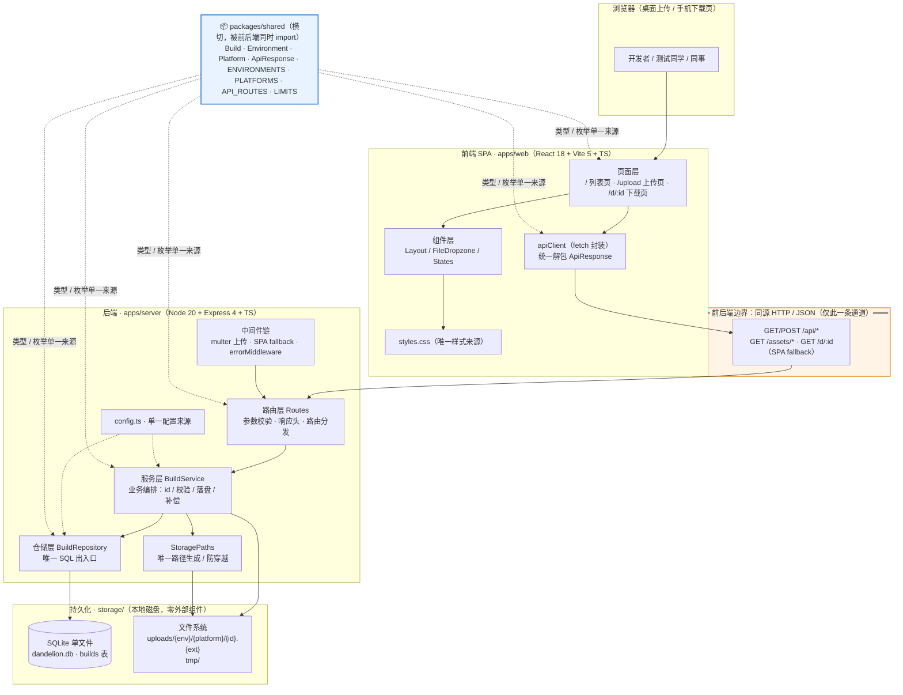
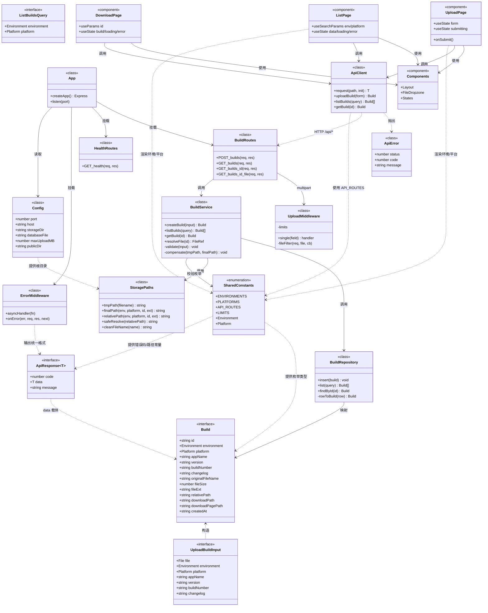
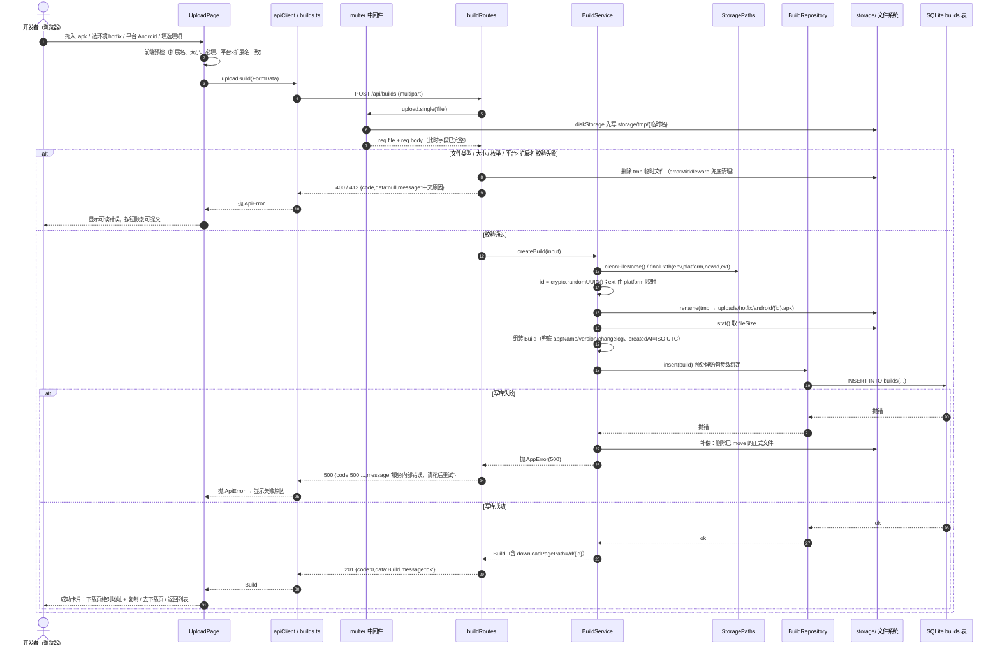
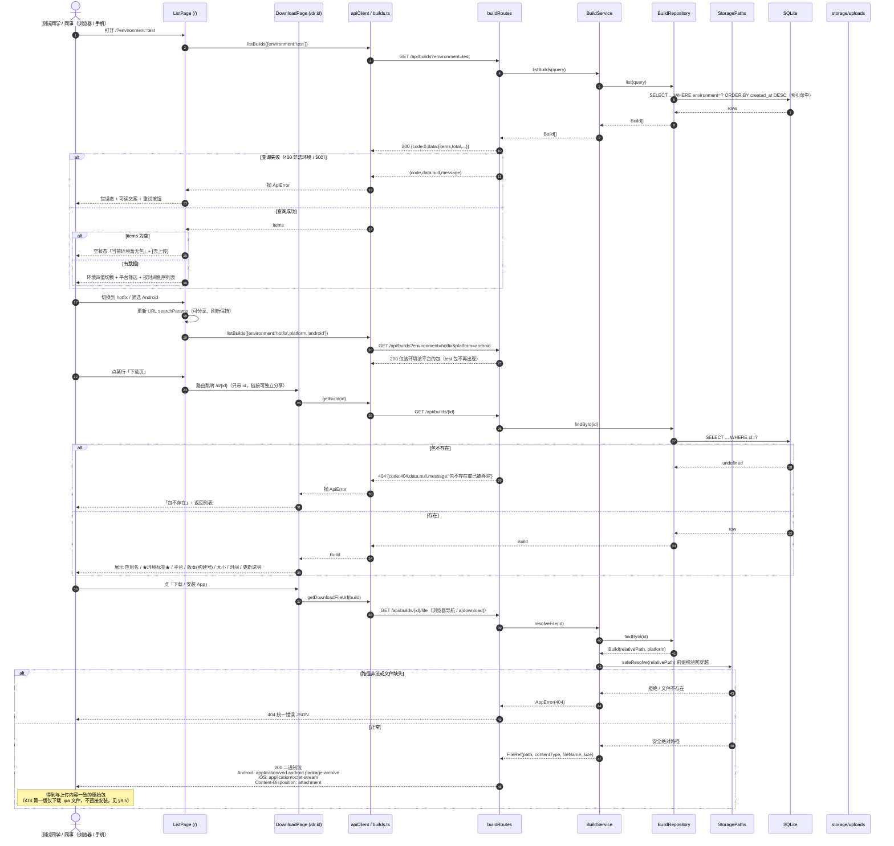

⚠️ 本文已由 v2 文档取代，仅供历史追溯，工程师请以 02-ARCHITECTURE-v2.md / 03-TASKS-v2.md 为准

# 02 · 系统架构设计｜Dandelion 多环境 App 包分发平台

> 文档类型：前后端总体设计方案（整体框架设计 + 功能页面技术设计）+ 部署方案
> 作者：高见远（架构师）｜日期：2026-11-13｜面向：主理人 / 工程师
> **唯一需求输入**：`docs/01-PRD.md`（许清楚，364 行）。本文不新增产品范围，不扩大 P0。
> **本文正面回答 PRD 的 Q1（前后端是否同仓）与 Q2（后续如何部署）**，并给出可供工程师直接落地的技术契约。
> 边界声明：本文只做设计，**不含任何实现代码**；文中出现的 SQL、配置、命令、JSON、TypeScript `interface` 均属「契约 / 示例」，不是应用代码。

---

## 0. 结论速览

| 问题 | 结论（一句话） | 详见 |
| --- | --- | --- |
| **Q1 前后端代码是否放一起？** | **放一起**：单仓多包 monorepo（npm workspaces），`apps/web` + `apps/server` + `packages/shared`，不引入 turborepo / nx / lerna 等重工具。 | §1.2、§10.1 |
| **Q2 后续如何部署？** | 分四阶段：① 本地开发（Vite proxy + tsx watch）→ ② 单机/内网（一个 Node 进程同时托管静态资源与 API，`storage/` 持久化 + systemd 守护）→ ③ 容器化（多阶段 Dockerfile + docker-compose 卷挂载 + Nginx 反代 + HTTPS）→ ④ 规模化（对象存储 + CDN，SQLite 迁 Postgres）。 | §9 |
| 一句话架构 | React SPA（3 页）→ 同源 HTTP API → Express 路由层 → 服务层 → 仓储层 → **本地文件系统 + SQLite 单文件**；`packages/shared` 是全仓唯一的类型 / 枚举 / 契约来源。 | §2 |

**三项 P0 闭环如何落到技术**（不增不减）：

| P0 闭环 | 前端 | 后端 | 持久化 |
| --- | --- | --- | --- |
| ① 上传包 | `/upload` 上传页（拖拽 + 环境/平台 + 选填信息） | `POST /api/builds`（multer → 校验 → 落盘 → 写元数据） | `storage/uploads/{env}/{platform}/{id}.{ext}` + `builds` 表一行 |
| ② 按环境（+平台）查列表 | `/` 列表页（环境四值切换 + 平台筛选） | `GET /api/builds?environment=&platform=` | `builds` 表按 `(environment, platform, created_at)` 索引查询 |
| ③ 独立下载页下载原始包 | `/d/:id` 下载页（信息核对 + 下载按钮） | `GET /api/builds/:id` + `GET /api/builds/:id/file` | 按 `relative_path` 安全解析后流式返回文件 |

---

## 1. 架构决策摘要（ADR）

### 1.1 决策表

> 每一行最后一列都必须回答「**为什么这样最简，且可扩展**」，这是本次选型的唯一裁决标准。

| 编号 | 决策点 | 候选与对比 | 最终选择 | 理由 | 为什么这样最简且可扩展 |
| --- | --- | --- | --- | --- | --- |
| ADR-01 | **仓库组织**（Q1） | ① 单仓多包 monorepo；② 前后端分仓；③ 单仓单包（前后端混在一个目录） | **① 单仓多包 monorepo + npm workspaces** | 环境枚举 / Build 类型 / API 契约必须单一来源（用户硬性约束）；一次 clone、一次 `npm install`、一次构建 | 最简：Node 自带 workspaces，零额外工具、零发布流程；可扩展：`shared` 已是独立包，未来拆仓/独立部署无需改一行业务代码。详见 §1.2 |
| ADR-02 | **前端框架** | React 18 + Vite 5 + TS / Vue3 / 原生 JS | **React 18 + Vite 5 + TypeScript** | 用户明确熟悉这套，零学习成本 | 最简：一个 `vite.config.ts` 即可跑；可扩展：组件化天然支持后续加页面，Vite 的 alias 让 `shared` 源码零构建复用 |
| ADR-03 | **前端 UI 方案** | ① MUI + Tailwind（PRD §0 默认）；② UnoCSS / Less；③ **原生 CSS 单文件 + CSS 变量 + 少量自写组件** | **③ 原生 CSS** | 只有 3 个页面：一个表单、一个表格、一张卡片；组件库与原子化框架带来的体积、主题配置、类名堆叠，反而伤害「一看就懂」 | 最简：**零 UI 依赖**，一个 `styles.css` + CSS 变量（颜色/间距/圆角）+ 媒体查询即可覆盖手机单列布局；可扩展：组件边界清晰，未来若换 MUI 只替换 `components/`，页面与数据层不动。详见 §1.3 |
| ADR-04 | **路由 / 状态** | react-router-dom v6 / 自研 hash 路由 / 引入 Zustand + React Query | **react-router-dom v6；状态用组件内 `useState/useEffect` + URL searchParams，不引入任何全局状态库** | 3 个页面 + 1 个动态路由 + 筛选条件需要可分享、刷新保持 | 最简：一个依赖、零 store、零样板代码；筛选态放 URL 后「返回列表」天然不丢条件；可扩展：未来加登录态再评估全局 store，届时只加一层 Provider，页面不改 |
| ADR-05 | **后端运行时** | Node 20 + TypeScript / Python / Go / Bun | **Node.js 20 LTS + TypeScript** | 用户倾向前后端同一语言；团队一人维护，心智负担最小 | 最简：与前端共用 `typescript`、共用 `shared` 类型、共用 `npm`；可扩展：服务层/仓储层与运行时解耦，未来换运行时不动接口契约 |
| ADR-06 | **后端框架** | Express 4 / Fastify / Koa / Node 原生 http | **Express 4** | multer 事实标准集成、中间件链直观、注释友好、遇到问题资料最多 | 最简：`router → service → repository` 三层用几十行中间件串起来，新人一眼看懂；可扩展：中间件链就是天然扩展点（鉴权、限流、日志以后挂上去即可） |
| ADR-07 | **TS 运行方式** | ① tsc 编译成 JS 再 node 跑；② **tsx 直接跑 TS 源码**；③ 打包器 bundle | **② tsx（`tsx watch` 开发 / `tsx` 生产）** | 避免「`shared` 要先编译」「rootDir 跨包报错」「构建顺序协调」三类 monorepo 经典坑 | 最简：`npm install` 后一条命令即可 dev，改 `shared` 两端即时生效，零构建协调；可扩展：若日后要产物化，只改启动脚本为 `tsc -p tsconfig.build.json && node dist/server.js`，业务代码不动 |
| ADR-08 | **元数据存储** | ① **SQLite 单文件**；② JSON 索引文件；③ Postgres / MySQL | **① SQLite（`better-sqlite3`）** | 需「重启不丢 + 按环境/平台索引查询 + 并发写安全」，又不引入需专职运维的数据库 | 最简：**嵌入式、无进程、无端口、无账号、就是一个文件**，备份 = 复制一个文件；却仍拥有 SQL 索引、事务、参数绑定。可扩展：全部 SQL 收敛在 `buildRepository`，迁 Postgres 只换这一个文件。详见 §1.4 |
| ADR-09 | **文件上传方案** | multer / busboy / formidable / 纯 `req` 流解析 | **multer（`diskStorage` 写 `storage/tmp/`）** | Express 生态事实标准，内置 `fileFilter` 与 `limits` | 最简：扩展名白名单与大小上限各一行配置；可扩展：先落 tmp 再 move 的顺序，让「校验 → 落盘 → 写库」三步职责分明，未来换对象存储只替换 move 与读文件两处 |
| ADR-10 | **文件存储布局** | 平铺 / 按环境平台分目录 / 按日期分目录 | **按 `{environment}/{platform}/{id}.{ext}` 分目录，文件名由服务端生成** | 环境是一等公民，落到磁盘布局上呼应；随机 id 天然防覆盖 | 最简：`id` 用 Node 内置 `crypto.randomUUID()`，零依赖、不可枚举；可扩展：`relative_path` 存在 DB 里，未来换对象存储时它直接变成 objectKey |
| ADR-11 | **下载页 / 路由方案** | SPA 路由 `/d/:id` + SPA fallback / 后端模板渲染页面 / 每个包生成静态 html | **前端 SPA 路由 `/d/:id`，后端 Express 做 SPA fallback** | 下载页要「可复制转发、手机浏览器可打开、刷新不 404」 | 最简：不生成任何静态 html、不需要服务端模板引擎，`app.get('*')` 回 `index.html` 即可；可扩展：URL 形态与后端实现解耦，未来做短链/固定链接只改前端路由 |
| ADR-12 | **静态资源托管** | ① **生产由 Express 同源托管 `dist`**；② Nginx 托管静态 + 反代 API；③ 独立静态托管服务 | **① 起步；② 在容器化阶段可平滑启用** | 单机部署只要一个进程、一个端口、一个端口开防火墙 | 最简：同源 ⇒ 无跨域、无 CORS 依赖、前端 `VITE_API_BASE` 默认留空；可扩展：静态资源与 API 边界清晰，Nginx 随时可以接管静态与 HTTPS 终止 |
| ADR-13 | **错误处理与响应格式** | 各路由自行 try/catch / **统一 `{code, data, message}` + 集中错误中间件** | **统一 `{code, data, message}`（成功 `code=0`），`AppError` + `asyncHandler` + `errorMiddleware` 集中处理** | 前端只需一个 `apiClient` 解包；中文可读错误直接上屏 | 最简：路由层零 try/catch 样板；可扩展：新增业务错误只加错误码常量，中间件链不变 |
| ADR-14 | **配置管理** | 各处 `process.env` / **单一 `config.ts`** / 配置中心 | **`.env` + 单一 `apps/server/src/config.ts`（`dotenv/config`），前端仅 `VITE_API_BASE`** | 端口、存储目录、大小上限必须集中，不能散落硬编码 | 最简：一个文件看完全部配置，都带默认值，本地零配置即可跑；可扩展：未来上配置中心只改 `config.ts` 一处 |

### 1.2 Q1 专题：前后端代码是否放一起？

**结论：放一起。采用单仓多包 monorepo（npm workspaces）。**

**为什么推荐「是」**

1. **环境枚举单一来源（用户硬性约束）**：`test / hotfix / pre / prd` 与 `android / ios` 只需在 `packages/shared/src/constants.ts` 定义一次，前端的下拉项、后端入参校验、磁盘目录名、下载响应头映射全部 `import` 同一份。全仓搜索 `'hotfix'` 只会命中一处。这是分仓最难保证的一点。
2. **共享类型**：`Build`、`ApiResponse<T>`、上传字段、查询参数、错误码在前后端是同一份 TypeScript 类型；改一个字段同一个提交改完，不会出现「后端加了字段、前端还在用旧的」的错配。
3. **一次 clone、一次 `npm install`、一次 `dev`**：workspaces 自动把 `packages/shared` 软链进 `node_modules`；`npm run dev` 一条命令同时起前后端；`npm run build` 一次产出前端静态资源。对一人维护、低运维的内部工具，这是最省心的形态。
4. **部署仍只有一个产物**：生产时 Vite 产物由 Express 同源托管，单机只需要「一个目录 + 一个进程 + 一个数据目录」，见 §9.2。

**如果分仓，会损失什么**

| 损失 | 具体后果 |
| --- | --- |
| 单一来源被破坏 | 环境枚举要么复制粘贴（前后端各自硬编码，正是用户明令禁止的），要么发布私有 npm 包（多出打包、版本号、registry、发版流程），与「简单」「零运维」直接冲突 |
| 契约同步成本 | 一个字段变更要跨仓两个 PR、两次发版、手动对齐联调地址 |
| 协作与运维成本 | 两次 clone、两套 CI、两次部署协调；本地联调要手动配后端地址与跨域 |
| 收益几乎为零 | 第一版是同一人、同一语言、同一部署单元；分仓的价值（团队边界、独立发布节奏、独立扩容）在本阶段都不存在 |

**仓库组织方式（尽量简单）**

```
dandelion/                       # 单个 git 仓库
├── package.json                 # "workspaces": ["apps/*", "packages/*"]，仅此一处声明
├── apps/web/                    # 前端 workspace：@dandelion/web
├── apps/server/                 # 后端 workspace：@dandelion/server
└── packages/shared/             # 共享 workspace：@dandelion/shared（纯 TS 类型 + 常量，零依赖）
```

- 用 **npm workspaces**（Node ≥20 自带），不装 turborepo / nx / lerna / pnpm 全局工具；并行起前后端仅用一个 `concurrently` 开发依赖。
- `packages/shared` 以**源码形式**被引用：前端 Vite `resolve.alias` 指到 `packages/shared/src`，后端 tsx 走 `tsconfig` 的 `paths`。**不需要先编译 shared**，这是最省心的关键。
- 路径别名统一为 `@dandelion/shared`；包内各自用相对路径，不搞第二套别名。

**未来「前后端独立部署 / 分仓」的演进路径（现在不做，只保证路是通的）**

| 步骤 | 做法 | 需要改动的地方 |
| --- | --- | --- |
| 1 | 前后端独立部署（仍在同仓） | 前端 `VITE_API_BASE` 由「留空=同源」改为后端域名；后端加 `cors` 中间件；构建脚本本来就分开（`vite build` / `tsx`），CI 拆两条流水线即可 |
| 2 | 静态资源交给 CDN / Nginx | 见 §9.3：Nginx 托管 `dist`，`/api` 反代到 Node；业务代码零改动 |
| 3 | 真正分仓 | `git subtree split` / `filter-repo` 把三个目录拆出；`packages/shared` 直接发布为私有包或随各仓复制一份（因为它**零逻辑、零依赖**）；服务层 / 仓储层 / 页面层完全不用改 |

> 一句话：**同仓是现在的「最简」，而 shared 的独立包形态就是未来分仓的「预埋出口」——它不需要任何空实现。**

### 1.3 为什么不引入 MUI / Tailwind（正面回应「尽量少的依赖」）

PRD §0 把前端默认写成「Vite + React + MUI + Tailwind」，但主理人转述的用户真实约束是「**尽量少的依赖与运维组件、简单优雅、一看就懂**」。两者冲突时以用户真实约束为准，理由如下（**可平滑反悔**）：

- 第一版只有 3 个页面：一个上传表单、一张列表、一张信息卡片。**没有**复杂交互、主题切换、设计系统、暗色模式、数据可视化。
- MUI 会带来 ~100KB+ 运行时、`ThemeProvider`、sx/emotion 心智；Tailwind 会让 JSX 里堆满类名，反而降低「命名即文档」的可读性；两者都要额外配置文件。
- 一个 `styles.css`（CSS 变量定义颜色/间距/圆角/字号 + 少量类 + 一个 `@media` 手机断点）+ 5 个自写组件即可完成全部 UI，且**新人打开一个文件就能看懂整个站点的视觉规则**。
- 若用户坚持要组件库：只替换 `apps/web/src/components/` 与 `styles.css`，`api/`、`pages/` 的数据与逻辑一行不动（这就是分层的价值）。

### 1.4 为什么元数据存储选 SQLite 单文件

| 方案 | 优点 | 致命短板 | 结论 |
| --- | --- | --- | --- |
| JSON 索引文件 | 零依赖、肉眼可读 | 并发上传会互相覆盖（读-改-写竞态）、每次查询全量载入内存、文件损坏即全丢、无索引无排序、迁库时改动面最大 | ❌ |
| **SQLite 单文件** | 嵌入式**无进程/无端口/无账号**（不算「需专职运维的数据库」）、ACID 事务保证并发写安全、索引 + `ORDER BY`、预处理语句防注入、备份就是复制一个文件 | native 模块需一次安装（可控，§9.3 有 Docker 处理） | ✅ **推荐** |
| Postgres / MySQL | 能力最强 | 独立进程、连接串、账号权限、备份策略、监控 —— 直接违背 N5「低运维」 | ⏭ 留作规模化（§9.4） |

**迁移路径（现在只做隔离，不写适配器）**：所有 SQL 只出现在 `apps/server/src/repository/buildRepository.ts`，对外只暴露 `insert / list / findById` 三个方法，参数与返回都是 `Build` 类型。未来迁 Postgres 时新增一个同签名实现、在 `config.ts` 切换注入即可，**路由层 / 服务层 / 前端零改动**。表字段用下划线命名并与 `Build` 一一映射，便于平滑搬迁。

---

## 2. 整体框架设计

### 2.1 分层图



### 2.2 「单一职责」如何体现在分层上

| 层 | 只负责什么 | 明确不做什么（防止职责蔓延） |
| --- | --- | --- |
| `packages/shared` | 类型、枚举、常量、API 路径常量 | 不写任何业务逻辑、不读写文件、不依赖第三方包 |
| 前端 `api/` | HTTP 请求、FormData 组装、统一解包与抛错 | 不写业务判断、不缓存、不碰 DOM |
| 前端 `pages/` | 一个页面一个职责：取数 → 三态渲染 → 交互 | 不直接 `fetch`（必须走 `api/`）、不拼 API 路径字符串 |
| 前端 `components/` | 无数据请求的纯展示 / 纯输入 | 不发请求、不持有跨页状态 |
| 后端 `routes/` | HTTP 语义：取参、校验、调服务、设响应头与状态码 | 不写 SQL、不拼磁盘路径、不直接操作文件 |
| 后端 `middleware/` | 横切关注点：上传解析、错误统一、SPA fallback | 不做业务判断（除「错误格式化」本身） |
| 后端 `service/` | 业务编排：生成 id、枚举校验、清洗文件名、tmp→final 落盘、失败补偿、构造 `Build` | 不写 SQL（交给仓储）、不解析 multipart（交给 multer） |
| 后端 `repository/` | **唯一** SQL 出入口，行 ↔ `Build` 映射 | 不做业务校验、不碰文件系统 |
| 后端 `storage/paths.ts` | **唯一**路径生成与安全解析 | 不做 IO（只算路径），避免出现第二处路径拼接 |
| 后端 `config.ts` | **唯一**读取环境变量并给默认值 | 不被各处 `process.env` 取代 |

> 校验「单一职责」的土办法：全仓搜索 `'hotfix'` 只应命中 `packages/shared` 一处；搜索 `storage/uploads` 只应命中 `paths.ts` 一处；搜索 `SELECT` 只应命中 `buildRepository.ts` 一处。

### 2.3 前后端边界与 `shared` 的位置

- **唯一通道是 HTTP**：`/api/*` 走 JSON；`/api/builds/:id/file` 走二进制流（唯一例外，见 §5.4）；其余路径由前端 SPA 或静态资源承载。前后端没有任何进程内调用、没有任何共享内存状态。
- **`shared` 是横切包，不是中间层**：它在编译期被两端 `import`，运行时不存在「shared 服务」。因此它不会成为部署组件、不会成为性能瓶颈、也不会引入运维对象。
- **同源**：生产环境前端静态资源由 Express 托管 ⇒ 无跨域、无需 CORS；本地开发由 Vite proxy 转发 `/api` ⇒ 前端代码无需感知后端地址。

---

## 3. 仓库目录结构

### 3.1 完整文件树（每个文件一句话职责）

```
dandelion/                                  # 仓库根（本地路径 /Users/linanan/Desktop/dandelion/）
├── package.json                            # 根：声明 workspaces、并发/构建/启动脚本、共享 devDependencies
├── tsconfig.base.json                      # 根：共享 TS 编译选项 + @dandelion/* 路径别名（各包 extends 它）
├── .gitignore                              # 忽略 node_modules / dist / storage / .env / *.log
├── .env.example                            # 环境变量样例（含默认值与说明），复制为 .env 即用
├── README.md                               # 快速开始、目录说明、API 速查、部署、常见问题
├── docs/
│   ├── 01-PRD.md                           # （已有）产品需求文档，唯一需求输入
│   ├── 02-ARCHITECTURE.md                  # （本文）系统架构设计 + 部署方案
│   ├── 03-TASKS.md                         # （配套）有序任务分解，工程师照此实现
│   ├── class-diagram.mermaid               # 数据结构与接口类图（本文 §4.6 的独立留存）
│   └── sequence-diagram.mermaid            # 程序调用流程图（本文 §6 的独立留存）
├── packages/
│   └── shared/
│       ├── package.json                    # 声明包名 @dandelion/shared（零依赖、纯 TS 源码导出）
│       ├── tsconfig.json                   # extends 根配置，仅类型检查用
│       └── src/
│           ├── index.ts                    # 统一出口（re-export），前后端只从 @dandelion/shared 导入
│           ├── types.ts                    # Build / ApiResponse<T> / ApiError / 上传与查询参数类型
│           └── constants.ts               # ★ ENVIRONMENTS / PLATFORMS / API_ROUTES / LIMITS 唯一定义处
├── apps/
│   ├── web/                                # 前端 workspace：@dandelion/web
│   │   ├── package.json                    # 前端依赖与 dev/build/preview 脚本
│   │   ├── tsconfig.json                   # extends 根配置，含 Vite 环境与 DOM 类型
│   │   ├── vite.config.ts                  # Vite 配置：React 插件、@dandelion/shared alias、/api proxy、build.outDir
│   │   ├── index.html                      # SPA 单一 HTML 挂载点
│   │   └── src/
│   │       ├── main.tsx                    # 入口：挂载 React + BrowserRouter + 全局样式
│   │       ├── App.tsx                     # 路由表（/ · /upload · /d/:id）与全站 Layout
│   │       ├── styles.css                  # 唯一样式文件：CSS 变量 + 组件类 + 手机断点
│   │       ├── api/
│   │       │   ├── client.ts               # fetch 封装：统一解包 {code,data,message}、抛 ApiError、FormData 处理
│   │       │   └── builds.ts               # 三个 API 函数 + 下载页/下载文件 URL 拼接（唯一 URL 生成处）
│   │       ├── components/
│   │       │   ├── Layout.tsx              # 全站顶栏（产品名 + 上传/列表入口），三页共用
│   │       │   ├── FileDropzone.tsx        # 拖拽/点击选文件、回显文件名与大小、移除、类型预检
│   │       │   └── States.tsx             # Loading / Empty / Error 三种通用状态 UI（含重试回调）
│   │       ├── pages/
│   │       │   ├── UploadPage.tsx         # P-01：表单、校验、提交、成功卡片（含下载页地址与复制）
│   │       │   ├── ListPage.tsx           # P-02：环境切换 + 平台筛选 + 列表（含空/错/加载态）
│   │       │   └── DownloadPage.tsx       # P-03：包信息核对 + 下载按钮 + 复制地址（手机优先）
│   │       └── utils/
│   │           └── format.ts               # formatBytes / formatDate / 标签取值（标签源自 shared 常量）
│   └── server/                             # 后端 workspace：@dandelion/server
│       ├── package.json                    # 后端依赖与 dev/start/check 脚本
│       ├── tsconfig.json                   # extends 根配置，Node 环境类型
│       └── src/
│           ├── config.ts                   # ★ 唯一配置来源：读 .env、给默认值、导出 Config
│           ├── db.ts                       # SQLite 连接单例 + 首次启动建表/建索引
│           ├── response.ts                 # ok()/fail() 统一响应构造 + AppError 错误类
│           ├── app.ts                      # createApp()：中间件顺序、静态托管、SPA fallback、错误中间件
│           ├── server.ts                   # 入口：读配置 → 初始化 DB/目录 → 监听端口 → 优雅退出
│           ├── repository/
│           │   └── buildRepository.ts     # ★ 唯一 SQL 出入口：insert / list / findById + 行↔Build 映射
│           ├── storage/
│           │   └── paths.ts               # ★ 唯一路径生成：tmp 路径、最终路径、文件名清洗、安全解析
│           ├── upload/
│           │   └── multer.ts              # multer 配置：diskStorage→tmp、扩展名白名单、大小上限
│           ├── service/
│           │   └── buildService.ts        # 业务编排：createBuild / getBuild / listBuilds / resolveFile（含失败补偿）
│           ├── routes/
│           │   ├── buildRoutes.ts         # 上传 / 列表 / 详情 / 下载文件 四个接口的 HTTP 语义
│           │   └── healthRoutes.ts        # GET /api/health 健康检查
│           └── middleware/
│               └── errorMiddleware.ts     # asyncHandler + 统一错误格式化 + 失败时清理 tmp 文件
├── storage/                                # ★ 运行时数据目录（.gitignore 忽略，部署时挂载/备份）
│   ├── dandelion.db                        # SQLite 元数据单文件（自动生成）
│   ├── tmp/                                # multer 临时落盘区（校验通过即移走，失败即删）
│   └── uploads/                            # 实际包文件，按环境/平台分目录
│       └── {env}/{platform}/{id}.{apk|ipa}
└── deploy/                                 # 部署资产（均为配置/示例，不是应用代码）
    ├── Dockerfile                          # 多阶段构建：build 阶段产出前端静态，run 阶段只带运行所需
    ├── docker-compose.yml                  # 单服务 + 可选 Nginx；卷挂载 storage/；healthcheck
    ├── nginx.conf                          # 反代 /api + 静态托管 + client_max_body_size + HTTPS 终止位
    └── dandelion.service                   # systemd unit 示例（单机进程守护）
```

### 3.2 源文件数量核对（「第一版够用」纪律）

| 范围 | 源文件数 | 清单 |
| --- | --- | --- |
| 前端 `apps/web/src` | **12**（含 1 个样式文件 `styles.css`） | main.tsx、App.tsx、styles.css、api/client.ts、api/builds.ts、components×3、pages×3、utils/format.ts |
| 后端 `apps/server/src` | **12** | config、db、response、app、server、repository×1、storage×1、upload×1、service×1、routes×2、middleware×1 |
| `packages/shared/src` | **3** | index、types、constants |

> **禁止预埋空模块**：不建 `services/`（复数）、`strategies/`、`adapters/`、`hooks/`、`store/`、`plugins/`、`app.entity.ts`、`qrcode/`、`analytics/` 等「以后可能用得上」的目录。第一版目录里每一个文件都对应一条 P0 职责；找不到的文件就是不需要的文件。

---

## 4. 数据模型

### 4.1 Build（包）实体字段表

| 字段 | 类型 | 来源 | 必填 | 说明 |
| --- | --- | --- | --- | --- |
| `id` | `string` | 服务端 `crypto.randomUUID()` | 是（自动生成） | 包唯一标识，同时是下载页 `/d/:id` 的参数；不可枚举、防覆盖 |
| `environment` | `Environment` | 上传表单 | **是** | 一等公民维度，值必须命中 `ENVIRONMENTS`；决定磁盘目录与列表主条件 |
| `platform` | `Platform` | 上传表单（按扩展名预选，可人工改） | **是** | 值必须命中 `PLATFORMS`；决定磁盘目录、扩展名、下载 Content-Type |
| `appName` | `string` | 上传表单 | 否 | 为空兜底为**清洗后的原始文件名**；长度上限 100 |
| `version` | `string` | 上传表单 | 否 | 如 `1.2.0`；为空兜底 `'-'` |
| `buildNumber` | `string` | 上传表单 | 否 | 如 `3`，列表展示 `1.2.0 (3)`；为空兜底 `'-'` |
| `changelog` | `string` | 上传表单 | 否 | 更新说明；为空兜底 `''`；长度上限 2000 |
| `originalFileName` | `string` | multipart 文件名（**服务端清洗后**） | 是 | 用于展示与 `Content-Disposition`；只取 basename、去路径分隔符/控制字符、限长 |
| `fileSize` | `number` | 服务端 `fs.stat()` | 是（自动） | 字节数；前端 `formatBytes` 展示 |
| `fileExt` | `'apk' \| 'ipa'` | 服务端按 `platform` 映射 | 是（自动） | **绝不取用户文件名的扩展名**，防任意文件写入 |
| `relativePath` | `string` | 服务端 `paths.ts` 生成 | 是（自动） | 相对 `storage/uploads/` 的规范化路径，如 `prd/android/<id>.apk`；DB 只存它 |
| `downloadPath` | `string` | 服务端派生（响应时计算） | 是（派生） | `/api/builds/{id}/file`，前端拼下载按钮 |
| `downloadPagePath` | `string` | 服务端派生（响应时计算） | 是（派生） | `/d/{id}`，前端用 `window.location.origin` 拼成可复制绝对地址 |
| `createdAt` | `string` | 服务端 `new Date().toISOString()` | 是（自动） | **ISO 8601 UTC**；列表按此倒序；见 §8「共享知识」 |

> 派生字段（`downloadPath` / `downloadPagePath`）**不入库**，由仓储层映射时按 `API_ROUTES` 常量生成，避免库里存 URL 后换域名要刷数据。

### 4.2 环境与平台枚举（★ 全仓唯一来源：`packages/shared/src/constants.ts`）

```ts
// 契约示意（不是实现代码）：一个常量同时供前端渲染、后端校验、磁盘布局、响应头映射使用
export const ENVIRONMENTS = [
  { value: 'test',   label: '测试' },
  { value: 'hotfix', label: '紧急修复' },
  { value: 'pre',    label: '预发' },
  { value: 'prd',    label: '生产' },
] as const;

export const PLATFORMS = [
  { value: 'android', label: 'Android', ext: 'apk', contentType: 'application/vnd.android.package-archive' },
  { value: 'ios',     label: 'iOS',     ext: 'ipa', contentType: 'application/octet-stream' },
] as const;

export type Environment = typeof ENVIRONMENTS[number]['value'];   // 'test'|'hotfix'|'pre'|'prd'
export type Platform    = typeof PLATFORMS[number]['value'];      // 'android'|'ios'
```

- **新增 / 删除环境**：只改 `ENVIRONMENTS` 一处 ⇒ 前端切换项、上传下拉、后端校验、合法目录名全部自动跟随；DB 存的是字符串，**无需改表结构**。这正是 PRD Q9 与 N3 要求的落点。
- `LIMITS.maxUploadMB`（默认 `200`）与 `API_ROUTES`（所有 `/api/*` 路径常量）同文件集中定义，前后端都不许手写路径字符串。

### 4.3 SQLite 表结构与索引

```sql
-- 示意：由 apps/server/src/db.ts 在首次启动时执行（幂等 CREATE TABLE IF NOT EXISTS）
CREATE TABLE IF NOT EXISTS builds (
  id                 TEXT PRIMARY KEY,          -- crypto.randomUUID()
  environment        TEXT NOT NULL,             -- 命中 ENVIRONMENTS
  platform           TEXT NOT NULL,             -- 命中 PLATFORMS
  app_name           TEXT NOT NULL,             -- 兜底为文件名
  version            TEXT NOT NULL DEFAULT '',
  build_number       TEXT NOT NULL DEFAULT '',
  changelog          TEXT NOT NULL DEFAULT '',
  original_file_name TEXT NOT NULL,             -- 已清洗
  file_size          INTEGER NOT NULL,          -- 字节
  file_ext           TEXT NOT NULL,             -- apk | ipa
  relative_path      TEXT NOT NULL,             -- 相对 uploads/ 的规范化路径
  created_at         TEXT NOT NULL              -- ISO 8601 UTC
);
-- 直接服务「按环境(+平台)查询 + 时间倒序」这一唯一查询模式
CREATE INDEX IF NOT EXISTS idx_builds_env_platform_created
  ON builds (environment, platform, created_at DESC);
```

### 4.4 文件命名与存储路径规则（防覆盖、防路径穿越）

| 规则 | 做法 | 防的是什么 |
| --- | --- | --- |
| 文件名由服务端生成 | `{crypto.randomUUID()}.{fileExt}`，`fileExt` 由 `platform` 映射而来 | 同名覆盖（N6）、任意文件类型上传（N8）、路径穿越 |
| **绝不**用原始文件名拼路径 | `originalFileName` 仅经 `path.basename()` + 过滤 `/\..\/\\/` 与控制字符 + 限长后用于**展示**和 `Content-Disposition` | `../../etc/xxx` 类穿越 |
| 分目录 | `storage/uploads/{environment}/{platform}/{id}.{ext}`，env/platform 在校验通过后均来自枚举常量 | 非法目录名、把所有包堆在一个目录 |
| 两段式落盘 | multer 先写 `storage/tmp/{临时名}` → 校验通过 + DB 写入成功后 `rename` 到最终目录 | 校验未通过的包混进正式目录；半写入状态 |
| 安全解析（下载时） | `path.resolve(uploadsRoot, relativePath)` 后校验 `startsWith(uploadsRoot + path.sep)`，不通过直接 404 | DB 被篡改后的任意文件读取 |
| 失败补偿 | 任一步失败：删 tmp 文件；若文件已 move 但 DB 写失败：删已落盘文件 | 磁盘垃圾、幽灵记录 |
| 唯一实现 | 以上全部只在 `apps/server/src/storage/paths.ts` 实现，其他模块一律调用它 | 路径逻辑散落（N3/N4） |

> **为什么 multer 不能直接写进最终目录**：multipart 字段到达顺序不保证，若 `file` 字段先于 `environment`/`platform` 文本字段，`diskStorage.destination` 里读不到 `req.body.environment`。因此统一先写固定 `tmp/`，等 `upload.single()` 完成后 `req.body` 已完整，再由服务层决定最终目录并 move —— 这是「两段式落盘」的技术理由，不是过度设计。

### 4.5 索引与查询排序规则

- **唯一查询模式**：`WHERE environment = ? [AND platform = ?] ORDER BY created_at DESC`，由 `idx_builds_env_platform_created` 覆盖，无需全表扫描。
- `platform` 省略 / `all` ⇒ 不加平台条件，返回该环境两端全部包。
- 所有查询用 `better-sqlite3` 的 `prepare(...).all(...)` **参数绑定**，杜绝 SQL 注入；禁止字符串拼接 SQL。
- `created_at` 用 ISO 8601 UTC 字符串，字典序即时间序，`DESC` 天然得到「上传时间倒序」（PRD P0-3 / US-2）。
- 第一版**不做分页**（内部包量级小，一次返回该环境全部历史包，PRD B2）；如未来需要，加 `LIMIT/OFFSET` 只改仓储层。

### 4.6 数据结构与接口类图



---

## 5. API 契约

### 5.1 统一响应格式与错误格式

```ts
// packages/shared/src/types.ts 契约示意
interface ApiResponse<T> {
  code: number;        // 成功为 0；失败为对应 HTTP 状态码数值（400/404/413/500）
  data: T | null;      // 失败恒为 null
  message: string;     // 简体中文、可直接上屏的可读文案
}
```

| 约定 | 规则 |
| --- | --- |
| 成功 | `code: 0`，`data` 为业务数据，`message: 'ok'`；HTTP 状态码 200 / 201 |
| 失败 | `code` = HTTP 状态码，`data: null`，`message` 为中文原因；HTTP 状态码同步正确设置 |
| 唯一例外 | `GET /api/builds/:id/file` 成功时返回**二进制流**，不套 JSON（失败时仍返回统一错误 JSON） |
| 错误来源 | 后端只通过 `AppError(status, code, message)` 抛出，由 `errorMiddleware` 统一格式化；路由层不写 try/catch |
| 前端 | `apiClient` 统一解包：`code !== 0` 抛 `ApiError`，页面直接显示 `error.message` |

**错误码表（第一版只此 5 个）**

| HTTP | code | 触发场景 | 示例 message |
| --- | --- | --- | --- |
| 400 | 400 | 缺文件 / 环境或平台缺失或非法 / 平台与扩展名不匹配 / 字段超长 | `请选择 .apk 或 .ipa 文件` / `环境参数不合法` / `所选平台与文件类型不一致` |
| 413 | 413 | 文件超过 `LIMITS.maxUploadMB` | `文件超过 200 MB 上限` |
| 404 | 404 | 包 id 不存在、文件已丢失、路径校验失败 | `包不存在或已被移除` |
| 405 | 405 | 非预期方法（Express 默认，交由统一中间件） | `请求方法不支持` |
| 500 | 500 | 写文件 / 写库失败等未预期错误 | `服务内部错误，请稍后重试`（日志里保留 id/环境/平台/文件名以满足 N9） |

### 5.2 接口总表

| # | 方法 | 路径 | 用途 | 请求 | 成功响应 |
| --- | --- | --- | --- | --- | --- |
| 1 | `POST` | `/api/builds` | 上传包（P0-2） | `multipart/form-data` | `201 {code:0,data:Build}` |
| 2 | `GET` | `/api/builds` | 按环境(+平台)查询列表（P0-3） | query | `200 {code:0,data:{items,total,environment,platform}}` |
| 3 | `GET` | `/api/builds/:id` | 查询单个包详情（下载页取数） | path | `200 {code:0,data:Build}` |
| 4 | `GET` | `/api/builds/:id/file` | 下载原始包文件（P0-6） | path | `200` 二进制流 + 下载头 |
| 5 | `GET` | `/api/health` | 健康检查（探活 / healthcheck） | — | `200 {code:0,data:{status,uptime,storageWritable}}` |
| 6 | `GET` | `/assets/*` `/*` | 前端静态资源 + SPA fallback | — | `200 index.html` / 静态文件 |

> 所有路径常量集中在 `packages/shared/src/constants.ts` 的 `API_ROUTES`；前端 `api/builds.ts` 与后端 `routes/` 都从它取值，禁止手写 `'/api/builds'` 字面量。

### 5.3 逐接口详细定义

#### ① `POST /api/builds` — 上传包

**请求** `Content-Type: multipart/form-data`

| 字段 | 类型 | 必填 | 校验规则 |
| --- | --- | --- | --- |
| `file` | binary | **是** | 扩展名（大小写不敏感）∈ `{.apk, .ipa}`；大小 ≤ `LIMITS.maxUploadMB`（默认 200MB）；且与所选 `platform` 必须匹配 |
| `environment` | text | **是** | 必须命中 `ENVIRONMENTS`；不命中 → 400 |
| `platform` | text | **是** | 必须命中 `PLATFORMS`；与文件扩展名不一致 → 400（N8 安全底线，避免把 apk 存成 ios） |
| `appName` | text | 否 | ≤100 字；为空兜底为清洗后原始文件名 |
| `version` | text | 否 | ≤50 字；为空兜底 `'-'` |
| `buildNumber` | text | 否 | ≤50 字；为空兜底 `'-'` |
| `changelog` | text | 否 | ≤2000 字；为空兜底 `''` |

**成功 `201`**

```json
{
  "code": 0,
  "message": "ok",
  "data": {
    "id": "9f1c0e7e-3b2a-4c8d-9a11-7e5d2b0c4a83",
    "environment": "hotfix",
    "platform": "android",
    "appName": "商城 App",
    "version": "1.2.0",
    "buildNumber": "3",
    "changelog": "修复登录态过期问题",
    "originalFileName": "app-prd-1.2.0.apk",
    "fileSize": 29779558,
    "fileExt": "apk",
    "relativePath": "hotfix/android/9f1c0e7e-3b2a-4c8d-9a11-7e5d2b0c4a83.apk",
    "downloadPath": "/api/builds/9f1c0e7e-3b2a-4c8d-9a11-7e5d2b0c4a83/file",
    "downloadPagePath": "/d/9f1c0e7e-3b2a-4c8d-9a11-7e5d2b0c4a83",
    "createdAt": "2026-11-13T15:20:00.000Z"
  }
}
```

**失败** `400 / 413 / 500`，形如 `{"code":400,"data":null,"message":"环境参数不合法"}`。

> 上传成功即返回下载页相对路径；**服务端不拼绝对域名**（避免反代 `Host` 配置坑）。前端用 `window.location.origin + downloadPagePath` 生成可复制地址，见 §5.5。

#### ② `GET /api/builds` — 按环境(+平台)查询列表

**Query**

| 参数 | 类型 | 必填 | 说明 |
| --- | --- | --- | --- |
| `environment` | `Environment` | **是** | 主条件；缺失或非法 → 400 |
| `platform` | `Platform \| 'all'` | 否 | 省略 / `all` = 不筛平台；`android` / `ios` 单选 |

**成功 `200`**

```json
{
  "code": 0,
  "message": "ok",
  "data": {
    "environment": "hotfix",
    "platform": "android",
    "total": 2,
    "items": [
      { "id": "9f1c…", "environment": "hotfix", "platform": "android", "appName": "商城 App",
        "version": "1.2.0", "buildNumber": "3", "changelog": "修复登录态过期问题",
        "originalFileName": "app-prd-1.2.0.apk", "fileSize": 29779558, "fileExt": "apk",
        "relativePath": "hotfix/android/9f1c….apk",
        "downloadPath": "/api/builds/9f1c…/file", "downloadPagePath": "/d/9f1c…",
        "createdAt": "2026-11-13T15:20:00.000Z" },
      { "id": "…", "createdAt": "2026-11-10T09:02:00.000Z" }
    ]
  }
}
```

`items` 按 `created_at DESC`（最新在前）；空结果返回 `total: 0, items: []`（**不是 404**），前端据此渲染空状态。

#### ③ `GET /api/builds/:id` — 单个包详情

- `200 {code:0,data:Build,message:'ok'}`
- `404 {code:404,data:null,message:'包不存在或已被移除'}`
- 用途：`/d/:id` 下载页挂载时取数（列表页只带 id 跳转，不依赖列表缓存，保证链接独立可分享）。

#### ④ `GET /api/builds/:id/file` — 下载原始包

- 成功：`200` **二进制流**，`createReadStream` + `pipe`，不做 JSON 包裹。
- 失败：仍返回统一错误 JSON（404 / 500）。
- 服务端按 `id` 查 `relative_path`，经 `paths.safeResolve()` 校验后读取；文件缺失 → 404（不报 500）。

**响应头（Android / iOS 差异）**

| 头 | Android（.apk） | iOS（.ipa，第一版） |
| --- | --- | --- |
| `Content-Type` | `application/vnd.android.package-archive` | `application/octet-stream` |
| `Content-Disposition` | `attachment; filename="app.apk"; filename*=UTF-8''<URL编码中文名>` | 同左（`.ipa`） |
| `Content-Length` | 实际字节数 | 实际字节数 |
| `Cache-Control` | `no-cache` | `no-cache` |
| `X-Content-Type-Options` | `nosniff` | `nosniff` |

> 取值来自 `PLATFORMS[platform].contentType`，**不在路由里写死字符串**。中文文件名必须同时给 `filename*`（UTF-8），否则部分浏览器下载名乱码。
> **第一版 iOS 只是下载 `.ipa` 文件，不做浏览器直接安装**，前置条件见 §9.5。

#### ⑤ `GET /api/health` — 健康检查

```json
{ "code": 0, "data": { "status": "ok", "uptime": 3620, "storageWritable": true }, "message": "ok" }
```

`storageWritable` 通过探测 `storage/tmp/` 可写得到，供 docker-compose `healthcheck` 与内网探活使用；不引入监控平台（N9）。

#### ⑥ 静态资源与 SPA fallback

- `express.static(config.publicDir)` 托管 Vite 构建产物（`index.html` + `assets/`）。
- 所有**非 `/api/*`、非静态文件命中**的 GET 请求 → 返回 `index.html`，使 `/d/:id`、`/upload` **直接打开或刷新都不 404**（PRD C1 / N7 的硬要求）。
- 中间件顺序固定：`/api` 路由 → 静态托管 → SPA fallback → `errorMiddleware`（错误中间件必须最后挂）。

### 5.4 前端下载页路由与 URL 生成约定

| 项 | 约定 |
| --- | --- |
| 下载页地址 | `${window.location.origin}${build.downloadPagePath}`，由前端 `api/builds.ts` 的 `getDownloadPageUrl()` **唯一生成** |
| 下载文件地址 | `${API_BASE}${build.downloadPath}`，同上唯一生成 |
| 为何服务端返回相对路径 | 域名属于部署细节；本地 / 内网 IP / 公网 HTTPS 三种部署下前端都能自动得到正确绝对地址，无需改后端或配 `PUBLIC_BASE_URL` |
| 复制与转发 | 上传成功卡片、下载页「复制页面地址」都调用同一个 `getDownloadPageUrl()`，保证两处地址一致 |

---

## 6. 程序调用流程

### 6.1 上传流程（含校验、写文件、写元数据、返回下载页 URL 与失败分支）



### 6.2 列表 → 下载页 → 下载文件流程（含失败分支）



---

## 7. 功能页面技术设计（承接 PRD §4）

### 7.1 路由表

| 路径 | 页面 | PRD | 组件 | 数据获取（服务端状态） |
| --- | --- | --- | --- | --- |
| `/` | 包列表页 | P-02 | `ListPage` + `Layout` + `States`（环境切换项、平台筛选、表格行作为页内小组件） | `GET /api/builds?environment=&platform=`，依赖 URL searchParams 变化即重取 |
| `/upload` | 上传页 | P-01 | `UploadPage` + `FileDropzone` + `Layout`（成功卡片为页内小组件） | `POST /api/builds`（无初始取数） |
| `/d/:id` | 独立下载页 | P-03 | `DownloadPage` + `Layout` + `States` | `GET /api/builds/:id`，按 `useParams().id` 取数 |
| 其他 | 未匹配 | — | 重定向到 `/` | — |

- 用 `BrowserRouter`（配合后端 SPA fallback，§5.3-⑥）。
- 列表页默认 `environment=test`、`platform=all`；**筛选条件写进 URL searchParams**，好处：链接可转发、刷新保持、从下载页「返回列表」不会丢失刚才的环境/平台。
- 上传成功后「去下载页」用 `navigate(build.downloadPagePath)`；「返回列表」用 `navigate('/')`。

### 7.2 组件拆分与数据获取方式

| 组件 | 职责 | 是否发请求 | 说明 |
| --- | --- | --- | --- |
| `App.tsx` | 路由表 + 全站 Layout 包裹 | 否 | 唯一路由定义处 |
| `Layout.tsx` | 顶栏（产品名 + 「包列表」/「+ 上传包」入口） | 否 | 三页共用，保持极简（PRD §4.2） |
| `FileDropzone.tsx` | 拖拽/点击选文件、回显名与大小、移除、扩展名预检、按扩展名**预选平台**回调 | 否 | 受控组件，文件对象交给 `UploadPage` |
| `States.tsx` | `Loading` / `Empty(text, action)` / `Error(message, onRetry)` | 否 | 三页复用，保证空/错/加载态一致（N7） |
| `UploadPage.tsx` | 表单状态、校验、提交中禁用、成功卡片（地址 + 复制 + 两个跳转） | 是（`uploadBuild`） | 「提交中禁用重复提交」是 PRD 明确要求 |
| `ListPage.tsx` | 环境四值切换、平台筛选、列表渲染、行点击跳转 | 是（`listBuilds`） | 切换环境/平台 → 改 URL → useEffect 重取 |
| `DownloadPage.tsx` | 包信息核对（**环境标签必显**）、下载按钮、复制地址、返回列表 | 是（`getBuild`） | 手机优先单列，信息足以判断「是不是要装的包」 |
| `api/client.ts` | fetch 封装、统一解包、抛 `ApiError`、FormData 不手动设 Content-Type | — | **唯一** HTTP 出入口 |
| `api/builds.ts` | 3 个 API 函数 + 2 个 URL 生成函数 | — | **唯一** URL 生成处 |
| `utils/format.ts` | 字节/日期格式化、环境/平台标签取值 | — | 标签取自 `shared` 常量，不写中文映射表 |

> 数据获取统一模式：页面内 `const [state,setState] = useState({data,loading,error})` + `useEffect` 调 `api/`，卸载/依赖变化时忽略过期响应；**不封装 `useFetch` hook、不做缓存层**（N4：三个页面用不上抽象）。

### 7.3 状态边界（服务端状态 vs 本地 UI 状态）

| 类别 | 内容 | 存放位置 | 为什么不提升到全局 |
| --- | --- | --- | --- |
| **服务端状态** | 包列表、单个包详情 | 各页面组件内的 `useState`（data/loading/error） | 三个页面各自独立取数，无跨页共享、无实时同步需求；下载页只带 id 跳转并自己取数，保证链接独立可用 |
| **本地 UI 状态** | 已选文件、表单字段、提交中、复制成功提示 | `UploadPage` 组件内 `useState` | 离开页面即丢弃，符合直觉 |
| **筛选状态** | `environment` / `platform` | **URL searchParams** | 天然可分享、刷新保持、返回不丢；比全局 store 更贴合「链接转发」场景 |
| **全局状态** | 无 | — | **第一版不引入 Redux / Zustand / React Query**。理由：无登录用户态、无跨页共享、无缓存一致性问题；引入只增加样板代码与心智负担。未来加鉴权用户信息时再评估（见 §8.2 扩展点） |

### 7.4 表单校验规则（P-01）

| 字段 | 前端预检 | 后端兜底（**必须再做一次**，前端不可信） | 失败文案示例 |
| --- | --- | --- | --- |
| 文件 | 必选；扩展名 ∈ `.apk/.ipa`（忽略大小写）；大小 ≤ `LIMITS.maxUploadMB` | multer `fileFilter` + `limits` + 服务层复核 | `请选择 .apk 或 .ipa 文件` / `文件超过 200 MB 上限` |
| 环境 | 必选，默认 `test`（PRD Q9 默认可改），必须 ∈ `ENVIRONMENTS` | 服务层按 `ENVIRONMENTS` 校验 | `请选择环境` / `环境参数不合法` |
| 平台 | 必选；选文件后按扩展名自动预选，允许人工修正 | 命中 `PLATFORMS` **且**与扩展名一致 | `请选择平台` / `所选平台与文件类型不一致` |
| 应用名 / 版本号 / 构建号 / 更新说明 | 选填，长度上限（100 / 50 / 50 / 2000） | 同左 + 兜底 | 不阻塞提交 |
| 提交按钮 | 提交中 `disabled`，防重复上传 | — | — |

> 「平台可人工修正」与「平台必须与扩展名一致」并不矛盾：允许改是为了纠正预选错误，但最终必须自洽，否则会把 `.apk` 存进 iOS 目录并导致下载 Content-Type 错误（违反 N8 安全底线）。

### 7.5 空 / 错 / 加载态（N7 全覆盖）

| 页面 | 加载 | 空 | 错误 |
| --- | --- | --- | --- |
| 列表页 | `Loading` 占位 + 「加载中…」 | 「当前环境暂无包」+「去上传」 | 中文错误文案 + 「重试」按钮 |
| 上传页 | 提交中按钮显示「上传中…」并禁用、可选进度文案 | — | 校验提示就地显示；请求失败显示 `ApiError.message` |
| 下载页 | `Loading` 占位 | 404 →「包不存在或已被移除」+ 返回列表 | 查询失败 → 错误文案 + 重试；文件缺失 → 404 文案 |

- 所有错误文案直接来自统一响应的 `message`（中文、可读），前端不再维护一套错误字典。
- 手机视口：下载页单列居中、按钮足够大、`@media (max-width: 640px)` 调整间距，保证「可读可点」（N7）。

---

## 8. 扩展性设计（恰好足够）

> 原则：**只保留「改动点清晰」的结构，不写任何空实现、不写 Strategy / Adapter / Hook / 插件骨架**。以下全部是「将来改哪里」的说明，不是现在要写的代码。

### 8.1 后续能力 → 改动层 → 不变的主流程

| 后续能力（PRD 编号） | 需要改动的层 / 文件 | **不会改动**的主流程 |
| --- | --- | --- |
| **下载二维码**（D1 / P1-1） | 仅前端 `DownloadPage`（加一个二维码组件，用现成 `downloadPageUrl` 生成）+ 可选 `ListPage`；新增 1 个前端依赖 | 上传、查询、下载三个接口与后端全部代码；`Build` 实体 |
| **下载次数**（E1 / P1-3） | `builds` 表 `ALTER TABLE ADD download_count`；`Build` 加字段；`buildRepository` 加 `incrementDownloads()`；下载路由成功后调一次 | 上传流程、列表查询逻辑（只是多返回一个字段）、前端列表/下载页按需展示 |
| **登录鉴权 / API Key**（F1 / G4） | 新增 `middleware/authMiddleware.ts` 挂在 `POST /api/builds`（及写操作）前；前端加登录页 | `BuildService` / `BuildRepository` / 三个核心接口签名 / 文件存储逻辑 |
| **对象存储 + CDN**（H3） | 替换 `StoragePaths` 与 `BuildService` 中「写文件 / 读文件」两处为 SDK；`relative_path` 语义变为 objectKey；下载可改 302 到签名 URL | 上传表单、列表查询、`Build` 类型、前端页面（仍走 `/file`）、SQLite 元数据 |
| **iOS 浏览器直接安装**（C3 / P1-4） | 新增 `GET /api/builds/:id/install.plist` 路由 + plist 模板；前端下载按钮对 iOS 换成 `itms-services://` 链接 | 上传、列表、详情接口；前置条件见 §9.5 |
| **自动解析包元数据**（A4 / P1-2） | `BuildService.createBuild()` 里在落盘后加一次解析并回填字段（新增 1~2 个依赖） | 上传接口签名、仓储层、三个页面 |
| **删除包 / 编辑信息 / 设为当前版本**（B7/B5/B4） | `buildRepository` 加 `delete/update`；新增对应路由；删除时同步删文件 | 上传与查询主流程 |
| **环境增删**（Q9） | **只改 `packages/shared/src/constants.ts` 的 `ENVIRONMENTS` 一处** | 前端切换项、上传下拉、后端校验、磁盘目录白名单全部自动跟随；**DB 无需改表** |
| **分页 / 大列表**（H2） | `buildRepository.list()` 加 `LIMIT/OFFSET` + `total` 计数 | 路由签名（加可选 query）、服务层、页面只多一个「加载更多」 |
| **SQLite → Postgres**（§9.4） | 新增一个与 `BuildRepository` 同签名的实现 + `config.ts` 切换 | 路由层、服务层、前端、API 契约 |

### 8.2 扩展点清单（挂载位置，现在全部留空）

1. **中间件链**（`app.ts`）：鉴权、限流、访问日志、审计 —— 挂一行 `app.use()` 即可。
2. **`Build` 实体字段**：新增统计 / 版本状态字段只需加列 + 加类型字段，派生字段仍不入库。
3. **`BuildRepository` 方法**：所有新查询只在此加，SQL 不扩散。
4. **前端 `DownloadPage` 组件区**：二维码、安装引导、反馈入口都在这里做加法。
5. **`packages/shared` 常量**：环境 / 平台 / API 路径 / 限额的唯一变更点。
6. **前端全局状态**：仅当未来出现「登录用户态」时才引入 `Context` 或 Zustand，其余场景一律不需要。

### 8.3 「现在不写」的纪律（防过度抽象）

- ❌ 不写 `interface StorageAdapter` / `RepositoryFactory` / `Strategy` / `EventBus` / `PluginManager`。
- ❌ 不预留 `hooks/`、`store/`、`services/`（复数）、`qrcode/`、`analytics/` 空目录。
- ❌ 不在 `Build` 里预置 `downloadCount?`、`qrCodeUrl?`、`installPassword?` 等「以后可能用」的可选字段。
- ❌ 不为「未来分仓」写双份配置、不为「未来换库」写 DAO 抽象。
- ✅ 靠的是**分层清晰 + 单一职责 + 常量集中**：需要时加一个文件即可，不需要时一行废代码都没有（N4）。

---

## 9. 部署方案（正面回答 Q2）

> 总原则：**第一版本地 / 内网 HTTP 即可跑通全部 P0**；HTTPS 域名只在用户勾选「iOS 直接安装」或需要公网访问时才成为必需（§9.5 / §9.7）。

### 9.1 ① 本地开发

| 项 | 约定 |
| --- | --- |
| 前置 | Node.js ≥ 20 LTS、npm ≥ 10（自带 workspaces） |
| 安装 | 仓库根一次 `npm install`（自动软链 `packages/shared`，无需单独构建） |
| 启动 | 根 `npm run dev` → 用 `concurrently` 同时起：`apps/server` 的 `tsx watch src/server.ts`（**`:3001`**）与 `apps/web` 的 `vite`（**`:5173`**） |
| 访问 | 浏览器打开 `http://localhost:5173`（前端）；API 经 Vite proxy 转发 |
| Vite proxy | `server.proxy: { '/api': 'http://localhost:3001' }` ⇒ 前端 `VITE_API_BASE` 默认留空（同源），**无需 CORS 依赖** |
| 热更新 | 前端 Vite HMR；后端 `tsx watch` 自动重启；改 `packages/shared` 两端即时生效（零编译协调） |
| 存储目录 | `storage/` 自动创建：`dandelion.db`（元数据）、`tmp/`（上传临时）、`uploads/{env}/{platform}/`（包文件）；已被 `.gitignore` 忽略 |
| 环境变量 | 复制 `.env.example` 为 `.env`；本地不配也能跑（全部有默认值） |

```bash
# 仓库根目录（示例命令，非实现代码）
cp .env.example .env
npm install
npm run dev          # 一条命令起前后端
# 冒烟：curl http://localhost:3001/api/health
```

### 9.2 ② 单机 / 内网部署（第一版推荐落点）

**形态：一个 Node 进程同时提供「前端静态资源 + API + 文件下载」，一个数据目录，一个端口。**

| 关注点 | 方案 |
| --- | --- |
| 前端静态资源 | `npm run build` → Vite 产物输出到 `apps/server/public/`（由 `vite.config.ts` 的 `build.outDir` 指定）；Express `express.static(publicDir)` 托管 + SPA fallback（§5.3-⑥） |
| 后端进程 | `npm run start` → `tsx src/server.ts`；`tsx` 放在 `dependencies`（生产也要），无需 tsc 构建 |
| 进程守护 | **systemd**（零额外依赖，示例 `deploy/dandelion.service`）：`Restart=always`、`WorkingDirectory=/opt/dandelion`、`EnvironmentFile=/opt/dandelion/.env`、`ExecStart=/usr/bin/npm run start`；可选 pm2（额外全局依赖，非必须） |
| 上传目录持久化 | `STORAGE_DIR` 用**绝对路径**（如 `/opt/dandelion/storage` 或独立数据盘 `/data/dandelion`）；进程重启 / 版本升级都不动它 ⇒ 满足 N6「服务重启后仍可查询与下载」 |
| 备份 | 停写窗口执行 `sqlite3 dandelion.db ".backup /backup/dandelion.db.bak"`（或简单 `cp`）+ `tar/rsync` 打包 `uploads/`；**SQLite 单文件 + 一个目录**就是全部状态，备份极简。建议每日定时 + 保留 7 天 |
| 端口与防火墙 | 只开放 `3001`（或由 Nginx 转发 80/443）；`firewall-cmd --add-port=3001/tcp` / 云安全组仅内网段放行；内网访问 `http://内网IP:3001`，下载页地址 `http://内网IP:3001/d/{id}`，手机与电脑同网段即可打开 |
| 可选前置 Nginx | 静态交给 Nginx、`/api` 反代到 Node，为 ③ 铺路；注意 `client_max_body_size 210m`（**必须 > 200MB 上限**，否则上传在 Nginx 层被 413 拦截，且后端收不到自定义错误） |

```ini
# deploy/dandelion.service 示例（systemd，非实现代码）
[Unit]
Description=Dandelion App Distribution
After=network.target
[Service]
Type=simple
WorkingDirectory=/opt/dandelion
EnvironmentFile=/opt/dandelion/.env
ExecStart=/usr/bin/npm run start
Restart=always
RestartSec=5
[Install]
WantedBy=multi-user.target
```

**容量预估（Q11 架构默认值）**：单包上限 **200 MB**（内部包常见 20–100 MB，留余量）；假设 4 环境 × 2 平台 × 每格保留 50 个历史包 × 平均 60 MB ≈ **24 GB**，建议数据盘预留 ≥ 50 GB 并做磁盘水位告警（第一版全量保留、不提供删除，见 Q10）。上传页需明确提示 200 MB 上限。

### 9.3 ③ 容器化部署

**多阶段 Dockerfile（要点）**

| 阶段 | 基础镜像 | 动作 |
| --- | --- | --- |
| `build` | `node:20-bookworm-slim` | `npm ci` → `npm run build`（产出前端静态到 `apps/server/public/`） |
| `run` | `node:20-bookworm-slim` | `npm ci --omit=dev`（`tsx` 在 dependencies 中保留）→ 拷贝 `apps/server`、`packages/shared`、已构建 `public`、根 `package.json` → `CMD ["npm","run","start"]` |

> **better-sqlite3 是 native 模块**：基础镜像选 **glibc 的 `bookworm-slim`（不要 alpine/musl）**，优先使用官方 prebuilt 二进制；若目标架构无 prebuilt，在 build 阶段 `apt-get install -y python3 make g++` 供 node-gyp 回退编译。这是零运维方案里唯一需要留意的环境细节。

**docker-compose.yml（要点）**

```yaml
# 示例（非实现代码）
services:
  dandelion:
    build: { context: .., dockerfile: deploy/Dockerfile }
    restart: unless-stopped
    env_file: ../.env
    ports: [ "3001:3001" ]           # 或交由 nginx 反代，不直接暴露
    volumes:
      - ../storage:/app/storage       # ★ 唯一持久化卷：SQLite + uploads 都在里面
    healthcheck:
      test: ["CMD", "curl", "-f", "http://localhost:3001/api/health"]
      interval: 30s
      retries: 3
  nginx:                             # 可选：需要 HTTPS / 静态托管时启用
    image: nginx:alpine
    ports: [ "80:80", "443:443" ]
    volumes:
      - ./nginx.conf:/etc/nginx/conf.d/default.conf:ro
      - ./certs:/etc/nginx/certs:ro
    depends_on: [dandelion]
```

```nginx
# deploy/nginx.conf 要点（示例）
client_max_body_size 210m;                  # ★ 必须 > MAX_UPLOAD_MB
location /api/ {
    proxy_pass http://dandelion:3001;
    proxy_set_header Host $host;
    proxy_set_header X-Forwarded-Proto $scheme;
    proxy_set_header X-Forwarded-For $proxy_add_x_forwarded_for;
    proxy_read_timeout 300s;                # 大包上传/下载
}
location / { proxy_pass http://dandelion:3001; }   # 第一版最简：静态与 SPA 仍由 Express 托管
# 演进：把 /assets/ 改为 root 直接托管静态，/api/ 继续反代即可，业务代码零改动
```

**HTTPS 证书**

- 内网自用：可自签，但现代浏览器会告警，**且 iOS OTA 安装不接受自签证书**（§9.5）。
- 公网 / 正式：Nginx 终止 TLS，80 → 443 跳转；证书用 Let's Encrypt（`certbot`）或企业证书，挂载到 `/etc/nginx/certs/`；`proxy_set_header X-Forwarded-Proto https` 保证前端拼出的下载页地址是 https。

```bash
# 示例命令
docker compose -f deploy/docker-compose.yml up -d --build
docker compose -f deploy/docker-compose.yml ps      # 看 healthcheck 是否 healthy
# 验证持久化：删掉容器再起，上传过的包仍能从 /api/builds 查到并下载
```

### 9.4 ④ 后续规模化演进

| 阶段 | 做什么 | 前提 / 触发条件 |
| --- | --- | --- |
| 对象存储 + CDN | `storage/uploads` → S3 / COS / MinIO；DB 的 `relative_path` 变 objectKey；下载改为签名 URL 302；CDN 加速大包 | 包量/下载量上升、单机磁盘吃紧、需要跨地域 |
| SQLite → Postgres | 只替换 `BuildRepository` 实现（同签名）+ `config.ts` 切换；表结构字段一一对应，写个迁移脚本导数据 | 需要多实例写、或需要更复杂查询/报表 |
| **水平扩展的前提（必须同时满足）** | ① 文件外置到对象存储（无本地磁盘状态）；② 元数据外置到共享 DB；③ 上传 tmp 不依赖本地独占（用对象存储直传 / 内存流）；④ 无进程内会话（第一版无鉴权无会话，天然满足）；⑤ 负载均衡按无状态转发 | ⚠️ **第一版是「单进程 + 本地磁盘有状态」，不能直接起多副本**，必须先完成 ①②③ |
| 独立部署 / 分仓 | 见 §1.2 演进路径 | 团队边界出现、前后端发布节奏不同 |

> 演进过程始终不变的东西：**API 契约（`packages/shared`）+ 三个页面 + 三项 P0 主流程**。这正是「可扩展基座」（PRD G3）的落地方式。

### 9.5 ★ iOS 安装的限制与前置条件（第一版只下载 .ipa）

**第一版行为**：`GET /api/builds/:id/file` 对 iOS 返回 `.ipa` 二进制（`application/octet-stream` + `attachment`）。手机浏览器点击后会**得到 / 保存一个 .ipa 文件**，但**不能像 Android 点 apk 那样直接安装**——iOS 不允许浏览器直接安装未签名 ipa。这是系统限制，不是本平台的实现缺陷。PRD Q5 / C3 已把「浏览器直接安装」列为 P1。

**若用户勾选 C3（P1-4），必须同时满足以下全部前置条件（缺一不可）**：

| # | 前置条件 | 说明 |
| --- | --- | --- |
| 1 | `itms-services://?action=download-manifest&url=<plist 的 HTTPS URL>` 协议链接 | iOS 只认这个 scheme；前端下载按钮对 iOS 需换成它 |
| 2 | 一个符合 Apple 规范的 `.plist` 分发清单 | 内含 `software-package` 的 ipa URL、`bundle-identifier`、`bundle-version`、`title`；需新增 `GET /api/builds/:id/install.plist` 路由 |
| 3 | **HTTPS 公网域名 + 受信任的有效证书** | plist 与 ipa 的 URL 都必须 HTTPS 且证书有效；**自签证书 / 纯 HTTP 内网地址一律不行** |
| 4 | 合规签名 | 企业签名（In-House / Apple Developer Enterprise Program）、**Ad Hoc**（设备 UDID 需写入 provisioning profile），或改用 TestFlight / 超级签名 |
| 5 | 设备侧配合 | 企业签名首次需用户手动「信任企业开发者」；Ad Hoc 需提前收集 UDID（PRD H6，P2） |
| 6 | 可访问性 | 手机能访问该公网域名（内网 IP 不行） |

> 因此：**第一版本地 / 内网 HTTP 部署即可 100% 跑通 P0；一旦勾选「iOS 直接安装」，部署形态必须升级到 §9.3（容器 + Nginx + 公网 HTTPS 域名 + 证书），并额外准备签名与设备条件。** 这也是把 C3 放在 P1 的根本原因。Android 无此限制，任何阶段点 apk 均可直接安装。

### 9.6 环境变量清单

| 变量 | 默认值 | 用途 | 归属 |
| --- | --- | --- | --- |
| `PORT` | `3001` | 后端监听端口 | server |
| `HOST` | `0.0.0.0` | 监听地址（容器/内网需 `0.0.0.0`） | server |
| `STORAGE_DIR` | `./storage` | 数据根目录（生产改绝对路径 / 挂载卷） | server |
| `DATABASE_FILE` | `${STORAGE_DIR}/dandelion.db` | SQLite 文件位置（可选覆盖） | server |
| `MAX_UPLOAD_MB` | `200` | 单包上限，前端从 `LIMITS` 读取展示、后端 multer 校验 | server（值同步在 shared `LIMITS`） |
| `NODE_ENV` | `development` | 区分日志与静态目录 | server |
| `VITE_API_BASE` | `''`（留空=同源） | 前端 API 基址；独立部署时填后端域名 | web |

> `MAX_UPLOAD_MB` 的**默认值**在 `packages/shared/src/constants.ts` 的 `LIMITS` 中定义（供前端展示），`config.ts` 读取同名环境变量覆盖并在启动时校验一致性 ⇒ 又一处「单一来源」。`.env.example` 需与本节表格逐项对齐。

### 9.7 部署形态与能力依赖链（一览）

| 部署形态 | 能否跑通全部 P0 | 能否 iOS 浏览器直接安装 | 何时升级 |
| --- | --- | --- | --- |
| ① 本地开发 | ✅ | ❌ | — |
| ② 单机 / 内网 HTTP | ✅（推荐第一版） | ❌ | 需要多人稳定访问 / 域名 |
| ③ 容器 + Nginx + **公网 HTTPS** | ✅ | 还需签名 + UDID（见 §9.5） | 勾选 C3 / 公网分发 |
| ④ 对象存储 + CDN + Postgres | ✅ | 同 ③ | 规模化、多实例 |

---

## 10. 待明确事项（PRD 13 个 Q 的架构侧结论）

### 10.1 Q1 / Q2 —— 直接结论

| Q | 结论 | 依据 |
| --- | --- | --- |
| **Q1 前后端代码是否放一起？** | **放一起。** 单仓多包 monorepo（npm workspaces）：`apps/web` + `apps/server` + `packages/shared`；共享类型、环境枚举单一来源、一次 clone 一次构建；**分仓会损失枚举单一来源与契约原子性、增加两次 CI/部署协调，而第一版收益为零**；未来独立部署/分仓路径见 §1.2（改 `VITE_API_BASE` + 加 cors → 拆 CI → subtree split，业务代码不动）。 | §1.1 ADR-01、§1.2、§3.1 |
| **Q2 后续如何部署？** | **四阶段**：① 本地 `5173` + `3001`、Vite proxy、`storage/` 自动创建；② 单机/内网：Vite 产物由 Express 同源托管、systemd 守护、`storage/` 绝对路径持久化 + 备份、只开 `3001`；③ 容器：多阶段 Dockerfile + compose 卷挂载 `storage/` + Nginx 反代（`client_max_body_size 210m`）+ HTTPS 证书；④ 规模化：对象存储/CDN + SQLite→Postgres + 满足水平扩展 4 个前提。**iOS 直接安装需公网 HTTPS + 签名，属 P1**。 | §9 全章 |

### 10.2 Q3–Q13 架构侧默认取值与影响

> 以下均为「架构侧默认」，用户后续勾选调整时，改动面已标注，主流程不受影响（§8.1）。

| Q | 问题 | 架构侧默认取值 | 若调整，影响 / 改动层 | 成本 |
| --- | --- | --- | --- | --- |
| Q3 | 登录鉴权 / 访问白名单 | **不做**；以内网/受控网络访问为准 | 新增 `authMiddleware` 挂到写接口 + 前端登录页；服务层/仓储层不变 | 中 |
| Q4 | 元数据解析深度 | **手填**应用名/版本/构建号/更新说明 + 服务端自动取大小与时间 | 勾选自动解析：在 `BuildService.createBuild()` 落盘后回填字段，引入解析依赖；接口签名与页面不变 | 中 |
| Q5 | iOS 安装方式 | **第一版只下载 `.ipa` 文件**；浏览器直接安装列 P1 | 需全部 §9.5 前置条件（HTTPS 域名/证书/签名/UDID）+ 新增 plist 路由 + 前端 iOS 按钮分支 | 高 |
| Q6 | 二维码是否进第一版 | **不进**（默认 P1） | 勾选后仅改前端 `DownloadPage`（+可选列表页）、加 1 个二维码依赖；后端零改动 | 低 |
| Q7 | 下载次数 / 统计 | **不做** | 勾选后：`builds` 加一列 + `Build` 加字段 + 仓储加计数方法 + 下载路由调一次；上传/查询主流程不变 | 低 |
| Q8 | 是否独立管理 App 实体 | **扁平列表**，不建 app 表，只有 3 个页面；应用名是 `Build` 上的普通字段 | 若要 App 详情页：新增实体/表/页面与聚合查询，属结构性变化 | 高 |
| Q9 | 四环境是否固定 / 可增减 | **默认固定** `test/hotfix/pre/prd`，但取值集中在 `packages/shared/constants.ts` | 增删环境**只改一处常量**；DB 存字符串无需改表，前端切换项与后端校验自动跟随 | 极低 |
| Q10 | 包保留策略 | **全量长期保留**，不提供界面删除；容量预估见 §9.2 | 若改「每环境每平台保留最近 N 个」：需加清理任务 + 删除文件逻辑 + 权限设计 | 中 |
| Q11 | 单包大小上限 / 存储位置 | **上限 200 MB**；存 `storage/uploads/{env}/{platform}/`，数据盘建议 ≥50 GB；上传页提示上限 | 调大上限需同步改 `LIMITS`、`config`、Nginx `client_max_body_size`、multer limits（4 处，均由常量派生） | 低 |
| Q12 | 版本/构建号/更新说明是否必填 | **选填**，兜底规则见 §4.1 与 §7.4（appName→文件名、version/buildNumber→`'-'`、changelog→`''`） | 改为必填只改前后端校验，数据结构不变 | 低 |
| Q13 | 上传后通知到人 | **不做**；上传者复制下载页地址人工转发 | 需新增外部集成（Webhook/邮件/IM）与配置，与 API 主流程无关 | 中 |

### 10.3 架构侧额外假设（PRD 未明确但已定）

1. **无分页**：第一版一次返回该环境全部历史包；如包量增长再在仓储层加 `LIMIT/OFFSET`（§4.5）。
2. **平台与扩展名必须一致**：PRD 允许人工修正平台，但架构侧要求最终自洽，否则拒绝并提示（N8，§7.4）。
3. **上传无进度条**：仅「提交中」状态（P1-5 才做进度/状态查询）；200 MB 上限与内网环境使该体验可接受。
4. **下载页绝对地址由前端拼**：服务端只返相对路径，避免反代 Host 配置（§5.4）。
5. **所有时间统一 ISO 8601 UTC 字符串**，字典序即时间序（§4.5 / §8 共享知识）。
6. **不做任何访问控制下的文件防列举**：id 为 UUID 不可枚举，但第一版不承诺「不可猜即安全」；公网部署时建议至少加 Nginx 层访问限制（Q3）。

---

## 附录 A · 与 PRD 的覆盖对照

| PRD 项 | 本文章节 |
| --- | --- |
| P0-1 上传页 | §7.1 / §7.2 / §7.4；§6.1 |
| P0-2 上传接口 | §5.3-①；§6.1；§4.4 |
| P0-3 按环境/平台查询列表接口 | §5.3-②；§4.5；§6.2 |
| P0-4 包列表页 | §7.1 / §7.2 / §7.3 / §7.5 |
| P0-5 独立下载页 | §7.1 / §7.2 / §7.5；§5.3-⑥ SPA fallback |
| P0-6 下载接口 | §5.3-④ / §5.4 响应头差异 |
| P0-7 基础校验与反馈 | §5.1 错误格式、§7.4 校验、§7.5 三态 |
| N1 简单优雅 / 单一职责 | §2.2、§3.2、§8.3 |
| N2 注释完善 | §8「共享知识」（03-TASKS.md）、§3.1 每文件职责 |
| N3 结构清晰、维度不散落 | §1.2、§4.2、§2.2 土办法校验 |
| N4 不冗余 | §3.2、§8.3 |
| N5 易部署、低运维 | §1.1 ADR-08/12、§9 全章 |
| N6 可靠性 / 不覆盖 | §4.4 随机 id + 两段式落盘、§9.2 持久化 |
| N7 可用性与反馈 | §7.5、§5.3-⑥ |
| N8 安全底线 | §4.4 防穿越、§7.4 类型/大小、§5.3-① |
| N9 可观测 | §5.1 500 日志信息 + §5.3-⑤ 健康检查 |
| Q1 / Q2 | §0、§1.2、§9、§10.1 |
| Q3–Q13 | §10.2 |

---

> **配套文档**：`docs/03-TASKS.md`（有序任务列表、依赖包、共享知识、负面清单）｜类图 `docs/class-diagram.mermaid`｜流程图 `docs/sequence-diagram.mermaid`
