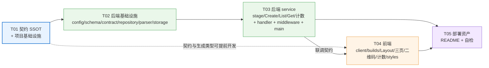

# 03-v2 · 任务分解（定稿）｜Dandelion 第一版实现

> 作者：高见远（架构师）｜日期：2026-11-13｜面向：工程师
> **⚠️ 旧版 `docs/02-ARCHITECTURE.md` 与 `docs/03-TASKS.md`（v1，Node + SQLite）已废弃，仅供历史追溯；本轮一切实现以 `docs/02-ARCHITECTURE-v2.md` + 本文为准。**
> **上游**：`docs/01-PRD.md` + `docs/04-DELTA-PRD.md` + `docs/05-MODULE-ROADMAP.md` + `docs/02-ARCHITECTURE-v2.md`（唯一设计源，API 契约 / 数据模型 / 目录树以其为准）+ 主理人最终裁决。
> 纪律：**只做 10 条 P0**；所有文件均为 `02-ARCHITECTURE-v2.md §3` 目录树中已列出的路径，**不得新增文件、不得建空目录**（`pages/updates/`、`event/`、`contract/urls.go` 等一律不建）。

**本版按最终裁决 + 质量关卡的四处实质修正**：① 上传改为 **`/builds/stage` 暂存 + token 复用**（取消 `/builds/parse`、提交不携文件不再解析）；② 下载次数改为 **流成功完成后才 +1**；③ 三个 URL 字段由 **`server/internal/service/build_service.go`** 唯一生成，`downloadPagePath` 仅用于前端内部跳转；④ **删除 `touchedFields` / `mergeFields` / `ParsePreview` 整套机制与 `metaSource` 请求字段**，stage 下**表单即唯一真值**，契约改用 `StageResult` + `CommitBuildRequest`（恰好 8 字段），提交命名 `Commit` / `commitBuild`。

---

## 0. 使用说明

- 严格按 **T01 → T02 → T03 → T04 → T05** 顺序：契约与生成物 → 后端 config/schema/contract/repository/parser/storage → 后端 service(stage/Create/List/Get/ResolveFile/计数) + handler + middleware + main → 前端 API client/builds/Layout/三页/二维码/计数/styles → 部署资产 + README → 自检（并入 T05 验收阶段）。
- 每个任务是一个**层次 / 功能模块**（≥3 个相关文件），不是「一个文件一个任务」；任务内按「实现要点」编号批量产出代码。
- **可并行提示**：T04 只需 T01 的契约与生成类型即可动手（对着 `02-ARCHITECTURE-v2.md §6` 写 `apiClient` 与页面），联调统一放 **T05**。
- 四处最容易写错的地方：**stage 提交时不带文件且不调用 parser / 不合并字段**、**表单即唯一真值（无 touched 标记）**、**计数在 `io.Copy` 成功之后**、**二维码/复制/下载只用绝对字段**。

---

## 1. 任务依赖图

---

## 2. 有序任务列表（T01 … T05）

### T01 · 契约 SSOT 与项目基础设施

| 项 | 内容 |
| --- | --- |
| **优先级** | **P0**（必须第一个完成） |
| **依赖** | 无 |
| **精确文件清单（相对根目录）** | `api/openapi.yaml`、`Makefile`、`.env.example`、`.gitignore`、`README.md`（骨架）、`web/package.json`、`web/tsconfig.json`、`web/vite.config.ts`、`web/index.html`、`server/go.mod`、`web/src/api/schema.d.ts`（生成物） |

**实现要点**

1. **`api/openapi.yaml`（OpenAPI 3.1，★ 唯一 SSOT）**：
   - `components.schemas`：`Environment`（`enum: [test, hotfix, pre, prd]`）、`Platform`（`enum: [android, ios]`，含 label/ext/contentType 描述）、`Build`（§6.3 全部字段，含 `downloadPagePath` / `downloadPageUrl(format: uri)` / `downloadFileUrl(format: uri)`）、`ApiResponse<T>`、`ParsedMeta`、**`StageResult`**、**`CommitBuildRequest{stageToken, environment, platform, appName, packageId, version, buildNumber, changelog}`**（恰好 8 字段，JSON、**无文件**）、`ListBuildsQuery`、`AppError` 响应 schema。**不定义 `UploadBuildRequest.touchedFields`、`metaSource` 请求字段或 `SubmitBuildRequest`**。
   - `servers: - url: /api/v1`；路径：`POST /builds/stage`（**唯一一次文件传输**：multipart `file` → tmp 暂存 + 同步解析 → `StageResult{stageToken, parsed(4字段), warnings[]}`，**恒 200**）、`POST /builds`（`CommitBuildRequest` JSON，**不携文件**）、`GET /builds`、`GET /builds/{id}`、`GET /builds/{id}/file`；`GET /healthz` 单独描述。**不定义 `/builds/parse` / `ParsePreview`**；`POST /builds` **不定义文件字段、不定义 `touchedFields` / `metaSource`**。
   - `LIMITS.maxUploadMB = 200`、stage token 有效期 1h、解析超时 5s 等常量集中描述。
   - **环境/平台枚举只在此处定义一次**。
2. `Makefile`：`gen:api`（`npx openapi-typescript api/openapi.yaml -o web/src/api/schema.d.ts`）、`dev`（并行 `go run ./cmd/server` + `npm --prefix web run dev`）、`build`（`npm --prefix web run build` → `CGO_ENABLED=0 go build -o bin/dandelion ./cmd/server`，**顺序不可颠倒**，`//go:embed public/` 需 dist 先存在）、`test`（`go test ./...`）、`up` / `down`（compose）。
3. `web/vite.config.ts`：React 插件、`server.host: '0.0.0.0'`（手机同网段可访问）、`server.proxy['/api'] → http://localhost:8080`、`build.outDir → ../server/public`、`emptyOutDir: true`。
4. `web/tsconfig.json`：严格模式、`moduleResolution: Bundler`、`noUncheckedIndexedAccess: true`；`web/package.json` 声明依赖与 `gen:api` 脚本。
5. `server/go.mod`：`module dandelion/server`、`go 1.22`；`go.sum` 由 `go mod tidy` 生成，不手写。
6. `.env.example`：`DATABASE_URL` / `PUBLIC_BASE_URL` / `PORT=8080` / `HOST=0.0.0.0` / `STORAGE_DIR=./storage` / `MAX_UPLOAD_MB=200` / `GO_ENV` / `VITE_API_BASE`，并写三场景 `PUBLIC_BASE_URL` 取值说明（本地局域网 IP:5173 / 内网域名 / 公网 HTTPS）。
7. `.gitignore`：`server/public/`、`storage/`、`.env`、`bin/`、`*.log`、`node_modules/`、`dist/`。
8. `README.md` 骨架（细节 T05 补全）。
9. 执行 `make gen:api` 生成 `web/src/api/schema.d.ts` 并**提交入库**（生成物入库 ⇒ 前端 dev 不需要 Go、后端 build 不需要 Node）。

**验收点**

- [ ] `make gen:api` 成功；`schema.d.ts` 可解析出 `Environment` / `Platform` / `Build` / `StageResult` / `CommitBuildRequest`，`Build.downloadPageUrl` 类型为 `string`，且 `CommitBuildRequest` **恰好 8 字段、没有 file / touchedFields / metaSource**，`POST /builds` 请求 schema **不含 file 字段**。
- [ ] `go mod tidy` 与 `npm --prefix web install` 均成功。
- [ ] 全仓搜 `'hotfix'` **只命中** `api/openapi.yaml` 与 `web/src/api/schema.d.ts`（契约测试断言 T02 加入）。
- [ ] `.env.example` 与 `02-ARCHITECTURE-v2.md §10.4` 环境变量清单逐项一致。
- [ ] 不存在根 `package.json` / workspaces / `packages/shared` 目录；不存在 `server/internal/contract/urls.go`。

---

### T02 · 后端基础设施：config / schema / contract / repository / parser / storage

| 项 | 内容 |
| --- | --- |
| **优先级** | **P0** |
| **依赖** | **T01** |
| **精确文件清单** | `server/internal/repository/schema.sql`、`server/internal/config/config.go`、`server/internal/contract/contract.go`、`server/internal/contract/contract_test.go`、`server/internal/repository/build_repository.go`、`server/internal/parser/parser.go`、`server/internal/parser/apk.go`、`server/internal/parser/ipa.go`、`server/internal/storage/paths.go` |

**实现要点**

1. `server/internal/repository/schema.sql`（**DDL 唯一来源**，用 `//go:embed` 打进二进制、启动时幂等执行，**不依赖启动 CWD**）：按 `02-ARCHITECTURE-v2.md §4.1` 一份幂等 DDL（`CREATE TABLE IF NOT EXISTS builds` + `CREATE INDEX IF NOT EXISTS idx_builds_env_platform_created`）。含 `package_id` / `download_count` / `meta_source` / `relative_path`。**`environment` 只 `NOT NULL`，严禁加 CHECK**；严禁 `apps` / `outbox` / `upd_bundles` / `module_type` 表与 `module` / `type` / `future_*` / `published_at` / `event_id` 字段；**第一版只有这一张表**。
2. `config/config.go`：★ 唯一 `os.Getenv` 处；导出带默认值的配置（`databaseURL` / `publicBaseURL` / `storageRoot` / `maxUploadMB` / `port`）；**校验 `PUBLIC_BASE_URL` 必须是绝对 http(s) URL，host 禁止 `localhost`/`127.0.0.1`/`0.0.0.0`/`::1`/容器服务名**；生产环境非法即 fail-fast，dev 放宽；`MAX_UPLOAD_MB` 与契约 `LIMITS` 一致性校验。
3. `contract/contract.go`：`Build` / `ApiResponse<T>` / `ParsedMeta` / `StageResult` / **`CommitBuildRequest`（恰好 8 字段）** / `ListQuery` DTO + `Environment` / `Platform` 常量与 `IsValid*()`；JSON tag 一律 camelCase、时间字段 `string`（ISO 8601 UTC）。**不定义 `SubmitInput` / `touchedFields` / `metaSource` 请求字段 / `mergeFields`**。
4. `contract/contract_test.go`（**契约一致性测试**）：用 `gopkg.in/yaml.v3`（**仅测试依赖**）读 `api/openapi.yaml`，比对 ① `Environment.enum` ↔ Go `Environments`、② `Platform.enum` ↔ `Platforms`、③ `paths` 中 `/api/v1/*` 与 `/healthz` ↔ `API_ROUTES` 常量、④ `LIMITS.maxUploadMB` ↔ config 默认值；任一不一致 `t.Fatal`。
5. `repository/build_repository.go`：★ 唯一 SQL 出入口 —— `Insert` / `List` / `FindByID` / `IncrDownloadCount`（`UPDATE builds SET download_count = download_count + 1 WHERE id = $1 RETURNING download_count`）；全部参数绑定（`pgx.ErrNoRows → 404`）；`rowToBuild` 做 `snake_case → camelCase` 映射，**3 个 URL 派生字段留空**（由 service 统一填充，**不得在此生成 URL**）；`List` 固定 `WHERE environment=$1 [AND platform=$2] ORDER BY created_at DESC`；用 `database/sql` + `pgx/v5/stdlib`。
6. `parser/parser.go`：统一入口 `Parse(io.ReaderAt, size, platform) (ParsedMeta, error)`；`context.WithTimeout(5s)`、manifest/plist 读取上限 5MB、zip 条目数上限防 zip bomb；允许**部分成功**（返回已解析字段 + error）；边界：只读、不落盘、不写 DB、不发网络、不调 service/repository、不生成 token。
7. `parser/apk.go`：`shogo82148/androidbinary` 的 `apk.OpenFile/OpenZipReader` → `Manifest.Package`（`packageId`）、`Manifest.VersionName`（`version`）、`Manifest.VersionCode`（`buildNumber`）、`App.Label`；label 为 `@string/...` 时用 `(*Apk).Label(nil)` 解 resources.arsc。**不调用 `Icon()`、不解析图标**。
8. `parser/ipa.go`：`archive/zip` 遍历 `Payload/*.app/Info.plist` → `howett.net/plist` 解到 struct/map：应用名 `CFBundleDisplayName`（缺失回退 `CFBundleName`）、`CFBundleIdentifier` → `packageId`、`CFBundleShortVersionString` → `version`、`CFBundleVersion` → `buildNumber`。**纯 Go，禁止 cgo / `unzip` 外部命令**。
9. `storage/paths.go`：★ 唯一路径实现 —— `stagePath(token, ext)`（→ `storage/tmp/{token}.{ext}`）、`tmpPath`、`finalPath(env, platform, id, ext)`、`relativePath`、`cleanFileName`（basename + 过滤路径分隔符与控制字符 + 限长）、`safeResolve`（`filepath.Abs` 后校验仍在 `storageRoot` 前缀内）。`fileExt` 只由 `platform` 映射，绝不取用户扩展名；根目录来自 `config.storageRoot`。

**验收点**

- [ ] 起 PG 后二进制启动自动执行 `repository/schema.sql`（embed）成功，且**重复启动不报错**；`\d builds` 无 CHECK 约束、无 `module`/`future_*` 列、库中只有 `builds` 一张业务表。
- [ ] `go test ./internal/contract/...` 通过；**把 yaml 里 `pre` 改成 `pre2` 后测试必须失败**。
- [ ] `parser/` 用 1 个真实 `.apk` + 1 个真实 `.ipa` 各跑一次拿到 4 字段；故意传损坏包 / 模拟超时 → 返回部分结果 + error，不 panic、不落盘、不写库。
- [ ] `cleanFileName("../../etc/passwd.apk")` 不含路径分隔符；`safeResolve("../x")` 被拒绝。
- [ ] 全仓搜 `SELECT|INSERT|UPDATE` 只命中 `build_repository.go`；搜 `storage/uploads` 只命中 `paths.go`；搜 `PUBLIC_BASE_URL` 只命中 `config.go` + 部署配置（T03 加入 `build_service.go`）。

---

### T03 · 后端 service（stage/Create/List/Get/ResolveFile/计数）+ handler + middleware + main

| 项 | 内容 |
| --- | --- |
| **优先级** | **P0** |
| **依赖** | **T02** |
| **精确文件清单** | `server/internal/service/build_service.go`、`server/internal/handler/build_handler.go`、`server/internal/handler/health_handler.go`、`server/internal/handler/response.go`、`server/internal/middleware/error.go`、`server/internal/app/router.go`、`server/cmd/server/main.go` |

**实现要点**

1. `handler/response.go`：`ok()` / `fail()` 统一 `{code,data,message}`；`AppError(status, code, message)`；错误码只用 `400/404/405/413/500`；中文可读文案直接上屏；未知错误日志保留 `id/环境/平台/文件名`。
2. `handler/build_handler.go` 五个 handler：
   - **`Stage`**（`POST /api/v1/builds/stage`，multipart `file`）：`http.MaxBytesReader` ≤200MB + `r.FormFile` + 扩展名白名单（缺文件/类型不符 400、超限 413）；生成 `stageToken`（UUID）、按扩展名推导 `platformHint`、写 `storage/tmp/{token}.{origExt}`；调 `service.Stage()`；**解析失败也返回 200**（`warnings` 中文原因）。
   - **`Commit`**（`POST /api/v1/builds`，**`application/json`，无文件**）：校验 `CommitBuildRequest` 8 字段（`stageToken` UUID 格式 / `environment` / `platform` / 字段长度）；**不校验 `metaSource`、不做 `mergeFields`**；调 `service.Create()`；成功 201。
   - **`List`**：`environment` 必填非法 → 400；`platform` 可选/`all`；空结果 `items: []` 非 404。
   - **`Get`**：详情 / 404。
   - **`DownloadFile`**：`Content-Type` 取自契约（Android `application/vnd.android.package-archive`、iOS `application/octet-stream`）；`Content-Disposition` **双重编码**（`filename="..."` + `filename*=UTF-8''...`）；`Content-Length` / `Cache-Control: no-cache` / `X-Content-Type-Options: nosniff`；`io.Copy` 流式；**成功后**才调计数旁路。
3. **`service/build_service.go`（★ 核心）**：
   - **★ `buildURLs(id)`（唯一 URL 生成处）**：`downloadPagePath = "/d/"+id`、`downloadPageUrl = PUBLIC_BASE_URL+"/d/"+id`、`downloadFileUrl = PUBLIC_BASE_URL+"/api/v1/builds/"+id+"/file"`；**绝不读请求 `Host`/`X-Forwarded-*`**。`Stage` 不生成 URL；**`Create` / `List` / `Get` 三条返回路径统一调用它**填充 DTO。
   - **`Stage(file)`**：写 `storage/tmp/{UUID}.{ext}` 后**同步**调用 `parser.Parse()`（5s 超时、manifest/plist ≤5MB、zip 条目上限）；失败仅记日志 + `warnings`，返回 `StageResult{stageToken, parsed(4字段), warnings[]}`，**恒 200、恒不因解析失败而报错、不阻塞上传**；`parsed` 只用于**表单带出**，不是最终元数据。启动时清空 `storage/tmp/`、每次 stage 前清理超过 **1 小时**的孤儿文件。
   - **`Create(input)`**（顺序严格）：`validateStageToken`（UUID 格式 + `safeResolve` + 存在性 + 未过期 1h，失效 → 400 `暂存文件已失效，请重新选择文件`）→ 校验 `platform` 与 stage 文件扩展名一致（不一致 400）→ `paths.finalPath`、id 由 DB `gen_random_uuid()`、ext 由 platform 映射 → `rename(tmp → uploads/{env}/{platform}/{id}.{ext})`（**token 用后立即不可重用**）+ `stat` → **组装 Build：表单即唯一真值，直接使用 `CommitBuildRequest` 的表单最终值，不再调用 `parser`、不做 `mergeFields`、不再用解析结果覆盖任何字段**，仅空字段兜底（`appName`→清洗后文件名、`packageId`→`app_name`、`version`/`buildNumber`→`'-'`、`changelog`→`''`）并据此**服务端派生 `meta_source`**（发生兜底→`fallback`，否则→`parsed`）→ `repository.Insert` → **失败补偿**：写库失败删已 move 文件 + 清 tmp → `buildURLs(id)` → **★ 唯一「上传完成」时点**（文件已落盘 + DB 事务提交 + 绝对地址已生成且可访问）→ 返回完整 Build。
   - `List` / `Get`：repository 返回后统一 `buildURLs()` 填充。
   - `ResolveFile(id)`：`FindByID` + `safeResolve` 前缀校验 → `FileRef(path, contentType, fileName, size)`。
   - **`IncrDownloadCount(id)`（旁路）**：仅由 `DownloadFile` 在 **`io.Copy` 成功完成且 `written == Content-Length` 之后**调用；2s 短超时；**失败只记日志、绝不阻断已完成的下载**；不在下载事务内持锁；**不做强去重**。
4. `handler/health_handler.go`：`GET /healthz` → `{code:0, data:{status, uptime, dbOk, storageWritable}, message:'ok'}`（独立于 `/api/v1`）。
5. `middleware/error.go`：统一错误格式化 + panic 恢复 + **失败时清理 tmp 残留**；handler 层零 try/catch。
6. `app/router.go`：chi `r.Route("/api/v1", ...)` 挂载 5 个接口；`/healthz` 独立注册；`//go:embed public/*` 静态托管；**SPA fallback**（非 `/api/v1/*`、非 `/healthz`、非静态命中的 GET 一律回 `index.html`）；挂载错误中间件（最后）。**不注册任何 push / 板块 / 鉴权 / `/builds/parse` 路由**。
7. `cmd/server/main.go`（装配层）：`config.Load()` → `PUBLIC_BASE_URL` 校验 → `sql.Open("pgx", DATABASE_URL)` + Ping + 连接池参数 → 通过 `//go:embed` 读取并幂等执行 `repository/schema.sql`（不依赖启动 CWD；compose initdb 挂载仅作双保险）→ 递归创建 `storage/{tmp,uploads}` + 启动时清空 tmp → 注入 repository/service/handler → `http.Server` 监听 → `SIGTERM/SIGINT` 优雅退出（关 DB）。**不引任何 Publisher/EventBus/Event 类型**。

**验收点**

- [ ] **stage（唯一一次文件传输）**：`curl -F "file=@x.apk" http://localhost:8080/api/v1/builds/stage` → 200 + `{stageToken, parsed, warnings}`；损坏包仍 200 + `warnings`（parsed 为空或部分）；超限 413；缺文件/类型不符 400。
- [ ] **commit（不传文件）**：`TOKEN=<上一步 stageToken>` → `curl -H 'Content-Type: application/json' -d "{\"stageToken\":\"$TOKEN\",\"environment\":\"hotfix\",\"platform\":\"android\",\"appName\":\"商城App\",\"packageId\":\"com.example.shop\",\"version\":\"1.2.0\",\"buildNumber\":\"3\",\"changelog\":\"修复登录态\"}" http://localhost:8080/api/v1/builds` → **201**；**文件全程只传一次**、`appName` = 用户值、**提交过程未调用 parser / 未做 mergeFields**（可加日志断言）、**请求无 touchedFields / metaSource**、其余字段为表单值。
- [ ] 返回的 `downloadPageUrl` / `downloadFileUrl` 是以 `PUBLIC_BASE_URL` 开头的绝对地址、`downloadPagePath` 为 `/d/{id}`；三者由同一 `buildURLs()` 生成；`List` / `Get` 返回的 DTO 同样带 3 个 URL。
- [ ] token 失效/伪造/重复使用 → 400；平台×扩展名不一致 → 400；写库失败时正式目录无残留文件、`tmp/` 无残留。
- [ ] `GET /api/v1/builds?environment=hotfix` 有该包、`?environment=test` 无、`?platform=ios` 排除 apk、按时间倒序。
- [ ] `GET /api/v1/builds/{id}/file` 下载字节一致；Android/iOS 响应头正确；中文文件名不乱码；**成功下载后 `download_count`=1**；**模拟客户端中断 / copy 出错 / 字节不足时计数不变**；故意让计数 UPDATE 失败仍能成功下载（旁路不阻断）。
- [ ] `curl http://localhost:8080/d/{id}` 返回 `index.html`（SPA fallback）；`/healthz` 返回 `code:0`。
- [ ] **重启后**包仍可查可下载；`go test ./...` 全过。

---

### T04 · 前端应用（API client / builds / Layout / 三页 / 二维码 / 计数 / styles）

| 项 | 内容 |
| --- | --- |
| **优先级** | **P0** |
| **依赖** | **T01**（契约与生成类型）、**T03**（联调） |
| **精确文件清单（12 个手写源文件）** | `web/src/main.tsx`、`web/src/App.tsx`、`web/src/styles.css`、`web/src/api/client.ts`、`web/src/api/builds.ts`、`web/src/components/Layout.tsx`、`web/src/components/FileDropzone.tsx`、`web/src/components/States.tsx`、`web/src/pages/UploadPage.tsx`、`web/src/pages/ListPage.tsx`、`web/src/pages/DownloadPage.tsx`、`web/src/utils/format.ts`（`schema.d.ts` 已在 T01 生成） |

**实现要点**

1. `api/client.ts`：唯一 HTTP 出入口；`baseURL = import.meta.env.VITE_API_BASE ?? ''`；统一解包 `{code,data,message}`，`code !== 0` 抛 `ApiError(message)`；发 FormData 时**不手动设 Content-Type**。
2. **`api/builds.ts`（★ 前端 URL 唯一消费处）**：`stageBuild(file)`（multipart，**唯一一次文件传输**）/ `commitBuild(input)`（`CommitBuildRequest` JSON，**不携文件、不带 touched/metaSource**）/ `listBuilds(query)` / `getBuild(id)`；**只直接使用 `Build` DTO 的 3 个 URL 字段，严禁 `window.location.origin` 拼接**；禁止用 `downloadPagePath` 生成二维码/复制/下载链接；路径常量取自契约。
3. `App.tsx`：`BrowserRouter` + 路由表 `/`、`/upload`、`/d/:id`、`* → /`；全站 `Layout` 包裹。
4. **`components/Layout.tsx`（★ 三段式）**：品牌区（`Dandelion`）+ 主导航区 + 内容区；主导航由**一个配置数组**渲染，**第一版仅 `{ label: '应用包', path: '/' }` 一个真实入口**；**严禁** disabled 占位菜单 / TODO / 空页面 / 隐藏入口 / 板块开关；结构与文案不含板块耦合。
5. `FileDropzone.tsx`：拖拽/点击、回显名与大小、移除、扩展名预检、按扩展名预选平台；**选文件后回调触发 `stageBuild`**。
6. `States.tsx`：`Loading` / `Empty(text, action)` / `Error(message, onRetry)`。
7. **`UploadPage.tsx`（P0-9 落地）**：
   - **选文件自动触发 `stageBuild(file)`**（stage 对用户透明，用户仍只点一次「上传并发布」，**不是 PRD A6 两步发布**）；`parsing` 加载态（「解析中…」）→ `StageResult` 返回后把 `parsed` 4 个值**自动带出**预填表单；`warnings` 显示「部分信息未自动识别，可手动修正」；保存 `stageToken`。
   - **所有字段始终可编辑、不锁定**；用户直接改，**表单当前值即最终值**，**无需 `touched` / dirty 标记、无字段合并逻辑**；重新选文件触发新 stage 时重新带出。
   - 提交调用 `commitBuild({stageToken, environment(默认 test), platform, appName, packageId, version, buildNumber, changelog})`（**`CommitBuildRequest` 恰好 8 字段，不携带文件、不带 `metaSource` / 解析状态**）；提交中按钮 `disabled`；token 失效时提示「重新选择文件」并回到选文件步骤。
   - 成功卡片：`downloadPageUrl` + 复制 / 去下载页（`navigate(downloadPagePath)`，**相对 path 唯一用途**）/ 返回列表。
8. `ListPage.tsx`：四环境切换（常驻高亮）+ 平台筛选写入 URL searchParams，变化即重取；列表展示平台、应用名、版本(构建号)、大小、时间、更新说明、**下载次数**、操作「下载页」；空/错/加载三态用 `States`；**列表页无二维码入口**。
9. **`DownloadPage.tsx`**：按 `useParams().id` 取数；展示应用名、**★环境标签必显★**、平台、版本(构建号)、大小、时间、更新说明、「已被下载 N 次」；`<QRCodeSVG value={build.downloadPageUrl} size={224} level="M" marginSize={4} />`（黑白高对比、不嵌 logo、**仅此页**）；下载按钮用 `build.downloadFileUrl` + 点击后禁用约 3s；复制地址消费同一 `downloadPageUrl`；**地址兜底**：地址为空/基址仅本机可达时显示「当前对外基址不可被手机访问，请配置 PUBLIC_BASE_URL」+ 可复制文本，不渲染扫不开的码；手机单列优先。
10. `utils/format.ts`：`formatBytes` / `formatDate`（ISO UTC → 本地）/ 标签取值（标签源自契约）。
11. `styles.css`：CSS 变量 + 少量类 + 一个 `@media (max-width: 640px)` 断点；**不引 MUI/Tailwind/UnoCSS/Less**。
12. `main.tsx`：挂载 React + BrowserRouter + 引入 `styles.css`。

**验收点**

- [ ] 端到端复现 `01-PRD §4.4`：上传 ~30MB `.apk` + `hotfix` + Android → 列表可见（信息一致、时间倒序）→ 下载页 → 文件一致；切 `test` 不出现该包。
- [ ] 选文件**自动触发 stage**、表单**自动带出** 4 字段且有「解析中」态；字段始终可编辑；**用户手改过的字段提交后原样入库**（表单即唯一真值），提交请求**不含文件 / touchedFields / metaSource**、服务端**未调用 parser / 未做 mergeFields**；重新选文件触发新 stage 会重新带出。
- [ ] `stage` 返回 `warnings`（解析失败）时上传仍成功并给出中文提示；表单留空可手填。
- [ ] 二维码手机默认相机可扫开，内容 = `downloadPageUrl`（**非 localhost、非相对路径**），扫码打开的正是该包下载页；复制地址与二维码内容完全一致。
- [ ] **本地 dev 若基址仅本机可达，二维码区显示不可用提示**，不渲染扫不开的码。
- [ ] `/d/{id}` 直接打开 / 刷新正常；id 不存在显示「包不存在」而非空白页；下载按钮用绝对 `downloadFileUrl`。
- [ ] 筛选写 URL，转发后保持、返回列表不丢；空/错/加载/上传失败/类型不符均有中文反馈无空白页。
- [ ] **导航只有「应用包」一项、无任何占位菜单**；列表页无二维码入口；手机视口（≤640px）单列可读可点。
- [ ] **全仓前端无 `window.location.origin` 拼接**；`npm --prefix web run build` 成功且产物落在 `server/public/`；无 Redux/Zustand/React Query/axios/MUI/Tailwind 依赖。

---

### T05 · 部署资产、README 与端到端自检

| 项 | 内容 |
| --- | --- |
| **优先级** | **P0** |
| **依赖** | **T03、T04** |
| **精确文件清单** | `deploy/Dockerfile`、`deploy/docker-compose.yml`、`deploy/nginx.conf`、`deploy/dandelion.service`、`README.md`（补全）、`.env.example`（校准）；自检按 §5 清单执行（无新增文件） |

**实现要点**

1. `deploy/Dockerfile`：**多阶段** —— node 阶段 `npm ci && npm run build` 出 dist → golang 阶段 `CGO_ENABLED=0 go build -o /out/dandelion ./cmd/server`（`//go:embed public/` 需 dist 先拷入）→ 运行阶段仅二进制 + 证书（DDL 已 embed，**无需外带 schema.sql**）；glibc `bookworm-slim`（不用 alpine）；**全链路无 cgo**。
2. `deploy/docker-compose.yml`：**三服务** —— ① `db`（`postgres:16-alpine`、`pgdata` 卷、`../server/internal/repository/schema.sql:/docker-entrypoint-initdb.d/01-schema.sql`（DDL 已 embed 进二进制，此处仅作「DB 就绪即有表」双保险）、`pg_isready` healthcheck）；② `server`（`depends_on: db: service_healthy`、`DATABASE_URL` + **`PUBLIC_BASE_URL`**、`uploads` 卷、`/healthz` healthcheck、`restart: unless-stopped`）；③ `nginx`（80/443、证书挂载）。`storage/tmp/` 不持久化。
3. `deploy/nginx.conf`：`client_max_body_size 210m`（**必须 > 200MB**）、`proxy_read_timeout 300s`、`proxy_set_header Host/X-Forwarded-*`（**仅日志，不参与拼地址**）、`location /api/` 反代、`location / { try_files $uri /index.html; }` **SPA fallback**（与 Go 单机版两处都写）、HTTPS 终止位与 80→443 跳转注释。
4. `deploy/dandelion.service`：`ExecStart=/opt/dandelion/bin/dandelion`、`EnvironmentFile`（含 `PUBLIC_BASE_URL`）、`After/Requires=postgresql.service`、`Restart=always`。
5. `README.md` 补全：`docker compose up -d db` → `cp .env.example .env` → `make dev`；三场景 `PUBLIC_BASE_URL` 与手机可达性；**7 个接口速查（含 stage + submit 两步）**；三阶段部署；备份（`pg_dump -Fc` / `pg_restore` / `tar rsync uploads/`）；**iOS 第一版仅 .ipa 文件下载的限制与 P1 前置条件**；FAQ（413 查 Nginx、扫码打不开查 `PUBLIC_BASE_URL`、包丢查卷挂载、token 失效重新选文件）；v1 已废弃指引。
6. `.env.example` 与 `config.go` 默认值逐项校准，不多不少。
7. 按 **§5 的 16 项自检清单**逐条执行并修正；**不得引入任何 P1/P2 功能**。

**验收点**

- [ ] `make dev` 一条命令起前后端；`make build` 产出单二进制；单机 `bin/dandelion` 三页全通。
- [ ] `docker compose -f deploy/docker-compose.yml up -d --build` 后 `db` 与 `server` 均 healthy；**删容器重建后**包仍可查可下载。
- [ ] 接近 200MB 的包不被 Nginx 413 拦截。
- [ ] README 中任一命令复制可执行；环境变量清单与代码默认值完全一致。
- [ ] §5 的 16 项自检全部通过；§6 负面清单逐条核对无违反。

---

## 3. 依赖包清单

> **所有第三方库的具体小版本待实机确认**（`go list -m -versions` / npm registry），以下只锁主版本与主选库，**不得凭印象编造 API**。

### 3.1 Go module（`server/go.mod`）

| 包 | 用途 | 备注 |
| --- | --- | --- |
| `github.com/go-chi/chi/v5` | HTTP 路由 / 中间件 / `r.Route("/api/v1")` 分组 | 小版本待实机确认；保留 `net/http` 标准 handler 契约 |
| `github.com/jackc/pgx/v5`（含 `stdlib`） | PostgreSQL 驱动，注册 `"pgx"` 给 `database/sql` | 占位符 `$1`、`RETURNING`、`pgx.ErrNoRows`；小版本待实机确认 |
| `github.com/shogo82148/androidbinary` | APK：binary AndroidManifest.xml + resources.arsc，取 `Package` / `VersionName` / `VersionCode` / `App.Label` | MIT；**不调用 `Icon()`**；版本与 API 表面待实机确认 |
| `howett.net/plist` | iOS `Info.plist`（XML / Binary plist）解码 | 纯 Go 无 cgo；最新 tag 待实机确认 |
| `gopkg.in/yaml.v3` | **仅测试**：`contract_test.go` 读 `openapi.yaml` 的 enum | 不进入运行时依赖 |
| 标准库 | `net/http`、`archive/zip`、`embed`、`io`、`database/sql`、`encoding/json`、`context`、`time`、`path/filepath` | 零依赖；multipart / zip / 静态托管全用标准库；UUID 由 PG `gen_random_uuid()` 生成 |

**明确不引入**：GORM、sqlc、golang-migrate/goose、Gin/Echo/Fiber、cors、`avast/apkparser`（LGPL-3.0，仅备选）、任何 cgo 库、任何 MQ/Redis/Kafka SDK、任何 UUID 第三方库。

### 3.2 npm（`web/package.json`）

| 包 | 用途 | 备注 |
| --- | --- | --- |
| `react` / `react-dom` | UI | ^18.3 |
| `react-router-dom` | 3 条路由 + `/d/:id` + `useSearchParams` | ^6 |
| `qrcode.react` | 下载页 `QRCodeSVG`（内置 TS 声明，无需 `@types`） | 版本与 `marginSize` API 以实机安装版本为准 |
| `vite` / `@vitejs/plugin-react` / `typescript` | 构建与类型 | devDependencies |
| `@types/react` / `@types/react-dom` | 类型声明 | devDependencies |
| `openapi-typescript` | 从 `api/openapi.yaml` 生成 `schema.d.ts` | devDependencies；生成物入库 |

**明确不引入**：MUI / Tailwind / UnoCSS / Less / Redux / Zustand / React Query / axios / 任何二维码后端生成库 / 任何包解析前端库。

---

## 4. 共享知识（跨语言约定，工程师必须逐条遵守）

1. **★ 契约单一来源 ★**：`api/openapi.yaml` 是类型、枚举、路径、请求/响应、错误码的唯一人工定义处。前端类型来自生成的 `schema.d.ts`（入库）；后端常量由 `contract_test.go` 与 yaml 比对。**全仓搜 `'hotfix'` 只命中 yaml + 生成物 + 契约测试断言**；增删环境只改 yaml 一处，DB 不改表。
2. **★ `PUBLIC_BASE_URL` 唯一生成处 = `server/internal/service/build_service.go` 的 `buildURLs(id)` ★**：只由 `config/config.go` 读取环境变量；**不读请求 `Host` / `X-Forwarded-*`**；生产非法 fail-fast。`Create` / `List` / `Get` 统一调用它；repository 不生成 URL。
3. **URL 唯一消费处（前端）= `web/src/api/builds.ts`**：只做「直接使用 DTO 字段」，不拼 origin、不拼路径。页面内 `navigate()` 用相对 `downloadPagePath`；**二维码 / 复制 / 下载按钮一律用绝对 `downloadPageUrl` / `downloadFileUrl`**；**严禁用 `downloadPagePath` 生成对外地址**。
4. **SQL 唯一在 `repository/build_repository.go`**：全部参数绑定，禁止字符串拼 SQL；URL 派生字段**不入库**；`pgx.ErrNoRows → 404`。
5. **路径唯一在 `storage/paths.go`**：任何模块不得自行拼 `storage/uploads/...`；文件名 `gen_random_uuid()`，扩展名只由 `platform` 映射；下载必须经 `safeResolve()` 前缀校验防穿越。
6. **★ stage 上传语义 ★**：`POST /builds/stage` **接收唯一一次文件**并同步解析（**5s 超时**、manifest/plist ≤5MB、zip 条目上限），写 `storage/tmp/{UUID}.{ext}`，返回 `StageResult{stageToken, parsed(4字段), warnings[]}`，**解析失败/损坏/超时恒 200**（只给空或部分 parsed + 中文 warnings，**不阻塞上传**）；`POST /builds` **只收 `CommitBuildRequest` JSON（token + 表单最终值，8 字段），不收文件、不再调用 parser、不做 `mergeFields`、不覆盖用户值**。**stage 由选文件自动触发、对用户透明，不是 PRD A6 两步发布，用户仍只点一次「上传并发布」**；R3 机器可调用 = CI/CLI 按契约先 stage 再 commit，两接口自描述、无会话依赖。
7. **★ stage token 治理 ★**：`storage/tmp/{token}.{origExt}`，UUID 不可枚举；**有效期 1 小时**；**启动时清空 tmp + 每次 stage 前清理 1 小时孤儿**；提交校验 UUID 格式 + `safeResolve` + 存在性 + 未过期；`rename` 后用后即失效、不可重用；零表、零定时任务、零外部组件。
8. **★ stage 解析值仅用于表单带出，提交以表单为唯一真值 ★**：解析值只预填表单，用户可直接改，提交的全是表单当前值；服务端原样采用、**不二次解析、不合并、不覆盖**，仅空字段兜底（`appName`→文件名、`version`/`buildNumber`→`'-'` 等）并**服务端派生 `meta_source`**（`parsed|fallback`，UI 不强制展示）。**无 `touched` / dirty 标记、无 `touchedFields` 请求字段、无 `metaSource` 请求字段、无 `mergeFields`**。
9. **统一响应与错误码**：所有 JSON 接口 `{code, data, message}`；成功 `code=0`，失败 `code=HTTP 状态码`、`data=null`、`message` 中文可读；错误码仅 `400/404/405/413/500`；**唯一例外** `/file` 成功返回二进制流。错误只抛 `AppError`，由 `middleware/error.go` 统一格式化，**handler 层零 try/catch**；失败清理 `storage/tmp/`。
10. **★ 下载次数口径 ★**：**`io.Copy` 成功完成且 `written == Content-Length` 之后**才原子 `+1`；404 / 路径非法 / 文件缺失 / **客户端中途断开** / copy 出错 / 字节不足**一律不计数**；**计数是旁路，失败只记日志绝不阻断已完成的下载**；**不强去重**（按钮禁用约 3s 抑制误触，强去重列 P1）；不做 Range/断点续传。
11. **命名规范**：Go 包名小写单数、导出标识符 PascalCase；DB 列 `snake_case`；JSON / TS 字段 `camelCase`；TS 组件文件与组件名 `PascalCase`、其余 `kebab-case`；API 路径小写复数 `/api/v1/builds`。
12. **注释规范（N2）**：**全部中文注释**；**每个文件顶部写 3~5 行「职责 / 输入 / 输出 / 边界」**；关键分支必须注释：stage 两段式落盘理由与「不是两步发布」、文件只传一次、解析超时与降级、**表单即唯一真值（不二次解析/不合并/不覆盖）**、失败补偿、`safeResolve` 前缀校验、SPA fallback 责任归属、URL 不读 Host 的理由、计数在流成功后且旁路不阻断、`environment` 不加 CHECK 的理由；不写废注释。
13. **时间格式**：统一 **ISO 8601 UTC 字符串**（DB `TIMESTAMPTZ` → JSON `createdAt`），字典序即时间序，`ORDER BY created_at DESC`。
14. **中间件顺序**（`app/router.go` 固定）：`/api/v1` 路由 → `/healthz` → `embed` 静态托管 → SPA fallback → 错误中间件（最后）。容器阶段 Nginx 承担静态与 fallback，**两处都要写**。
15. **构建顺序**：`make gen:api`（契约变更时）→ `npm --prefix web run build` → `CGO_ENABLED=0 go build`（`//go:embed public/`）；`Makefile` 是唯一编排入口。
16. **第一版不分页**；列表空返回 `items: []`（非 404）；**不做精确下载去重**、不做 Range/断点续传。
17. **零预留代码**：不写 Publisher/EventBus/Event 类型、不写板块占位菜单/空页面、不写 `TODO`、不建空目录、不建 `apps`/`outbox`/`upd_bundles` 表、不在 `builds` 加 `module`/`type`/`future_*` 字段。所有「未来可扩展」只体现在**分层位置、契约共享维度、config 化根目录、文档中的 DDL 示例**。

---

## 5. 端到端自检清单（16 项，T05 逐条打勾）

| # | 自检项 | 对应 |
| --- | --- | --- |
| 1 | `docker compose up -d db` → `cp .env.example .env` → `make dev` 一条命令起前后端；`5173` / `8080` / `5432` 均可用 | §10.3 |
| 2 | 选 `.apk` **自动触发 stage（文件全程只传一次）**：返回 200 + `stageToken` + 4 个解析字段并**自动带出表单**；**解析失败 / 包损坏 / 超时仍返回 200 + warnings，且后续 commit 上传成功** | P0-9 降级 |
| 3 | **表单即唯一真值**：用户手改过的字段提交后原样入库、不被解析值覆盖；提交请求**不含文件 / touchedFields / metaSource**、服务端**未调用 parser、未做 mergeFields**；CI/CLI 按契约先 stage 再 commit 两步可完成上传 | P0-9 / stage / R3 |
| 4 | 上传 `hotfix`+Android 成功后立即得到**绝对**下载页地址并可复制；`downloadPagePath` 仅为 `/d/{id}` | P0-1/2、Q2 |
| 5 | `storage/uploads/hotfix/android/{id}.apk` 字节与源文件一致；`builds` 有对应一行（`environment` 无 CHECK、库里只有一张业务表） | P0-2、N6 |
| 6 | 切 `hotfix` 列表出现该包（含下载次数列），信息一致、时间倒序；筛 Android 生效；切 `test` **不出现** | P0-3/4 |
| 7 | 点「下载页」进入 `/d/:id`；**直接新标签打开或刷新**正常（Go 与 Nginx 两处 SPA fallback 都验） | P0-5、§10.3 |
| 8 | 下载页展示应用名 / **环境标签** / 平台 / 版本(构建号) / 大小 / 时间 / 更新说明 / 「已被下载 N 次」 | P0-5/10 |
| 9 | 二维码 `QRCodeSVG` 用**绝对 `downloadPageUrl`**、手机默认相机可扫开、内容**非 localhost/非相对路径**；**本地 dev 基址仅本机可达时显示不可用提示**；复制地址与二维码内容完全一致 | P0-8、Q2 硬约束 |
| 10 | 点下载得到一致文件；Android `application/vnd.android.package-archive`；`.ipa` 得 `application/octet-stream`；中文下载名双重编码不乱码 | P0-6、§6.5⑤ |
| 11 | **成功下载 1 次后列表与下载页均显示 1**；**模拟客户端中断 / copy 出错 / 字节不足时计数不变**；浏览/扫码/复制/404 不增加；故意让计数失败仍成功下载 | P0-10、§6.7 |
| 12 | **重启服务 / 重建容器后**包仍可查可下载；`pg_dump` 备份 + `pg_restore` 恢复可用 | N6、§10.3 |
| 13 | 非法环境 / 超限 / 平台×扩展名不一致 / token 失效 / **commit 请求体含未知字段**（`file` / `metaSource` / `touchedFields` 任一）分别 **400 / 413 / 400 / 400 / 400**（未知字段文案固定为「请求体包含未知字段（仅允许 stageToken/environment/platform/appName/packageId/version/buildNumber/changelog）」）；**正常 8 字段 → 201**；且 `tmp/` 无残留；1 小时孤儿文件被清理 | P0-7、stage 治理、D-2 |
| 14 | `make gen:api` 重生成后 `git diff --exit-code` 通过；`go test ./...` 通过；**把 yaml `pre` 改成 `pre2` 契约测试必须失败**；全仓搜 `'hotfix'` **只允许 4 处**：`api/openapi.yaml`（SSOT）、`web/src/api/schema.d.ts`（生成物）、`server/internal/contract/contract.go`（Go 常量镜像，需注释标注来源）、`web/src/utils/format.ts`（前端标签镜像，需注释标注来源）；后两处由契约测试校验一致；**禁止**出现在其他业务代码 / SQL / 页面 / 部署配置 | ADR-07（主理人裁决：不新增代码生成器） |
| 15 | **push 相关代码行数 = 0**：无 Publisher/EventBus/Event 类型、无 outbox/events/subscriptions 表、无预留列、无 MQ、无 `TODO`；**`CGO_ENABLED=0 go build` 成功（无 cgo）**；无外部命令解析 | §11、§6 |
| 16 | **负面清单逐条核对**：无 `apps`/`upd_bundles`/`modules` 表与判别列、无占位菜单/空页面/空目录、`/d/:id` 路径与二维码内容未被板块化改动、列表页无二维码入口、依赖与 §3 完全一致、`contract/urls.go` 与 `/builds/parse` 均不存在 | §6 负面清单 |

---

## 6. 第一版负面清单（防止自行加功能）

### 6.1 功能

❌ iOS 浏览器直接安装 / plist / itms-services / UDID ｜ ❌ 列表页二维码入口 ｜ ❌ 推送 / 通知 / 消息 / Webhook / 订阅 / 回调 / CI 集成 / 开放 API Key / 事件监听 ｜ ❌ 为 push 新增的表单字段 / 页面 / 配置项 ｜ ❌ 登录鉴权与成员体系 ｜ ❌ 密码/回答问题安装 ｜ ❌ 有效期 / 定时发布 / 短链 ｜ ❌ 渠道 / 统计报表 / 看板 ｜ ❌ 鸿蒙 / CDN / 多语言 / 大包分发 ｜ ❌ 包删除与上传后编辑 ｜ ❌ **应用图标解析** ｜ ❌ 后端二维码接口 ｜ ❌ 热更新包上传/管理/发布/灰度/回滚/版本绑定/差量包 ｜ ❌ 任何多板块功能 ｜ ❌ **`POST /builds/parse` / `ParsePreview` / `touchedFields` / `mergeFields` 整套机制** ｜ ❌ **提交接口携带文件 / 携带 `metaSource` / 服务端二次解析或覆盖用户值**。

### 6.2 数据与框架

❌ `apps` / `modules` / `upd_bundles` / `module_type` 判别列 / 板块枚举表 ｜ ❌ `builds` 上的 `module` / `type` / `future_*` / `published_at` / `event_id` 预留字段 ｜ ❌ `events` / `outbox` / `subscriptions` / `receivers` / 通用下载计数表 ｜ ❌ **第二张表** ｜ ❌ SQLite 及任何嵌入式 KV / MySQL / GORM / sqlc / 迁移框架 ｜ ❌ `environment` 加 CHECK 约束 ｜ ❌ 把四值枚举提升为全平台强制维度 ｜ ❌ **`downloadPagePath` 用于二维码 / 复制 / 下载链接**。

### 6.3 工程

❌ 空目录（`pages/updates/`、`event/`、`store/` 等）｜ ❌ 空实现 / 空接口 / `TODO: 未来接 push` / `TODO: 热更新板块` 占位 ｜ ❌ 禁用占位菜单 / 隐藏入口 / 板块开关 / 插件系统 / 模块注册表 / 动态路由加载 ｜ ❌ Publisher / EventBus / EventHandler 类型 ｜ ❌ **cgo** ｜ ❌ 外部命令解析（aapt/unzip）｜ ❌ MQ / Redis / Kafka SDK ｜ ❌ MUI / Tailwind / Redux / Zustand / React Query / axios ｜ ❌ 分页 / Range 断点续传 / **精确下载去重表或缓存** ｜ ❌ 前端拼 `window.location.origin` ｜ ❌ **`touched` / dirty 标记与服务端字段合并** ｜ ❌ **服务端提交时二次解析或覆盖用户值** ｜ ❌ `server/internal/contract/urls.go` 文件 ｜ ❌ 文件树之外的任何新文件。

**✅ 第一版只保留的「预留」**：三段式 Layout + 配置化导航数组（1 项）、路由命名空间约定（`/d/:id` 永不可改）、契约里的共享维度、config 化的存储根目录、`02-ARCHITECTURE-v2.md` 中的演进 DDL 示例（明确标注「第一版不执行」）、`/api/v1` 前缀、`BuildService.Create()` 唯一时点、装配层可注入。

---

## 7. 遗留项（不阻塞第一版，见 `02-ARCHITECTURE-v2.md §12.2`）

真实 APK/IPA 解析成功率实测 ｜ `applicationId` 与二进制 manifest `package` 一致性（含 `applicationIdSuffix`）｜ **是否按 IP/用户强下载去重（P1，第一版不做）** ｜ Go / PG / 各库小版本实机确认 ｜ 解析 5s 超时与 5MB 上限校准 ｜ `PUBLIC_BASE_URL` 手机扫码实机验证 ｜ 域名变更致既有二维码失效 ｜ 按钮抑制时长 / 二维码 level / 单包 200MB 上限默认值 ｜ PM Q1–Q5（pushy 所指 / 是否共用应用主体 / 环境是否复用四值 / 板块独立权限 / 上线顺序）｜ Q14–Q17（未来推送渠道等）。**已删除「stage 二次文件传输」「一步式上传端点」「仅完整传输成功才计数是否精确」遗留项**（stage 与成功计数均为第一版定稿方案）。

---

## 8. 实现偏差备案（主理人已裁决，全部接受）

> 工程师在实现中提出的 5 处合理偏差，主理人已全部接受；**均不影响对外契约与验收标准**，仅作备案，避免后续 review 误判为违约。

| 编号 | 文件 / 位置 | 偏差内容 | 理由 | 影响契约？ |
| --- | --- | --- | --- | --- |
| DB-1 | `server/embed.go`（**新增文件**，位于 `server/` 根包） | 比文档多一个 Go 文件，且不在 `internal/` 下 | `//go:embed public/*` **只能写在与 `public/` 同级的包内**，而 `public/` 在 `server/` 根、该层原本无 `.go` 文件。属 Go 语言约束，**必需** | 否（不暴露任何 HTTP 契约） |
| DB-2 | `server/internal/repository/build_repository.go` | 新增 `NextID()`，成为仓储第 5 个方法 | 文件落盘需**先有 id**，而 id 由 PG `gen_random_uuid()` 生成 ⇒ 先取 id → `rename` → `Insert`。**仍满足「id 由 DB 生成」**，不改为应用侧 UUID | 否（`Build.id` 语义与格式不变） |
| DB-3 | `server/internal/storage/`（`storage/tmp/{token}.name` 伴生文件） | stage 阶段额外写一个 sidecar 存清洗后的原始文件名 | `originalFileName` 需跨 stage / commit 两个**无状态请求**传递，而 `CommitBuildRequest` 不带文件名；sidecar 与 tmp 同生命周期、**零表零组件** | 否（**tmp 暂存区的内部实现细节，不属于对外契约**；不得出现在 API 字段中） |
| DB-4 | `server/internal/handler/response.go` | `OK()` / `OKWithStatus()` **返回 `error`** | 让 handler 可 `return OK(w, data)`，与统一错误中间件的签名对齐，属写法取舍 | 否（响应体仍是 `{code,data,message}`） |
| DB-5 | `server/internal/middleware/error.go` + `app/router.go` | 错误中间件用**最外层包装**（`Use` 早于路由注册） | chi 要求 `Use` 必须在路由注册前，才能在「最后挂载」语义下捕获全部路由错误 | 否（错误响应格式不变） |
| **DB-6** | `server/internal/repository/schema.sql`（从 `deploy/` 迁入）+ `//go:embed` | DDL 位置变更 | 消除对**当前工作目录**的依赖，使二进制自举建表、容器与单机行为一致 | **否**（对外契约不变；仅部署资产路径变化） |

## 9. 需对齐文档的代码调整（主理人已裁决，以文档为准）

> 以下 3 项是**代码与最终文档不一致**、需要工程师按文档调整的项（不属于「可接受偏差」）。

| 编号 | 现状（代码） | 应改为（文档为准） | 依据 |
| --- | --- | --- | --- |
| AL-1 | `SubmitBuildRequest` / handler `Submit` / 前端 `submitBuild` | **`CommitBuildRequest` / handler `Commit` / 前端 `commitBuild`** | 全文命名统一，见 `02-ARCHITECTURE-v2.md` §6.5②、§4.4、§9.2 |
| AL-2 | 前端计算 `metaSource` 并随请求提交 | **请求删掉 `metaSource`**（`CommitBuildRequest` 恰好 8 字段）；**服务端在 `Create()` 按「是否发生空值兜底」派生 `parsed\|fallback`** 写入 `meta_source` 列 | §6.3、§6.5②、T03 `Create` |
| AL-3 | 前端 `touched` 机制 | **允许保留**（`useRef` 实现「stage 异步返回不覆盖用户已输入值」），但**仅限前端局部状态**：不进 API 契约、不参与服务端合并、不出现在 `CommitBuildRequest` | §9.3「`touched` 的定位」 |
| **AL-4** | `api/openapi.yaml` 的 `MetaSource.enum` 仍为 `[parsed, manual, fallback]`，描述仍写「前端按 touched 计算」 | **改为 `["parsed","fallback"]` 两值**、描述改「服务端按是否发生空值兜底派生、不出现在请求契约」；`manual` 删除（仅可在「已废弃」说明中保留字面量） | §6.3 `metaSource` 行、§6.5② |

---

> **配套**：`docs/02-ARCHITECTURE-v2.md`（唯一设计源）、`docs/06-FOLDER-LAYOUT.md`（目录布局与分类规范）。旧 `docs/02-ARCHITECTURE.md` / `docs/03-TASKS.md` 已加废弃声明，仅供历史追溯。
