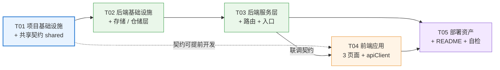

⚠️ 本文已由 v2 文档取代，仅供历史追溯，工程师请以 02-ARCHITECTURE-v2.md / 03-TASKS-v2.md 为准

# 03 · 任务分解｜Dandelion 第一版实现

> 作者：高见远（架构师）｜日期：2026-11-13｜面向：工程师
> **上游输入**：`docs/01-PRD.md`（唯一需求源）+ `docs/02-ARCHITECTURE.md`（唯一设计源，API 契约 / 数据模型 / 目录结构以其为准）
> 纪律：**只做 P0 三项闭环**（上传 → 按环境/平台查列表 → 独立下载页下载原始包），负面清单见 §5。

---

## 0. 使用说明

- 严格按 **T01 → T02 → T03 → T04 → T05** 顺序实现：先共享契约，再后端基础设施/存储/服务/路由，再前端，最后部署与自检。
- 每个任务是一**个层次/功能模块**（≥3 个相关文件），不是「一个文件一个任务」；任务内按「实现要点」的小项顺序写即可批量产出代码。
- **可并行提示**：T04 页面开发只依赖 T01 的类型/常量契约即可动手（对着 `02-ARCHITECTURE.md §5` 的契约写 `apiClient` 与页面），不必等 T03 完成；**联调统一放在 T05**。
- 所有文件均为 `02-ARCHITECTURE.md §3.1` 文件树中已列出的文件，**不得新增文件、不得新建空目录**。

---

## 1. 任务依赖图

---

## 2. 任务列表（T01 … T05）

### T01 · 项目基础设施与共享契约

| 项 | 内容 |
| --- | --- |
| **优先级** | **P0**（必须第一个完成） |
| **依赖** | 无 |
| **涉及文件（相对根目录）** | `package.json`、`tsconfig.base.json`、`.gitignore`、`.env.example`、`README.md`（骨架）、`packages/shared/package.json`、`packages/shared/tsconfig.json`、`packages/shared/src/index.ts`、`packages/shared/src/types.ts`、`packages/shared/src/constants.ts`、`apps/web/package.json`、`apps/web/tsconfig.json`、`apps/web/vite.config.ts`、`apps/web/index.html`、`apps/server/package.json`、`apps/server/tsconfig.json` |

**实现要点**

1. 根 `package.json`：`"workspaces": ["apps/*", "packages/*"]`、`"private": true`、`"engines": {"node": ">=20"}`；脚本 `dev`（`concurrently` 并行起 `dev:server` + `dev:web`）、`dev:server`、`dev:web`、`build`（`vite build`，产物输出到 `apps/server/public/`）、`start`、`check`（各包 `tsc --noEmit`）；共享 devDependencies 只放 `typescript` 与 `concurrently`。
2. `tsconfig.base.json`：严格模式、`ES2022` + `NodeNext`/`Bundler` 按包覆盖、**路径别名 `@dandelion/shared` → `packages/shared/src/index.ts`**；各包 `tsconfig.json` 一律 `extends` 它。
3. `packages/shared`（**零运行时依赖、零业务逻辑**）：
   - `constants.ts`：★ `ENVIRONMENTS`（value+label 四值）、`PLATFORMS`（value+label+ext+contentType）、`API_ROUTES`（所有 `/api/*` 路径）、`LIMITS.maxUploadMB = 200`、`Environment` / `Platform` 类型由常量 `as const` 推导。**全仓唯一定义处**。
   - `types.ts`：`Build`（字段见 `02 §4.1`，含派生的 `downloadPath` / `downloadPagePath`）、`ApiResponse<T>`、`ApiError`、`UploadBuildInput`、`ListBuildsQuery`。
   - `index.ts`：统一 re-export，前后端**只从 `@dandelion/shared` 导入**。
4. `apps/web`：`vite.config.ts` 配 React 插件、`resolve.alias` 指向 shared 源码、`server.proxy['/api'] → http://localhost:3001`、`build.outDir → ../server/public`、`emptyOutDir: true`；`index.html` 单一挂载点。
5. `.env.example`：逐项对齐 `02 §9.6`（`PORT/HOST/STORAGE_DIR/DATABASE_FILE/MAX_UPLOAD_MB/NODE_ENV/VITE_API_BASE`）并写中文说明与默认值。
6. `.gitignore`：`node_modules/`、`dist/`、`apps/server/public/`、`storage/`、`.env`、`*.log`。
7. `README.md` 骨架：项目名称、一句话简介、快速开始（`cp .env.example .env && npm install && npm run dev`）、目录结构指引（细节留到 T05 补全）。

**验收点**

- [ ] 根目录执行 `npm install` 一次成功，`node_modules/@dandelion/shared` 为软链。
- [ ] `npm run check` 全部通过（含 shared 类型被两端正确解析）。
- [ ] 全仓搜索 `'hotfix'`、`'/api/builds'`、`200`（MB 上限）**只命中 `packages/shared/src/constants.ts`**（后端配置除外，见 §4）。
- [ ] `packages/shared/package.json` 的 `dependencies` 为空。

---

### T02 · 后端基础设施、存储与仓储层

| 项 | 内容 |
| --- | --- |
| **优先级** | **P0** |
| **依赖** | **T01** |
| **涉及文件** | `apps/server/src/config.ts`、`apps/server/src/db.ts`、`apps/server/src/response.ts`、`apps/server/src/repository/buildRepository.ts`、`apps/server/src/storage/paths.ts`、`apps/server/src/upload/multer.ts` |

**实现要点**

1. `config.ts`：**唯一** `import 'dotenv/config'` 处与唯一 `process.env` 读取处；导出带默认值的 `Config`（`port=3001`、`host=0.0.0.0`、`storageDir=./storage`、`databaseFile=${storageDir}/dandelion.db`、`maxUploadMB=200`、`publicDir`）；启动时校验 `MAX_UPLOAD_MB` 与 `LIMITS.maxUploadMB` 一致。
2. `db.ts`：`better-sqlite3` 连接单例；启动时递归创建 `storage/`、`storage/tmp/`、`storage/uploads/`，并执行 `02 §4.3` 的 `CREATE TABLE IF NOT EXISTS builds` + `CREATE INDEX IF NOT EXISTS idx_builds_env_platform_created`；开启 WAL 日志模式。
3. `response.ts`：`ok(res, data, status=200)` / `fail(...)` 统一构造 `{code, data, message}`；`AppError(status, code, message)`；错误码只用 `02 §5.1` 表内 5 个。
4. **`storage/paths.ts`（★ 唯一路径实现）**：`tmpPath(filename)`、`finalPath(env, platform, id, ext)`、`relativePath(...)`、`cleanFileName(name)`（basename + 过滤路径分隔符/控制字符 + 限长）、`safeResolve(relativePath)`（`path.resolve` 后校验 `startsWith(uploadsRoot + path.sep)`）。**扩展名只由 `PLATFORMS[platform].ext` 决定，绝不取用户文件名**。
5. **`repository/buildRepository.ts`（★ 唯一 SQL 出入口）**：`insert(build)`、`list(query)`、`findById(id)`；`rowToBuild()` 完成 `snake_case → camelCase` 映射，并按 `API_ROUTES` 派生 `downloadPath` / `downloadPagePath`（**派生字段不入库**）；全部用 `prepare()` 参数绑定，禁止字符串拼 SQL；`list` 固定 `WHERE environment=? [AND platform=?] ORDER BY created_at DESC`。
6. `upload/multer.ts`：`diskStorage` 固定写 `storage/tmp/`（不要用 `req.body` 拼目标目录，原因见 `02 §4.4`）；`fileFilter` 做扩展名白名单（大小写不敏感）、`limits.fileSize = maxUploadMB * 1024 * 1024`；字段名 `file`。

**验收点**

- [ ] `npm run dev:server` 启动后自动生成 `storage/dandelion.db`、`tmp/`、`uploads/`，且重复启动不报错（幂等）。
- [ ] 用 sqlite 客户端可见 `builds` 表与 `idx_builds_env_platform_created` 索引。
- [ ] 全仓搜索 `SELECT` / `INSERT` **只命中 `buildRepository.ts`**；搜索 `storage/uploads` **只命中 `paths.ts`**。
- [ ] `cleanFileName('../../etc/passwd.apk')` 不含路径分隔符；`safeResolve('../x')` 被拒绝。

---

### T03 · 后端服务层、路由与应用入口

| 项 | 内容 |
| --- | --- |
| **优先级** | **P0** |
| **依赖** | **T02**（契约来自 T01） |
| **涉及文件** | `apps/server/src/service/buildService.ts`、`apps/server/src/routes/buildRoutes.ts`、`apps/server/src/routes/healthRoutes.ts`、`apps/server/src/middleware/errorMiddleware.ts`、`apps/server/src/app.ts`、`apps/server/src/server.ts` |

**实现要点**

1. `buildService.ts`（业务编排，**不写 SQL、不解析 multipart**）：
   - `createBuild(input)`：校验 `environment` / `platform` 命中 shared 常量、平台×扩展名一致、字段长度与兜底 → `id = crypto.randomUUID()` → `paths.cleanFileName` / `finalPath` → **两段式落盘**（`rename(tmp → final)`）→ `stat()` 取 `fileSize` → 组装 `Build`（`createdAt = new Date().toISOString()`）→ `repository.insert()` → **失败补偿**：写库失败则删除已 move 的正式文件。
   - `listBuilds(query)`、`getBuild(id)`、`resolveFile(id)`（返回 `{absPath, contentType, fileName, size}`，经 `paths.safeResolve()`）。
2. `buildRoutes.ts`（只做 HTTP 语义）：严格实现 `02 §5.3` 的 ①②③④：
   - `POST /api/builds` → 201 + `Build`；
   - `GET /api/builds` → `{items, total, environment, platform}`，空结果返回 `items: []`（**不是 404**）；
   - `GET /api/builds/:id` → 详情 / 404；
   - `GET /api/builds/:id/file` → `createReadStream().pipe(res)`，按 `PLATFORMS[platform].contentType` 设置响应头，Android `application/vnd.android.package-archive`、iOS `application/octet-stream`，中文名同时给 `filename` 与 `filename*=UTF-8''...`，附 `Content-Length` / `Cache-Control: no-cache` / `X-Content-Type-Options: nosniff`。
   - 所有路径取自 `API_ROUTES`，**禁止手写路径字面量**。
3. `healthRoutes.ts`：`GET /api/health` 返回 `{status:'ok', uptime, storageWritable}`，`storageWritable` 通过探测 `tmp/` 可写得到。
4. `errorMiddleware.ts`：`asyncHandler(fn)` 包裹所有异步路由（**路由层零 try/catch**）；`onError` 把 `AppError` / multer 超限错误 / 未知错误统一成 `{code, data:null, message}`，并设置正确 HTTP 状态码；**失败时删除 `req.file` 对应的 tmp 文件**；未知错误日志保留 id/环境/平台/文件名（N9），上屏文案固定为中文通用语。
5. `app.ts` `createApp()`：中间件顺序固定 → `/api` 路由 → `express.static(publicDir)` → SPA fallback（非 `/api` 的 GET 一律回 `index.html`）→ `errorMiddleware`（最后挂）。**不引入 cors**（同源 + Vite proxy）。
6. `server.ts`：读 `config` → 初始化 db/目录 → `listen(port, host)` → 处理 `SIGTERM/SIGINT` 优雅退出（关闭 DB）。

**验收点**

- [ ] `curl http://localhost:3001/api/health` 返回 `code:0`。
- [ ] `curl -F "file=@x.apk" -F "environment=hotfix" -F "platform=android" http://localhost:3001/api/builds` 返回 201 且 `downloadPagePath=/d/{id}`；`storage/uploads/hotfix/android/{id}.apk` 存在。
- [ ] `GET /api/builds?environment=hotfix` 有该包；`?environment=test` 不出现该包；`?platform=ios` 不出现该 apk；按时间倒序。
- [ ] `GET /api/builds/{id}/file` 下载文件与上传文件字节一致；响应头 Android/iOS 各自正确。
- [ ] 非法环境 / 缺文件 / 超限 / 平台×扩展名不一致分别得到 400 / 400 / 413 / 400，且 `tmp/` 无残留。
- [ ] 浏览器直接访问 `http://localhost:3001/d/{任意id}` 返回 `index.html`（不 404）—— 注：build 前 `public/` 可能暂无产物，此项在 T05 联调复验。
- [ ] **杀掉进程重启后**，之前上传的包仍可查询、仍可下载（N6）。

---

### T04 · 前端应用（三个页面 + API 客户端）

| 项 | 内容 |
| --- | --- |
| **优先级** | **P0** |
| **依赖** | **T01**（类型/常量契约）、**T03**（联调，见 §0 并行提示） |
| **涉及文件（共 12 个源文件，与 `02 §3.2` 一致）** | `apps/web/src/main.tsx`、`App.tsx`、`styles.css`、`api/client.ts`、`api/builds.ts`、`components/Layout.tsx`、`components/FileDropzone.tsx`、`components/States.tsx`、`pages/UploadPage.tsx`、`pages/ListPage.tsx`、`pages/DownloadPage.tsx`、`utils/format.ts` |

**实现要点**

1. `api/client.ts`：**唯一** HTTP 出入口。`baseURL = import.meta.env.VITE_API_BASE ?? ''`；统一解包 `ApiResponse<T>`，`code !== 0` 抛 `ApiError(message)`；发 FormData 时**不手动设 `Content-Type`**（让浏览器带 boundary）；`GET` / `POST` 两个薄封装。
2. `api/builds.ts`：**唯一 URL 生成处**。`uploadBuild(form)`、`listBuilds(query)`、`getBuild(id)`、`getDownloadFileUrl(build)`、`getDownloadPageUrl(build) = window.location.origin + build.downloadPagePath`；路径全部取自 `API_ROUTES`。
3. `App.tsx`：`BrowserRouter` + 路由表 `/`（ListPage）、`/upload`（UploadPage）、`/d/:id`（DownloadPage）、`* → navigate('/')`；全站 `Layout` 包裹。
4. `Layout.tsx`：顶栏（产品名 + 「包列表」/「+ 上传包」），三页共用。
5. `FileDropzone.tsx`：拖拽 + 点击选文件、回显名与大小、移除、扩展名预检、**按扩展名回调预选平台**（`.apk→android` / `.ipa→ios`）。
6. `States.tsx`：`Loading` / `Empty(text, action)` / `Error(message, onRetry)` 三个通用状态组件。
7. `UploadPage.tsx`（P-01）：表单状态 + `02 §7.4` 全部校验（默认 `environment=test`）、提交中 `disabled` 防重复、成功卡片展示 `getDownloadPageUrl()` + 「复制地址 / 去下载页 / 返回列表」；选填项为空不阻塞。
8. `ListPage.tsx`（P-02）：**环境四值切换（常驻高亮）+ 平台筛选（全部/Android/iOS）写入 URL searchParams**，变化即重取；列表按后端返回顺序（时间倒序）渲染平台标识、应用名、版本(构建号)、大小、时间、更新说明摘要、「下载页」操作；空/错/加载三态用 `States`。
9. `DownloadPage.tsx`（P-03）：按 `useParams().id` 取数；展示应用名、**★环境标签必显★**、平台、版本(构建号)、大小、时间、更新说明；主按钮 `a[href]` 指向 `getDownloadFileUrl()`；「复制页面地址」「返回包列表」；手机优先单列（`@media ≤640px`）；**二维码占位不渲染、不写任何逻辑**。
10. `utils/format.ts`：`formatBytes`、`formatDate`（ISO UTC → 本地可读）、标签取值（**标签来自 shared 常量，不另写中文映射表**）。
11. `styles.css`：CSS 变量（颜色/间距/圆角/字号）+ 少量类 + 一个手机断点；**不引入任何 UI 框架**（理由见 `02 §1.3`）。
12. `main.tsx`：挂载 React + BrowserRouter + 引入 `styles.css`。

**验收点**

- [ ] 严格按 PRD §4.4 端到端：上传 ~30MB `.apk` 选 `hotfix`+Android → 切 `hotfix` 筛 Android 出现该包且信息一致、时间倒序 → 进入独立下载页 → 下载得到一致文件；切到 `test` 该包不出现。
- [ ] 上传页 4 步内完成（选文件、选环境、选平台、提交）；成功后可见并可复制下载页地址。
- [ ] `/d/{id}` **直接打开或刷新**都能正常显示（依赖 T03 的 SPA fallback）；`id` 不存在时显示「包不存在」而非空白页。
- [ ] 环境/平台筛选写在 URL，复制 URL 给他人打开后筛选条件保持；「返回列表」不丢条件。
- [ ] 空环境 / 查询失败 / 加载中 / 上传失败 / 类型不符 均有中文可读反馈，无空白页（N7）。
- [ ] 手机视口（≤640px）下载页单列居中、按钮可读可点。
- [ ] **无 Redux / Zustand / React Query / axios / MUI / Tailwind 依赖**；`npm run build` 成功且产物落在 `apps/server/public/`。

---

### T05 · 部署资产、README 与端到端自检

| 项 | 内容 |
| --- | --- |
| **优先级** | **P0** |
| **依赖** | **T03、T04** |
| **涉及文件** | `deploy/Dockerfile`、`deploy/docker-compose.yml`、`deploy/nginx.conf`、`deploy/dandelion.service`、`README.md`（补全）、`.env.example`（校准） |

**实现要点**

1. `deploy/Dockerfile`：**多阶段**（`02 §9.3`）。build 阶段 `node:20-bookworm-slim` + `npm ci` + `npm run build`；run 阶段 `npm ci --omit=dev`（`tsx` 保留在 dependencies）、只拷贝 `apps/server`、`packages/shared`、`apps/server/public`、根 `package.json`；`CMD ["npm","run","start"]`。**用 glibc 基础镜像（不用 alpine）**以适配 `better-sqlite3` prebuilt；无 prebuilt 时在 build 阶段装 `python3 make g++` 供 node-gyp 回退。
2. `deploy/docker-compose.yml`：`dandelion` 服务（`restart: unless-stopped`、`env_file`、`volumes: ../storage:/app/storage` ★ 唯一持久化卷、`healthcheck` 打 `/api/health`）+ 可选 `nginx` 服务（80/443 + 证书挂载）；本地/内网可只起 `dandelion`。
3. `deploy/nginx.conf`：**`client_max_body_size 210m`**（必须 > 200MB）、`/api/` 反代 + `proxy_set_header Host/X-Forwarded-Proto/X-Forwarded-For`、`proxy_read_timeout 300s`、`location /` 反代（第一版静态仍由 Express 托管）；注释说明未来把 `/assets/` 摘出来直接托管静态的改法；HTTPS 终止位留注释。
4. `deploy/dandelion.service`：按 `02 §9.2` 的 systemd 示例，`WorkingDirectory` / `EnvironmentFile` / `Restart=always`。
5. `README.md` 补全：快速开始（本地）、三项 P0 接口速查（方法+路径+字段）、环境变量表（对齐 §9.6）、目录结构说明、三种部署步骤（单机 systemd / docker compose / Nginx+HTTPS）、**备份方法**（SQLite `.backup` + `uploads/` 打包）、**iOS 第一版只下载 .ipa 的限制与 P1 前置条件**（指向 `02 §9.5`）、常见问题（413 查 Nginx、上传后重启丢包查卷挂载）。
6. `.env.example` 与 `02 §9.6` 及 `config.ts` 默认值逐项校准，不多不少。
7. 按 §6 自检清单逐条执行并修正，不引入任何 P1/P2 功能。

**验收点**

- [ ] `npm run dev` 一条命令同时起前后端；`npm run build && npm run start` 单机模式 `http://localhost:3001` 三页全通。
- [ ] `docker compose -f deploy/docker-compose.yml up -d --build` 后 `healthcheck` 为 healthy；**删除容器重建后**先前上传的包仍可查询与下载（卷挂载生效）。
- [ ] 通过 Nginx 上传一个接近 200MB 的包不被 413 拦截（`client_max_body_size` 生效）。
- [ ] README 中任一命令复制可执行；环境变量清单与代码默认值完全一致。
- [ ] §6 自检清单 12 项全部通过；§5 负面清单逐条核对无违反。

---

## 3. 依赖包列表（按 workspace 分组，尽量少）

> 全仓运行时依赖合计 **8 个**：`express / multer / better-sqlite3 / dotenv / tsx / react / react-dom / react-router-dom`。无数据库服务、无消息队列、无缓存、无组件库、无状态库。`tsx` 同时承担开发与生产运行，省掉 tsc 构建协调（ADR-07）。

| Workspace | 包 | 版本建议 | 用途 | 类型 |
| --- | --- | --- | --- | --- |
| **根 `package.json`** | `typescript` | `^5.6.0` | 全仓类型检查 / 编辑器（各包 extends 根 tsconfig） | dev |
| | `concurrently` | `^9.0.0` | `npm run dev` 一条命令并行起前后端（唯一「工具型」依赖） | dev |
| **`packages/shared`** | — | — | **零依赖**：纯 TS 类型 + 常量，不发布、不编译 | — |
| **`apps/server`** | `express` | `^4.21.0` | HTTP 路由 / 中间件 / 静态托管 / SPA fallback | runtime |
| | `multer` | `^2.0.0` | multipart 上传（`diskStorage` + `fileFilter` + `limits`）；选 2.x 规避 1.x 历史安全公告 | runtime |
| | `better-sqlite3` | `^11.0.0` | 嵌入式 SQLite 单文件（同步 API、事务、预处理语句）；**无独立进程** | runtime |
| | `dotenv` | `^16.4.0` | 仅 `config.ts` 顶部 `import 'dotenv/config'` 一处 | runtime |
| | `tsx` | `^4.19.0` | `tsx watch` 开发热重载 / `tsx` 生产直接跑 TS 源码（放 dependencies） | runtime |
| | `@types/express` / `@types/multer` / `@types/better-sqlite3` / `@types/node` | 与运行时对应 | 类型声明 | dev |
| **`apps/web`** | `react` | `^18.3.1` | UI | runtime |
| | `react-dom` | `^18.3.1` | DOM 挂载 | runtime |
| | `react-router-dom` | `^6.26.0` | 3 条路由 + 动态 `/d/:id` + `useSearchParams` 筛选态 | runtime |
| | `vite` | `^5.4.0` | 开发服务器 / proxy / 构建 | dev |
| | `@vitejs/plugin-react` | `^4.3.0` | React 快刷新 | dev |
| | `@types/react` / `@types/react-dom` | `^18.3.0` | 类型声明 | dev |

**明确不引入（及理由）**

| 不引入 | 理由 |
| --- | --- |
| MUI / Tailwind / UnoCSS / Less | 3 个页面、零设计系统需求；一个 `styles.css` + CSS 变量足够，避免体积与类名堆叠伤害「一看就懂」（`02 §1.3`） |
| Redux / Zustand / React Query | 无跨页共享状态、无登录用户态、无缓存一致性问题；筛选态放 URL 更贴合「链接转发」（`02 §7.3`） |
| axios | 原生 `fetch` + 一个 30 行 `apiClient` 即可统一解包 |
| cors | 生产同源（Express 托管静态）、开发 Vite proxy，无跨域 |
| Postgres / MySQL / Redis / MQ | 违背 N5「低运维」；SQLite 单文件 + 本地磁盘即全部状态 |
| turborepo / nx / lerna / pnpm 全局工具 | npm workspaces 已够，不引入构建编排工具（ADR-01） |
| 二维码 / 包解析 / 统计 / 鉴权 SDK | 均属 P1/P2，第一版不写（§5 负面清单） |
| `nanoid` / `uuid` | Node 内置 `crypto.randomUUID()` 即可，零依赖 |

---

## 4. 共享知识（跨文件约定，工程师必须逐条遵守）

1. **统一响应格式**：所有 JSON 接口一律 `{ code, data, message }`；成功 `code = 0` / `data` 为业务数据 / `message = 'ok'`；失败 `code = HTTP 状态码`、`data = null`、`message` 为**简体中文可直接上屏**的文案，且 HTTP 状态码同步正确设置。**唯一例外**：`GET /api/builds/:id/file` 成功返回二进制流（失败仍返回统一错误 JSON）。
2. **错误中间件约定**：业务错误一律 `throw new AppError(status, code, message)`；所有异步路由用 `asyncHandler` 包裹；`errorMiddleware` 在 `createApp()` 中**最后挂载**并统一格式化；**路由层不写 try/catch**；上传失败必须清理 `storage/tmp/` 残留文件。第一版错误码只有 `400 / 404 / 405 / 413 / 500` 五个。
3. **★ 环境 / 平台枚举单一来源**：`packages/shared/src/constants.ts` 是全仓唯一定义处（`ENVIRONMENTS` / `PLATFORMS` / `API_ROUTES` / `LIMITS`）。前端下拉与标签、后端入参校验、磁盘目录白名单、下载 `Content-Type` 全部 `import` 自它；**任何文件不得出现 `'hotfix'` / `'prd'` / `'/api/builds'` 字面量**。新增环境只改这一处。
4. **路径别名**：跨包只用 `@dandelion/shared`；各包内部用相对路径；不设第二套别名。前端 Vite `resolve.alias` 与后端 tsconfig `paths` 都指向 `packages/shared/src/index.ts`（源码引用，**不需要先编译 shared**）。
5. **命名规范**：组件文件与组件名 `PascalCase`；函数/变量 `camelCase`；常量 `UPPER_SNAKE_CASE`；DB 列名 `snake_case`（`app_name`、`created_at`）、`Build` 字段 `camelCase`（映射只在 `rowToBuild` 一处）；API 路径小写复数 `/api/builds`；文件名 `kebab-case`（后端）/ `PascalCase`（前端组件）。
6. **注释规范（N2）**：**全部使用中文注释**；每个模块文件顶部写 3~5 行「职责 / 输入 / 输出 / 边界」说明；关键分支必须注释，尤其：两段式落盘的理由、失败补偿、`safeResolve` 前缀校验、multer 为何先写 tmp、平台×扩展名一致性校验、下载响应头差异、SPA fallback 的作用；不写「显而易见」的废注释。
7. **★ 存储路径生成函数唯一实现**：`apps/server/src/storage/paths.ts`。任何模块不得自行拼接 `storage/uploads/...`；文件名由 `crypto.randomUUID()` 生成，扩展名只由 `PLATFORMS[platform].ext` 决定；下载必须经 `safeResolve()` 前缀校验防路径穿越。
8. **SQL 唯一实现**：`apps/server/src/repository/buildRepository.ts`。只用 `prepare()` 参数绑定，禁止拼接 SQL；派生字段（`downloadPath` / `downloadPagePath`）在映射时计算，**不入库**。
9. **URL 生成唯一实现（前端）**：`apps/web/src/api/builds.ts`。下载页绝对地址 = `window.location.origin + downloadPagePath`（服务端只返相对路径，避免反代 Host 配置坑）。
10. **常量集中位置**：产品维度常量 → `packages/shared/src/constants.ts`；运行时配置 → `apps/server/src/config.ts`（唯一读 `process.env` 处）；视觉变量 → `apps/web/src/styles.css`。三者不交叉。
11. **时间格式**：所有时间统一 **ISO 8601 UTC 字符串**（`new Date().toISOString()`），字典序即时间序，直接 `ORDER BY created_at DESC`；展示时由 `formatDate` 转本地可读格式。
12. **兜底规则**（前后端一致）：`appName` 空 → 清洗后原始文件名；`version` / `buildNumber` 空 → `'-'`；`changelog` 空 → `''`；选填项一律不阻塞上传。
13. **中间件顺序**（`app.ts` 固定不可调换）：`/api` 路由 → `express.static(publicDir)` → SPA fallback（非 `/api` 的 GET 回 `index.html`）→ `errorMiddleware`。
14. **中间件/服务职责边界**：`routes` 不写 SQL 不拼路径；`service` 不写 SQL、不解析 multipart；`repository` 不碰文件系统；`components` 不发请求；`pages` 不直接 `fetch`（走 `api/`）。
15. **可观测（N9）**：500 日志必须包含 `id / environment / platform / originalFileName / 错误堆栈`；上屏只给通用中文文案，不泄漏堆栈。
16. **第一版不做分页**：`list` 一次返回该环境全部历史包；空结果返回 `items: []`（不是 404）。

---

## 5. 第一版不做什么（负面清单 · 防止自行加功能）

> 工程师若发现自己在写下面任一项，说明已经越界，请停手并回到 P0 三项闭环。

### 5.1 功能负面清单（PRD P1/P2，一律不实现）

| ❌ 不做 | 对应 PRD |
| --- | --- |
| 登录 / 账号 / 会话 / 权限 / 访问白名单 / API Key | F1、F2、G4、Q3 |
| 二维码（含占位组件、占位逻辑、生成依赖） | D1、D2、D4、Q6 |
| 下载次数 / 下载统计 / 趋势图表 / 看板 | E1、E2、E3、Q7 |
| iOS 浏览器直接安装 / plist / itms-services / UDID / 证书解析 | C3、H6、Q5 |
| 密码安装 / 回答问题安装 / 下载有效期 / 自定义短链 / 定时发布 / 显示隐藏版本 | C5、C6、C7、B3、B6 |
| 删除包 / 编辑版本信息 / 设为当前版本 / 清理策略 / 两步发布 | B7、B5、B4、H5、A6、Q10 |
| 自动解析包元数据（应用名/版本/图标/Bundle ID） | A4、Q4 |
| 上传进度条 / 上传状态查询接口 | A5、P1-7 |
| 通知（短信/邮件/Webhook/IM）、CLI、MCP、CI/CD、检查更新接口 | E5、G5、G6、Q13 |
| 渠道 / 合并二维码 / 鸿蒙 `.hap` / 多语言 / CDN / 大包专项 / 安装页自定义 / 文件夹聚合 / 应用 App 独立实体与详情页 | D2、D3、H1、H2、H3、H4、C8、H7、Q8 |

### 5.2 代码与工程负面清单（防过度设计 / 防冗余，N4）

- ❌ 不新增 `02 §3.1` 文件树之外的任何源文件；不建 `store/`、`hooks/`、`services/`（复数）、`strategies/`、`adapters/`、`qrcode/`、`analytics/`、`plugins/` 等空目录。
- ❌ 不写 `StorageAdapter` / `RepositoryFactory` / `Strategy` / `EventBus` / `PluginManager` 等抽象层。
- ❌ 不在 `Build` 里预置 `downloadCount?` / `qrCodeUrl?` / `installPassword?` 等「以后可能用」的可选字段。
- ❌ 不写空实现、空函数、TODO 占位模块；不写「未来分仓」「未来换库」的双份配置或适配代码。
- ❌ 不封装 `useFetch` / 通用 hook / 请求缓存层 / 全局状态 Provider（三个页面用不上）。
- ❌ 不引入 §3 表格之外的任何第三方依赖（尤其组件库、状态库、HTTP 库、解析库、二维码库）。
- ❌ 不做分页、不建第二张表、不加外键、不加 migrations 框架（一条 `CREATE TABLE IF NOT EXISTS` 足够）。
- ❌ 不写前端路由守卫、不写错误字典（错误文案直接来自后端 `message`）。
- ❌ 不生成静态下载页 HTML、不引入模板引擎（SPA fallback 即可）。
- ❌ 不改 PRD 已定的四项环境取值、不新增第五个环境、不把环境做成可配置 DB 表。

---

## 6. 端到端自检清单（T05 验收，逐条打勾）

| # | 自检项 | 对应 PRD / 设计 |
| --- | --- | --- |
| 1 | `npm install` → `npm run dev` 一条命令起前后端；`5173` 与 `3001` 均可用 | §9.1 |
| 2 | 上传 `.apk` 选 `hotfix` + Android，成功后立即得到 `/d/{id}` 下载页地址并可复制 | P0-1 / P0-2、流程 A |
| 3 | `storage/uploads/hotfix/android/{id}.apk` 存在且字节与源文件一致；DB 有对应一行 | P0-2、N6 |
| 4 | 切到 `hotfix` 环境列表出现该包，信息一致、时间倒序；筛 Android 生效 | P0-3 / P0-4、US-2 |
| 5 | 切到 `test` 环境该包**不出现**；四个环境均可切换且有空状态提示 | US-2 / US-4 |
| 6 | 点「下载页」进入 `/d/{id}`，应用名/**环境标签**/平台/版本(构建号)/大小/时间/更新说明齐全 | P0-5、C2 |
| 7 | 直接在新标签打开或刷新 `/d/{id}` 正常显示（SPA fallback 生效） | C1、N7 |
| 8 | 点下载得到一致文件；Android 响应头 `application/vnd.android.package-archive` | P0-6、§5.3-④ |
| 9 | 上传 `.ipa` 下载得到 `.ipa`，响应头 `application/octet-stream`；**不出现任何安装/plist 逻辑** | P0-6、Q5 |
| 10 | **重启服务 / 重建容器后**，先前上传的包仍可查询与下载 | N6、§9.2/§9.3 |
| 11 | 非法环境、缺文件、超 200MB、平台×扩展名不一致、包不存在 → 均有中文可读反馈，无空白页，`tmp/` 无残留 | P0-7、N7/N8 |
| 12 | **负面清单逐条核对**：全仓无二维码 / 统计 / 鉴权 / plist / 全局状态库 / 空模块；依赖数量与 §3 一致；`grep 'hotfix'` 只命中 `packages/shared/src/constants.ts` | §5、N3/N4 |

---

> **配套文档**：`docs/01-PRD.md`（需求）｜`docs/02-ARCHITECTURE.md`（设计与部署方案）｜`docs/class-diagram.mermaid`｜`docs/sequence-diagram.mermaid`
