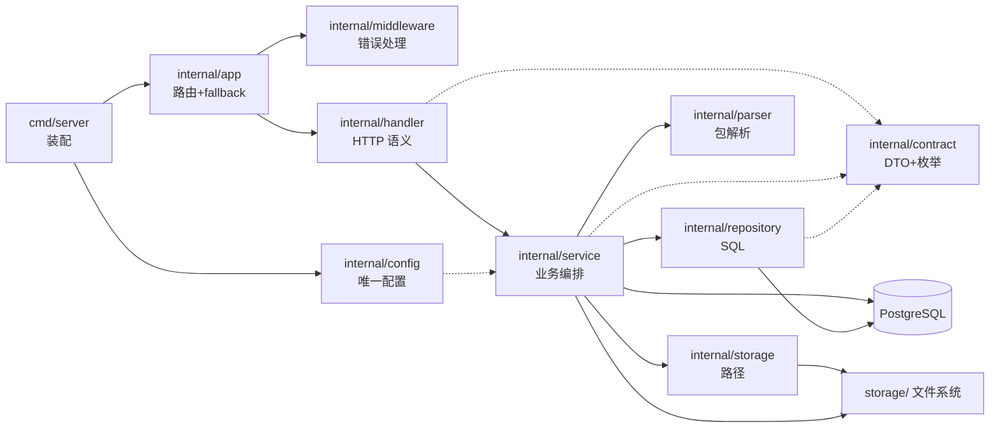

# 06 · 前后端目录布局与分类规范

> 作者：高见远（架构师）｜日期：2026-11-13｜面向：工程师
> **效力**：本文是 `docs/02-ARCHITECTURE-v2.md` §3 目录树的**展开版规范**，回答「每个目录是什么、能放什么、不能放什么、新增文件放哪」。
> **基准**：以工程师**已生成的 58 个非文档文件**为准（全仓共 66 个，含 `docs/` 8 个；排除 `node_modules/`、`bin/`、`server/public/assets/`）。本文不要求为理想结构重构，差异项见 §8。
> **纪律**：只描述结构，不含实现代码；`server/` 下的包名、`web/src/` 下的目录名不新增、不改名。

## 0. 一句话原则

**按「变化原因」分目录，不按「文件类型」分目录**：同一个目录里的文件应当因为同一个原因被修改；跨层调用只能沿单一方向，反向依赖一律禁止。

---

## 1. 顶层布局

| 目录 / 文件 | 职责 | 允许放什么 | **不允许放什么** |
| --- | --- | --- | --- |
| `api/` | 跨语言契约（唯一 SSOT） | `openapi.yaml`——枚举、DTO、路径、请求/响应、错误码 | 后端 DTO 实现、前端类型手抄、任何业务逻辑 |
| `web/` | 前端应用（唯一 npm 包） | `src/`、`index.html`、`vite.config.ts`、`tsconfig.json`、`package.json` | 后端代码、`node_modules`（gitignore）、手写生成物 |
| `server/` | 后端 Go 模块（`go.mod` 根） | `cmd/`、`internal/`、`embed.go`、`public/`（构建产物）、`go.mod`/`go.sum` | 前端源码、SQL 迁移以外的脚本、`.env` 实体 |
| `deploy/` | 部署资产（配置，非应用代码） | `Dockerfile`、`docker-compose.yml`、`nginx.conf`、`dandelion.service` | 业务逻辑、数据库连接串明文、证书私钥；**不含 DDL**（已移至 `server/internal/repository/schema.sql`，`//go:embed` 进二进制） |
| `docs/` | 需求 / 设计 / 规范文档 | `01`~`06` 文档、`*.mermaid` 图 | 代码文件、构建产物 |
| `bin/` | **构建产物**（gitignore） | `dandelion` 可执行文件 | 任何源文件、任何需入库的内容 |
| `storage/` | **运行时数据**（gitignore） | `tmp/`（stage 暂存）、`uploads/{env}/{platform}/`（正式包）、`README.md`（结构说明） | 源代码、SQL、配置；手工放入的包（元数据在 PG，手工放的文件不会出现在列表） |
| 根 `Makefile` | 唯一编排入口 | `gen:api` / `dev` / `build` / `test` / `up` / `down` | 业务逻辑、环境相关的硬编码值 |
| 根 `.env.example` | 环境变量样例（**唯一参照**） | 变量名 + 默认值 + 中文说明 | 真实密钥、真实密码 |
| 根 `.gitignore` | 产物与数据隔离 | `node_modules/`、`dist/`、`bin/`、`.env`、`server/public/*`、`storage/` | 被忽略的**源文件**（禁止误把源码目录写进忽略） |
| 根 `README.md` | 面向使用者的说明 | 快速开始、接口速查、部署、备份、FAQ | 设计决策细节（放 `docs/`） |

---

## 2. 前端目录（`web/src/`，38 个手写源文件 + 1 个生成物）

| 目录 / 文件 | 职责（一句话） | 现有文件 | **分类规则与禁止** |
| --- | --- | --- | --- |
| `api/` | HTTP 出入口与契约类型消费 | `client.ts`、`builds.ts`、`projects.ts`、`people.ts`、`teams.ts`、`me.ts`、`users.ts`（超管账号）、`audit.ts`（审计查询）、`roles.ts`（角色与权限目录）、`auth.ts`、`session.ts`、`settings.ts`、`schema.d.ts`（生成物） | `client.ts` 是**唯一** `fetch` 封装（解包、附带 Bearer、401 统一回登录页）；每个业务模块一份接口文件，是 URL 的**唯一**消费处；`session.ts` 是 localStorage 的**唯一**读写处；`schema.d.ts` 由 `make gen:api` 生成，**禁止手改** |
| `hooks/` | 跨页面复用的状态逻辑 | `useEnvironment.ts`、`useAllBuilds.ts`、`useProjects.ts`（`useProjects` 全量 + `useProjectsPage` 分页，`useProjectKey` 不取数）、`useDirectory.ts`（`usePeoplePage` / `useTeamsPage` 分页 + `useAllPeople` / `useAllTeams` 全量选项）、`usePageState.ts`（分页参数放 URL）、`useMe.ts` | 不渲染 UI、不写业务文案；每份数据只有**一处**模块级缓存；**列表页只能挂自己的那个 hook**，不要为了显示关联名字去挂别人的列表 |
| `components/` | 无业务领域知识、可跨页面复用的 UI | `Layout.tsx`、`Sidebar.tsx`、`Topbar.tsx`、`ProjectGate.tsx`、`ProjectSelect.tsx`、`MultiSelect.tsx`、`FormPage.tsx`、**`DataTable.tsx`**（antd Table 的唯一封装）、**`DetailDrawer.tsx`**（antd Drawer 的唯一封装）、**`ConfirmDialog.tsx`**（antd Modal 的唯一封装）、`AdminGate.tsx`（超管专区守卫）、`States.tsx`、`FileDropzone.tsx`、`icons.tsx`、`navigation.ts` | **不发起请求**、不 import `api/`、不持有页面级状态、不写死某业务字段；**`antd` 只允许出现在 `DataTable.tsx`、`DetailDrawer.tsx`、`ConfirmDialog.tsx` 与 `theme/antd.ts`**，业务页面不得直接 import antd 组件 |
| `pages/` | 路由级页面：**目录 = 一级菜单**，自己取数、管加载/错误/空态 | `overview/OverviewPage.tsx`；`distribution/`（`PackagesPage` / `UploadPage` / `AppsPage`）；`directory/`（`PeoplePage` / `PersonFormPage` / `TeamsPage` / `TeamFormPage` / `ProjectsPage` / `ProjectFormPage` / `ProjectDetailPage`）；`platform/SettingsPage.tsx`；`login/`（自持样式）；`public/DownloadPage.tsx`（公开下载页，不属于任何菜单） | **页面之间禁止互相 import**；页面**只能**通过 `api/` 取数，不直接 `fetch`；**不拼接口 URL 字符串**；列表页只读、表单页独立路由（`/new`、`/:id/edit`）；**新增一级菜单 = 新建同名目录**，不要再把页面堆回 `pages/` 根下 |
| `theme/` | 第三方组件库的主题映射 | `antd.ts`（token 对齐 CSS 变量） | 只声明 token，不改组件行为；主色改动需与 `styles.css` 的 `:root` 同步 |
| `utils/` | 纯函数工具 | `format.ts`（字节/时间/标签） | **无副作用、无 React 依赖、不 import 任何 `api/`/`pages/`/`components/`**；有状态或依赖浏览器 API 的逻辑不放这里 |
| `App.tsx` | 路由表 + 全局 Layout 包裹 | — | 不放数据获取、不放业务判断 |
| `main.tsx` | 挂载入口 + 全局样式引入 | — | 不放业务逻辑 |
| `styles.css` | 唯一样式来源（CSS 变量 + 组件类 + 断点） | — | 不引入组件库/原子化框架 |

**前端五条硬约束**：① 页面互不 import；② 组件内无 `fetch`；③ 页面不拼 URL；④ 页面级私有子组件留在该页面文件内，**不进** `components/`（进 `components/` 的前提是「至少两个页面会用」）；⑤ 全局环境只能经 `useEnvironment` 读写 URL，页面不得自己再存一份。

---

## 3. 后端目录（`server/`，39 个 Go 源文件）

| 包 / 文件 | 职责 | 输入 | 输出 | **边界（不允许做什么）** |
| --- | --- | --- | --- | --- |
| `cmd/server/main.go` | **装配层**：读配置 → 建 DB 连接池 → 注入 → 启 HTTP → 优雅退出 | 环境变量、`config` | 运行中的进程 | 不写业务逻辑、不写 SQL、不做参数校验 |
| `embed.go` | 前端产物编译期绑定（`//go:embed public/*`） | `server/public/` 构建产物 | `embed.FS` | 不读环境变量、不访问磁盘、不含业务；**只能放在 `public/` 同级包内**（`embed` 指令技术约束，属合规例外，见 §8-D2） |
| `internal/app/router.go` | 路由表、静态托管、SPA fallback、挂载中间件 | handler、middleware、`embed.FS` | `http.Handler` | 不做业务判断、不写 SQL、不拼磁盘路径 |
| `internal/handler/*.go` | **HTTP 语义**：取参、校验、调 service、设响应头/状态码 | `*http.Request`、service | 响应 JSON / 二进制流 | **禁止**：写 SQL、调 `parser`、自行拼接或信任客户端传入的路径、做业务规则判断。**流式 I/O 与探活属允许的例外，见下方专段** |
| `internal/service/*.go` | **业务编排**：stage/commit 流程、字段兜底、失败补偿、URL 生成、计数旁路 | handler 传入的 DTO、repository/parser/storage | 领域对象（`Build` 等） | **不触碰 `*http.Request` / `http.ResponseWriter`**、不写 SQL、不解析 multipart |
| `internal/repository/*.go` | **唯一 SQL 出入口**、行 ↔ DTO 映射 | 连接池、查询条件 | DTO / 受影响行数 | **不调 service**、不做业务校验、不碰文件系统、不生成 URL |
| **`internal/repository/schema.sql`** | **DDL 唯一来源**：`projects` + `builds` 表与索引，`//go:embed` 进二进制、启动幂等执行（不依赖 CWD） | — | 表结构 | 不放业务查询 SQL（查询在 `build_repository.go` / `project/repository.go`）、不含环境相关密码、不做数据迁移（默认项目迁移是一次性运维脚本） |
| `internal/parser/*.go` | 包文件 → 元数据（APK/IPA 四字段） | `io.ReaderAt` + 大小 + 平台 | `ParsedMeta` | **不落盘、不写 DB、不发网络、不读 HTTP、不调 service/repository** |
| `internal/storage/paths.go` | **唯一路径生成/清洗/安全解析** | 环境、平台、id、扩展名 | 规范化路径 | 不做 IO（只算路径）、不写文件、不查库 |
| `internal/contract/*.go` | DTO + 枚举常量 + 契约一致性测试 | `api/openapi.yaml`（测试读取） | 类型、常量、测试结论 | 不含业务逻辑、不访问 DB/文件（测试除外） |
| `internal/config/config.go` | **唯一环境变量读取与校验** | `os.Getenv` | `Config` | 不被其他地方再读 `os.Getenv`；不做业务判断 |
| `internal/middleware/error.go` | 统一错误格式化、panic 恢复、失败清理 tmp | handler 抛出的 `AppError` | 统一错误响应 | 不做业务判断、不写 SQL |
| **`internal/{handler,service,middleware}/login/`** | 登录功能按层归位：`handler/login` 是 HTTP 入口、`service/login` 是凭据与令牌、`middleware/login` 是鉴权中间件 | config 的账号与密钥、请求 | `LoginResult`、401 判定 | 不跨层建聚合包（不设 `internal/auth`）；三层包名统一为 `login`，import 时按需起别名（`loginhandler` / `loginsvc` / `loginmw`）；登录不落库，因此**没有** `repository/login` |
| **`internal/{handler,service,repository}/settings/`** | 系统设置：Webhook 配置读写 + API Key | 请求、DB | `contract.Settings` | 不投递 Webhook（在 `service/webhook`）、不做 SQL 方言拼装 |
| `internal/service/webhook/` | Webhook 投递：按配置挑字段、HMAC 签名、POST；另提供同步测试投递 | 配置、`contract.Build` | 投递结果 / 日志 | 不写库、不重试、不在失败时影响发布主流程 |
| **`internal/{handler,service,repository}/project/`** | 项目：`handler` 是 `/projects` 与 `/projects/{key}`、`service` 是 key 规范化 / 库地址校验 / 详情组装、`repository` 是 projects 表与项目侧的两张关联表 | 请求、DB | `contract.Project` / `ProjectDetail` | 不改 `builds` 表结构；包的归属解析（key → project_id）在 `service/build_service.resolveProject`；**不含任何权限判断**（P2 才做） |
| **`internal/{handler,service,repository}/audit/`** | 审计：`handler` 是 `/admin/audit-logs`（只读）、`service` 负责组装与容错、`repository` 只提供 INSERT 与分页查询 | 请求、DB | `contract.AuditLog` | **不提供 UPDATE / DELETE**；写失败只记日志、不回滚业务 |
| `internal/middleware/authz/`（模式限制：团队专用 / 管理员单人可用）
| `internal/authctx/` | 调用者身份在 context 里的存取 | ctx、`contract.Identity` | 写入/读取 | 单独成包是为**打断 import 环**（中间件用 `handler.WriteError`，handler 又要读身份）；不含任何判定逻辑 |
| **`internal/{handler,service,repository}/role/`** | 角色与权限：`handler` 是 `/roles`（读全员、写超管）与 `/permissions` 目录、`service` 负责校验与内置角色播种、`repository` 是 roles + role_permissions | 请求、DB | `contract.Role` / `Permission` | 权限目录只写在 `contract.Permissions`，库里不重复定义；`super-admin` 权限不可改 |
| **`internal/{handler,service,repository}/people/`** | 人员：`handler` 是 `/people` 与 `/me`、`service` 是字段校验与「当前登录人」投影、`repository` 是 people 表 + 人员侧的两张关联表 + 角色外键（`LEFT JOIN roles` 取角色名） | 请求、DB | `contract.Person` / `Me` | 只管人员这一侧；团队侧对 `team_members` 的写入在 `repository/teams`，两侧各自维护自己那一半 |
| **`internal/{handler,service,repository}/teams/`** | 团队：`handler` 是 `/teams`、`service` 是字段校验、`repository` 是 teams 表 + 团队侧的关联表 | 请求、DB | `contract.Team` | 同上；不含任何权限判断 |
| `internal/handler/openapi/` | 外部上传接口（stage + create 合成一次请求） | multipart | 201 + `Build` | 不复刻解析与落盘：复用 `handler.ReadUpload` 与 `service` 的 Stage/Create |
| `internal/middleware/apikey/` | `X-API-Key` 校验 | `KeyProvider` | 401 / 放行 | 不生成或轮换 Key、不区分调用方身份 |
| `internal/handler/upload.go` | **multipart 唯一实现**：流式写 tmp + 收集文本字段 | 请求、上限、路径 | `UploadForm` | 不调用业务层、不碰正式目录；stage 与 open 上传共用 |
| `internal/handler/commit.go` | 提交请求的统一字段校验（枚举 + 长度） | `CommitInput` | `AppError` | 不校验 stageToken（service 负责），两条上传入口共用 |
| `public/` | 前端构建产物（`npm run build` 输出） | — | — | **不手写**、不入库（保留兜底 `index.html`） |

**后端四条硬约束**：① handler 无 SQL；② repository 不调 service；③ parser 不落盘/不写库/不碰 HTTP；④ service 不碰 `*http.Request`/`ResponseWriter`。

**handler 允许的例外（第一版，含边界与前提 —— 避免以后误判为越界）**

| 例外 | 允许做什么 | 前提 / 边界 | 仍然禁止 |
| --- | --- | --- | --- |
| **流式 I/O** | `stage` 用 `os.OpenFile` 把 multipart 流直接写入 `storage/tmp/`；`download` 用 `os.Open` + `io.Copy` 流式输出 | **路径必须由 `storage.Paths` 生成**，且**存在性/安全校验（含 `safeResolve` 前缀校验）已由 `service` 完成**；handler 不得自行拼接路径、**不得信任客户端传入的路径** | 不得在 handler 内决定落盘目录、不得跳过 service 的校验后直接落盘 |
| **健康探活** | `health_handler` 直接访问 `repository` 取 `dbOk` / `storageWritable` | 探活**不属于业务编排**、不经 service；`repository.DB()` **仅为探活暴露**，不得在 handler 中用它执行业务查询 | 不得借此在 handler 内查业务数据、不得执行业务 SQL |

> **判定口径**：handler 可以「搬运字节」与「报告依赖状态」，**但不可以「决定业务规则」**。凡涉及枚举合法性、平台×扩展名一致性、token 有效期、字段兜底、元数据变更，一律在 `service`。若不满足上表「前提」列，即视为越界。

**特殊情况说明（4 项，均属合规，不是越界）**

| 项 | 说明 |
| --- | --- |
| `server/embed.go` 在 `server/` 根包（不在 `internal/`） | `//go:embed public/*` 的路径只能引用**同包目录下**的文件，而 `public/` 在 `server/` 根、该层原本无 `.go`；属 Go 语言约束，**位置不可调整**。它只做编译期绑定，不含业务逻辑（见 `03-TASKS-v2.md §8 DB-1`） |
| `web/src/api/schema.d.ts` | **生成物**，由 `make gen:api` 从 `api/openapi.yaml` 产出；**禁止手改**，改动一律回契约 |
| `storage/tmp/` | **运行时目录**（stage 暂存），不在代码树语义内、已整体 `gitignore`；内部可含 `{token}.name` 伴生文件（**tmp 内部实现细节，不属于对外契约**） |
| `bin/` | **构建产物**（`make build` 输出），已 `gitignore`，不入库、不放源文件 |

---

## 4. 依赖方向（单向，禁止反向与循环）

| 禁止项 | 说明 |
| --- | --- |
| handler 写 SQL | SQL 只允许出现在 `repository` |
| repository 调 service | 仓储层不得反向依赖业务层 |
| parser 落盘 / 写库 / 读 HTTP | 解析器是纯函数式组件 |
| service 碰 `*http.Request` / `ResponseWriter` | 业务层不感知传输协议，便于 CLI/CI 复用 |
| `config` 被 handler/service 直接读 `os.Getenv` | 只由 `cmd/server` 读取并注入 |
| `middleware` 被 handler 引用 | 只由 `app` 装配 |
| 功能子目录反向依赖 | `handler/login` 可以复用父包 `handler` 的 `OK` / `WriteError` / `DecodeJSON`；**父包不得 import 子目录**，同层子目录之间也不得互相 import |
| 任何循环依赖 | `go list -deps` 应无环；出现环说明分层被打破 |

---

## 5. 「新增一个文件该放哪」决策表

| # | 场景 | 放哪个目录 | 为什么 | 需同步改哪里 |
| --- | --- | --- | --- | --- |
| 1 | 新增一个 HTTP 接口 | `internal/handler/` 加方法 + `internal/app/router.go` 注册 | HTTP 语义归 handler，路由归 app | `api/openapi.yaml` 路径与 schema → `make gen:api` → `schema.d.ts` → `web/src/api/builds.ts` 加函数 |
| 2 | 给 `Build` 加字段 | 契约 + `contract` DTO + `repository` 映射（+`service` 赋值） | 字段是横切契约，不能只改一处 | `api/openapi.yaml` 的 `Build` → 重新生成 → `contract.go` → `rowToBuild` → 必要时 `internal/repository/schema.sql` 加列 |
| 3 | 支持第三个平台（如鸿蒙） | `api/openapi.yaml` 的 `Platform.enum` + `contract` 常量 + `parser/` 加解析分支 | 平台是契约枚举，单一来源 | 重新生成 `schema.d.ts`；`paths.go` 扩展名映射；前端标签自动跟随 |
| 4 | 改错误文案 | `internal/handler` 或 `service` 抛错处 | 文案贴近触发点，无需新增文件 | 若新增错误码，同步 `api/openapi.yaml` 与 `response.go` |
| 5 | 新增公共 UI 组件 | `web/src/components/` | 至少两个页面会用才下沉 | 无契约改动；若需状态，props 传入 |
| 6 | 新增纯函数（格式化/校验） | `web/src/utils/` | 无副作用、无 React 依赖 | 无 |
| 7 | 新增环境变量 | `internal/config/config.go` + `.env.example` + `deploy/` 三处 | 配置单点 + 样例 + 部署同步 | `docs/02-ARCHITECTURE-v2.md` §10.4 变量表；compose/systemd |
| 8 | 新增数据库表 | `internal/repository/schema.sql`（幂等 DDL，embed）+ `internal/repository/*.go` | DDL 与仓储同包，随二进制自举 | **需架构确认**（当前只有 `projects` 与 `builds` 两张表）；契约可能需补 schema |
| 9 | 新增解析能力（如读图标） | `internal/parser/` 新文件 | 解析器职责单一 | `ParsedMeta`/`Build` 字段 + 契约 + `internal/repository/schema.sql`；**第一版不做图标** |
| 10 | 加 pushy 热更新板块 | `internal/{handler,service,repository}/` 加 `update_*` + `web/src/pages/updates/` | 复用现有分层，不新建大目录 | 契约新增路径、`internal/repository/schema.sql` 加表、导航数组加项（§7） |
| 11 | 加一个部署脚本 | `deploy/` | 部署资产集中 | `README.md` 说明；必要时 `Makefile` 加目标 |
| 12 | 加一个测试 | **与被测包同目录**，`*_test.go` / `*.test.ts` | Go/TS 惯例，便于就近维护 | 无 |
| 13 | 改登录 / 令牌 / 鉴权范围 | `handler/login/`（HTTP 语义）、`service/login/`（凭据与令牌）、`middleware/login/`（鉴权） | 按层归位，改哪层开哪层 | 契约若改字段，重生成 `schema.d.ts`；受保护接口在 `app/router.go` 的 `private` 分组里注册 |
| 14 | 加一个板块（如热更新） | 每层一个同名子目录：`handler/updates/`、`service/updates/`、`repository/updates/`；契约加路径；前端 `api/updates.ts` + `pages/distribution/UpdatesPage.tsx`（或按新一级菜单建同名目录）+ `navigation.ts` 加一项 | 与 login / settings 完全同构，Layout 与路由骨架不动 | 受保护接口进 `private` 分组；`contract.APIRoutes` 加常量（契约测试会卡数量） |
| 15 | 新增**项目内**板块（如热更新、应用管理） | 后端按 §5-14 归位；前端 `navigation.ts` 里 `scope: 'project'` 的那一项 + `App.tsx` 在 `/p/:key` 子路由下加一条（**不要**新起顶层路由） | 项目是一级归属：`/p/:key/*` 前缀由 `navHref` 统一拼，页面组件拿 `useCurrentProject().key` 取项目；切项目只换前缀、板块不丢 | 契约里所有涉及包/应用的接口都必须带 `project`（列表走查询参数、写接口进请求体）；`isProjectScoped` 天然覆盖新路径，面包屑在 `navigation.ts` 补 `label` 即生效 |

---

## 6. 命名与文件约束

| 约束 | 具体要求 |
| --- | --- |
| 文件头注释 | **每个文件顶部中文注释**：职责 / 输入 / 输出 / 边界（Go 用包注释或文件头块注释，TS 用文件头块注释） |
| 一包一职责 | 一个 Go package 只承担一个职责；包名小写单数、语义明确（`parser` 而非 `util`） |
| 功能子目录 | 同一功能的跨层实现**按层归位**：`handler/login/`、`service/login/`、`middleware/login/`。子目录名全仓统一（都用 `login`），便于按功能检索；某层没有该功能的职责时**不建空壳**（登录不落库 ⇒ 没有 `repository/login`） |
| 禁止大杂烩 | **禁止** `utils.go` / `common.go` / `helpers.go` / `misc.go`；函数按职责落到对应包（如路径处理进 `storage`） |
| 文件行数 | 单文件建议 ≤ 400 行；超过说明职责不单一，应拆分 |
| 生成物 | `web/src/api/schema.d.ts` 由 `make gen:api` 生成，**禁止手改**；改动一律改 `api/openapi.yaml` |
| 枚举字面量 | `test/hotfix/pre/prd` **只允许出现在 4 处**：`api/openapi.yaml`（SSOT）、`web/src/api/schema.d.ts`（生成物）、`server/internal/contract/contract.go`（Go 常量镜像）、`web/src/utils/format.ts`（前端标签镜像）；**后两处必须注释标注来源并由契约测试校验**；**禁止**出现在其他业务代码 / SQL / 页面 / 部署配置（主理人裁决：不为此新增代码生成器） |
| 命名风格 | Go：包名小写、导出标识符 PascalCase；DB 列 `snake_case`；JSON/TS 字段 `camelCase`；TS 组件 PascalCase、其余 kebab-case |
| 空目录/空文件 | **禁止**提交空目录、空文件、TODO 占位文件（`gitkeep` 仅限 `storage/uploads/**` 的运行时骨架） |
| 测试位置 | Go：`internal/<pkg>/*_test.go`；前端暂无测试框架，不新建目录 |

---

## 7. 未来板块的目录演进（**第一版不建、不写**）

| 方案 | 做法 | 优点 | 缺点 | 结论 |
| --- | --- | --- | --- | --- |
| **A 复用现有分层** | `internal/service/bundle_service.go`、`internal/handler/update_handler.go`、`internal/repository/bundle_repository.go`、`internal/parser/ppk.go`；前端 `web/src/pages/updates/` | 分层一致、无新概念、`storage/paths.go` 与 `middleware` 直接复用 | `internal/service` 目录文件变多 | ✅ **推荐**（板块 ≤ 3 个时） |
| B 独立业务包 | `internal/bundle/{handler,service,repository}` 自成一套 | 板块内聚、边界清晰 | 与现有分层重复，跨板块共享逻辑（URL/路径/错误）需提升或复制 | 仅当板块 ≥ 3 个、单人维护不过来时再评估 |

**触发条件（满足任一才动，均属未来）**：① 已上线板块 ≥ 3 个；② `internal/service` 单目录文件 > 8；③ 某板块需要独立权限/独立发布节奏。
**`pages/` 目录 = 一级菜单**：`overview/`（总览）、`distribution/`（分发）、`directory/`（基础资料）、`platform/`（平台）与 `navigation.ts` 的四组一一对应；`login/` 与 `public/` 是不进菜单的独立页面。新增一级菜单时同步新建目录，纯文件移动、不改路由与组件。

**与 §5 / §8 一致**：第一版不建 `apps`/`upd_bundles` 表、不建 `pages/updates/` 目录、不写占位代码；未来加板块只「加目录 + 加文件 + 加路由 + 加导航项 + 加表」。

---

## 8. 与现状的差异核对（以已生成代码为基准）

| # | 目录 / 项 | 现状 | 规范结论 | 需调整 |
| --- | --- | --- | --- | --- |
| D1 | `02-ARCHITECTURE-v2.md §3` 源文件计数 | 写「Go 源文件 15 个」 | 实际 **16 个**（含 `server/embed.go`） | ✅ 已同步修正为 16 |
| D2 | `server/embed.go` 位于 `server/` 根（非 `internal/`） | 已存在 | `//go:embed` 只能引用**同包目录下**的文件，放 `server/` 根是**技术必需**，属合规例外 | 现状合规，**无需调整** |
| D3 | `server/public/index.html` 兜底文件 | 存在（`.gitignore` 用 `!` 保留） | 保证无 `dist` 时 `//go:embed` 可编译 | 现状合规，**无需调整** |
| D4 | `bin/dandelion` | 存在，已在 `.gitignore` | 构建产物不入库 | 现状合规，**无需调整** |
| D5 | `web/src/api/schema.d.ts` | 存在且入库 | 生成物入库是设计选择（前端 dev 不需 Go） | 现状合规，**无需调整**；仅需确保未被手改 |
| D6 | `web/src/` 手写源文件 | 12 个（`main`/`App`/`styles.css` + `api`×2 + `components`×3 + `pages`×3 + `utils`×1） | 与 §2 分类一致 | 现状合规，**无需调整** |
| D7 | `server/internal/` 包结构 | 9 个包（app/config/contract/handler/middleware/parser/repository/service/storage） | 与 §3 一致，依赖抽查无越界 | 现状合规，**无需调整** |
| D8 | `storage/uploads/test/android/` 残留 2 个 `.apk` | 存在 | 运行数据，`storage/` 已整体 gitignore，不入库 | **建议清理**（非结构问题，避免误传测试包） |
| D9 | `docs/` 含 v1 `02`/`03` | 存在，首行已加废弃声明 | 保留供追溯，不参与实现 | 现状合规，**无需调整** |
| D10 | 是否为空目录 | `storage/tmp/` 为空 | 运行时由程序创建；`gitkeep` 仅用于 `uploads` 骨架 | 现状合规，**无需调整** |
| **D11** | **分层越界抽查** | 实测 `service` 无 `net/http`、`handler` 无 SQL、`repository` 不引 `internal/service`、`pages` 无互引、`components` 无 `fetch` | **未发现越界**，与 §3/§4 一致 | 现状合规，**无需调整** |
| **D12** | 代码命名与请求字段 | 现为 `SubmitBuildRequest` / `Submit` / `submitBuild`，且前端计算 `metaSource` 随请求提交 | 与最终文档不一致（文档为 `CommitBuildRequest` / `Commit` / `commitBuild`，`metaSource` 服务端派生） | **需工程师调整代码**（非目录调整）：按 `03-TASKS-v2.md §9` 的 **AL-1 / AL-2 / AL-4** 执行；`touched` 保留为前端局部状态（AL-3） |
| **D13** | `schema.sql` 位置 | 已由工程师从 `deploy/` 迁至 `server/internal/repository/` 并 `//go:embed` | 消除启动 CWD 依赖，二进制自举建表；`deploy/` 不再含 DDL | **文档已同步**（02 §3/§4.1/§10.3、03 T02/T03/T05、06 §1/§3/§5）；`deploy/` 下无残留即为合规 |

---

## 9. 工程师自查清单（提交前逐条打勾）

- [ ] 每个目录内文件职责单一，未越界（对照 §2 / §3 的「边界」列）
- [ ] 无页面之间互相 `import`；页面级私有组件没有塞进 `components/`
- [ ] 无组件内直接 `fetch`；所有请求经 `api/client.ts` + `api/builds.ts`
- [ ] 无页面手拼接口 URL；URL 字段只直接消费 DTO
- [ ] 无 `handler` 内 SQL；无 `repository` 内业务判断；无 `service` 触碰 `*http.Request`
- [ ] 无 `parser` 落盘/写库/发网络；无 `os.Getenv` 出现在 `config` 之外
- [ ] 新增文件能在 §5 决策表找到归属；没有新建规范外的目录
- [ ] `web/src/api/schema.d.ts` 未被手改（改动都落在 `api/openapi.yaml`）
- [ ] 无空目录、空文件、`TODO` 占位；无 `utils.go`/`common.go` 大杂烩
- [ ] 每个新增文件顶部有中文注释：职责 / 输入 / 输出 / 边界

---

> **配套**：`docs/02-ARCHITECTURE-v2.md`（整体架构与 API 契约）、`docs/03-TASKS-v2.md`（任务与验收）。本规范与 `§5 数据库框架`、`§8 多板块页面预留` 的结论保持一致：**第一版不建目录、不建表、不写占位代码**。
