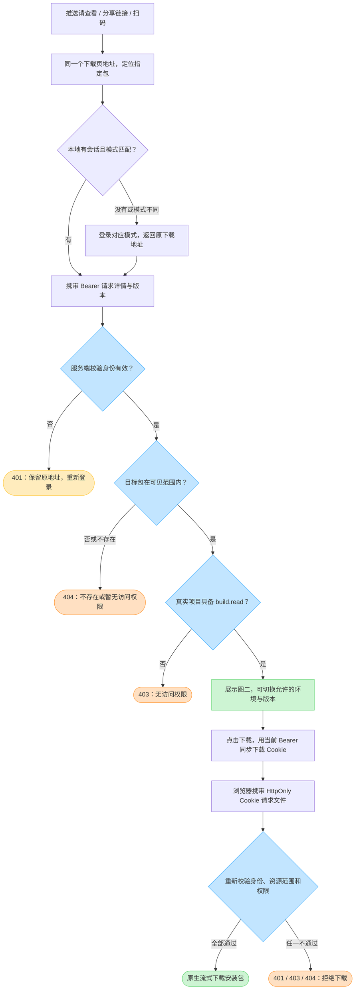

<!-- 职责：定义推送、分享与扫码统一进入受控下载页的 MVP 方案；输入：当前下载链路、登录模式、权限与数据范围实现；输出：访问规则、接口变更、开发边界与验收标准；边界：本文是待实施方案，不代表现有行为，不修改现有权限目录。 -->

# 推送与分享下载页权限 MVP

状态：历史方案（接收者登录版），尚未实施。用户已明确要求推送和分享的接收者免登录，当前实施依据改为 [免登录分享 Token MVP](14-SHARE-TOKEN-MVP.md)。本文及下方 FigJam 图保留为登录访问模型的备查资料，不代表当前选定方案。

## 1. 产品决策

将现有公开下载页改为内部受控下载页：推送中的「请查看」、页面「分享当前版本」和二维码都使用同一个 `Build.downloadPageUrl`。访问者凭自己的登录身份访问；转发地址不会转发分享者的权限。

本方案假设接收者拥有平台账号。没有账号或没有对应数据范围时不能查看或下载，需要管理员完成账号、人员和团队关联。飞书免登录、访客授权和对外匿名分发不属于本期。

图二的独立页面布局保留，登录后直接返回原包，不经过后台首页，也不展示后台侧栏。

## 2. 已核实的现状

| 位置 | 当前行为 | 对方案的影响 |
| --- | --- | --- |
| `web/src/App.tsx` | `/d/:id` 在 `RequireAuth` 之外 | 从后台点入也没有下载页登录守卫 |
| `server/internal/app/router.go` | 详情、版本列表和文件接口均为公开路由 | 必须同时保护三个接口，页面跳转本身不能代替接口鉴权 |
| `server/internal/service/build_service.go` | `Get`、`Versions`、`ResolveFile` 跨两个分区按 ID 查找 | 改为按可信会话模式查询，并补齐项目范围与权限校验 |
| `web/src/api/client.ts` | JSON 请求从 localStorage 读取并附带 Bearer；401 直接跳 `/login` | 可以复用认证，但需要保留登录前的地址 |
| `web/src/pages/public/DownloadPage.tsx` | 下载使用普通 `<a href={build.downloadFileUrl}>` | 浏览器不会为普通链接自动附加 localStorage 中的 Bearer |
| `server/internal/service/authz/service.go` | `build.read` 是团队账号的默认读取基线 | 本期读取隔离主要由公司、团队、项目范围决定，不能承诺取消角色勾选就能禁止下载 |
| `server/internal/service/login/service.go` | 公司是否启用仅在登录时检查，Verify 尚未重复检查 | 若要停用公司后阻断已有登录，需要补齐统一 Verify；本方案将此纳入认证收口 |
| `server/internal/service/webhook/service.go` | 按配置投递 `downloadPageUrl` 等字段，不直接生成飞书卡片 | 卡片接收服务需要把「请查看」绑定到这个字段 |

因此，「已经从有权限的后台页面跳转」只说明入口曾受控，不能说明下载资源已经受控。

## 3. 统一地址与访问体验

对外地址示例：`https://分发域名/d/<buildId>?mode=team`。

- 推送链接、分享链接和二维码统一消费服务端返回的 `downloadPageUrl`；继续由 `buildURLs` 使用 `PUBLIC_BASE_URL` 生成。
- `buildId` 固定定位通知对应版本；打开旧消息仍显示该版本，不自动替换为最新包。
- `downloadPagePath` 继续保持 `/d/<buildId>` 形式，用于 Router 的 pathname；`mode` 只作为绝对分享地址的登录提示参数。
- `mode` 提示来自服务端已确认的分区，不由页面自行推导。服务端权限和分区选择始终以签名令牌中的模式为准。
- 环境仍经 `useEnvironment` 管理。切环境和历史版本后，分享当前已选版本的服务端地址。

访问过程：打开链接 → 检查会话 → 必要时登录 → 返回原下载地址 → 服务端校验目标包 → 展示或拒绝。

| 状态 | 页面行为 |
| --- | --- |
| 没有会话 | 跳转登录页，保存原下载地址；不预先加载应用详情 |
| 有有效会话且模式匹配 | 直接请求目标包，不重复登录 |
| 登录过期 | 清理失效会话，携带原地址重新登录 |
| 会话模式与链接提示不同 | 提示切换模式登录；不静默修改本地模式冒充有效会话 |
| 当前身份不可见或包已不存在 | 展示「安装包不存在或你暂无访问权限，请检查账号与登录模式」 |
| 数据可见但缺少所需能力 | 展示无权限状态，不反复跳登录页 |

登录页需要支持可持久保留的 `returnTo` 参数；路由守卫和 API 的 401 跳转共用回跳规则。只接受解析后仍为本站允许的 `/d/<UUID>` 等内部路径，拒绝外部域名、协议相对地址和反斜杠等绕过形式，并保留合法的环境与模式参数。

普通登录仍默认 solo；从团队分享地址进入时预选 team。已有会话访问登录页时，先检查模式和合法回跳地址，不能固定重定向到首页；模式切换应显式退出当前会话并重新登录。

飞书内置浏览器、系统浏览器和另一台扫码手机可能没有共享登录态，各自在首次访问时登录。接收到 Webhook 或位于飞书群里不构成平台身份。

## 4. 服务端授权规则

允许读取或下载 = 有效登录身份 + 当前模式中的可见资源 + 真实项目下的 `build.read`。

| 会话身份 | 可访问范围 |
| --- | --- |
| team 普通成员 / 团队管理员 | 本公司内，其所属团队关联的项目及包；无团队关联时没有可见业务数据 |
| team 公司管理员 | 本公司的项目及包 |
| team 超管 | 延续现有全平台范围 |
| solo 会话 | 仅本人空间的项目及包，继续叠加项目 owner 与包 owner 过滤 |
| 未登录 | 不返回详情、版本数据或安装包 |

`build.read` 延续当前默认基线；本期「可查看的包即可下载」。不新增 `build.download`，不新增按环境授权。测试、热更、预发、生产沿用现有项目级可见范围。

实现统一的 `resolveReadableBuild(ctx, id, identity)` 业务入口，供详情、版本列表、文件下载共用：

1. 校验 ID；使用 `repos.For(identity.Mode)`，不再通过 `.All()` 探测分区。
2. 仓储从目标包的真实 `project_id` 取得项目标识，同时在 SQL 中限定项目 owner 或公司、团队范围，并叠加 solo 包 owner 约束；不可见与不存在均不对外返回资源。
3. 业务层继续通过 `resolveProject(..., identity.UserID, identity.Mode)` 确认可见项目，并核对它与目标包的真实项目 ID 一致。
4. 使用真实项目 key 调用现有 `authz.Check(..., "build.read")`，沿用项目角色、人员角色与默认基线规则。
5. 成功后才能返回详情、查询兄弟版本或解析磁盘路径。版本 SQL 同样限定可见范围，每次切换目标包和下载时重新校验。

项目 ID/key 可作为仓储内部记录字段，不需要为内部授权强行扩展公开 Build DTO。客户端传来的 `project`、`tenantId`、`teamId`、`mode` 不作为目标资源归属或权限依据。

错误约定：无效或缺失身份返回 401；资源在当前范围不可见或不存在返回 404；可见资源缺少能力返回 403。现有项目 key 参数校验继续保持原有 400 语义。

## 5. 文件下载认证

MVP 采用同源 HttpOnly Cookie 承载现有签名登录令牌，供浏览器原生文件下载使用。它只增加令牌的传输方式，不增加会话表、另一种令牌或另一套角色权限系统。

选择这个方式是因为页面中的安装包约 170 MB，浏览器直接流式下载可以避免先用 JS 将整个包读取为 Blob。分享 URL 始终没有用户令牌或免登录下载凭证。

接口安排：

| 接口 | 认证及作用 |
| --- | --- |
| `GET /api/v1/builds/{id}` | Bearer → 注入 Scope → 统一包授权 → 返回详情 |
| `GET /api/v1/builds/{id}/versions` | Bearer → 注入 Scope → 统一包授权 → 返回允许范围内的版本 |
| `POST /api/v1/auth/download-cookie`（新增） | 必须有有效 Bearer；将这一枚现有令牌写入下载 Cookie，返回统一成功响应 |
| `GET /api/v1/builds/{id}/file` | 文件专用认证读取 Bearer 或下载 Cookie → 现有 Verify → 注入 Scope → 统一包授权 → 流式下载 |
| `POST /api/v1/auth/logout`（新增） | 清除下载 Cookie；即使原令牌已过期也能执行清理 |

下载交互：点击下载 → 通过现有 API client 调用 Cookie 同步接口 → 成功后导航到服务端给出的 `downloadFileUrl` → 浏览器自动携带 Cookie → 服务端再次验证身份、范围和权限后开始传输。

Cookie 约束：

- 使用固定专用名称、`HttpOnly`、`SameSite=Lax`、host-only 和 `Path=/api/v1/builds/`；部署使用同源 HTTPS，设置 `Secure`；本机 HTTP 开发按已有配置处理。
- Cookie 的有效期不超过原登录令牌；复用原有 Verify 检查到期时间、账号状态和 `token_version`。公司启用检查目前仅在 Authenticate 中执行，本期补入统一 Verify，使停用公司后的已有令牌也不能继续下载。
- Cookie 仅被文件下载认证入口接受；其余管理 API 延续 Bearer 认证。请求带有 Bearer 时以它为准，Bearer 无效时不回退到另一枚 Cookie 令牌。
- 每次下载前同步当前会话，兼容存量 Bearer 登录，以及换账号、换模式后的首次下载。
- 退出、改密和切换账号时同步清理下载 Cookie；HttpOnly Cookie 必须由服务端清除，不能只调用当前 `clearSession()`。网络失败时不能把 Cookie 已清除当作成功事实。
- Cookie 同步和退出接口使用 POST，并校验同源请求；JSON API 继续经唯一的 `client.ts` 调用。
- 详情、版本与文件响应使用 `Cache-Control: private, no-store`，防止共享代理或浏览器缓存绕过后续访问校验。

已有 Vite `/api` 代理与生产 Go 同源部署可以承接本方案。若某部署用 `VITE_API_BASE` 指向另一域名，应先统一反向代理到下载页同源，再上线这一 MVP，避免增加跨域 Cookie 兼容范围。

文件接口保留原有计数规则：只有完整流式传输成功且字节数符合 Content-Length 才计数。实际下载时令牌过期或团队关联被撤销，服务端必须拒绝；已经开始传输的字节无法收回。

## 6. 推送与页面调整

- Webhook 继续发送 `build.downloadPageUrl`；飞书卡片「请查看」绑定这一字段，不能绑定原始文件 URL、上传者令牌或 API Key。
- 如果卡片由外部中转服务生成，需要在该服务调整字段映射；当前仓库仅能保证投递字段正确。
- `/d/:id` 放入登录守卫，但保留独立下载布局，不依赖后台菜单可见性判断访问权限。
- 下载页提供当前账号、当前模式和切换账号入口；错误状态区分登录失效、暂无访问权限与网络故障。
- 分享成功提示明确「接收者需登录且拥有该项目访问权限」。二维码仍指向当前版本的页面地址。
- 通知卡片中的应用名、版本和更新内容已发送给群成员，页面鉴权不能撤回这些内容；应确认 Webhook 接收群符合当前分发范围。
- 当前应用预览图打包为前端静态资源。若这些图片也属于受控资料，应改为鉴权资源接口加载；前端页面守卫无法保护已有静态文件 URL。若保留静态演示图，需确认其允许公开访问。

## 7. 本期变更边界与上线影响

新增两个认证辅助接口，不新增权限点、业务数据表或配置系统；复用现有账号、角色、Scope、分区与 URL 生成逻辑。

需要同步的实现位置：

1. `api/openapi.yaml`、Go DTO / `APIRoutes`：三个读取接口改为受保护；新增 Cookie 同步与退出接口及安全声明；生成前端类型。
2. `middleware/login`、`handler/login`：复用 Verify，增加文件 Cookie 入口、写入与清理；`service/login.Verify` 补齐公司启用检查，HTTP Cookie 逻辑留在 handler / middleware。
3. `repository/build_repository.go`、`service/build_service.go`、`handler/build_handler.go`：统一授权，绑定真实项目，移除三条读取路径中的公开跨分区查找。
4. 前端 `App.tsx`、登录页、`api/client.ts`、认证 API 与账号菜单：守卫、可校验回跳、模式提示与完整退出。
5. 下载 hook 与下载按钮：权限错误状态、Cookie 同步后原生下载；所有请求继续经 API 层。
6. Webhook 字段映射、README、AGENTS 中关于公开下载的现状描述：随功能上线更新，避免继续把下载接口当成匿名接口。

上线后，已有 `/d/:id` 地址仍能定位原包，但需要登录；没有模式提示的旧地址允许用户自行选择模式。旧的文件直链也需要有效身份。此前依赖匿名下载的调用方会受到影响，需在发布说明中明确。

本期不做飞书 SSO、群成员自动映射、访客账号、访问口令、免登录签名分享、链接有效期管理、下载次数授权、按环境权限和 iOS OTA 安装链路。当前页面对 iOS 的行为仍是下载 IPA 文件。

如果业务后续要求「群成员没有平台账号也能下载」，应另行设计有范围、期限与撤销能力的访客授权；凭链接免登录属于独立授权能力，不能宣称继承了接收者原有团队权限。

## 8. 验收标准

| 场景 | 预期结果 |
| --- | --- |
| 推送、分享、二维码分别打开同一版本 | 指向同一服务端页面地址，展示相同 buildId |
| 无痕窗口打开团队推送 | 登录前不返回详情或版本；登录后回原版本，预选 team |
| 已登录且有可见范围 | 直接进入图二；无需再次登录 |
| 登录中刷新页面或会话过期 | 登录后仍返回原包及合法环境参数 |
| 将链接转发给另一家公司账号 | 详情、版本、文件均拒绝，且不泄漏目标包是否存在 |
| 同公司但不在关联团队 | 三个接口均拒绝；不能只依赖 `build.read` 放行 |
| 普通账号未绑定人员或团队 | 无业务可见范围，不退化为全公司可见 |
| solo A 请求 solo B 的包或团队包 | 按签名模式与 owner 隔离，不跨分区补查 |
| 伪造项目、团队、公司或 mode 参数 | 不改变服务端身份、资源归属和访问范围 |
| 直接请求文件 URL，没有 Bearer/Cookie | 401，不返回文件字节 |
| 带有效下载 Cookie，但目标包不在可见范围 | 404，不返回文件字节 |
| 详情已打开后账号被禁用、改密或被移出团队 | 下一次版本请求或下载被拒绝；文件接口重新验证 |
| 公司停用但浏览器仍有未到期令牌 | 统一 Verify 拒绝详情、版本与下载请求 |
| 退出、切换账号、切换模式 | 原下载 Cookie 清理或替换，不沿用前一个身份下载 |
| 手机下载约 170 MB APK | 原生流式下载，无需整包 Blob；传输中断不计数 |
| 点击历史通知、切换版本后分享 | 默认打开通知指定包，分享的是当前选定版本 |

实施时重点补充服务端跨公司、跨团队、跨 owner 与直连文件的授权测试，以及登录回跳和 Cookie 生命周期测试。按仓库要求运行 `make gen:api`、`make test`、前端构建与 `make build`；本文仅为方案，当前未执行实现验收。

## 9. 流程图与阅读说明

[在 FigJam 打开可编辑流程图](https://www.figma.com/board/tI9S4bUPTNjdOIjfW3A4bA)。下图描述待实施的 MVP，不代表当前公开下载链路。

阅读时注意三处边界：

1. 登录只确认「你是谁」。前端检查本地会话是为了决定是否先显示登录页，服务端仍须验证这枚令牌。
2. 授权再确认「这个包你能不能访问」。team 使用公司与所属团队关联项目范围，solo 使用本人项目与包 owner 范围，并检查真实项目的 `build.read`。
3. 点击下载是新的请求。下载 Cookie 携带同一身份，文件接口重新验证权限；即使页面此前已打开，也不能跳过这一关。换版本、切环境触发的请求同样重新授权。

例如，甲把链接发给乙：乙在允许的团队范围内，登录后即可查看和下载；乙属于另一家公司或不相关团队，则在资源范围校验处被拒绝。乙能收到推送或拿到链接，不会自动获得甲的权限。
