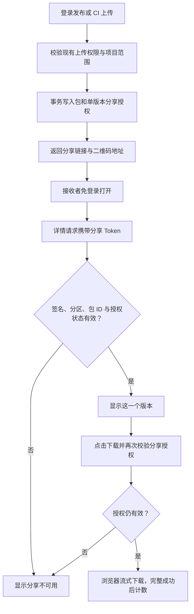

<!-- 职责：定义推送与分享免登录访问的 Token MVP；输入：用户免登录要求、现有登录鉴权、公司 API Key、Webhook 投递和分区实现；输出：分享凭证格式、授权边界、请求链路与验收标准；边界：设计尚未实施，不将分享凭证投影为后台账号或角色。 -->

# 免登录分享 Token MVP

状态：当前设计方案，尚未实施。替代 `13-DOWNLOAD-ACCESS-MVP.md` 中要求接收者登录的方案。

> 第 1—8 节保留原始设计，“尚未实施”和“本轮仅更新设计文档”表示方案提出时的状态。当前实施进度与差异见第 9—10 节，以代码及 OpenAPI 为准。

## 1. 已确认的目标

推送中的「请查看」、页面分享链接与二维码指向同一个版本分享页。接收者无需登录，持有有效分享链接即可查看授权版本并下载。

后台登录权限决定谁能发布、对哪些资源创建分享。匿名请求使用独立分享授权，不继承发布者完整权限，也不能识别访问者自己的账号角色。

本期一份分享只授权一个指定版本的详情和原始文件。图二的其他环境、历史版本入口先隐藏，不通过分享一个版本开放整套应用或项目。

## 2. 区分现有凭证

| 凭证 | 当前用途 | 是否交给打开推送的浏览器 |
| --- | --- | --- |
| 登录 Bearer | 代表账号身份，由 Verify、ScopeOf 与 authz 推导后台权限 | 不通过推送传递 |
| 公司 X-API-Key | CI 等外部系统上传；服务端反查归属公司 | 不传递 |
| Webhook Secret / 投递签名 | 接收服务校验通知来源与完整性 | Secret 不传递；投递签名不用于页面授权 |
| 分享 Token（新增） | 只读取分享记录绑定的版本和文件 | 通过分享链接传递 |

当前 Webhook 是 Dandelion 向外 POST 通知，不是浏览器登录接口。这里的“从 Webhook 进入”指用户点击消息中的地址后，页面再向 Dandelion 发请求。

现有登录令牌格式为 `账号|版本|到期时间戳|模式.HMAC`，没有把所有权限直接装入令牌。服务端据此查账号、推导范围和权限。分享 Token 不应构造虚假用户身份来复用这条授权链。

## 3. Token 及分享记录

建议使用“签名分享标识 + 数据库授权记录”，同时支持稳定链接、服务端重新生成同一地址和即时撤销。

Token 格式：`s1.<mode>.<shareId>.<signature>`。

- `shareId` 使用随机 UUID；`mode` 只允许 team / solo，并参与签名。
- `signature` 使用 HMAC-SHA256，覆盖用途版本、模式、分享 ID、绑定包 ID 和分享 revision；签名内容使用固定且无歧义的编码。
- 分享签名子密钥由现有 AUTH_SECRET 通过用途隔离的 HKDF 派生，例如 info=`dandelion/share/v1`；不复用登录令牌的签名格式或验证函数。
- Token 中不携带发布者的登录令牌、密码、API Key、角色全集或可由客户端选择的权限。
- 数据库记录决定实际访问范围、到期与撤销状态，签名不能代替记录校验。

分享记录的核心字段：

```json
{
  "id": "随机分享ID",
  "buildId": "唯一授权包ID",
  "projectId": "包的真实项目ID",
  "revision": 1,
  "expiresAt": null,
  "revokedAt": null,
  "issuerKind": "user",
  "issuerId": "创建分享的账号ID"
}
```

在 `schema.sql` 的同构分区 DDL 中增加 `build_shares`，分别落在 team / solo；物理分区提供可信模式。分享记录与包绑定，外键指向同分区 builds；项目归属由真实包关联取得并核对，不接受客户端声明。具体字段可减少冗余，但必须能确定绑定包、分区与真实项目。

MVP 为每个发布版本保留一份当前分享记录。发布时创建，分享按钮读取这份授权并由服务端重建相同 Token，保证推送、分享和二维码使用相同地址。撤销后普通读取不能自动创建或重新启用分享，重新开启必须经过显式授权操作。

默认有效期沿用长期分发需求：可不设固定到期，包存在且分享未撤销时有效；字段预留有限期授权。revision 增加可以轮换该分享的凭证，使旧链接失效。轮换 AUTH_SECRET 同时会使现有分享签名失效，这一影响需列入密钥轮换说明。

## 4. 谁能签发

- 网页发布：使用现有账号身份，核对真实项目的数据范围与 `build.write` 后，为刚发布的版本创建分享。这是本期明确的产品规则，不新增整套分享权限目录。
- 显式重新开启或轮换既有版本分享：同样要求真实项目范围与 `build.write`，不能仅凭分享 Token 操作。
- CI 发布：沿用公司 X-API-Key 的上传授权，只能为本次成功创建且属于该公司的包生成分享；不为 CI 伪造后台超级管理员身份。
- 包和分享归属取真实项目及已选分区。Webhook 配置的 tenantId 可能是平台兜底行，不能用它作为分享范围来源。
- 包写入与首次分享记录创建在业务事务中完成；提交后再向 Webhook 投递分享地址，避免通知指向不存在的授权。

“权限对应上”指签发时不能超出调用方被允许的资源范围；签发后是一份独立的分发授权。发布者退出登录或其普通登录 Token 到期，不自动撤销分享。需要收回时撤销分享，后续请求立即拒绝；不承诺追回已下载文件。

## 5. 地址与页面请求

分享地址示例：`https://分发域名/d/<buildId>?shareToken=s1.team.<shareId>.<signature>`。

地址仍只由 `service/build_service.go` 的 URL 生成入口使用 PUBLIC_BASE_URL 组装。推送、分享和二维码直接消费服务端返回地址，不在页面自行拼接。

页面请求使用单独的公开分享路由组，例如：

```text
GET /api/v1/public/builds/{id}
X-Share-Token: s1.team.<shareId>.<signature>
```

`X-Share-Token` 是分享认证输入，不是登录 Bearer。公开分享 API 通过现有唯一 `api/client.ts` 发送请求，但使用明确的分享认证模式，不自动携带本地账号令牌；分享失效也不触发当前全局“401 清登录并跳登录页”的处理。在途去重需要包含认证模式及凭证区分，避免同 URL 不同身份共享响应。

本期可用的公开能力只有目标版本详情和下载。现有详情、版本与文件的匿名无凭证入口必须同时关闭或改为严格校验分享，不能留下旧 URL 绕过授权。后台 API 继续走原有账号认证；公开分享接口不接受登录 Token 冒充分享 Token。

## 6. 每个请求的验证顺序

1. 校验 Token 类型、格式、显式合法模式和分享 ID。格式非法不能落入 PartitionFor 的默认模式作为授权结果。
2. 模式字段只用于选择候选分享仓储；未验证签名前不返回任何资源。通过 `Partitioned.For(mode)` 查分享记录，取实际分区与绑定包信息。
3. 根据记录的真实绑定信息重算签名，使用常量时间比较；确认未撤销、未过期及 revision 对应。
4. 服务端构造 `ShareGrant`，包含绑定包、真实项目和可信分区；它不是 `contract.Identity`，不能调用后台角色推导获取权限。
5. 对照 URL 包 ID 与授权包 ID，只允许读取这一份包；仓储按授权分区、包 ID 和项目关联收敛。不通过 `.All()` 跨分区找业务包，不接受 query 中的 owner、tenantId、project 或 environment 扩大范围。
6. 返回只读白名单字段或流式文件，内部路径、上传者资料等不外发；版本列表不开放其他包。

没有凭证、签名错误、已撤销、已过期、包 ID 不匹配或资源不存在，公开页面统一显示“分享不可用”，不透露具体资源是否存在。网络故障单独提示重试。

## 7. 大包下载

前一版“将用户登录令牌同步到 Cookie”的设计不再用于匿名分享。

MVP 可直接使用服务端返回的、携带同一低权限分享 Token 的文件 URL：`/api/v1/public/builds/<id>/file?shareToken=...`，保留浏览器原生流式下载约 170 MB 安装包的体验。文件接口每次开始传输前完整验证同一分享授权；不能只因详情请求通过就放行。

分享 Token 本来就是链接访问凭证，可以出现在分享地址和专用文件地址中；后台登录 Token 与 API Key 不允许这样传递。URL 中的分享凭证需要从访问日志及错误上报中脱敏，页面设置 `Referrer-Policy: no-referrer`，部署使用 HTTPS，详情和文件响应使用 `Cache-Control: private, no-store`。这些措施减少泄露，不能阻止持链接者主动转发。

后续如需隐藏文件 URL 中的凭证，可以增加短时下载票据或分享 Cookie；本期不同时增加这些机制。

## 8. MVP 验收

1. 无痕浏览器点击推送、分享或扫码，无需登录即可查看同一个指定版本并下载。
2. 撤销或轮换分享后，原链接的后续详情、文件请求均被拒绝；读取页面不会自动复活授权。
3. 改 URL 包 ID、mode、项目或环境，不能读取其他包、公司、分区或历史版本。
4. 分享 Token 调用后台列表、上传、人员、角色等接口失败；登录 Token 和 API Key 不能冒充分享 Token。
5. 文件直链缺少有效分享凭证时失败；旧的无凭证详情、版本、下载入口没有旁路。
6. 发布者退出登录、其普通 Token 到期，不影响已建立且未撤销的独立分享授权。
7. 同一版本的推送、分享按钮与二维码使用同一份当前分享授权；撤销后的重新开放需要后台写权限。
8. 默认只显示授权版本，其他环境和历史记录不加载；预览图若属于内部受控资料，也须经分享资源接口校验，不能保留可绕过的静态文件地址。
9. 170 MB 包继续原生流式下载，传输失败不计数；日志和第三方错误上报不记录完整分享凭证。

实施时同步 OpenAPI、Go DTO / APIRoutes、分区 DDL、repository / service / handler、前端 API 与 hook，并执行契约生成、后端授权测试及构建。本轮仅更新设计文档，尚未修改业务接口或实施上述校验。

## 9. 当前实施情况（补充）

本次已实现下载页的单版本免登录分享；Webhook 推送对接后续再做。原稿中的权限边界和后续设计约束继续保留，当前实现范围如下：

| 项目 | 当前实现与原方案的差异 |
| --- | --- |
| 分享入口 | `/d/<buildId>?shareToken=...` 免登录访问指定版本；裸 `/d/<buildId>` 为登录预览，按包的真实项目检查范围与 `build.read`。 |
| 链接分发 | 发布时按现有上传权限创建授权；有对应项目 `build.read` 的登录用户可取得已有有效授权的相同链接。读取不会创建或重新启用失效授权。 |
| 密钥派生 | 原稿提出 HKDF；当前使用 `HMAC-SHA256(AUTH_SECRET, "dandelion/download-share/v1")` 派生分享子密钥，签名覆盖 `s1\|mode\|shareId\|buildId\|revision`。 |
| 授权字段 | 实际存储 `id / build_id / revision / expires_at / revoked_at`；项目由绑定包关联取得，未存储原稿中的 `projectId / issuerKind / issuerId`。 |
| 有效期与撤销 | 默认长期有效；服务端已校验到期、撤销及 revision，但本期未提供设置有效期、撤销、轮换或重新开启的管理 API／UI。 |
| 页面范围 | 分享与登录预览共用 DownloadPage；分享可切换同应用已有有效分享版本，具体范围见第 10 节。 |
| 静态截图 | 现有截图随前端发布，不作为受控附件；如后续加入内部受控资料，仍须满足第 8 节的资源鉴权要求。 |

当前下载分享流程：



升级时需部署完整前后端产物并重启 Go 进程，由应用数据库账号执行幂等 DDL；存量包会补齐分享授权，重复启动不覆盖已有授权状态。旧的无凭证链接不再允许匿名访问，需重新复制带 `shareToken` 的完整分享地址。`PUBLIC_BASE_URL` 应配置为接收者可访问的地址。

轮换 `AUTH_SECRET` 会使已发登录令牌和分享签名失效，需重新获取分享地址。上述实现说明不表示原稿中的 Webhook 对接或分享管理入口已完成。

## 10. 分享入口的版本切换

根据同一下载页的交互要求，分享入口也加载环境、平台及版本记录。`GET /public/builds/{id}/versions` 先验证来源包的分享，再在凭证确定的分区内查同项目、同 appName、同上传者的其它包；同平台按 packageId 收敛，跨平台允许不同包名。与登录预览复用同一条版本查询和同一个页面组件。

仅返回已有有效分享，不创建或恢复授权。每个目标携带自己的 `downloadPageUrl`，页面导航时替换分享凭证；目标详情和文件继续逐次校验，来源凭证不能直接下载任意目标。空环境显示空态，不保留旧包下载按钮。第 1—8 节及第 9 节流程图中的“仅显示一个版本”是早期范围，已由本节更新。飞书投递已实现，配置见 [飞书发布通知接入](15-FEISHU-WEBHOOK.md)。
